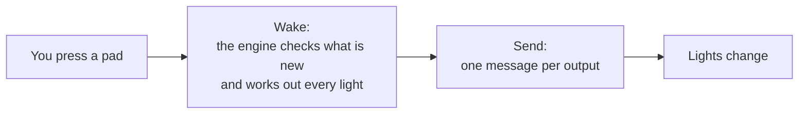

# Glossary

Plain words for the terms in reports and tickets. Update it when a new term shows up.

| Term | Plain meaning |
|---|---|
| Engine | the part that decides what every light does. It runs on its own and keeps going if the window closes |
| Output | one cable or network link that carries light values to fixtures (DMX adapter, network strip). A show can use up to 16 |
| Universe | one DMX line of 512 values. An output carries one or more |
| Look | something you can play: a colour, a step, a sequence, a Wave |
| Step | a single saved look: a colour (and more) on some lights |
| Sequence | steps played one after the other, with timing |
| Wave | a colour that moves across a group of lights, such as a chase from left to right |
| Grab | a hold by hand: you take a light and keep it until you let go |
| Mixer | the one place that decides who wins when two things want the same light (a grab, a look, the autopilot) |
| Press | any command: a pad, a key, a fader move |
| Wake | one round of the engine's work. It wakes when an output is due, applies the presses that arrived, works out every light and hands the result to the outputs. Roughly 44 to 60 times a second per output |
| Lateness | how late a light's message goes out compared with its planned moment. It is measured in microseconds (a millionth of a second). 1 000 microseconds is 1 millisecond |
| p99 | "99 out of 100 are better than this". The usual way to say how late the late ones are |
| Drop | a message that was skipped because a newer one replaced it. Zero is the goal |
| Cap | a limit the desk keeps so it never gets too slow: how many presses it takes per round, how much work per round, how many plays at once |
| Milestone | a block of planned work. The first milestones were the engine, the patch and the show file; the third was Looks and who wins (steps, sequences, Waves, the Mixer, tempo, mover lights) |
| Scorecard | a measurement run that plays a heavy show for 60 seconds and reports lateness and drops per output |
| Catalog | the page of every control in every situation that you approved before the real screens are built |
| Peer | an outside coding agent we hand hard tasks to (Codex or Copilot). Opus checks what they return |
