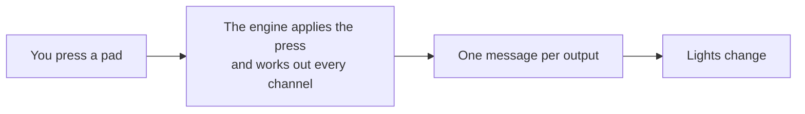

# Glossary

Plain words for the terms in reports and tickets. Update it when a new term shows up.

| Term | Plain meaning |
|---|---|
| Light | what you see and pick in the app: one lamp, moving head, strip or smoke machine at its place in the patch. A light is the channels its fixture file gives it |
| Fixture | the file that describes a kind of light: its maker, model, modes and channels. Only the file, never the lamp itself |
| Channel | one value, 0 to 255, that a light listens to (dimmer, red, pan). Two channels can move together as one finer value (coarse and fine) |
| Pair | a coarse and a fine channel that move as one finer value. Joined only when the fixture file makes it certain; otherwise you join them in Patch |
| Rig | the part that turns a light and its fixture file into channels and their rules (which follow Master, which follow Blackout). It runs on every patch edit, also during a show, beside the part that drives the lights, never inside it |
| Master | one level that scales the brightness of every light that follows it. 50% Master makes a dimmer at 70% send 35% |
| Blackout | everything that gives light goes dark at once, until it is turned off |
| Raw hold | a channel set by hand on the DMX screen, by number. It wins over every look until you release it |
| Engine | the part that decides the value of every channel. It knows channels, not lights. It runs on its own and keeps going if the window closes |
| Output | one cable or network link that carries channel values to the lights (DMX adapter, network strip). A show can use up to 16 |
| Universe | one DMX line of 512 values. Patch shows where a channel is as universe and address. A DMX output carries one; a network strip takes a run of channels |
| Route | which channels an output sends, in order |
| Look | something you can play: a colour, a step, a sequence, a Wave |
| Step | a single saved look: a colour (and more) on some lights |
| Sequence | steps played one after the other, with timing |
| Wave | a colour that moves across a group of lights, such as a chase from left to right |
| Grab | a hold by hand: you take a light's channels and keep them until you let go |
| Mixer | the one place that decides who wins when two things want the same channel (a grab, a look, the autopilot). Each channel is decided on its own |
| Press | any command: a pad, a key, a fader move |
| Lateness | how late a light's message goes out compared with its planned moment. It is measured in microseconds (a millionth of a second). 1 000 microseconds is 1 millisecond |
| p99 | "99 out of 100 are better than this". The usual way to say how late the late ones are |
| Drop | a message that was skipped because a newer one replaced it. Zero is the goal |
| Input limit | a limit that keeps the desk from getting too slow or too big: how many presses it takes at once, how much a show may ask the engine to compute, how many plays run at once, how many outputs. Beyond a limit the desk refuses the input and says why |
| Milestone | a block of planned work. The first milestones were the engine, the patch and the show file; the third was Looks and who wins (steps, sequences, Waves, the Mixer, tempo, mover lights) |
| Scorecard | a measurement run that plays a heavy show for 60 seconds and reports lateness and drops per output |
| Catalog | the page of every control in every situation that you approved before the real screens are built |

## The tests, by name

| Test | What it proves, in plain words |
|---|---|
| `whole_performance` | a whole show night: a Wave under a sequence, a hand grab and release, then a restart that brings the show back |
| `stalled_free_thread_bounds` | the biggest show the desk admits: 32 plays finishing together, a full burst of presses, nothing leaks, too much is refused |
| `waves_on_the_wire`, `linked_sequences`, `saved_step_at_manual`, `who_wins_on_the_wire`, `launch_on_beat`, `mover_step_on_the_wire` | one feature each, checked on the real bytes sent to the lights |
| `no_alloc` | the engine does no memory work while lights are running |
| scorecard | plays a heavy show for 60 seconds on 16 outputs and reports lateness and drops per output |
