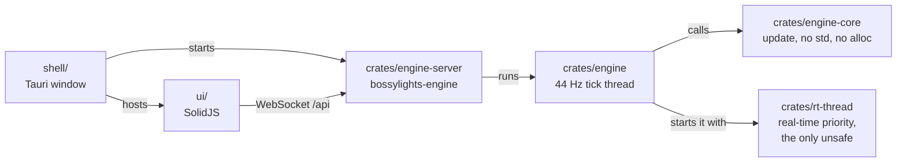
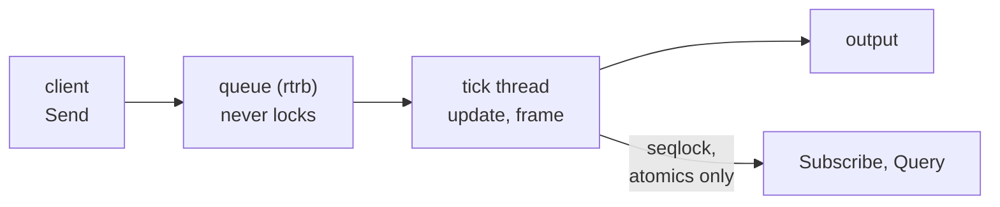

# Bossylights

An open-source lighting desk that is easy first and deep on request.

- Live busking, recording what you busk, timecoded shows, and an autopilot that follows the music.
- A control surface you design yourself, mirrored on pad controllers.
- Reads the QLC+ fixture library.
- Built for AI agents too: one engine API, with an MCP server on top.

Status: skeleton. A debug window shows the engine's frame counter and sets raw channels through the API, nothing more yet.

## Build, run, test

Needs Rust, Node 24 and npm. On Linux also the [Tauri system libraries](https://v2.tauri.app/start/prerequisites/#linux).

| What | Command |
|---|---|
| Install | `npm install` |
| Desktop app for development | `npm run dev` |
| All tests | `npm test` |
| Build | `npm run build` |
| Engine only, no window | `npm run engine` (API on `127.0.0.1:7744`; `-- --universes 64` for more, 4 by default) |
| UI in a browser | `npm run engine` and `npm run ui`, then open http://127.0.0.1:5174 |

Engine API: `GET /health` (`ok` while the engine runs) and the WebSocket `GET /api`. Types: `ui/src/engine-api.ts`, generated from `crates/engine-core/src/api.rs`.

| Client sends | Engine answers |
|---|---|
| `{"Send": {"command": {"SetChannel": {"channel": {"universe": 1, "address": 1}, "value": 255}}}}` | `"Accepted"`, or `{"Refused": {"reason": "NoSuchAddress"}}` and nothing changes |
| `"Query"` | `{"Picture": {"state": ..., "universes": [[...512 levels]]}}` |
| `"Subscribe"` | the `Picture`, then `{"Changed": {"state": ..., "channels": [...]}}` with every frame |

| Command | Does |
|---|---|
| `SetChannel` (universe, address, value) | holds that channel at the value |
| `ReleaseChannel` (universe, address) | lets it go back to zero |
| `ReleaseAll` | lets every held channel go |
| `Blackout` (on) | every channel goes out at zero while on; the held values stay |

`npm test` runs:

| Check | Proves |
|---|---|
| licence check | every crate and npm package is compatible with Apache-2.0 |
| layers check | crates and ui files depend only along the edges in `scripts/layers.mjs`; `engine-core` has no `std` and no `alloc` |
| `cargo clippy` | the lints for state machines and errors (root `Cargo.toml`, core crates); nothing on the tick thread can lock, block, do I/O or log (`crates/engine/clippy.toml`, linked from `crates/rt-thread`); every `unsafe` block says why it is sound |
| `cargo test` | `update`, `frame`, the tick schedule and the thread's priority as tables, 44 Hz, no allocation while ticking and taking commands (`crates/engine/tests/no_alloc.rs`), `ui/src/engine-api.ts` matches the Rust types; over the WebSocket: "set channel" reaches the state stream and a mock output, wrong requests are refused (`crates/engine-server/tests/api.rs`) |
| `tsc`, oxlint, `node --test` | the UI type-checks; exhaustive switches, no `any`, only `engine.ts` talks to the engine; its connection state machine, every state and event; how replies change its picture |
| Playwright | engine + UI in a browser: the counter advances, the thread's priority shows, a fader sets a channel |

`npm run scorecard` prints numbers to watch (tick lateness, send to frame); CI writes them into each run's summary. A nightly workflow runs `npm run mutants`.

## Plan

- [The map issue](https://github.com/abossard/bossylights/issues?q=is%3Aissue+label%3Amap): every area, feature, requirement and task, with blockers.
- [Interactive map](docs/plan/map/index.html): open it in a browser.
- [Requirements](docs/plan/requirements.md)
- [Capability map](docs/plan/capability-map.md): what QLC+, BlinderKitten, Chataigne, Mizer and xLights can do.

## Decisions so far

- A new engine in Rust, a web UI in a Tauri shell.
- Looks, layers and pads on top of a programmer engine.
- Apache-2.0.
- Version 1 is one great night on one rig.
