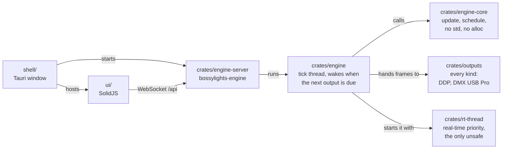
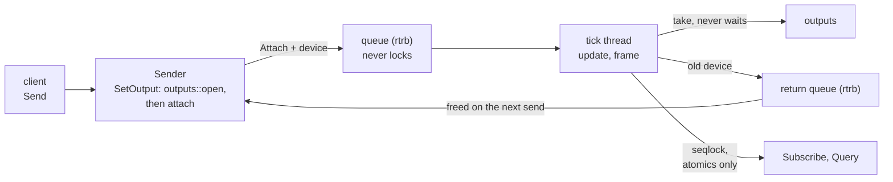
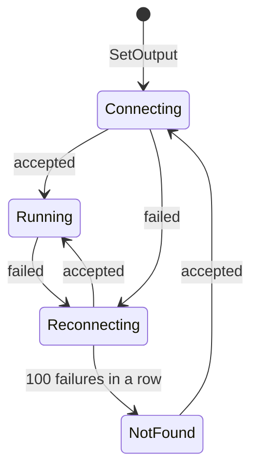
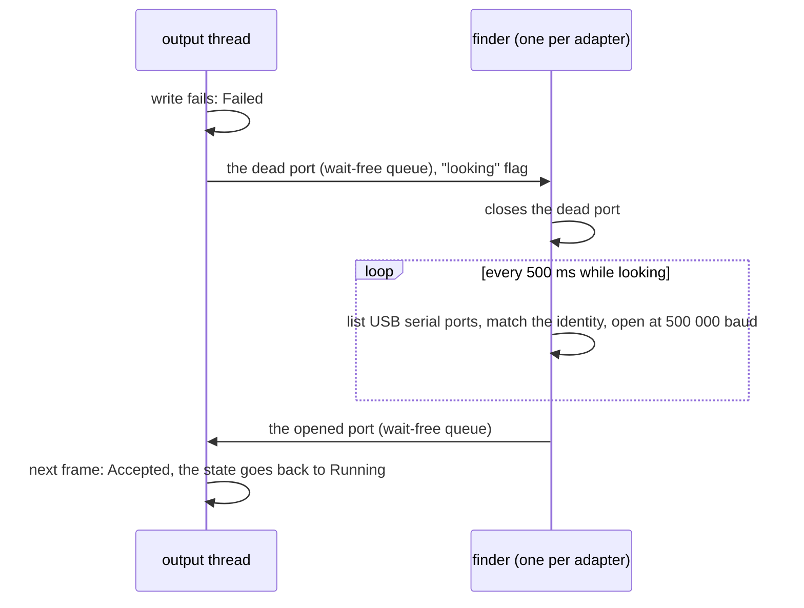

# Bossylights

An open-source lighting desk that is easy first and deep on request.

- Live busking, recording what you busk, timecoded shows, and an autopilot that follows the music.
- A control surface you design yourself, mirrored on pad controllers.
- Reads the QLC+ fixture library.
- Built for AI agents too: one engine API, with an MCP server on top.

Status: skeleton. A debug window shows the engine's frame counter, its outputs, and sets raw channels through the API. Outputs: DDP (WLED), ENTTEC DMX USB Pro.

## Build, run, test

Needs Rust, Node 24 and npm. On Linux also the [Tauri system libraries](https://v2.tauri.app/start/prerequisites/#linux).

| What | Command |
|---|---|
| Install | `npm install` |
| Desktop app for development | `npm run dev` |
| All tests | `npm test` |
| Build | `npm run build` |
| Engine only, no window | `npm run engine` (API on `127.0.0.1:7744`; `-- --universes 64` for more, 4 by default) |
| UI in a browser | `npm run engine` and `npm run ui`, then open http://127.0.0.1:5174 |





The engine knows "an output": a run of universes, a rate, a state, counters, and a `Device` that takes a frame without waiting. Kinds, devices and bytes live only in `crates/outputs`; `engine-core` only lists the kinds a client may ask for, as data (`kinds.rs`).

How an output gets on and off the tick thread:

| Step | Where | What |
|---|---|---|
| 1 | `Sender::send` | checks `SetOutput`; `outputs::open(kind)` makes a `Box<dyn Device>` (for DDP: a socket bound, connected, non-blocking) |
| 2 | `Sender::attach` | the one door for every device, also a test's own: sends `Attach` with the device |
| 3 | tick thread | puts it in the output's slot; the old device goes to the return queue |
| 4 | tick thread | when the output is due: `take(frame)` sends or drops, never waits |
| 5 | `Sender::send` | `RemoveOutput` or a replaced output: the next send frees the old device |

Engine API: `GET /health` (`ok` while the engine runs) and the WebSocket `GET /api`. Types: `ui/src/engine-api.ts`, generated from `crates/engine-core/src/api.rs`.

| Client sends | Engine answers |
|---|---|
| `{"Send": {"command": {"SetChannel": {"channel": {"universe": 1, "address": 1}, "value": 255}}}}` | `"Accepted"`, or `{"Refused": {"reason": "NoSuchAddress"}}` and nothing changes |
| `"Query"` | `{"Picture": {"state": ..., "universes": [[...512 levels]]}}` |
| `"Subscribe"` | the `Picture`, then `{"Changed": {"state": ..., "channels": [...]}}` with every frame |

| Command | Does |
|---|---|
| `SetChannel` (universe, address, value) | holds that channel at the value |
| `ReleaseChannel` (universe, address) | lets it go back to zero |
| `ReleaseAll` | lets every held channel go |
| `Blackout` (on) | every channel goes out at zero while on; the held values stay |
| `SetOutput` (output 1 to 16, kind, universes, rate) | adds or replaces an output. Kind `{"Ddp": {"address": "ip:port", "color": "Rgb" or "Rgbw"}}` or `{"DmxUsbPro": {"adapter": 1}}` (the first ENTTEC DMX USB Pro by USB identity, in the order of their USB serial numbers). Universes `{"first": 1, "count": 3}`, sent as one stream of channels. Rate `"30"`, `"44"`, `"60"` or `null`: 60 for DDP, 44 for the DMX USB Pro |
| `RemoveOutput` (output) | removes it |

```json
{"Send": {"command": {"SetOutput": {"output": 1, "kind": {"Ddp": {"address": "192.168.1.50:4048", "color": "Rgbw"}}, "universes": {"first": 1, "count": 3}, "rate": null}}}}
```

Each output in the state:



Counters: `accepted`, `dropped` (the socket or the link was busy: the frame is dropped, never waited for), `failed`, `off_beat` (intervals more than 2 ms from the rate). With no output the engine still wakes 44 times a second and publishes its state.

A device that can vanish finds itself again, off the output thread:



| Who looks | How often | Cost |
|---|---|---|
| the finder thread of each DMX USB Pro output | checks a flag every 100 ms; while the port is lost, lists the USB serial ports every 500 ms | asleep almost always. One listing is an IOKit or sysfs query of a few ms, never on the output thread |

Checks that need hands or hardware. Each prints what to do and when, with a bell:

| What | Command |
|---|---|
| WLED pattern (4 dots on 320 RGBW pixels, 30 s) | `cargo run -p engine-server --example wled_pattern -- 192.168.1.50` (port 4048 by default, or `ip:port`; optional seconds) |
| DMX USB Pro, 10 minutes: no interval off, nothing dropped | `cargo run --release -p engine-server --example dmx_usb_pro -- <port> ten-minutes` |
| DMX USB Pro, unplug and plug back in | `cargo run --release -p engine-server --example dmx_usb_pro -- <port> unplug` |
| DMX USB Pro, sleep and wake | `cargo run --release -p engine-server --example dmx_usb_pro -- <port> sleep` |

`<port>` is the adapter's port (`/dev/cu.usbserial-...` on macOS). It only says which adapter; the output finds it by its USB identity.

`npm test` runs:

| Check | Proves |
|---|---|
| licence check | every crate and npm package is compatible with Apache-2.0 |
| layers check | crates and ui files depend only along the edges in `scripts/layers.mjs`; `engine-core` has no `std` and no `alloc` |
| names check | `engine-core` and `engine` name no protocol or device (DDP, UDP, DMX USB Pro, serial) outside the list of kinds (`scripts/names.mjs`) |
| `cargo clippy` | the lints for state machines and errors (root `Cargo.toml`, core crates); nothing on the tick thread can lock, block, do I/O or log (`crates/engine/clippy.toml`, linked from `crates/rt-thread`); every `unsafe` block says why it is sound |
| `cargo test` | `update`, `frame`, which output is due next, each output's state machine, DDP packets (every header byte, split at 1440 bytes), DMX USB Pro messages and the thread's priority as tables, no allocation while serving two test devices and taking commands (`crates/engine/tests/no_alloc.rs`) and in each kind's `take` (`crates/outputs/tests/no_alloc.rs`); a DMX USB Pro against a fake serial port (a pseudo terminal): every byte, and unplugged, it fails until its finder hands in a new port, `ui/src/engine-api.ts` matches the Rust types; over the WebSocket: an output added, then "set channel" changes the bytes on its DDP socket in the next frame, wrong requests are refused (`crates/engine-server/tests/api.rs`) |
| `tsc`, oxlint, `node --test` | the UI type-checks; exhaustive switches, no `any`, only `engine.ts` talks to the engine; its connection state machine, every state and event; how replies change its picture |
| Playwright | engine + UI in a browser: the counter advances, the thread's priority shows, a fader sets a channel, an output and its counters show |

`npm run scorecard` prints numbers to watch (lateness per output with two outputs at 60 and 44 a second, intervals off by more than 2 ms, send to frame); CI writes them into each run's summary. A nightly workflow runs `npm run mutants`.

## Plan

- [The map issue](https://github.com/abossard/bossylights/issues?q=is%3Aissue+label%3Amap): every area, feature, requirement and task, with blockers.
- [Interactive map](docs/plan/map/index.html): open it in a browser.
- [Requirements](docs/plan/requirements.md)
- [Capability map](docs/plan/capability-map.md): what QLC+, BlinderKitten, Chataigne, Mizer and xLights can do.

## Decisions so far

- A new engine in Rust, a web UI in a Tauri shell.
- Looks, layers and pads on top of a programmer engine.
- Apache-2.0.
- Version 1 is one great night on one rig.
