# Bossylights

An open-source lighting desk: easy first, deep on request.

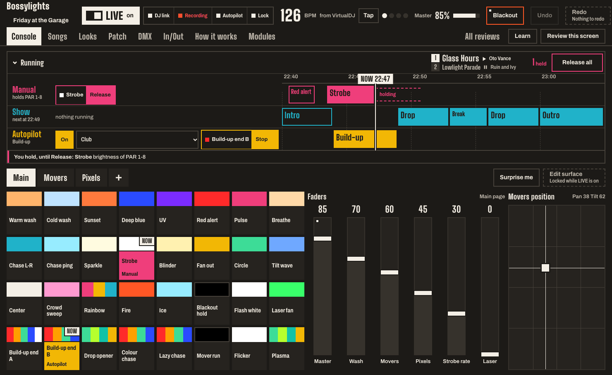

The Console. **Design, not built yet** (`mockups/`).

| Live busking | Record what you busk | Timecoded shows | Autopilot to the music |
|---|---|---|---|
| **Your own surface, mirrored on pads** | **Reads the QLC+ fixture library** | **One engine API, MCP for AI agents** | **Rust engine, web UI, Apache-2.0** |

## What it looks like

| | |
|---|---|
| 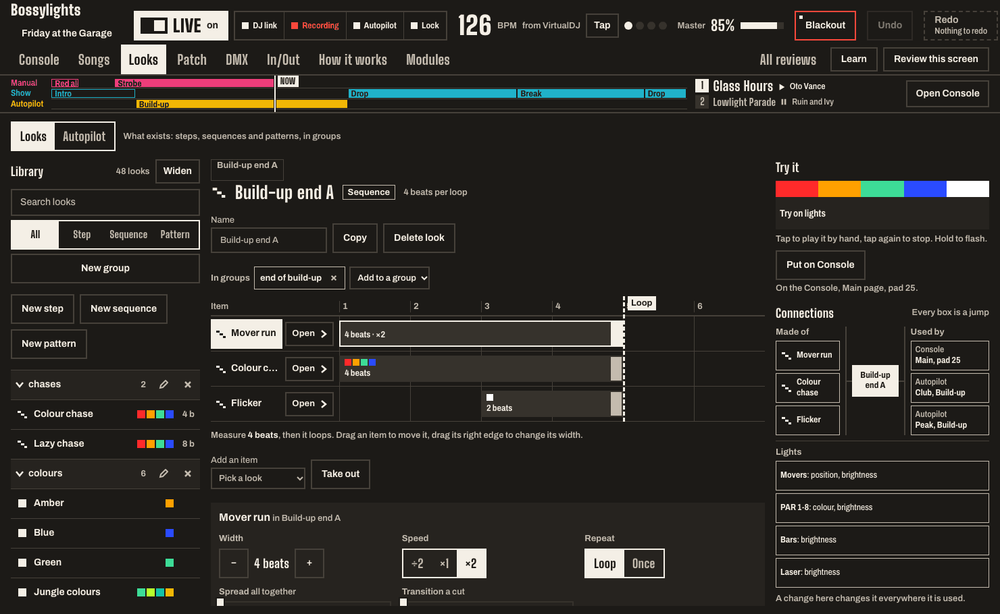 | 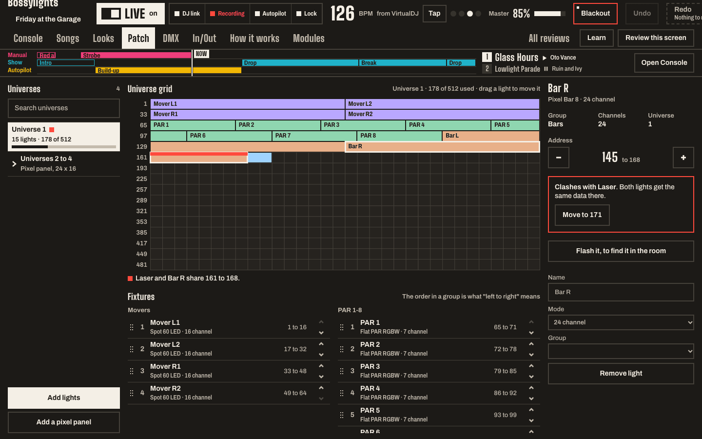 |
| **Looks**: steps, sequences, patterns. *Design, not built yet* | **Patch**: lights, not channels. *Design, not built yet* |
| 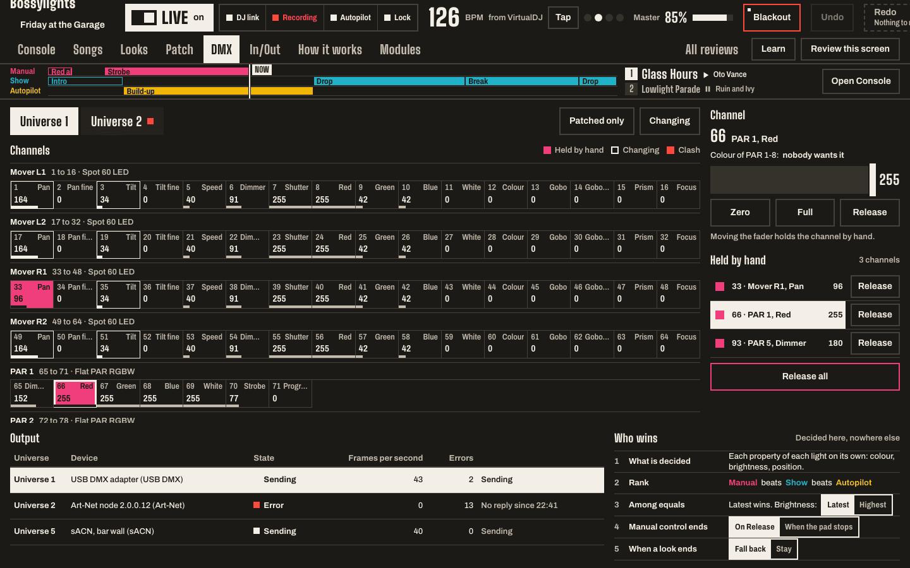 | 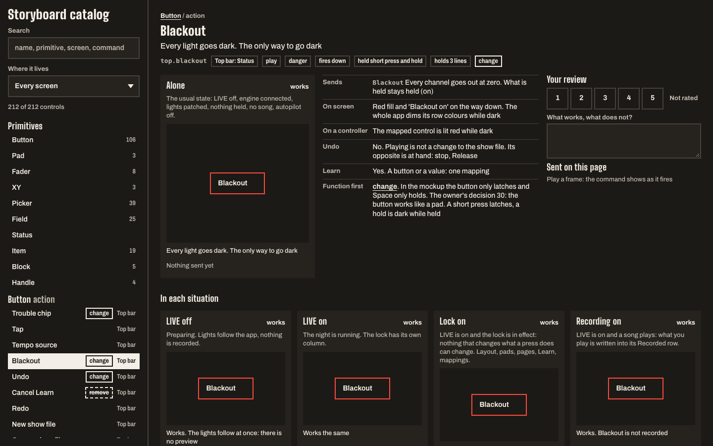 |
| **DMX**: channels, outputs, who wins. *Design, not built yet* | **Storyboard catalog**: every control, every situation. *Runs today* (`npm run catalog`) |

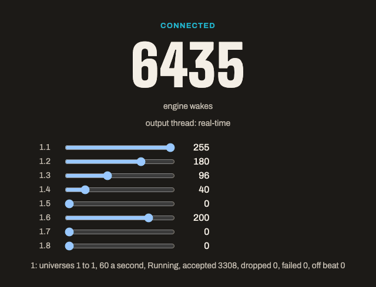

**Runs today**: the debug UI against the real engine. Wakes, the real-time thread, faders that set channels, an output and its counters.

| Status | |
|---|---|
| Built | engine, API, outputs DDP (WLED) and ENTTEC DMX USB Pro, fixture library reader, debug UI |
| Not built | the product screens above: they wait for the storyboard catalog ([#102](https://github.com/abossard/bossylights/issues/102)) |

## The theory in one picture

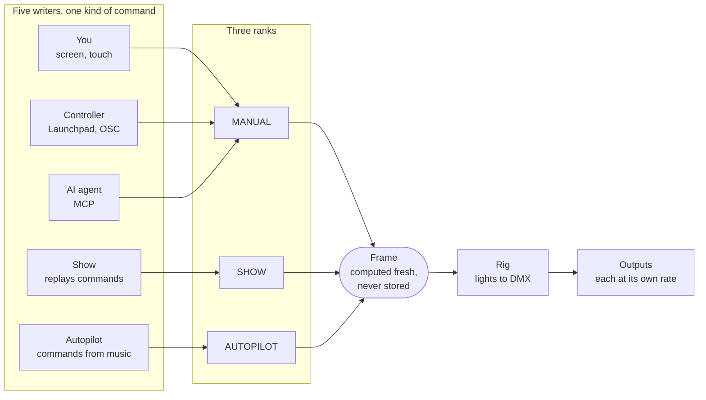

**Every frame is computed fresh from what plays, manual over show over autopilot, and everything that happens is a command.**

| # | Idea | # | Idea |
|---|---|---|---|
| 1 | A frame is computed, never stored | 6 | One clock |
| 2 | Lights, not channels | 7 | Everything is a command |
| 3 | A step is a value | 8 | Two kinds of state: project, performance |
| 4 | Everything that moves is a source | 9 | The real-time core is small and dumb |
| 5 | Who wins: one small set of rules | | |

Each idea as a picture: [docs/design/theory.md](docs/design/theory.md).

## Architecture

### Two processes

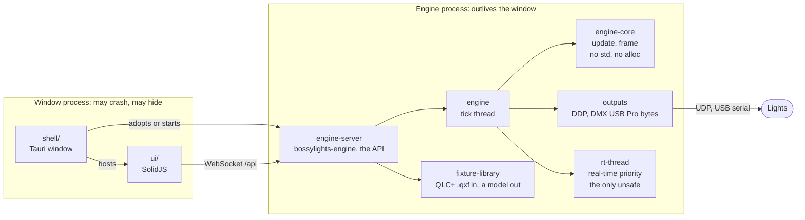

- A crashed or hidden window never touches the lights. The next window adopts the running engine.
- Allowed edges: [scripts/layers.mjs](scripts/layers.mjs), checked by `npm test`.

### A press, to the next frame

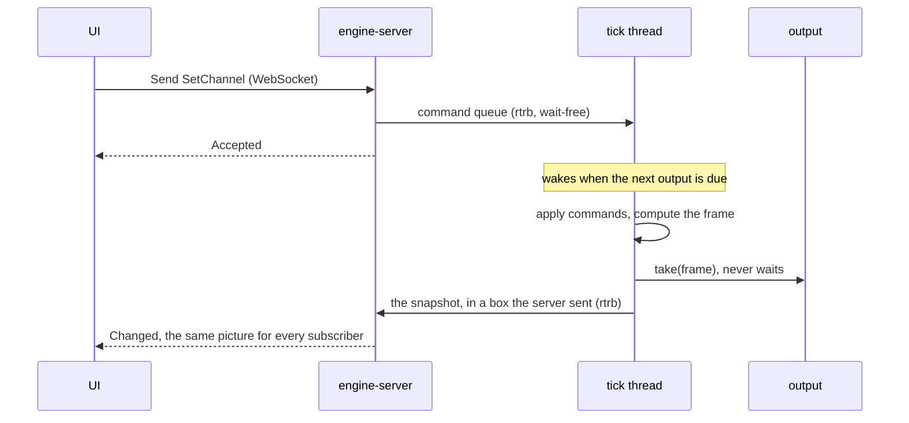

- The tick thread never locks, blocks or allocates. Two boxes go round for the snapshot: no shared memory, no atomics.
- Each output has its own rate: by default 60 a second for DDP, 44 for DMX.

### Who wins

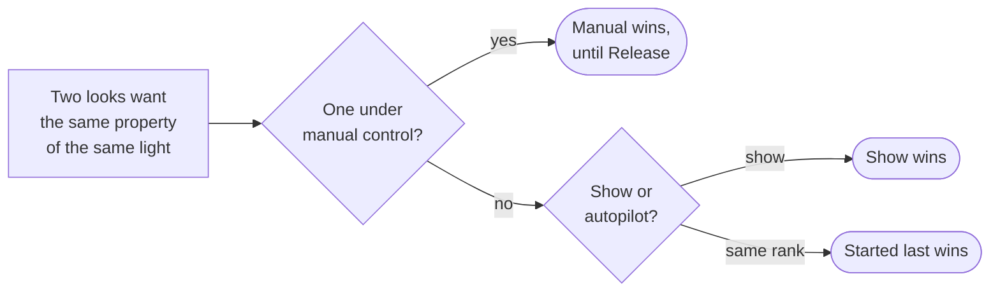

All rules live in one table: [docs/design/who-wins.md](docs/design/who-wins.md).

## Milestones

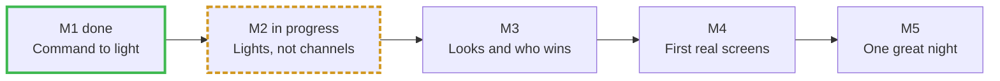

A gate review sits between each two. How the work is run: [docs/agents/orchestration.md](docs/agents/orchestration.md).

## Build, run, test

Needs Rust, Node 24 and npm. On Linux also the [Tauri system libraries](https://v2.tauri.app/start/prerequisites/#linux).

| What | Command |
|---|---|
| Install | `npm install` |
| Desktop app for development | `npm run dev` |
| All tests | `npm test` |
| Build | `npm run build` |
| Engine only, no window | `npm run engine` (API on `127.0.0.1:7744`; `-- --universes 64` for more, 4 by default) |
| Engine with the fixture library | `npm run engine -- --fixtures <folder>` (a QLC+ checkout) |
| UI in a browser | `npm run engine` and `npm run ui`, then open http://127.0.0.1:5174 |
| Storyboard catalog | `npm run catalog` (opens http://127.0.0.1:5175, needs no engine) |
| Design mockups | `npm install` and `npm run dev` in `mockups/` (on http://localhost:5199) |
| Scorecard, mutation score | `npm run scorecard`, `npm run mutants` |

## More

| Read | For |
|---|---|
| [docs/engine.md](docs/engine.md) | the engine in detail: API, commands, output states, DMX port thread, hand checks, what `npm test` proves |
| [docs/coding.md](docs/coding.md) | how we write code |
| [The map issue](https://github.com/abossard/bossylights/issues?q=is%3Aissue+label%3Amap), [interactive map](docs/plan/map/index.html) | every area, feature, requirement and task |
| [docs/plan/requirements.md](docs/plan/requirements.md) | requirements |
| [docs/plan/capability-map.md](docs/plan/capability-map.md) | what QLC+, BlinderKitten, Chataigne, Mizer and xLights can do |

| Decided | |
|---|---|
| Engine | new, in Rust; web UI in a Tauri shell |
| Model | looks and pads on top of a programmer engine |
| Licence | Apache-2.0 |
| Version 1 | one great night on one rig |
