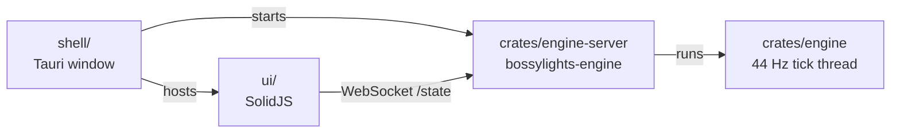

# Bossylights

An open-source lighting desk that is easy first and deep on request.

- Live busking, recording what you busk, timecoded shows, and an autopilot that follows the music.
- A control surface you design yourself, mirrored on pad controllers.
- Reads the QLC+ fixture library.
- Built for AI agents too: one engine API, with an MCP server on top.

Status: skeleton. A window shows a frame counter from the engine, nothing more yet.

## Build, run, test

Needs Rust, Node 24 and npm. On Linux also the [Tauri system libraries](https://v2.tauri.app/start/prerequisites/#linux).

| What | Command |
|---|---|
| Install | `npm install` |
| Desktop app for development | `npm run dev` |
| All tests | `npm test` |
| Build | `npm run build` |
| Engine only, no window | `npm run engine` (API on `127.0.0.1:7744`) |
| UI in a browser | `npm run engine` and `npm run ui`, then open http://127.0.0.1:5174 |

| Engine API | What |
|---|---|
| `GET /health` | `ok` while the engine runs |
| `GET /state` | WebSocket, one message per frame: `{"frame":123}` |

`npm test` runs:

| Check | Proves |
|---|---|
| licence check | every crate and npm package is compatible with Apache-2.0 |
| `cargo clippy` | the engine crate uses nothing that can lock, block, do I/O or log (`crates/engine/clippy.toml`) |
| `cargo test` | `update` and the tick schedule as tables, 44 Hz, no allocation while ticking (`crates/engine/tests/no_alloc.rs`) |
| `tsc`, `node --test` | the UI type-checks; its connection state machine, every state and event |
| Playwright | engine + UI in a browser: the counter advances |

## Plan

- [The map issue](https://github.com/abossard/bossylights/issues?q=is%3Aissue+label%3Amap): every area, feature, requirement and task, with blockers.
- [Interactive map](docs/plan/map/index.html): open it in a browser.
- [Requirements](docs/plan/requirements.md)
- [Capability map](docs/plan/capability-map.md): what QLC+, BlinderKitten, Chataigne, Mizer and xLights can do.

## Decisions so far

- A new engine in Rust, a web UI in a Tauri shell.
- Looks, layers and pads on top of a programmer engine.
- Apache-2.0.
- Version 1 is one great night on one rig.
