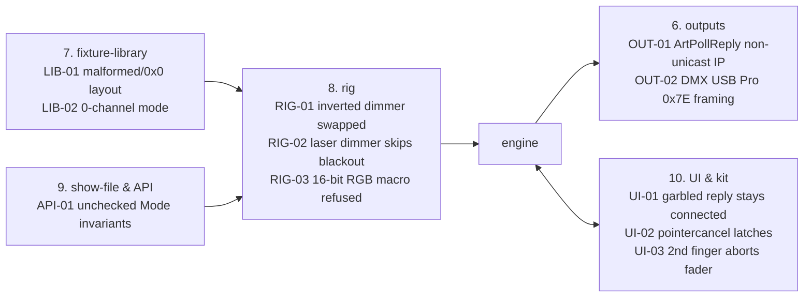

# Review #349 (Aspects 6-10)

## Findings

| ID | Aspect | Severity | Claim | Test | Command | Expected vs actual |
|---|---|---|---|---|---|---|
| `OUT-01` | 6. outputs | high | Art-Net discovery accepts `255.255.255.255` and `0.0.0.0` from `ArtPollReply`, aborting `Udp::send` with `Outcome::Failed` before later unicast universes are sent. | `crates/outputs/tests/review_outputs.rs::finding_outputs_01_artnet_non_unicast_poll_reply` | `cargo test -p outputs --test review_outputs -- finding_outputs_01_artnet_non_unicast_poll_reply` | Expected no `Outcome::Failed` and `ArtDmx` delivered to healthy unicast Port-Address 5; got `[Failed, Failed, Failed, Failed, Failed, Failed]` (`bad PollReply IP 255.255.255.255 made the Art-Net output fail`). |
| `OUT-02` | 6. outputs | high | `DmxUsbPro` scans raw serial bytes for `0x7E` instead of framing by packet length, splitting a valid label-3 reply when firmware minor (`1.126`) or `break_steps` (`126`) equals `0x7E` at the 64-byte read boundary and rejecting the widget. | `crates/outputs/tests/review_outputs.rs::finding_outputs_02_dmx_usb_pro_0x7e_in_settings_payload` | `cargo test -p outputs --test review_outputs -- finding_outputs_02_dmx_usb_pro_0x7e_in_settings_payload` | Expected `lost_with == None` and settings `(9, 1, 40)` read; got `Some("not a DMX USB Pro")`. |
| `LIB-01` | 7. fixture-library | medium | `fixture_library::parse` drops non-numeric `<Layout Width="wide" Height="1"/>` with neither an error nor a warning, and accepts `Width="0" Height="0"` as `Some(Layout { width: 0, height: 0 })`. | `crates/fixture-library/tests/review_fixture_library.rs::finding_fixture_library_01_malformed_and_zero_layout` | `cargo test -p fixture-library --test review_fixture_library -- finding_fixture_library_01_malformed_and_zero_layout` | Expected `Err(Problem::BadNumber { what: "Width", .. })` or a warning (and rejection of `0x0`); got `Ok(Fixture { layout: None, warnings: [] })` (and `Some(Layout { width: 0, height: 0 })`). |
| `LIB-02` | 7. fixture-library | medium | `fixture_library::parse` accepts `<Mode Name="Empty"/>` with zero `<Channel>` entries (`channels: []`), violating the `channels: 1..` mode invariant. | `crates/fixture-library/tests/review_fixture_library.rs::finding_fixture_library_02_empty_mode_accepted` | `cargo test -p fixture-library --test review_fixture_library -- finding_fixture_library_02_empty_mode_accepted` | Expected empty `<Mode>` to be refused or rejected; got `Ok(Fixture { modes: [Mode { name: "Empty", channels: [], .. }], refused: [], warnings: [] })`. |
| `RIG-01` | 8. rig | high | A falling dimmer (`Preset="BigToSmall"`, `dark = 255`) binds `Take::INTENSITY` with `Sense::Rising` (`0..=255`), writing dark `255` at full intensity and full-bright `0` at zero intensity. | `crates/rig/tests/review_rig.rs::finding_rig_01_inverted_dimmer_bright_and_dark_swapped` | `cargo test -p rig --test review_rig -- finding_rig_01_inverted_dimmer_bright_and_dark_swapped` | Expected DMX `0` at `intensity = u16::MAX` (and `255` at `0`); got `left: 255, right: 0`. |
| `RIG-02` | 8. rig | high | On `<Type>Laser</Type>` fixtures carrying an intensity dimmer (`JB-Systems-Lounge-Laser-DMX.qxf`, ch 6 `"Dimmer LED"`), `rig::compile` drives the channel from `Light.intensity` while `rig::channels` sets `Follows::NONE`, `Ties::Latest`, and `Change::Jump`, ignoring Blackout and Master. | `crates/rig/tests/review_rig.rs::finding_rig_02_laser_dimmer_ignores_blackout_and_master` | `cargo test -p rig --test review_rig -- finding_rig_02_laser_dimmer_ignores_blackout_and_master` | Expected `Follows(3)` (`MASTER \| BLACKOUT`), `Ties::Highest`, `Change::Fade`; got `left: Follows(0), right: Follows(3)`. |
| `RIG-03` | 8. rig | medium | On a 16-bit RGB mode whose colour-macro bypass range names all six RGB channels (`"All LEDs Set via Channels 1-6"`), `names_the_mix` checks `1..=6` against coarse-only `mixers` (`[0, 2, 4]`) and refuses `Property::Colour`. | `crates/rig/tests/review_rig.rs::finding_rig_03_sixteen_bit_rgb_macro_refuses_colour` | `cargo test -p rig --test review_rig -- finding_rig_03_sixteen_bit_rgb_macro_refuses_colour` | Expected `Ok(Rigged)`; got `Err(Refused(Unsupported { light: 1, property: Colour }))`. |
| `API-01` | 9. API & engine-server | medium | `bossylights-engine --show` deserializes `fixture_library::Mode` without re-checking `.qxf` invariants, accepting 0-channel modes (`channels: 0`), out-of-bounds `pixels` indices, and `min > max` ranges as `show: "Kept"` instead of `LeftAlone`. | `crates/engine-server/tests/review_api.rs::finding_api_01_show_file_loads_broken_mode_invariants` | `cargo test -p engine-server --test review_api -- finding_api_01_show_file_loads_broken_mode_invariants` | Expected `show.LeftAlone` and empty `patch`; got `show = "Kept"` with `[{"address":1,"channels":0,"mode":"Empty",...}]` in `Picture.patch`. |
| `UI-01` | 10. UI & shell | medium | `decode()` in `ui/src/picture.ts` returns unknown string variants (`"BogusVariant"`), unknown object variants, and malformed `Picture` payloads instead of `undefined`, keeping status `"connected"` instead of `"unreadable reply"`. | `e2e/review_ui.spec.ts::finding_ui_01_picture_decode_accepts_garbled_replies` | `cargo run -q -p engine-slot -- npx playwright test e2e/review_ui.spec.ts -g "finding_ui_01_picture_decode_accepts_garbled_replies"` | Expected status `"unreadable reply"`; got `"connected"`. |
| `UI-02` | 10. UI & shell | high | `Button` and `Pad` wire `onPointerCancel` to `up` / `pointerUp`, so an OS `pointercancel` within 350 ms latches `top.blackout` and `console.pad` ON instead of aborting the momentary press. | `e2e/review_ui.spec.ts::finding_ui_02_pointer_cancel_latches_pad_and_blackout` | `cargo run -q -p engine-slot -- npx playwright test e2e/review_ui.spec.ts -g "finding_ui_02_pointer_cancel_latches_pad_and_blackout"` | Expected `"Blackout"` (`Blackout on: false`); got `"Blackout on"`. |
| `UI-03` | 10. UI & shell | medium | `Fader` tracks drag with a boolean `down` without checking `e.pointerId`, so a second finger lifting (`pointerId: 2`) aborts an active drag still held by finger 1 (`pointerId: 1`). | `e2e/review_ui.spec.ts::finding_ui_03_second_finger_aborts_active_fader_drag` | `cargo run -q -p engine-slot -- npx playwright test e2e/review_ui.spec.ts -g "finding_ui_03_second_finger_aborts_active_fader_drag"` | Expected `aria-valuenow="100"` as finger 1 drags to top; got `"50"`. |

## Not proven

| Where | Suspicion | Why not a failing test |
|---|---|---|
| `ui/src/catalog/catalog.spec.ts:900-905` | Vacuous assertion in `UX-15`: `expect(Math.min(...sizes)).toBeGreaterThanOrEqual(44)` passes when `sizes` is empty because `Math.min()` of zero arguments is `+Infinity`. | Reproducing requires emptying the catalog or editing `catalog.spec.ts`. |
| `crates/engine-server/tests/library.rs:448-452` | `every_client_sees_the_same_library_in_the_same_frame` compares `asked` and `subscribed` only on shared frame numbers without asserting that any shared or transition frame occurred. | Cannot fail without modifying `library.rs` or engine scheduling. |
| `crates/outputs/src/sacn/discovery.rs:286` | `send_pages` sends sACN discovery page `0` last (`(1..=last).chain(once(0))`) when `last > 0`. | Unreachable while `Universes::MAX` is `64` (`< 512` universes per page). |
| `shell/src/main.rs:299-302` | `start_or_adopt` treats any non-`ConnectionRefused` error on the initial `GET /version` (such as a transient socket read timeout) as `Engine::Other` without spawning or retrying. | `shell` is a binary crate with private startup helpers and no `test-support` seam. |

## Looked at, fine

| Aspect | Checked |
|---|---|
| 6. outputs | DDP header/offset/push bytes, sACN E1.31 data/sync/priority/termination/CID/discovery frames, Art-Net v4 `ArtDmx`/`ArtSync`/`ArtPoll` wire layout, IDN-Hello/Stream header/channel/chunk timestamps, non-blocking `take` handoff via `latest` slot, and Enttec label-6/label-10 packets match their protocol specs. |
| 7. fixture-library | XML entity/DTD refusal, 1 MiB cap, channel function/preset inference, fine-byte pairing, shutter open/closed/strobe classification, colour hex parsing, and head/pixel validation handle malformed `.qxf` inputs cleanly. |
| 8. rig | Coarse/fine 16-bit pairing, additive RGB/CMY/white mixing, pan/tilt arc overlap and centre rest, patch universe/address overlap refusal, and field-table sorting/deduplication match `docs/design/channel-model.md`. |
| 9. API & engine-server | `ui/src/engine-api.ts` matches `crates/wire` via `ts-rs`, unknown command fields are rejected (`deny_unknown_fields`), serial number mismatch refuses stale edits, single-slot library reload and atomic show-file saves keep live state consistent. |
| 10. UI & shell | State flows one way (`Reply::Picture` -> `picture.ts` -> view -> `Request`), the UI computes no DMX bytes, `shell` adopts a matching engine on `127.0.0.1:7070` without killing it on window close, and `scripts/layers.mjs` boundaries hold. |
