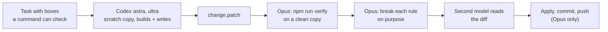
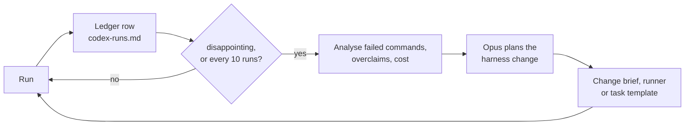

# Codex lane

Hard tasks with a command that checks the result go to Codex. Opus verifies every result. No result is trusted on a report.



## Models

From the Codex model list (`~/.codex/models_cache.json`), read 2026-11-19.

| Model | For | Context |
|---|---|---|
| `gpt-6.2-astra` | most capable: hard, long tasks with a clear check | 272k (up to 872k) |
| `gpt-6.2-sol` | fast go-to: reviews, big reads, normal tasks | 500k (up to 872k) |
| `gpt-6.1-terra` | visual understanding, computer use | 500k |
| `gpt-6-luna` | easy, cheap | 272k |

Context: the models start at 500k tokens (a 475k window). The runner sets `model_context_window=872000`, the model's own maximum, on every run, and a Copilot run takes `--context long_context`. Checked: the session log of a run shows 475000 without it and 828400 with it.

| Effort | Use |
|---|---|
| `high`, `xhigh` | normal work and reviews |
| `max` | the hardest single task |
| `ultra` | max, plus Codex hands parts to its own helpers. For work that splits cleanly. Do not use it for a small edit or a fix of one file |

Measured here: a read-only review at `ultra` takes 10 to 15 minutes, 50 to 70 shell commands, 120k to 210k tokens. Even "reply ok" costs 7k tokens of preamble.

## When Codex, when a Claude worker

| Task | Who |
|---|---|
| Hard, long, a command shows done (a feature with an end-to-end test, a model change, a measured cost, a hard bug with a repro) | Codex astra ultra, `build` |
| Review of a diff or a design against our rules | Codex astra or sol ultra, `review`, with Copilot in parallel |
| Needs the live conversation, the UI, a judgment about the owner's intent, hotspot edits beside other workers | Claude worker (Opus high) |
| Small slice, a table of known rows | Claude worker (Sonnet) |

Never to Codex: a task with no check, product or design decisions, anything outward (push, issues, comments).

## Run it

```bash
npm run codex -- build <commit> <task-file> --name t7-sequences
npm run codex -- review <commit> <task-file> --model sol --effort xhigh
```

| What the runner does | Why |
|---|---|
| a scratch copy of the commit, removed after | the shared checkout is never touched, no overlap with workers |
| `--ignore-user-config` | the user config starts six MCP servers per run and carries deprecated flags |
| sandbox `workspace-write` in the scratch copy, network access on (so the engine tests bind `127.0.0.1`), `CARGO_TARGET_DIR` outside the copy | it compiles, runs and tests anything, writes only in its throwaway copy. `rm -rf` is still blocked by Codex's automatic review. Tested: bind ok, `engine-server` show tests 9 of 9 |
| the brief `codex-brief.md` first, then the task | no 50 commands to find the repo again |
| `--json` events, `-o` last message | the report counts commands, failures, tokens; the answer is one file |
| a build leaves `change.patch`; a review leaves only its findings | nothing is committed or pushed by Codex; a review proves a finding with a test in its copy, it does not fix |

The task file is a ticket: parent, boxes with their commands, files it may touch, out of scope. A task that cannot name its check is not for Codex.

## Verify (Opus, every time)

| Step | |
|---|---|
| 1 | read `last-message.md`: every box has a command and a red then green |
| 2 | `git apply` the patch in a clean copy, `npm run verify -- <commit>` with the patch committed there |
| 3 | break each new rule on purpose; the test must fail |
| 4 | a second model reads the diff (Copilot, or Codex sol), findings verified one by one |
| 5 | commit with explicit paths, `git log origin/main..`, push |

A patch that fails 2 or 3 goes back with the failing output, not fixed by Opus.

## Context and hand-over

The orchestrator is Opus 5.5 at high effort. At about 500k tokens of context it hands over to a fresh Opus High session: hand-over comment on the `Orchestrator state` issue (#147), then the new session reads the body and the last 3 comments. Long Codex runs go on in the background meanwhile; the new orchestrator verifies what they leave.

## Measure it and improve it (orchestrator job)



| Rule | |
|---|---|
| After every run | one row in `codex-runs.md`: seconds, commands, failed, tokens, verify first time, what our checks found |
| Failed commands are harness bugs | read `events.jsonl`: each denied or wrong command becomes a line in `codex-brief.md` or a runner change |
| Overclaims are task bugs | a break that passes or a finding that did not reproduce: the task template must ask for the proof it lacked |
| Who plans a change to the harness | an Opus model (the orchestrator at Opus high, or a session started on Opus). Not a Sonnet worker, not Codex itself. The change is then built, tested (`scripts/codex.test.mjs`) and verified like any code |
| Compare, do not guess | a change to the brief is judged on the next 3 comparable runs in the ledger |

Harness v1 (the runner, the brief, this page) was written in one pass by a Sonnet 5.5 orchestrator on 2026-11-19. Issue `Codex harness: Opus review and plan` holds the job of reviewing it.

## What we learned from the first runs

| Observation (4 reviews, 2026-11-19) | What changed |
|---|---|
| Source-only reviews: read-only sandbox, nothing was run, so claims needed a rerun by us | both modes run in a scratch copy that may write and run tests; a finding comes with its repro |
| 50 to 70 commands spent finding the repo | `codex-brief.md` gives the map, the rules and the allowed commands |
| 300 to 800 KB of transcript per run, the answer read from the tail | `-o` writes the last message, `--json` events are summarised |
| Six MCP servers started per run, deprecation warnings | `--ignore-user-config` |
| Astra ultra reviews found real defects that Copilot missed (and the other way round) | both run in parallel, findings verified by us |
| A run beside a verify made a UI test time out (load) | run reviews after the verify, not beside it |
