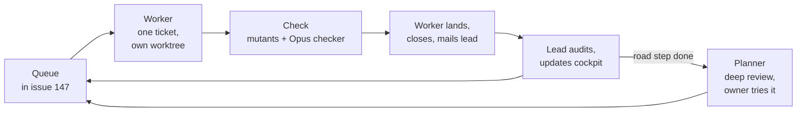

# How the work is run

A crew of Claude sessions in tuios: lead and workers in session `bossy-crew`, the planner in `session-3`. The lead runs the queue, each worker builds and lands one ticket, the planner gates each road step.



| Where | What |
|---|---|
| [Cockpit](https://claude.ai/artifact/RFGnHgq9gcwYVJdaRWJcBt) (private to the owner) | the one status page: the road, what is in work, the decision register |
| [Decisions page](https://claude.ai/artifact/KBkqWhcVWnyKaDYtejFBoC) | questions to the owner, with options and a recommendation |
| Issue #147 | the queue |
| `.claude/decisions/crew/` in the main checkout (not in git) | `rules.md`, briefs (`t-<ticket>.md`), plans, check reports. Shared by all panes |

## Who

| Role | Pane | Model, effort | Does | Never |
|---|---|---|---|---|
| Planner, step gate | `planner` | Fable 5.2, xhigh | the road, slicing, plan review of real-time core tickets, deep review at the end of a road step | the routine loop |
| Lead | `lead` | Opus 5.5, high | queue, briefs, starts and closes workers, audits landings, cockpit, decisions page, nudges the owner | product code, product decisions |
| Worker | `w-<ticket>` | Opus 5.5, high. xhigh for the real-time core (`engine-core`, `engine`, `rt-thread`, `rig`) | one ticket: plan, red tests, build, check, land, close, report | a second ticket, a product decision, a rule change |
| Checker | subagent `checker` of the worker (`.claude/agents/checker.md`) | Opus 5.5 | plants breaks in its own clean copy, gives a verdict | edits, commits |

| Rule | |
|---|---|
| Always pass the model | new sessions default to Fable: `--model claude-opus-5-5 --effort high` (or `xhigh`) |
| Keep the pane name | `lead`, `w-<ticket>`: mail finds a pane by it. Never rename a pane or the session |
| Rules change only by the owner or the planner | a third repeat of one problem becomes one rule, not a new habit |

## The lead's loop

| # | Step | How |
|---|---|---|
| 1 | Pick | the next open `ready-for-agent` issue of the queue with no open blocker |
| 2 | Pre-check | can every box pass with this ticket's own commands? Does a box need a rule of who wins, or allow a state that cannot come out right? Settle it, or ask the owner on the decisions page, before the worker starts |
| 3 | Brief | `crew/t-<ticket>.md`: the criteria, out of scope, the modules the worker owns (see "Work isolation"), the docs to read |
| 4 | Start | a worker pane `w-<ticket>` with the right model, in its own worktree on `wip/<ticket>` |
| 5 | Audit | on the worker's mail: the commit on `main`, the evidence on the issue, the check report. Never trust a report alone |
| 6 | Cockpit | update the road and the work rows. Close the worker's pane |
| 7 | Gate | when a road step is done: hand it to the planner |

## A worker's ticket, step by step

| # | Step | How |
|---|---|---|
| 1 | Read | the issue, the brief, `AGENTS.md`, `docs/coding.md`, the docs the brief names. Nothing else |
| 2 | Set up | own worktree on `wip/<ticket>`, `npm install`. Never write in the main checkout |
| 3 | Plan | a ticket that changes behaviour or a module edge: `crew/plans/<ticket>.md` (files, order, state machine rows, expected answers from outside the code, how `npm test` stays green). Real-time core: mail the planner, wait for its answer. Others: one Opus explain-back against `docs/design/theory.md`. Test, CI and doc fixes skip this |
| 4 | Build | red tests first. Every feature has an end-to-end test that checks DMX output |
| 5 | Check | `npm test` green, commit, push the branch. `npm run verify -- <sha> --mutants`: every missed mutant is killed or explained. Then one `checker` pass with planted breaks, report to `crew/reports/<ticket>-check.md` |
| 6 | Fix | at most two fix rounds. A third finding of the same kind: stop, mail the lead. It becomes one rule or a question to the owner |
| 7 | Land | from the main checkout, because land refuses inside the branch's own worktree: `npm run land -- wip/<ticket> <message-file>`. One commit on `main`, the worktree goes with it |
| 8 | Issue | tick the boxes, post the evidence (table: what ran, numbers, checker verdict, what was not checked), close it |
| 9 | Report | mail the lead, `tuios set-agent-state done -m '<ticket>: landed <sha>'`, stop |

| Stop early when | Do |
|---|---|
| the context reaches 30% (about 300k) | hand-over comment on the issue (done, next, pitfalls), push the branch, mail the lead, stop |
| a product or design question comes up | mail the lead with the question, options and a recommendation. Go on with boxes that do not depend on it |
| a rule seems wrong | mail the lead. Do not work around it |

| What `npm run verify` and `npm run land` do | |
|---|---|
| `verify -- <sha> [--mutants]` | a clean copy of the commit, every suite of `npm test` with the default target folder, mutants on what the branch adds since it left `origin/main` (missed lines listed). All suites green and no mutant missed: it records the commit's tree in the shared git folder. Any other run removes that tree's record |
| `land -- wip/<ticket> <message-file> [--last]` | squashes the branch onto `origin/main` and lands it only when that tree has a record: no check again. Another tree (main moved): merge `origin/main`, push, verify again. Then pushes and moves the branch and its worktree onto the landed commit, build kept, for the next slice. `--last` (the ticket's last slice) removes them. Last it waits for CI on `main` for its commit and says green or red. Red: open a `CI red on main:` issue, then fix forward or revert, each a landing that names it. Refuses while CI on `main` is running, missing or cancelled. A red run is passed only when the message names the open `CI red on main:` issue |

## Mail

Short, the detail in a file the mail names. A chat answer reaches nobody.

```sh
tuios send-agent-message -s bossy-crew -w lead --from "$TUIOS_PANE_ID" 'w-250: landed abc1234, issue closed. Report: crew/reports/250-check.md'
tuios send-agent-message -s session-3 -w planner --from "$TUIOS_PANE_ID" 'w-250: plan ready for review: crew/plans/250.md'
```

## Work isolation: a branch and a worktree per ticket

| Rule | How |
|---|---|
| A worker owns modules | the brief names the crates, files or folders it may write. Two workers never own the same file |
| New file over a shared edit | a new command family, test table or fake goes into a file of its own, wired in by one line |
| Hotspots get one owner at a time | `engine-core` `Command` and `api`, `scripts/layers.mjs`, `engine-server/src/lib.rs`. When two slices need one, they run one after the other, or the first splits it so each owns a part |
| Plan slices along seams | before running two slices side by side, list the files each will touch. An overlap means sequence them or cut the seam first |
| One ticket, one branch | `git worktree add -b wip/<ticket> ../wip-<ticket> origin/main`, the folder named like the branch. Push only the branch. Nobody commits to `main` by hand |

## Standing rules

| Rule | |
|---|---|
| Nothing mocked or half-working is reachable in the app | it grows by complete pieces on the real engine |
| No invalid state | refuse the command. Never allow and flag |
| No backward compatibility | no old shows, no migration |
| Simplest behaviour | pressed is pressed |
| Machine load is normal | never hold or delay work because of it. Run checks side by side |
| Size | 1,024 universes and 16 outputs |
| No AI attribution | no `Co-Authored-By`, no "Generated with" |
| Never | push `main` by hand, force-push, delete someone's work, create issues in another repository |
| JSON | `jq`, never grep or sed |
| Tool output | to a file, show only the tail or the failures |

| Stays with the owner | |
|---|---|
| Product and design decisions | asked once on the decisions page, with a recommendation |
| `ready-for-human` issues | never run unattended |
| Anything destructive or outward | force-push, deleting, security alerts, visibility |
| Hardware and hands | adapters, unplug and sleep checks |

## Writing for the owner

The owner has ADHD and is a visual learner. Every issue, comment and report: a picture or a table first, one or two short lines per idea, no em dashes, no walls of bullets.

| An issue reads like this | |
|---|---|
| Title | plain words, what the owner gets. No codes |
| First line | status: waiting, in work, done |
| Table | "You do" and "You see" |
| Check by hand | steps the owner can do on the rig |
| Below a fold (`<details>`) | everything for agents: files, criteria, blockers |

## What a step gate does

At the end of a road step the planner reviews the repository fresh, without the workers' reports. Then the owner tries the step.

| Part | Question | Output |
|---|---|---|
| 1. Rules | does the code follow `docs/coding.md`, beyond what the checks can see | findings |
| 2. Design | is each module deep. Is any seam in the wrong place. What can be deleted or merged | findings, with the simpler shape drawn |
| 3. Generality | did the second real case fit without bending the core | yes or no, with the diff that shows it |
| 4. Truth | do the docs, the theory and the issues still say what the code does | corrections |
| 5. Numbers | the scorecard against the last gate: calculation share, public items, escape hatches, lateness, mutation score | a table, with what moved and why |
| 6. Tests | would the tests catch a wrong change. Any test that asserts timing on a runner, or tests nothing | findings |
| 7. Next step | the spec and tickets of the next road step | a spec in `docs/design/`, tickets with blockers |

| Rule for findings | |
|---|---|
| Each has a failing scenario or a measured number | "this could be cleaner" is not a finding |
| Each becomes an issue, most severe first | labelled `gate-finding` |
| The verdict is one of two | pass, or fix first with the list |
| Fixes go back to the queue | workers fix, the lead audits. The planner does not fix its own findings |

## Learned the hard way

| What happened | Rule |
|---|---|
| A worker waited on a run that had already ended | check the process and its expected end, not only a notification |
| A frame-rate assertion failed on a CI runner | CI judges what is sent, a real machine judges timing. No test asserts a time under one second (`scripts/check-timing.mjs`) |
| Waiting for CI slows every ticket | nobody waits for CI while building: `npm test` is what CI runs. Only `npm run land` checks CI on `main` |
| Local checks passed while CI was red | one command: CI runs `npm test`, the Rust version is pinned in `rust-toolchain.toml` |
| A serial link looked on time and was minutes behind | count what the device accepted |
| A capture of a hidden window was blank | a hidden web view does not draw. Say what was not seen |
| Workers ended with a chat answer, nobody heard | the ticket ends with tuios mail to the lead |
| A worker's question was answered while it kept building, the answer came too late | the pre-check settles rules before the brief; a worker that asks waits for the answer on that box |
| Sessions shared one checkout, a push carried another worker's commit | a branch and worktree per ticket; `npm run land` puts exactly one squashed commit on `main` |
| e2e ports clash between sessions | gone: every run takes free ports (`e2e/ports.ts`) |
| A check used another target folder, e2e found no binary | verify with the default target folder |
| "Allow it and flag it" was overruled | a command that would make an invalid project is refused, and so is a later command that would break it |
