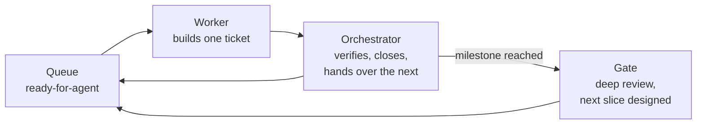
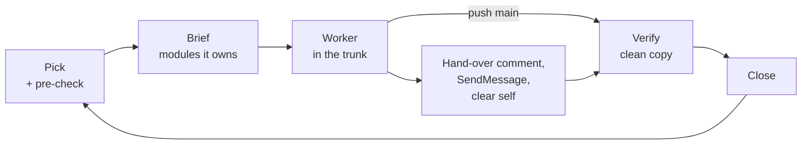
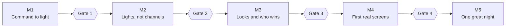

# How the work is run

Three roles, three price levels. The expensive model works only where a wrong answer is expensive.

## Who does what

| Role | Model, effort | Does | Never does |
|---|---|---|---|
| **Worker** | Sonnet 5.5, medium. Opus 5.5, high for tickets that touch the real-time core or cross crates | builds one ticket, test first, reports with evidence | closes issues, changes checks, decides design |
| **Orchestrator** | Opus 5.5, medium | picks the next ticket, briefs the worker, verifies, closes, keeps `main` green | writes product code, makes product decisions |
| **Gate reviewer** | Fable 5.2, high | deep review at a milestone, designs the next slice | routine verification, ticket by ticket |

| Price per million tokens, in and out | |
|---|---|
| Sonnet 5.5 | 2 and 10 |
| Opus 5.5 | 4 and 20 |
| Fable 5.2 | 8 and 40 |

Why cheaper models are safe for the routine: the rules are held by the compiler, the lints and the tests (`docs/coding.md`, last column). A worker cannot talk its way past them.

## The loop (orchestrator)

| Step | How |
|---|---|
| 1. Pick | the lowest open `ready-for-agent` issue with no open blocker |
| 2. Pre-check | can every box pass with this ticket's own commands? Does a box need a rule of who wins, or allow a state that cannot come out right? Settle it (or ask the owner) before the worker builds |
| 3. Brief | the criteria from the issue, out of scope, the modules the worker owns (see "Work isolation"), the end of the slice (below). One ticket per worker. Send it only when `list_events` shows the worker empty |
| 4. Verify | never trust a report. `npm run verify -- <commit> --mutants`: a clean copy of the pushed commit, every suite of `npm test` with the default target folder, mutants on the commit's diff (missed lines are listed). Then `npm run scorecard`. Drive the feature by hand. Break each new rule on purpose and see its check fail. Compare numbers with raw result files |
| 5. Close | tick the boxes, close with a table of evidence, note what was not verified |
| 6. Next | hand over the next ticket. Stop only for a decision of the owner |

| A worker's slice ends with, in this order | Why |
|---|---|
| 1. a hand-over comment on the issue: done, evidence, next, pitfalls | the next session starts from the issue, not from a chat |
| 2. `SendMessage` to the orchestrator: the commit and three lines | a chat answer reaches nobody: workers sat idle for hours |
| 3. `clear_session "self"` | the worker is empty for its next brief, no round trip |

| The orchestrator wakes on | |
|---|---|
| a worker's message | the normal path |
| a new commit on `main` | a watch polls `origin/main` every minute: a push with no message still gets verified |
| a busy worker gone idle without a message | checked on every wake: a worker that stopped before pushing is nudged |

## Work isolation: modules, not worktrees

Workers share one checkout of `main`. The design keeps them apart: a slice that needs a separate worktree points at a seam in the wrong place.

| Rule | How |
|---|---|
| A worker owns modules | the brief names the crates, files or folders it may write. Two workers never own the same file |
| New file over a shared edit | a new command family, test table or fake goes into a file of its own, wired in by one line |
| Hotspots get one owner at a time | `engine-core` `Command` and `api`, `scripts/layers.mjs`, `engine-server/src/lib.rs`. When two slices need one, they run one after the other, or the first splits it so each owns a part |
| Plan slices along seams | before running two slices in parallel, list the files each will touch. An overlap means sequence them or cut the seam first |
| Stage only your own | `git diff --cached --stat`, `git commit -m ... -- <paths>`, `git apply --cached` for your hunks in a file with others' edits. Before a push, `git log origin/main..` shows only your commits |
| One worktree remains | the orchestrator's clean copy for verifying a pushed commit (`git worktree add --detach`, removed after) |

| Stays with the owner | |
|---|---|
| Product and design decisions | asked once, in a table, with a recommendation |
| `ready-for-human` issues | never run unattended |
| Anything destructive or outward | force-push, deleting, security alerts, visibility |
| Hardware and hands | adapters, unplug and sleep checks |

| Learned the hard way | Rule |
|---|---|
| A worker waited on a run that had already ended | check the process and its expected end, not only a notification |
| A frame-rate assertion failed on a CI runner | CI judges what is sent, a real machine judges timing. No test asserts a time under one second (`scripts/check-timing.mjs`) |
| Waiting for CI slows every ticket | nobody waits for CI. Run locally what CI runs (`npm test`), push, move on. CI is a backstop, read later |
| A serial link looked on time and was minutes behind | count what the device accepted |
| A capture of a hidden window was blank | a hidden web view does not draw. Say what was not seen |
| Sessions share one checkout | one writer per file. Stage with explicit paths. Never stash another session's work |
| Workers ended with a chat answer, the orchestrator never heard | the slice ends with `SendMessage`, and the orchestrator watches `main` |
| A brief arrived before a worker's clear, the clear was lost | the worker clears itself at the end of a slice; brief only an empty worker |
| A worker's question was answered while it kept building, the answer came too late | the pre-check settles rules before the brief; a worker that asks waits for the answer on that box |
| A push carried another worker's commit | `git log origin/main..` before every push |
| e2e ports clash between sessions | gone: every run takes free ports (`e2e/ports.ts`) |
| The orchestrator's own check used another target folder, e2e found no binary | verify with the default target folder |
| "Allow it and flag it" was overruled | a command that would make an invalid project is refused, and so is a later command that would break it |

## Milestones and gates

A milestone is a slice that ends in something a person can see. A gate is a review that the next milestone waits for.

| Milestone | Ends in | Needs first |
|---|---|---|
| M1 Command to light | a command over the API lights a WLED device and a DMX adapter, each at its own rate | the first engine slice (`docs/design/engine-slice-1.md`) |
| M2 Lights, not channels | "PAR 3: red" becomes the right bytes. Patch, groups, fixture order | the fixture library |
| M3 Looks and who wins | steps, sequences and patterns play on the beat. Manual beats show beats autopilot | M2 |
| M4 First real screens | Console and DMX on the real engine | the storyboard catalog (#102) approved |
| M5 One great night | songs, recording, autopilot, controllers | M3, M4 |

Only M1 has tickets. Each gate designs the next milestone's tickets.

## What a gate does

The reviewer is a fresh session. It has not seen the workers' reports, only the repository. That keeps it unbiased.

| Part | Question | Output |
|---|---|---|
| 1. Rules | does the code follow the eight rules of `docs/coding.md`, beyond what the checks can see | findings |
| 2. Design | is each module deep. Is any seam in the wrong place. What can be deleted or merged | findings, with the simpler shape drawn |
| 3. Generality | did the second real case fit without bending the core | yes or no, with the diff that shows it |
| 4. Truth | do the docs, the theory and the issues still say what the code does | corrections |
| 5. Numbers | the scorecard against the last gate: calculation share, public items, escape hatches, lateness, mutation score | a table, with what moved and why |
| 6. Tests | would the tests catch a wrong change. Any test that asserts timing on a runner, or tests nothing | findings |
| 7. Next slice | the spec and tickets of the next milestone | a spec in `docs/design/`, tickets with blockers |

| Rule for findings | |
|---|---|
| Each has a failing scenario or a measured number | "this could be cleaner" is not a finding |
| Each becomes an issue, most severe first | labelled `gate-finding` |
| The verdict is one of two | pass, or fix first with the list |
| Fixes go back to the queue | workers fix, the orchestrator verifies. The reviewer does not fix its own findings |

Tools the reviewer may use: the review skills of this repo's agent setup (standards, spec and adversarial review, deep-module review, simplicity review), `npm run scorecard`, `npm run mutants`.
