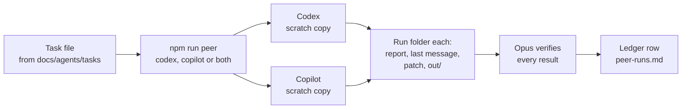
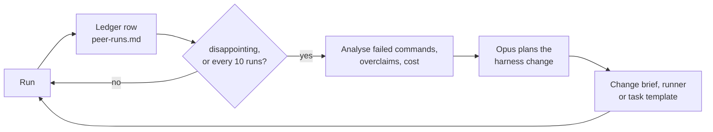

# Peer lane: Codex CLI and Copilot CLI

Hard tasks with a command that checks the result, second looks and research go to peer agents. Opus verifies every result. No result is trusted on a report.

## Quick start (orchestrator)

```bash
npm run peer:doctor                                                      # installed, signed in, models, one tiny call each
npm run peer -- both review <commit> docs/agents/tasks/review.md          # second look: Codex and Copilot in parallel
npm run peer -- codex build <head> <task-file> --name <issue-slug>        # a hard task with a check, on the current head
npm run peer -- both research <commit> <task-file> --name <slug>          # research with network, every claim linked
npm run peer -- codex spec <head> <task-file> --name spec-<issue>         # a spec for an issue: one file, out/spec.md
cat "$(node -p 'require("os").tmpdir()')/bossylights-peer/latest"        # the run folders of the last call
```

Copy a template from `docs/agents/tasks/` (review, build, research, spec, ux-review), fill it in, pass its path. `npm run codex -- <mode> <commit> <task-file>` still works: it is `npm run peer -- codex ...`.



## What a run does

| Option | Values | Default |
|---|---|---|
| tool | `codex`, `copilot`, `both` (parallel, a copy each) | |
| mode | `review`, `build`, `research`, `spec` | |
| `--model` | `astra`, `sol`, `terra`, `luna` (for every tool picked) | Codex: `sol` for review, `astra` for build, research and spec. Copilot: `sol` |
| `--effort` | per model (see Models). An effort the picked model does not take is refused with the models that take it, also when it is the default: `--model luna` needs `--effort` | Codex `ultra`, Copilot `max` |
| `--name` | letters, digits, `.`, `-`, `_` | `<mode>-<sha>` |
| `--out` | a base folder | `<tmp>/bossylights-peer` |

| CLI | Fixed flags | Why |
|---|---|---|
| Codex | `exec --ignore-user-config` | the user config starts six MCP servers per run and carries deprecated flags |
| Codex | `-c model_context_window=872000` | the models' own maximum; the default window is 475k |
| Codex | `-s workspace-write`, `sandbox_workspace_write.network_access=true`, `web_search="live"`, `--add-dir <out>` | writes only in its copy and the out folder, binds `127.0.0.1` for the engine tests, reads the web. `rm -rf` is still blocked by Codex's automatic review. Tested: bind ok, `engine-server` show tests 9 of 9 |
| Codex | `--json`, `-o last-message.md`, prompt on stdin | the report counts commands, failures, tokens; the answer is one file |
| Copilot | `--model gpt-6.2-sol --reasoning-effort max --context long_context` | strongest effort and window it offers |
| Copilot | `--allow-all --no-ask-user`, stdin `/dev/null` | a prompt in a `-p` run is a denial; all tools, paths and URLs are allowed in the throwaway copy |
| Copilot | env `COPILOT_TASK_WAIT_TIMEOUT_SECONDS=3600` | the default 600 s wait for its background shells ended review-248 with no answer while a cargo build ran |
| Copilot | `--add-dir <out> --share transcript.md --log-dir logs --output-format json --usage-output-file usage.json` | evidence folder, a readable transcript, events and tokens |
| both | a scratch copy of the commit (`git worktree add --detach`), removed after; `CARGO_TARGET_DIR` in the run folder | the shared checkout is never touched, no overlap with workers |

## The run folder

`<tmp>/bossylights-peer/<name>-<tool>-<yyyymmdd-hhmmss>/`; `<tmp>/bossylights-peer/latest` lists the folders of the last call.

| File | What |
|---|---|
| `prompt.md` | the prompt sent: `peer-brief.md`, the task, the out folder, the mode's ending |
| `events.jsonl`, `stderr.txt` | the CLI's events (both CLIs write JSON lines) |
| `transcript.md`, `usage.json`, `logs/` | Copilot only |
| `last-message.md` | the answer |
| `change.patch` | build: the change, verify it with `npm run verify` on a copy |
| `repro.patch` | review and research: the tests and scripts it wrote. A worker starts from its red test |
| `out/spec.md` | spec: the one file it writes. No patch is kept; a missing spec fails the run |
| `out/` | evidence the agent wrote there (logs, measurements, screenshots) |
| `report.md` | facts, paths and the ledger row (also printed) |

| Mode | Ending of the prompt |
|---|---|
| review | prove each finding by running something, do not fix, keep the tests |
| build | leave the change uncommitted, end with the commands that show every box passing |
| research | primary sources first, link do not copy, every claim has a link, nothing secret or local in text for a public issue |
| spec | write `out/spec.md`, change nothing, every claim about the code has file:line checked by reading it, no em dashes, short sentences and tables, end with a ten-line summary and the path |

A spec is checked by an Opus model against the code (every file:line read) before it is posted on the issue.

## Models

From `codex debug models` and `copilot help config`, read 2026-11-20. `npm run peer:doctor` prints the current lists.

| `--model` | Model | For | Codex context | Codex efforts | In Copilot |
|---|---|---|---|---|---|
| `astra` | `gpt-6.2-astra` | most capable: hard, long tasks with a clear check | 272k (up to 872k) | `low` to `ultra` | yes |
| `sol` | `gpt-6.2-sol` | fast go-to: reviews, big reads, normal tasks | 500k (up to 872k) | `low` to `ultra` | yes |
| `terra` | `gpt-6.1-terra` | visual understanding, computer use | 500k (up to 872k) | `low` to `ultra` | yes |
| `luna` | `gpt-6-luna` | fast and affordable: easy tasks | 272k (up to 872k) | `low` to `max` | yes |

Luna has no `ultra`: `--model luna --effort ultra` is refused ("ultra needs astra, sol or terra"). Copilot takes `none` to `max` for every model.

Context: Codex models start at 500k tokens (a 475k window). The runner sets `model_context_window=872000` on every run. Checked: the session log of a run shows 475000 without it and 828400 with it. Copilot takes `--context long_context` (its tiers: `default`, `long_context`).

| Effort | Use |
|---|---|
| `high`, `xhigh` | normal work and reviews |
| `max` | the hardest single task; Copilot's highest |
| `ultra` (Codex only) | max, plus Codex hands parts to its own helpers. For work that splits cleanly. Do not use it for a small edit or a fix of one file |

Measured here: a read-only Codex review at `ultra` takes 10 to 15 minutes, 50 to 70 shell commands, 120k to 210k tokens. Even "reply ok" costs 7k tokens of preamble (the doctor's tiny call: about 25k with cache).

## When a peer, when a Claude worker

| Task | Who |
|---|---|
| Hard, long, a command shows done (a feature with an end-to-end test, a model change, a measured cost, a hard bug with a repro) | Codex astra ultra, `build` |
| Review of a diff or a design against our rules | `both review`: Codex and Copilot find different defects |
| UX review of controls or screens | `both review` with `tasks/ux-review.md` (sol, highest effort) |
| A question with sources on the web | `both research` |
| A spec for an issue, before its build tickets | `codex spec` (astra ultra), checked by Opus against the code |
| Needs the live conversation, the UI, a judgment about the owner's intent, hotspot edits beside other workers | Claude worker (Opus high) |
| Small slice, a table of known rows | Claude worker (Sonnet) |

Never to a peer: a task with no check, product or design decisions, anything outward (push, issues, comments).

The task file is a ticket: parent, boxes with their commands, files it may touch, out of scope. A build task that cannot name its check is not for a peer.

## Verify (Opus, every time)

| Step | |
|---|---|
| 1 | read `last-message.md`: every box has a command and a red then green; every finding has a repro |
| 2 | build: `git apply` the patch in a clean copy, `npm run verify -- <commit>` with the patch committed there |
| 3 | break each new rule on purpose; the test must fail |
| 4 | review: apply `repro.patch` on a copy and run each red test; a finding that does not reproduce is dropped |
| 5 | a second model reads the diff (the other CLI), findings verified one by one |
| 6 | commit with explicit paths, `git log origin/main..`, push |

A patch that fails 2 or 3 goes back with the failing output, not fixed by Opus.

## Context and hand-over

The orchestrator is Opus 5.5 at medium effort. At 50% of its context (about 500k tokens) it hands over to a fresh Opus 5.5 medium session; a worker hands over at 30% (about 300k): hand-over comment on the `Orchestrator state` issue (#147), then the new session reads the body and the last 3 comments, and `latest` for runs still to verify. Long peer runs go on in the background meanwhile; the new orchestrator verifies what they leave.

## Measure it and improve it (orchestrator job)



| Rule | |
|---|---|
| After every run | paste the ledger row the runner prints into `peer-runs.md`, fill in "Verify first time" and "What our checks found". The runner never writes the ledger |
| Failed commands are harness bugs | read `events.jsonl`: each denied or wrong command becomes a line in `peer-brief.md` or a runner change |
| Overclaims are task bugs | a break that passes or a finding that did not reproduce: the task template must ask for the proof it lacked |
| Who plans a change to the harness | an Opus model (the orchestrator at Opus high, or a session started on Opus). Not a Sonnet worker, not a peer itself. The change is then built, tested (`scripts/peer.test.mjs`) and verified like any code |
| Compare, do not guess | a change to the brief is judged on the next 3 comparable runs in the ledger |

Harness v1 (Codex only) was written in one pass by a Sonnet 5.5 orchestrator on 2026-11-19; issue `Codex harness: Opus review and plan` held the job of reviewing it. Harness v2 (both CLIs, run folders, repro patches, doctor, templates) was planned and built by Opus 5.5.

| Files | What |
|---|---|
| `scripts/peer.mjs` | calculations: arguments, defaults, each CLI's flags, prompt, event summaries, report, ledger row |
| `scripts/peer-cli.mjs` | the action that starts one CLI |
| `scripts/peer-run.mjs`, `scripts/peer-doctor.mjs` | the two entries |
| `docs/agents/peer-brief.md` | the brief every run starts with |
| `docs/agents/tasks/` | task templates: review, build, research, spec, ux-review |
| `docs/agents/peer-runs.md` | the ledger |

## What we learned from the first runs

| Observation (4 reviews, 2026-11-19) | What changed |
|---|---|
| Source-only reviews: read-only sandbox, nothing was run, so claims needed a rerun by us | every mode runs in a scratch copy that may write and run tests; a finding comes with its repro |
| 50 to 70 commands spent finding the repo | `peer-brief.md` gives the map, the rules and the allowed commands |
| 300 to 800 KB of transcript per run, the answer read from the tail | `last-message.md` holds the answer, the events are summarised |
| Six MCP servers started per run, deprecation warnings | Codex: `--ignore-user-config` |
| Astra ultra reviews found real defects that Copilot missed (and the other way round) | `both` runs them in parallel, findings verified by us |
| A run beside a verify made a UI test time out (load) | run reviews after the verify, not beside it |
| A patch built on an old commit stopped compiling when `main` moved | build on the current head and verify at once |
| The repro tests of a review were thrown away with the copy (#184) | a review or research keeps the copy's diff as `repro.patch` and an `out/` folder |
| Both CLIs can run a whole research task with network access | `research` mode with its own ending and template |
