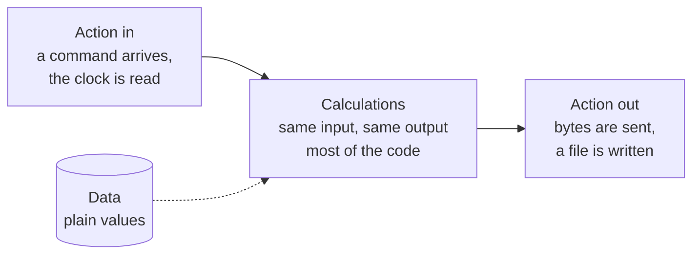
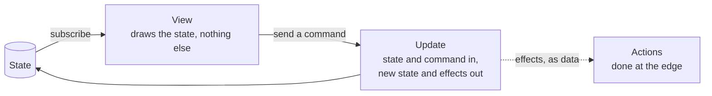
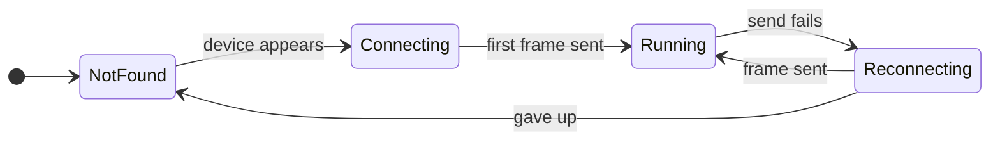
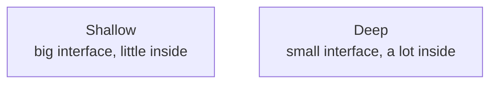
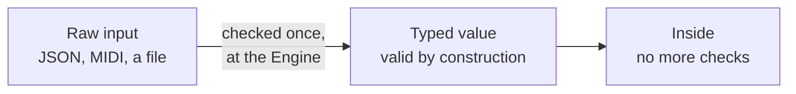
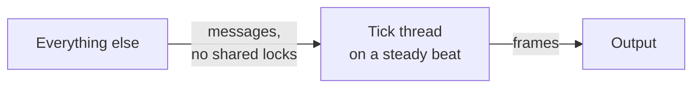

# How we write code

Eight rules. Each has one picture. They apply to Rust and TypeScript alike.

| # | Rule | From | Checked by |
|---|---|---|---|
| 1 | Data, calculations, actions: keep them apart | Grokking Simplicity | compiler: `engine-core` has no `std`, so no clock, file or network. Test: `scripts/layers.mjs` |
| 2 | State flows one way | Elm, Redux | `update` lives in `engine-core`. oxlint: only `ui/src/engine.ts` opens a socket, views import no setter |
| 3 | State machines are written down, never implied | statecharts | clippy: `struct_excessive_bools`, `fn_params_excessive_bools`, `wildcard_enum_match_arm`. oxlint: exhaustive switches |
| 4 | Deep modules, tiny interfaces | A Philosophy of Software Design | test: allowed edges in `scripts/layers.mjs`. Scorecard: public items per crate |
| 5 | Wrong values cannot be built | "parse, don't validate" | test: `ui/src/engine-api.ts` is generated from Rust. oxlint: no `any` |
| 6 | Errors become states, or cannot happen | A Philosophy of Software Design | clippy in core crates: no `unwrap`, `expect`, `panic`, indexing. `forbid(unsafe_code)`, except `rt-thread`: each block says why it is sound. Every `allow` or `expect` has a reason |
| 7 | The real-time core does five things less | this project | compiler: `engine-core` has no `std`, no `alloc`. `crates/engine/clippy.toml`. Test: `no_alloc.rs`. Scorecard: lateness p99 over 60 s |
| 8 | Tests are tables | this project | nightly mutation testing on the calculation crates |

`npm test` runs every check. `npm run scorecard` prints the numbers, `npm run mutants` the mutation score.

## 1. Data, calculations, actions

| Kind | Is | Here | Rule |
|---|---|---|---|
| **Data** | a value. Does nothing | a step, a command, a frame, a project | never changed in place by someone else. A change makes a new value |
| **Calculation** | input to output, nothing else | the mixer deciding who wins, a pattern at beat 3.5, resolving a look to channels | no clock, no file, no network, no global. Time comes in as an argument |
| **Action** | depends on when or how often it runs | sending DMX, reading MIDI, saving, reading the clock | thin, at the edge, as few as possible |

- An action that contains logic gets split: the logic becomes a calculation, the action only calls it.
- A function that calls an action is an action. Keep that from spreading upward.

## 2. State flows one way

| Part | Rule |
|---|---|
| **View** | a calculation from state to screen. It never changes state. It sends a command and draws what comes back |
| **Command** | data. The only way anything changes. Listed, typed, the same for the UI, controllers, agents, the show and the autopilot |
| **Update** | a calculation: state and command in, new state and a list of effects out. No clock, no I/O |
| **Effects** | data that says what to do (send, save, start). Performed by an action outside the update |
| **State** | one owner. The engine owns what the lights do and what the project holds. Nobody keeps a second copy |

- UI-only state stays in the UI: which tab is open, a drag in progress, a folded panel. Everything else comes from the engine.
- No two-way bindings to engine state. A fader sends a command and shows the value the engine reports.
- The same loop runs inside the engine and inside the UI. Controllers and agents enter it at "send a command".
- It pays three times: a recording is a list of commands, a replay sends them again, and undo is the history.

## 3. State machines are written down

One type lists the states. One function holds every transition.

| Implied (not allowed) | Written down (do this) |
|---|---|
| `connected`, `retrying`, `has_error` as three booleans | one type: not found, connecting, running, reconnecting |
| 8 combinations, 4 make no sense | 4 states, all make sense |
| transitions spread over many `if`s | one function: state and event in, new state out |
| the UI guesses a label from flags | the UI shows the state by name |

- The transition function is a calculation. What must happen on a transition is returned as data and done by the caller.
- Two booleans that depend on each other are a state machine. Write it down.
- Machines we already know: output device, the LIVE switch, a pad (off, running, held, pad off), recording, song analysis (queued, analysed, needs review), the UI's connection to the engine.

## 4. Deep modules, tiny interfaces

| Do | Do not |
|---|---|
| hide a decision in one module | let two modules know the same detail |
| make the common case need no options | add a parameter "for flexibility" |
| pull complexity down into the module | hand it to every caller |
| write the interface comment first | add pass-through functions |
| wait for the second real case | build a plugin interface for one case |

The modules and what each one hides: [design/modules.md](design/modules.md). Only Output knows bytes. Only Rig knows addresses. Only the Mixer decides who wins.

## 5. Wrong values cannot be built

| Instead of | Use |
|---|---|
| a bare number for an address, a universe, a beat count | a type for each. A beat is not a second |
| a string for a kind | a closed list of kinds |
| "anything" as a command | the listed commands, one type |
| the same shape typed twice, in Rust and TypeScript | one source, the other is generated or checked against it |
| an optional field that is required in some modes | one variant per mode, each with exactly its fields |

## 6. Errors become states, or cannot happen

| Where | Rule |
|---|---|
| Design | first try to make the error impossible: a release of something not held does nothing |
| Devices | a lost adapter is a state (reconnecting), shown on screen. It is not an error that travels up |
| The Engine | a bad command is refused with a reason. Nothing inside changes |
| The real-time core | cannot fail. No panic, no unwrap, no index that can be out of range |
| The lights | on any failure the last good frame stays. Never dark by accident |

## 7. The real-time core does five things less

| On the tick thread | |
|---|---|
| Locks | no |
| Allocation | no |
| Blocking calls, files, network | no (Output sends, nothing else) |
| Logging | no. It counts, others read the counters |
| Calls outward | no. It never waits for anyone |

Each of the five has a test or a documented check. A claim without one does not count.

## 8. Tests are tables

| Code | Test |
|---|---|
| Calculation | a table of inputs and expected outputs, one parametrised test. No mocks |
| State machine | a table of state, event, new state. Every pair is in it |
| Update | a table of state, command, new state and effects. No engine process needed |
| Who wins | the rule table from [design/who-wins.md](design/who-wins.md), row by row |
| Action | as thin as possible, covered by the end-to-end test |
| Feature | one end-to-end test that checks the DMX that comes out |

- The test comes first when the behaviour is known.
- A bug gets a failing test before it gets a fix.

## Before a push

| Check | |
|---|---|
| New logic is a calculation, not buried in an action | ☐ |
| State changed only through a command. The view only draws | ☐ |
| No new pair of booleans that depend on each other | ☐ |
| No module learned a detail that another one hides | ☐ |
| Nothing new on the tick thread from the list in rule 7 | ☐ |
| Cases are a table, tests pass | ☐ |
| Same words as the app and the docs: looks, pads, steps | ☐ |
