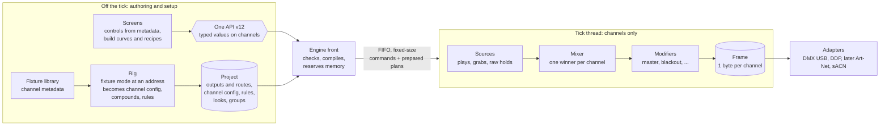
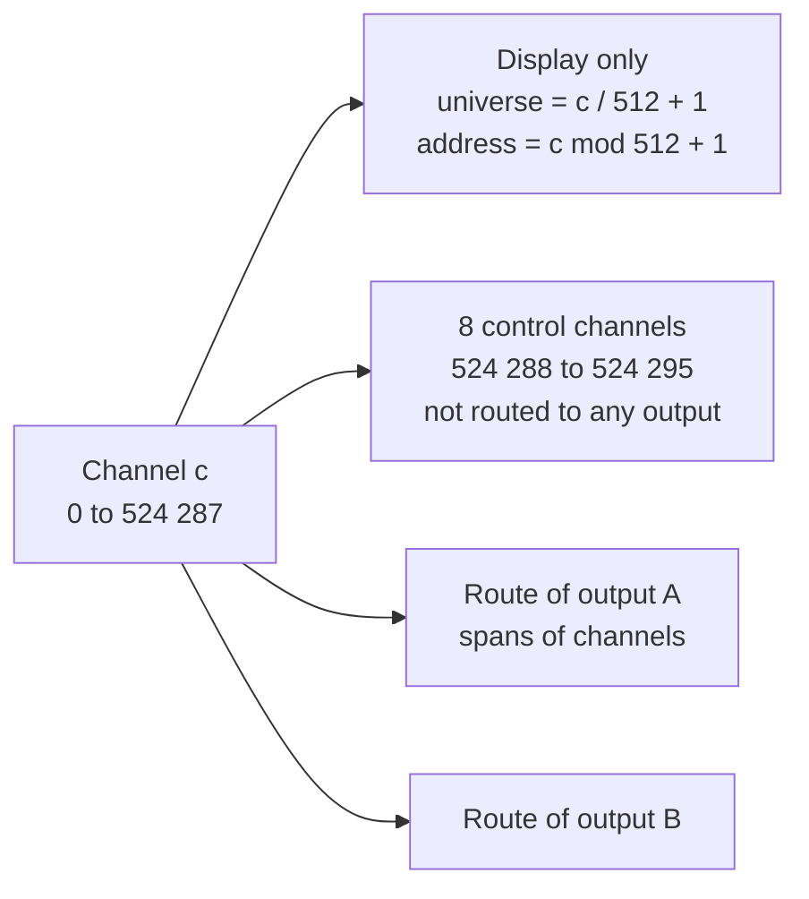
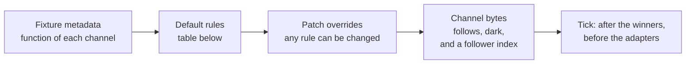
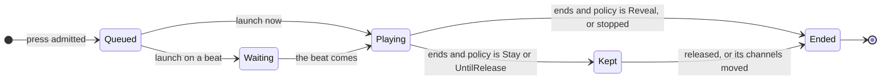
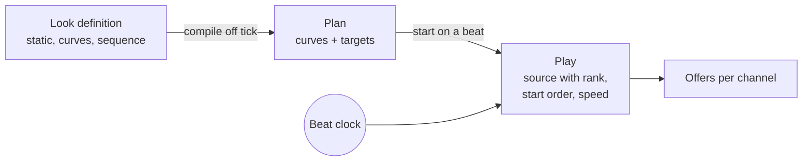
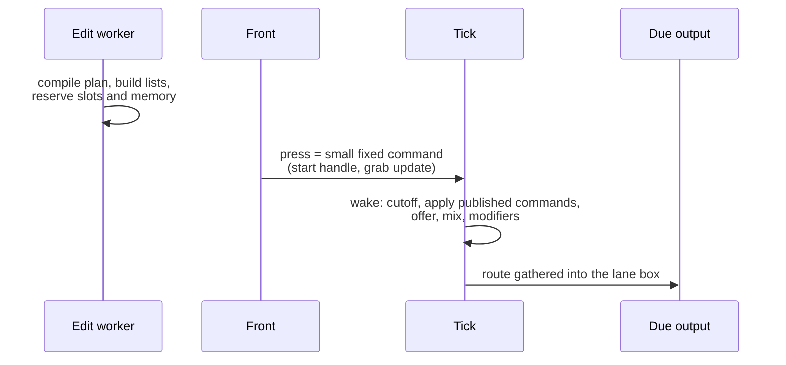
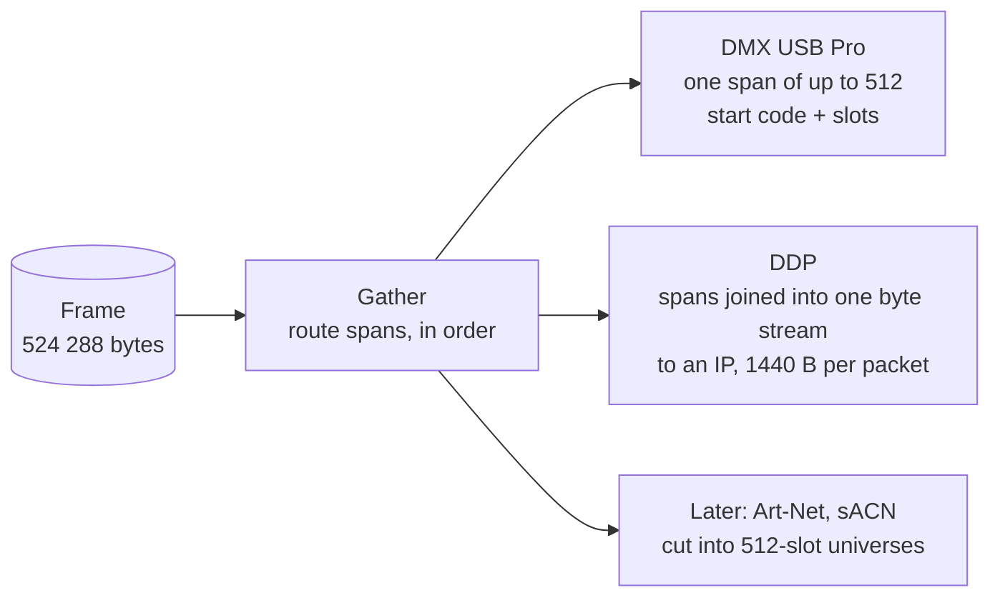
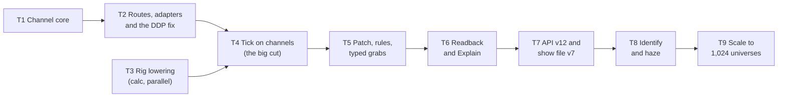

# The channel model: the engine manages channels

Issue #239. Replaces the light record. Design only, no code yet. Owner answers: the decisions page, 2026-11-20 (ch-1 to ch-9, chk-1 to chk-10, cx-1 to cx-6, s1-*).

## The idea in one picture

| Layer | Knows | Does not know |
|---|---|---|
| Tick thread and engine core | channels, rules, sources, curves, bytes | fixtures, lights, colours, heads, universes, packets |
| Engine front and Rig (off tick) | fixtures, modes, compounds, groups, recipes' existence | what a recipe means |
| Adapters | their wire format (512-slot universes, DDP stream) | what a channel is for |
| Screens | fixtures, compounds, metadata, recipes | addresses on the wire |

- Same words as the owner: the engine is a channel manager. A "light" exists only in the screens and in Patch.
- The engine stores recipes as opaque text and never reads them.

## Decisions, and where each lands

| Id | Owner answer | Lands in |
|---|---|---|
| ch-1 | engine knows only channels | whole document |
| ch-2, q1 | 1 byte of data per channel, 8 bytes in all | [per-channel bytes](#the-bytes-of-a-channel) |
| ch-3, cx-2 | coarse and fine are two channels, one fader; pairs move as one 16-bit value, only the output splits | [pairs](#pairs-sixteen-bits-split-last) |
| ch-4, chk-1, chk-3, cx-3, cx-4 | metadata and types, calculation helpers, rules from metadata, no implicit virtual dimmer | [rules](#rules-which-channels-follow-the-dimmer-and-blackout), [compounds](#compound-types-and-helpers) |
| ch-5, cx-5 | look keeps channels, screens keep the recipe | [looks](#looks-curves-and-recipes) |
| ch-6 | engine plays curves, screens build them | [curves](#curves-on-the-beat) |
| ch-7 | fresh show files | [show file](#show-file-v7) |
| ch-8 | core first, main green and real | [tickets](#rebuild-order) |
| ch-9, UX rule | screens know fixtures, controls come from metadata | [API](#api-v12) |
| cx-1 | each channel is won on its own | [who wins](#who-wins-per-channel-one-table) |
| cx-6 | one space of 1,024 universes | [channel space](#one-channel-space) |
| Reality check, LED walls | not DMX-shaped, DDP is an IP and a range | [adapters](#adapters-and-the-ddp-fix) |
| s1-* | Identify only, output fields, haze fader, one WLED four rows | [adapters](#adapters-and-the-ddp-fix), [API](#api-v12) |

## One channel space

| Fact | Value |
|---|---|
| Channels | `CHANNELS = 524_288` (1,024 universes of 512), one constant, raised in ticket T9 after the timing gate |
| Control channels | 8 more, `SLOTS = CHANNELS + 8`: levels of virtual dimmers, set and played like any channel, never sent |
| Address | a plain index. Universe and address are how Patch reads and shows a position, nothing else |
| An output | a list of spans `(start, len)` of channels (its route). Several outputs may share channels (mirroring) |

## The bytes of a channel

Owner decision (q1): **8 bytes per channel**, 1 byte of data. Struct of arrays, not an array of structs: no padding, a frame pass touches only what it needs.

| Array | Type | Bytes | Written | Holds |
|---|---|---:|---|---|
| `value` | `u8` | 1 | every frame | the byte that goes out. The one byte of data |
| `rest` | `u8` | 1 | patch revision | what shows when nothing plays: the profile default, the open shutter value |
| `dark` | `u8` | 1 | patch revision | where the channel goes when its modifiers are at 0, and the zero of its brightness (0 for a dimmer, 255 for a reverse dimmer or a cyan filter) |
| `flags` | `u8` | 1 | patch revision | see below |
| `follows` | `u8` | 1 | patch revision | which modifiers this channel follows, one bit per slot (8 slots) |
| `source` | `u16` | 2 | every frame | who set `value`: `0` rest, `1` raw hold, `2..` index in the source table |
| reserved | `u8` | 1 | | zero. Room for the next rule |
| **Total** | | **8** | | |

| Bit of `flags` | Meaning |
|---|---|
| 0 `fade` | 1 fades between values, 0 jumps (wheels, shutters, modes) |
| 1 `highest` | 1 highest wins among equals, 0 latest wins |
| 2 `pair` | member of a 16-bit pair (the pair table gives the partner). The pair is offered, compared, faded and scaled as one 16-bit value, and has one policy for both halves |
| 3 to 7 | zero |

Outside the dense arrays, all bounded and sized at start or reserved before they are sent:

| Store | Size | Notes |
|---|---|---|
| Source table | 1,024 entries of 24 B (rank, kind, start order, start time, speed, id) | one per live play, grab or Identify. Explain needs start and speed |
| Raw holds | up to `HOLDS = 32,768` entries `(channel u32, byte u8)` (today's 64 universes), refused `TooManyHolds` beyond | sparse list, also copied into the snapshot, so a hold can be listed and read back. A haze fader is one of these |
| Pair table | `(coarse u32, fine u32)` sorted | built at patch |
| Follower index | the channels whose `follows` is not 0, as a sorted `u32` list | so a modifier pass visits only followers. Swapped as one revision |
| Plans | curves and sparse targets in `Arc`, 64 MiB cap as today | built off tick, retired by the free thread. Frozen offers of a kept play live in its entry list |
| Route spans | up to 1,024 per output | immutable, in the output |

### Budget for the biggest show

16 outputs, 1,024 universes, 524,288 distinct channels (`SLOTS` = 524,296 with the 8 control channels).

| What | Bytes | MiB |
|---|---:|---:|
| `value`, `rest`, `dark`, `flags`, `follows`, reserved (6 x 524,296) | 3,145,776 | 3.0 |
| `source` (2 x 524,296) | 1,048,592 | 1.0 |
| **Dense arrays, 8 bytes per channel** | **4,194,368** | **4.0** |
| 2 snapshot boxes of `value` + `source` (3 B x 524,296 each) | 3,145,776 | 3.0 |
| 16 outputs x 3 lane boxes x route (cap 65,536 channels) | 3,145,728 | 3.0 |
| **Typical total** | | **about 10** |
| Worst follower index (every channel followed, 4 B each), twice during a swap | 4,194,368 | 4.0 |
| **Worst fixed total** | | **about 14** |

| Per wake (one frame) | Work |
|---|---|
| Reset | copy `rest` to `value` (0.5 MiB) and zero `source` (1 MiB): about 0.15 ms |
| Offers | every live source offers its channels: at most `OFFERS = CHANNELS` per wake (a word counts 2), summed over all plays and reserved at admission, so one static look over every channel is admitted. A play that offers 8,192 RGBW pixels costs 32,768. T9 measures it and lowers the cap if the gate fails |
| Modifiers | only followers: cost follows the follower index, not the space |
| Gather | each due output copies its route into its lane box |
| Snapshot | a reader that takes every frame adds one copy of 1.5 MiB per wake. It is bounded: a slow reader skips frames |

The whole space is computed on every wake, so a control channel, a pair partner or an offline hold is never skipped. The 60 Hz payload of the biggest show is 30 MiB/s. If the timing gate (T9) fails, the cost is cut inside the Mixer without changing what it computes (for example, skipping untouched stretches), never by changing the model.

## Rules: which channels follow the dimmer and Blackout

The owner's rule (chk-3): the engine has rules, set up from fixture metadata, shown in the UI, open to more cases than master and Blackout.

A **modifier** is a level `m` in `0..255`, "how much shows". A follower channel names the modifiers it follows (its `follows` byte) and has a `dark` byte (where it goes when `m` is 0). Both are stored on the channel.

| Slot | Modifier | Level comes from |
|---|---|---|
| 0 | Master | a command (`SetMaster`), default 255 |
| 1 | Blackout | one boolean on the tick: 0 while on, 255 while off. The front owns who asked: a latch and one hold per connection. It sends `on` when the first asks and `off` when the last lets go, so A on, B on, A off stays dark |
| 2 to 7 | Virtual dimmers, created in the console (cx-4) | the mixed value of control channel `k`, played like any channel. A seventh is refused (`NoSlot`) |

For a channel with value `v`, dark `d`, following modifiers with levels `m1..mn` (all in `0..255`):

`out = d + round( (v - d) x m1 x ... x mn / 255^n )` in signed arithmetic, one rounding at the end.

- A 16-bit pair follower does this on the assembled 16-bit value and splits it after.
- Blackout at 0 gives `d` exactly. For a shutter, `d` is the first byte of its Closed range.
- A **jump** channel (`fade` clear) follows all or nothing: `d` when the combined level is 0, else `v`. A shutter on Master at 50% therefore never passes through a strobe range.
- A control channel cannot follow a modifier (refused at patch), so there are no cycles.
- **Owner (cm-master-scale-or-cap, cm-master-ceiling, 2026-11-21): Master scales, with the formula above** (like QLC+'s default and ONYX): a dimmer at 70% under Master 50% sends 35%. On a fixture with head dimmers and a shared dimmer, Master follows the head dimmers only and the shared dimmer keeps its value. On a fixture with no dimmer, Master scales the colour bytes, so the hue stays. T5 builds it. Sources: #251.
- Master and the virtual dimmers apply to the winner and the raw hold. Identify is written after them and before Blackout, so a low Master never hides it, and Blackout always does. A raw hold on one byte of a pair under Master shows the assembled, scaled word. Explain gives both the held byte and the sent one.

Default rules, from the fixture file (cx-3: unknown channels start independent):

| Function of the channel | Master | Blackout | Dark |
|---|---|---|---|
| Dimmer | yes | yes | 0, or the closed value of a reverse dimmer |
| Emitters (R, G, B, White, Amber, UV, Lime, Indigo) that **no dimmer channel controls** | yes | yes | 0 |
| Emitters that a dimmer controls (the dimmer is in the same head, or is the fixture's shared dimmer and the emitter's head has no dimmer of its own) | no | no | the dimmer carries it |
| C, M, Y on a fixture without a dimmer | yes | yes | 255 (subtractive) |
| Shutter | no | yes | the first byte of its Closed range. A shutter with no Closed range does not follow Blackout |
| Strobe, pan, tilt, zoom, focus, iris, wheels, prism | no | no | |
| Fog, haze, fan, unknown, other. On a smoke machine or hazer a dimmer preset is the fog output unless it is a plain byte (a level with steps, "fog off" then "fog output", is a pump) and it shares a head with an emitter, or the mode has no heads and has emitters | no | no | |

- No virtual dimmer exists unless a user creates one (cx-4). Creating one is: pick a slot, pick follower channels in Patch. Looks can then set its control channel like any channel.
- Brightness on a dimmerless fixture is baked into the emitter bytes (cx-4) unless such a virtual dimmer exists.
- Every default is only a default: Patch stores the changes as overrides (`rest`, `follows`, `dark`, `fade`, `highest`) per channel.
- The Who wins row "highest wins for brightness" is a bulk edit of `highest` on every channel whose function is Dimmer. `SetMixRules` loses its brightness field in v12. Until T7 the v11 field stays on the wire and the front turns it into this bulk edit, so the flag on the channel is the only truth. A pair has one policy for both halves.
- A v11 step that sets only brightness on a fixture without a dimmer compiles to **no offers** (there is no brightness channel to hold). A step with colour and brightness compiles to the colour scaled by the brightness. `Highest` has no effect on such fixtures: their colour is latest-wins, and `highest` needs a virtual dimmer, whose control channel can be `highest`. The `who_wins_on_the_wire` expectations on dimmerless pars are rewritten in T4.
- A consequence of cx-4, stated for the owner: on a fixture without a dimmer a colour press at Manual also holds that fixture's brightness, because brightness is in the emitter bytes. "Red alert over the autopilot chase" holds the colour and the level together. A virtual dimmer for a group brings the split back.
- More cases later (a haze kill, a group master) are more slots or a wider mask, never new code paths.

## Compound types and helpers

The tick sees bytes and 16-bit pairs. Everything else is the API and the Rig (chk-1: metadata, types, convenience wrappers).

| Compound | Channels in order | Detected from |
|---|---|---|
| `Byte` | one | every channel, always |
| `Word` | coarse, fine | only when certain, and the definition is the truth: where it contradicts the maker's chart (a slot moved, a fine declared coarse, a fog switch declared a shutter), the lowering follows the definition, with no rule for one fixture; the fix is the definition (Patch, T5, and upstream to QLC+). Both in the same heads, the same colour, the coarse has no fine yet, never an index with a wheel selector; never a fog output to a light dimmer (on Smoke and Hazer the Fog row decides: a pump with "no fog", then "fog" declared a dimmer fine stays apart from the LED dimmer). Evidence in order, each kind choosing before the next. 1 `ActsOn`: the fine joins the channel acting on the same one as it (a rotation fine names the wheel, as its rotation does), else the named channel; sharing what they act on stands for the group (Ayrton: the rotation in group Speed, its fine in Gobo); the one right before it if several; none, it stays apart. 2 Preset: the coarse with its preset (the way it runs and other names, Master, X axis, do not count) before the fine, or right after it when that is the only coarse of its control (Briteq BT-250-EZ: Dimmer fine, then Dimmer): one, unless another coarse of its group is right before the fine; several, the one right before the fine unless a fine follows (Showtec Acrobat: Pan 1, Tilt, Pan 2, then their fines); none, it waits for 3, taking only a coarse that declares no preset (Zoom never takes a Focus fine). 3 Adjacent: the coarse right before it when it is of its group and fits (a plain fine, one range over the whole byte included, fits any coarse; a fine with steps only the same steps), not in blocks (the channel before that coarse looks the same and a fine of its group follows: Shutter B, C, D, then their fines). Every other fine stays a single byte, shown in Patch as "fine, not joined", where the user joins it (T5): a wrong pair moves the wrong thing, a lone fine only loses precision. The fixtures the reviews named are checked against hand-written charts; a chart row the definition contradicts says "definition error, follows the definition" |
| `Xy` | pan word or byte, tilt word or byte | Pan and Tilt functions, degrees from the mode |
| `Rgb`, `Rgbw`, `Rgba`, `Cmy` | the colour channels | R, G, B, White, Amber, C, M, Y functions in one mode or head. No `Cmyk` (owner, cm-cmyk, 2026-11-21): no fixture definition has a black function; it comes back with the first one that does |
| `Slot` | one wheel channel | colour wheel, gobo, prism and mode ranges: named slots |
| `Components` | up to 8 named, ordered | anything a mode or the user groups |

Helpers (pure calculations, table-tested, in `rig`):

| Helper | Does |
|---|---|
| `word_split`, `word_join` | 16 bits to coarse and fine and back |
| `to_native` | a normalised component to a native byte or word: declared range, direction, colour order |
| `rgb_to_rgbw` | shared white extraction, and its inverse |
| `slot_byte` | a wheel slot to the lower midpoint of its range |
| `degrees` | pan and tilt in degrees to a word |

- Compounds are project data made at patch time, with ids. The front expands a typed value to bytes. The tick never sees a compound.
- Channels without a known type stay addressable on their own, with their named ranges or a fader. Never a bare number only (UX rule).
- Heads: a fixture with pixels gets one compound per head. A shared master dimmer is one channel in one compound.

## Who wins per channel, one table

One function, `mix`, in `engine-core`, one panel in the app. Each channel is won on its own (cx-1): a look that cares about colour sets all its channels, so no split appears.

| Step | Rule |
|---|---|
| 1 Offers | a live source offers `(channel, byte)`, or a whole word for a pair. A source may offer nothing at a moment (a gap), and then a lower source shows through. A channel nobody offers takes `rest` |
| 2 Rank | Manual beats Show beats Autopilot. A direct grab is Manual |
| 3 Among equals | latest start wins, first-in breaks an equal instant. If the channel has `highest`: the greater **brightness** wins, latest breaks a tie. Brightness is the distance from `dark` (so a reverse dimmer at 0 beats 255) and for a pair the 16-bit distance |
| 4 Raw hold | an explicit raw hold from the DMX screen replaces the addressed byte, including with 0. A pair is assembled after this step, so holding only the fine byte gives the winner's coarse and the held fine |
| 5 Identify | Identify is its own source kind and row, above raw holds and under Blackout, so it blinks while a hand holds Manual. It offers brightness and colour channels only (emitters and the dimmer), never a shutter, strobe, motion or fog. It is refused when the shutter's `rest` is not a steady open value |
| 6 Modifiers | followers move toward their dark value by the modifier levels: first Master and the virtual dimmers, then the Identify overlay, then Blackout |

- An ordinary offer (look or grab) always carries a whole pair. A typed `Byte` grab or a look `Raw` ref on one member of a pair is refused (`PairMember`). Only the raw hold may take one byte, and Explain shows it.
- Control channels are mixed the same way, in the same pass, before the modifiers read them.

| End or release | Result |
|---|---|
| Manual ends | `UntilRelease` keeps its last offer until Release. `UntilStop` removes it when the pad or fader stops. A haze fader is a channel `Hold`, kept until `ReleaseChannel` |
| Show or Autopilot ends | `Reveal` removes it. `Stay` freezes each channel's last offer at its rank, and a channel in a gap has none. A kept play can be released (`ReleasePlay`) |
| A new grab on the same target by the same connection | replaces the earlier one. Ending it never brings an older grab back |
| A stale end | does nothing |
| A fixture moves, is unpatched or changes mode | every kept offer on its channels ends in the same edit |

- Rank, ties, release and stay are the rules of [who-wins.md](who-wins.md), now per channel. The property rows there are replaced when T4 lands.
- Explain recomputes one channel with the same `mix` function over retained inputs: the source table (start, speed, rank), the plans and grab lists the front holds, the raw holds and the eight modifier levels, all stamped with the frame. It returns the winner and the runner-up (`under`) exactly, and cannot drift from the tick. Only the latest snapshot frame is retained; an older frame reports "expired".

## Fades and jumps

| Case | Rule |
|---|---|
| Channel with `fade` | between knots a Linear segment interpolates the integer value, nearest, half up |
| Channel with `jump` | every segment holds its start value and takes the next at the knot |
| Pair | one 16-bit curve, interpolated as 16 bits, split last. Both bytes carry one source and one start order |
| Crossfade between steps of a sequence | flattened into knots when the look is compiled. The tick has no transition |

## Curves on the beat

| Part | Shape |
|---|---|
| Curve | period (beats, fixed point), end mode `Loop`, `Once` (ends after the last knot, by the end policy) or `Latch` (holds the last knot until stopped; a static look is `Latch`, and its last knot is never a `Gap`), knots `(at, value u16, Hold, Linear or Gap)`. Values are 0..255 for a byte, 0..65535 for a word. `Gap` means no offer from this knot to the next, so a sequence item that does not mention a channel lets a lower source through |
| Target | `(channel, curve, offset)` or `(coarse, fine, curve, offset)`. Many targets share one curve with different offsets: a wave over 8,192 pixels is 4 curves and 32,768 targets |
| Static look | one knot, `Latch` |
| Time | the existing beat clock (Q32). Tempo changes act continuously. A delayed wake seeks to the current phase |
| Once | takes the last knot, then the source ends by its policy (a last `Gap` ends it with no offer) |

- A chase is Hold segments. A wave is Linear segments with offsets from the screens. A pan sweep is a word curve.
- The engine has no wave, pattern, palette or swatch. The screens build the curve and keep the recipe (ch-6).
- Work is bounded: visits per frame and plan bytes are reserved at admission, exactly as today.

## A press is in the very next frame

| Rule | Check |
|---|---|
| A press published before the FIFO cutoff is in that wake. After it, in the next | stepped-clock test at both sides of the cutoff, at 44 and 60 Hz |
| A press is fixed-size: a handle plus bytes. No compile, no list build, no file, no device open | `no_alloc` test with press bursts during an edit |
| A paused edit or device open never delays a press, on any connection. Starting a lane no longer happens under the publisher lock (T2) | e2e test: press on the same `/api` connection and on a second one while an open is paused, first due frame carries it |
| A finger hold belongs to its connection and is released in the next frame when the connection drops. A channel Hold stays until Release | e2e test with a dropped socket |
| A full queue or a limit changes nothing and says why | refusal tests |

## No allocation, lock or blocking on the tick or output threads

| What | Where it is allocated and freed |
|---|---|
| Dense arrays, source table, play slots, snapshot boxes | once at engine start |
| Plans, grab lists, follower plan, route spans | the front, before the command is sent. They travel in the command |
| Lane boxes | `Lane::start`, off tick, sized by the route length |
| Old plans, devices, lists | go back on the return queue, freed by the free thread |
| Capacity | the front refuses at admission when slots, visits or bytes are short, and reserves the release slot |

- `engine-core` keeps no `std` and no `alloc`. The tick crate keeps the lock, channel, file and print bans of `clippy.toml`.
- `engine/tests/no_alloc.rs` gets a channel-model setup: all five stores, press bursts, an edit swap, a stalled reclaimer. It asserts zero allocations and zero frees on the tick.

## Adapters and the DDP fix

- An adapter's whole interface: `take(&[u8]) -> Outcome`, a route and a rate. It never waits. It knows its bytes and nothing about channels' meaning.
- Lane boxes are sized by the route, not by the engine's universe count.

**The DDP bug.** `crates/outputs/src/ddp.rs` sends a run of universes as one stream of 512-byte rows, rounded to whole pixels (`total` at line 269, `channels()` at lines 370 to 386). A row of 320 channels per universe gets 192 padding bytes, which is 48 RGBW pixels, after every row.

| One WLED, four rows of 80 RGBW pixels | Route span | DDP payload |
|---|---|---|
| Row 1, universe 1, addresses 1 to 320 | channels 0..319 | bytes 0..319 |
| Row 2, universe 2 | channels 512..831 | bytes 320..639 |
| Row 3, universe 3 | channels 1024..1343 | bytes 640..959 |
| Row 4, universe 4 | channels 1536..1855 | bytes 960..1279 |

- A DDP output is `address + colour order + route`. The stream is the spans joined: 1,280 bytes, one packet, type `0x1B`, offset 0, PUSH. Longer streams split at 1,440 bytes, only the last carries PUSH.
- Black pixels still occupy their bytes. Patch checks the **assembled stream**: its length must be a whole number of pixels for the output's colour setting (spans of 2 and 1 channels that form one RGB pixel are fine). It refuses a route edit that drops or moves a byte a patched fixture uses.
- Route cap: 65,536 channels per output (`ROUTE_MOST`), 1,024 spans.
- DMX USB Pro: one span, at most 512 channels. Today's copy of the first universe only is a limit of the old run type and goes away.
- Output setup stays by kind: DDP asks address and RGB or RGBW, USB asks which adapter (s1-output-fields). Where the pixels are is Patch's route.

## Looks, curves and recipes

| What is saved | Where it lives | Who reads it |
|---|---|---|
| **Look definition**: static assignments, curves, or a sequence of other looks | Project, in the show file | the front compiles it to a plan |
| **Recipe**: how the screens built it (group, selector, order, palette link, spread) | Project, opaque text up to 64 KiB, never read by the engine | the screens |
| **Plan**: curves and channel targets | in memory, `Arc`, sent to the tick | the tick |

- A target is a **ref**: `Fixture{id, channel}` or `Raw{channel}`. The front resolves refs against the current patch when it compiles. Moving a fixture recompiles every look that names it, in the same edit. A look follows its fixture, never an old address. Reusing an address never retargets a look.
- Sequences keep the graph of looks and its admission checks (depth, expansion, offers) and are flattened to one plan. A channel an item does not mention becomes a `Gap` in that item's span.
- A look target on a pair names the pair: `Fixture{id, channel}` of the coarse byte or a compound ref. A `Raw` ref to one member of a pair is refused.
- Groups are ordered lists of fixture ids in the Project, for the screens. Changing a group changes no look (ch-5).
- Apply to new fixtures (cx-5) is a screens action: it reads the recipe, builds curves for the new fixtures only, appends them to the end, keeps existing timing, previews first, and sends one `PutLook` with the base revision. A repeat Apply adds nothing.

## API v12

One Rust wire schema in `engine-core::api`, generated TypeScript as today. The screens spec (`docs/history/screens-slice-1.md`) is built on this table.

| Command | Meaning |
|---|---|
| `Hold{channel, byte}`, `ReleaseChannel`, `ReleaseChannels` | raw hold, as today's `SetChannel`. The DMX screen and the haze fader use it |
| `Grab{target, value}`, `UpdateGrab`, `EndGrab` | live hold at Manual. `target` is a channel or a compound id. `value` is typed: `Byte`, `Word`, `Xy`, `Rgb`, `Rgbw`, `Rgba`, `Cmy`, `Slot`, `Components` |
| `PutLook{id?, name, definition, recipe, base}`, `RemoveLook` | look definition in refs, with the revision it was built on. Replies `Saved{look}`. A draft with no target saves and `Start` is refused `NoTarget` |
| `Start{look, rank, launch, speed, repeat}`, `Stop`, `Flash`, `EndFlash` | play a look |
| `ReleasePlay{play}`, `ReleaseAll` | release a kept play. `ReleaseAll` clears every hold and kept play of every owner, never the Blackout latch |
| `Patch{fixture, mode, at}`, `PatchStrip{at, pixels, color}`, `Move`, `Unpatch`, `Rename`, `SetFixtureMode` | fixtures. `PatchStrip` makes a generic RGB or RGBW strip with no library entry. The Rig derives channel config and compounds |
| `SetChannelRules{ref, rest?, follows?, dark?, fade?, highest?}` | overrides per channel |
| `SetVirtualDimmer{slot, name, followers}`, `SetGroupLevel` | modifier slots 2 to 7, their followers and level |
| `SetMaster{level}`, `Blackout{on}`, `SetBlackoutLatch{on}` | modifier slots 0 and 1. The front counts holders (see rules) |
| `SetOutput{kind, rate, route}`, `RemoveOutput` | outputs with spans. Refused `ChannelsTaken{span}` when a span overlaps another output's patched use |
| `SetGroup`, `RemoveGroup` | ordered fixture ids |
| `SetMixRules`, `SetInternalTempo`, `TapTempo`, `ReleaseTempo` | as today, minus the brightness field |
| `Request::Search`, `Fixture`, `Failures` | the library, as today |

| Read | Meaning |
|---|---|
| `Query`, `Subscribe` | frame, revision, outputs with routes and health per output generation, plays (with `started` in engine time), grabs, holds, blackout `{latched, holders}`, master. Channel bytes as pages and deltas of `(channel, byte)` |
| `Channels{range}` | effective bytes and source per channel, paged |
| `Looks` pages | look definitions and recipes, so a screen can read them back |
| `Patch` pages | fixtures, modes, per-channel config with its source (file or changed), compounds, followers, so the screens choose controls from metadata. Also channel to (output, slot) and to fixture name and channel |
| `Explain{channel}` | `Decided{origin: Look, Raw or Fixed, channel, winner, under, modifiers}`. An unpatched or fixed byte gives an origin, never an error |

- Typed values are checked once, at the front. A stale compound or look reference is refused `Stale`, with nothing changed.
- Light, property and wave types leave the API: see [what is removed](#what-is-removed). Every v11 press-side command above keeps its meaning.
- **Owned by a connection** (kept by the front, never by the tick): finger holds (`Grab`, `Flash`, `Blackout{on}`, Identify) are released in the next frame when their connection drops. Channel `Hold`s stay until released.
- **Front and server only, no tick change**, specified by the screens spec and built in T7: Live and Lock (refusals `Live`, `Locked`), undo and redo with labels, new, open, save and rename a show with a staged commit, look groups and `PlayPreview`, `LookInUse` on `RemoveLook` and on edits that strand a look, console pages and widgets as project data, panels as groups in wiring order plus a recipe.
- **Identify** is a command of its own (`Identify{fixture or probe{mode, at}}`) with refusals `Live`, `Blackout`, `NothingToBlink`. It is source kind Identify in the Mixer (above). Two targets on one channel in one look (a fixture ref and a raw ref that resolve to the same channel) are refused `Duplicate`.
- One generation check: a fader gesture on a patch that changed since it began is refused.

## Show file v7

Fresh format (ch-7). Text JSON, strict, `deny_unknown_fields`. The reader accepts v7 only. An older file is `LeftAlone`: reason shown, autosave to it suppressed, bytes kept.

| Section | Holds |
|---|---|
| `show` | the number 7 |
| `outputs` | kind, address or adapter, rate, route spans |
| `modes` | each pinned mode descriptor once, so a show opens without the library |
| `fixtures` | id, name, mode, first channel |
| `overrides` | per-channel rule changes (only what differs from the defaults) |
| `virtual_dimmers`, `groups` | slots and followers, ordered fixture ids |
| `looks` | id, name, definition in refs, recipe text |
| `rules` | mix rules |

- Derived data (channel config, compounds, follower plan, plans) is never stored. It is rebuilt on open, with the same checks as a new edit, and swapped in once.
- Restart: plays, holds, Identify, tap and Blackout idle, master full, channels at rest.
- Cap 64 MiB for the file, checked on input and on the encoded document. A file over it stays `LeftAlone`.
- The test shows are rewritten. An old file is a refusal case in the tests.

## What is removed

| Where | Goes | Stays or changes |
|---|---|---|
| `engine-core` | at T4: `resolve.rs` (Writer, Take, Place, LightRun, MAX_LIGHTS), Held and Claims per property, `Want`, `wave.rs` swatch sampling, Light-typed `sample` and `blend`. At T7: `property.rs` (Property, Light, Rgb, Position, Gobo, Wheel, kept until then as v11 wire-only types) and the refusals tied to lights | clock, `Moment`, `interpolate`, plays, rank and `wins`, release policy, output and health state machines, `mix` as per-channel |
| `engine` | `Snapshot.lights` and `grabs` (16,384 each), per-light scratch, `Writers`, `Lights`, `Darken`, `Runs` commands | wake loop, FIFO cutoff, lanes (re-sized by route), snapshot hand-over, free thread, prepare and admit |
| `outputs` | `Levels` per universe, `Whole`, the 512 stride, DMX first-universe copy | socket, health and link machines, packetising, ports |
| `rig` | `Writer` generation, `LightNumber` | the inference tables (`Has`, `take`, wheels, `join`, heads, `fixed`) as channel metadata and compound detection |
| `looks` | Step on a Target, `Pattern::Wave`, `WaveTarget`, Palette, per-light `Plan` | graph, admission, memoisation of sequences, plan bytes and visit limits |
| `show-file` | v1 to v6 readers, light numbers | the size cap, bounded read, refusal and atomic write |
| `ui/src/engine-api.ts` | generated again | |

Test shows that model a light record are rewritten (the feature files `who_wins_on_the_wire`, `mover_step_on_the_wire`, `whole_performance`, `linked_sequences`, `saved_step_at_manual`, `waves_on_the_wire`, then `patch`, `pixels`, `shared_channel`, `show`, `admit`, `held_lights` files of `engine-server`, and the colour, group and property tests of `rig`). Kept: `api`, `dmx_usb_pro`, `library`, `health_on_the_wire`, `first_due_frame`, `process`, `launch_on_beat` and the fixture-library and outputs tests. `streams`, `last_pixel` and `pixels` keep their bytes and are rebuilt as the table below says.

## Rebuild order

Rules for every ticket:

- Lands on `main` green: full `npm test`, an end-to-end test that checks output bytes (stepped clock on `/api` or on the engine's test-support door, USB Pro frames decoded on a pseudo-terminal, DDP payloads compared with a USB mirror), the no-alloc test, nothing half-working reachable.
- Never breaks a wire shape before T7: **v11 stays on the wire until T7.** T5 and T6 may add commands and fields (additive), and then regenerate `ui/src/engine-api.ts` (`UPDATE_TS=1`), so the generated-types check stays green. Routes are used through the engine's own door in tests until T7.
- Tests whose expectation changes because of a decision (cx-4: brightness is baked into colour, fade rounding) are rewritten in the ticket that causes it, with the old and new bytes in the commit message.
- Updates `docs/design/{theory,modules,who-wins}.md` and `docs/engine.md` for what it changes, and `scripts/layers.mjs` before any new edge.

| # | Ticket | What changes on the production path | Evidence: bytes |
|---|---|---|---|
| T1 | **Channel core** | the dense arrays, raw holds as the `1` source and Blackout as modifier 1 (following every channel, as today) replace the final raw and Blackout pass in `frame()` **and** the `Want::Raw` and `Want::Blackout` arms of `resolve::put`, so one who-wins function remains. Old resolver still fills the base, as source `2`. v11 unchanged | existing tests unchanged. New: raw `91` on both sides of the cutoff at 44 and 60 Hz, release, Blackout, `8N` array bytes, zero tick allocations and frees |
| T2 | **Routes, adapters and the DDP fix** | `Device::take(&[u8])`, routes as spans (internal type), lane boxes by route, DDP joins spans, USB takes one span. v11 `SetOutput.universes` stays on the wire and becomes one span inside. Starting a lane moves off the publisher lock | through the engine's door: four row markers at DDP offsets 0, 320, 640, 960 and the last W at 1279, interior zeros kept, multi-packet offsets and PUSH, RGB pixel split across spans 2 + 1 accepted, a stream of 319 RGBW bytes refused, USB full 512 slots. Wire: a v11 run becomes one span cut to whole pixels, as today (510 bytes for one RGB universe), and the existing DDP and USB tests are unchanged. The four-row layout is reachable on the wire at T7. Rerouting a kept device restarts its lane A press on a second connection during a paused open |
| T3 | **Rig lowering** (pure calculation, no reachable surface, so table tests only) | mode at an address to channel config, pair table, compounds and default rules, helpers, from the existing inference | a 100-channel mode addresses byte 100, nonadjacent fine (the pinned moving head: pan at offset 2, fine at 11), inverse zoom, wheel midpoint, open shutter, fog stays independent, two heads with a dimmer on one |
| T4 | **Tick on channels** (the one big cut, all crates but `outputs`, `fixture-library`, `shell`, `ui`) | plays, grabs and holds become sparse offers and curves on the tick, with `Gap` knots. The source table comes with them: each play, grab or Identify offers under its own entry, so `source` names it. Rank, ties, highest by brightness, pairs as words. The front compiles today's light steps, patterns and sequences into channel plans off tick and bakes brightness into colour on dimmerless fixtures (cx-4). `Light`, `Property` and `Rgb` stay as v11 **wire-only** types until T7. `Writer`, `Take`, per-property Claims, `Snapshot.lights` go: the held-light reply (`HeldLight` moves to `api.rs`) is built by the front from the grabs it sent. v11 `SetMixRules.brightness` becomes the bulk edit of `highest` flags. `rig`, `looks`, `show-file`, `engine-server` change with it | existing feature end-to-end expectations hold byte for byte except those cx-4 or fade rounding change, listed in the commit. New: rank and tie table in both orders, highest on a reverse dimmer and a 16-bit dimmer, a pair torn by nothing, sequence gaps revealing Autopilot (`17` to `91`), stay and reveal, kept play released, no-alloc with press bursts |
| T5 | **Patch, rules, typed grabs** | `Patch` builds channel config, compounds, the `follows` and `dark` bytes and the follower index through T3. Master, Blackout and virtual dimmers follow rules, not "every channel". `Grab` with typed values. `SetChannelRules`, `SetVirtualDimmer`, connection-owned holds and the Blackout latch (front) | Blackout changes only the dimmer, emitters and shutter of a mixed fog and LED fixture, and the second head of a two-head fixture. Reverse dimmer, shared master once, 16-bit dimmer, RGBW grab bytes, a seventh virtual dimmer refused, A on, B on, A off stays dark, dropped socket releases finger holds |
| T6 | **Readback and Explain** | channel pages and deltas, raw holds and source table in the snapshot, `Explain` by recomputing with `mix`, `Channels{range}`, channel to output slot map (the salvaged #203 work) | Explain equals the tick for every channel in a property test, including `under` with a raw hold over two different grabs, expired frame reports so, backpressured subscriber still gets the press |
| T7 | **API v12 and show file v7** | one cutover: look definitions in refs with recipes, curves API, routes on the wire, light commands and types removed, v7 file, generated `engine-api.ts`, rewritten test shows. The one `/version` bump. The front and server features of the screens spec (Live, Lock, undo, show operations, console pages, look groups) | move a fixture and reuse its old address: the look is at the new address only, a kept offer on the old one is gone. Group edit changes no byte. Restart without library or hardware, replay, same bytes. An old file stays intact after Stop |
| T8 | **Identify and haze** | Identify source kind, `Identify` and probe, brightness and colour channels only, refused when the shutter rest is not steady open. Haze fader is a channel hold | haze `73` as a channel hold with an unrelated byte `19`, Identify, a later Manual `0` and a Master at 0 do not hide it, cancel reveals the moving look, `ReleaseChannel` reveals the lower value, Blackout hides it, timeout, disconnect, a fixture whose shutter rest is not steady open refused |
| T9 | **Scale** | `CHANNELS` to 524,288 after the gate, caps and scorecard, last scaffolding out | USB mirror of universe 1,024, last-byte sentinels on 16 max routes, one-over refusal, 60 s timing gate |

| Ticket | Owns (so no two overlap) | Blocked by |
|---|---|---|
| T1 | `engine-core/src/{channel,mix,resolve,lib}.rs`, `engine/src/{lib,snapshot}.rs` | none |
| T2 | `outputs/`, `engine/src/lane.rs`, `engine-core/src/{output,kinds,project}.rs`, `engine/src/lib.rs` (`serve`, lane start), `engine-server/src/lib.rs` (open path) | T1 |
| T3 | `rig/src/` (new module), `fixture-library/src/` | none |
| T4 | `engine-core/src/*`, `engine/src/*`, `rig/`, `looks/`, `show-file/`, `engine-server/`, their tests | T2, T3 |
| T5 | `rig/`, `engine-core/src/{api,lib}.rs`, `engine/src/lib.rs`, `engine-server/src/lib.rs`, `ui/src/engine-api.ts` | T4 |
| T6 | `engine/src/snapshot.rs`, `engine-server/src/lib.rs`, `engine-core/src/api.rs`, `ui/src/engine-api.ts` | T5 |
| T7 | `looks/`, `show-file/`, `engine-server/`, `engine-core/src/{api,lib,project}.rs`, `ui/src/{engine-api.ts,engine.ts,picture.ts,main.tsx}` (only the changes the new wire needs: the skeleton counter view, not the product UI, which stays behind #102), all light-model tests | T6 |
| T8 | `rig/`, `engine-core/src/{api,lib,mix}.rs`, `engine/src/lib.rs` | T7 |
| T9 | `engine-core/src/channel.rs`, `outputs/`, scorecard | T8 |

- `engine/src/lib.rs` and `engine-core/src/{api,lib}.rs` are shared hot files: tickets that touch them run one at a time. Only T3 runs beside T1 and T2.
- T4 lands in three commits behind one mixer (#250): L1 each patched channel takes its rest, dark, fade and pair from the lowering; L2 a light's value as channel offers, a calculation; L3 the per-channel mixer. Never two mixers on the production path.
- Product UI tickets stay behind the storyboard catalog approval (#102). They start when T5, T6 and T7 have landed.

### Tests that change

| Test | Fate |
|---|---|
| `engine-server`: `api`, `dmx_usb_pro`, `library`, `health_on_the_wire`, `first_due_frame`, `launch_on_beat`, `process`, `out` (back-pressure part) | keep |
| `engine-server`: `last_pixel`, `streams`, `pixels` | keep the byte expectation, rebuilt on the strip patch of T4 and routes of T2 |
| `engine-server`: `who_wins_on_the_wire`, `mover_step_on_the_wire`, `whole_performance`, `linked_sequences`, `saved_step_at_manual`, `waves_on_the_wire`, `patch`, `shared_channel`, `show`, `admit`, `held_lights` | rewritten in T4 (bytes kept where cx-4 allows) and T7 (new format) |
| `rig`, `looks`, `show-file`, `engine-core`, `engine` inline and integration tests | rewritten with the code they test, in the ticket that changes it |
| `fixture-library`, `outputs`, `rt-thread`, `e2e/` | keep |

## Superseded work

| Issue | Now |
|---|---|
| #239 | this design |
| #201, #203 | re-cut on T5, T6 and T8. Kept: the four pinned fixture definitions, the no-fine-haze finding, the Mover white-spot question, the 17 example byte expectations, the per-frame `out` helpers and the backpressured press test |
| #199 to #206, #220 to #227, #229, #231, #235 to #238 | re-cut by the screens rework on this API |

## Decided by the owner (decisions page, 2026-11-20)

| # | Question | Answer |
|---|---|---|
| q1 | Size per channel | **8 bytes.** Value, rest, dark, flags, follows, 2-byte source tag, 1 reserved. About 10 MiB typical, about 14 MiB worst for the biggest show |
| q2 | A fixture moves: do its looks follow? | **Yes.** Looks go to the fixture's channels, and fixtures can be repatched without any issue. A look can also be applied and migrated to other fixtures (a screens action on its recipe) |
| q3 | Brightness on fixtures without a dimmer | **No default dimmer.** In Patch the user can change the channel rules and add a dimmer to an RGB or RGBW fixture if they want one: `SetVirtualDimmer` offers "add a dimmer to this fixture or group" in one step |
