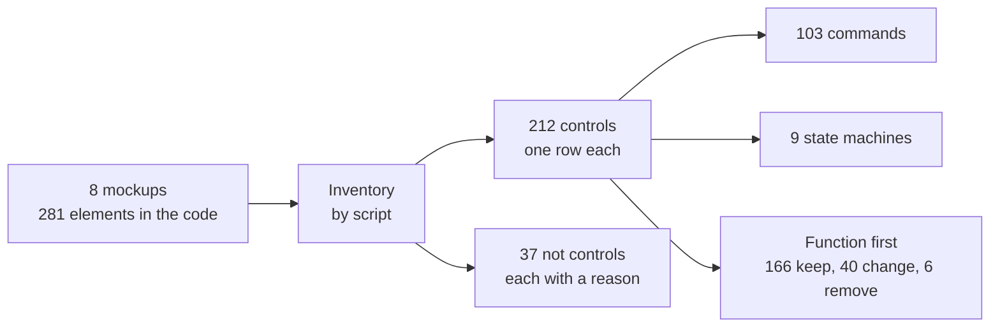
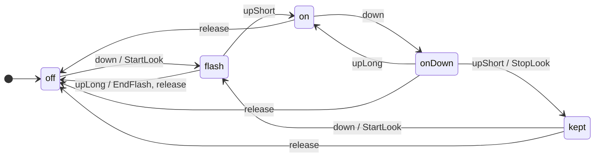
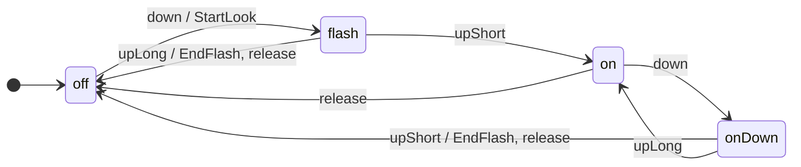
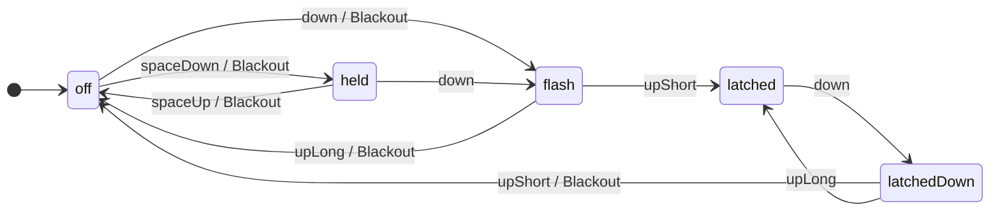
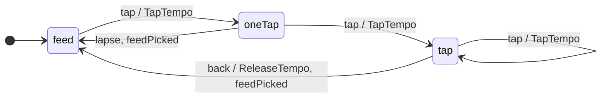
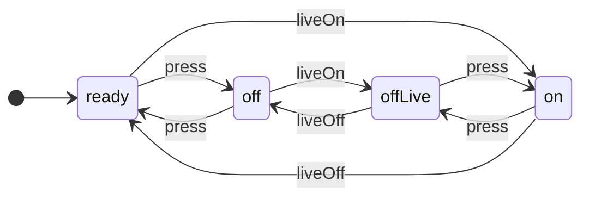
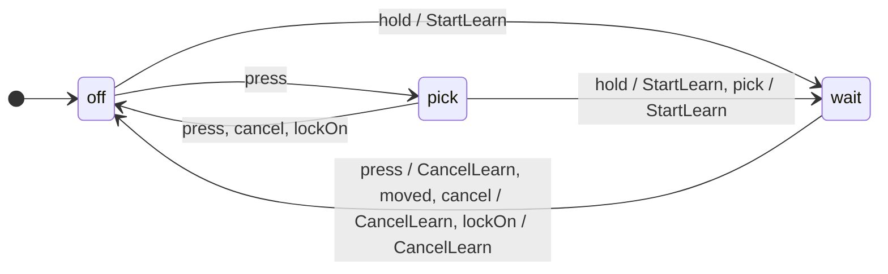
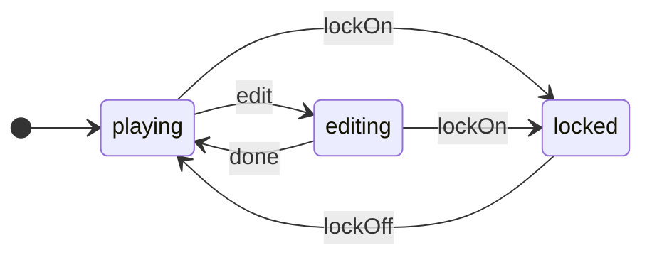
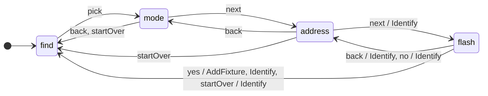
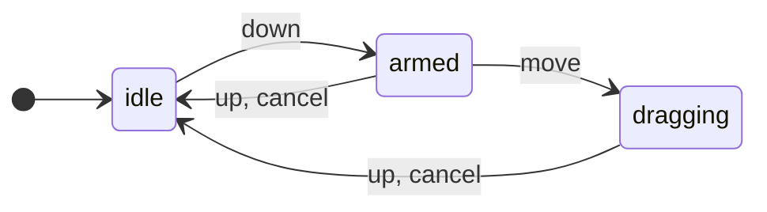

# Every control, in every situation

Written by `node scripts/write-controls-doc.mjs` from `ui/src/controls`. Change the data there, never this file.
This is the paper form of the storyboard catalog of issue #102. The catalog shows the same rows as live frames: `npm run catalog`.

| Where | What |
| --- | --- |
| `ui/src/controls/inventory.json` | every interactive element of the mockups, found by `scripts/inventory.mjs` |
| `ui/src/controls/rows/` | the rows, one file per screen |
| `ui/src/controls/situations.ts` | the situations, the columns |
| `ui/src/controls/commands.ts` | the commands |
| `ui/src/controls/machines.ts` | the state machines |
| `ui/src/controls/findings.ts` | contradictions and missing controls |
| `ui/src/controls.test.mjs` | no empty cell, every element has a row, every command is sent, every state is reached |
| `ui/src/kit/` | the primitives the controls are drawn with, named by what they are for: props in, a gesture out, no engine. Which one draws which control: `docs/design/kit.md` |
| `ui/src/catalog/` | the catalog: the primitives first, then one page per control with a live frame per situation and state, the command as it fires, rating and comment |

## How to read a row

| Rule |  |
| --- | --- |
| A column is one fact | Each situation is the usual state plus one fact. The usual state: LIVE off, engine connected, lights patched, nothing held, no song, autopilot off, every output running |
| A control is checked where it exists | 'Release' on one look is checked with a look held. A control is 'not there' only when the fact of the column removes it |
| Four kinds | **play** plays the lights, now, by hand. **edit** changes the show file. **setting** changes how the engine behaves. **view** changes only what the screen shows |
| A row says only where it differs | Each kind has a usual answer per situation, in the next table. A row states the cells that differ |
| Off means: with its reason | A control that is off shows the reason under its label. The reason is the text of the cell, 40 letters at most |
| Marks | ● the usual answer of its kind. ◆ works, with its own answer. ○ off, with the reason. – not there |

## The situations

| Situation | The one fact |
| --- | --- |
| LIVE off | Preparing. Lights follow the app, nothing is recorded. |
| LIVE on | The night is running. The lock has its own column. |
| Lock on | LIVE is on and the lock is in effect: nothing that changes what a press does can change. Layout, pads, pages, Learn, mappings. |
| Recording on | LIVE is on and a song plays: what you play is written into its Recorded row. |
| Autopilot on | The autopilot plays its picks. |
| Something held | You hold at least one thing by hand, until Release. |
| Engine not connected | The window has lost the engine. The lights keep their last frame. |
| Nothing patched | An empty show file: no lights, no looks, no songs. |
| Edit surface | The Console layout is being arranged. |
| Learn mode | Learn waits for you to pick a control on screen. |
| A song plays | A deck plays an analysed song. |
| No song plays | Both decks are stopped or empty. |
| An output lost | One output device is gone and reconnecting. The others run. |
| Window closed | The window is closed, the engine runs. Only the menu bar item is there. |

## The usual answer of each kind

| Situation | play | edit | setting | view |
| --- | --- | --- | --- | --- |
| LIVE off | Works. The lights follow at once: there is no preview | Works. It is saved by itself, and on the lights at once if it plays | Works. It takes effect at once | Works. It changes only what this screen shows |
| LIVE on | Works the same | Works. It is a live edit: on the lights at once if it plays | Works. It takes effect at once, mid-show | Works the same |
| Lock on | Works. The lock holds what a press does, never the playing | Works. The lock holds only what changes a press: layout, pads, pages, Learn, mappings | Works. The lock holds only what changes a press: layout, pads, pages, Learn, mappings | Works the same |
| Recording on | Works, and it is written into the Recorded row of the song that plays | Works. Edits are not recorded, only what you play | Works. Settings are not recorded | Works. It is not recorded |
| Autopilot on | Works. A hand beats the autopilot on the lights it touches | Works. If the autopilot plays it, the change shows at once | Works the same | Works the same |
| Something held | Works. It adds to what you hold | Works. What you hold stays on top | Works the same | Works the same |
| Engine not connected | **off**: Engine not connected | **off**: Engine not connected | **off**: Engine not connected | Works: it is the screen's own state. What it shows is the last the engine sent |
| Nothing patched | Works. No light is patched, so nothing lights up | Works the same | Works the same | Works the same |
| Edit surface | Works the same | Works the same | Works the same | Works the same |
| Learn mode | It is picked for Learn. The press maps it and does not fire it | It is picked for Learn. The press maps it and does not fire it | It is picked for Learn. The press maps it and does not fire it | It is picked for Learn. The press maps it and does not fire it |
| A song plays | Works the same | Works the same | Works the same | Works the same |
| No song plays | Works the same | Works the same | Works the same | Works the same |
| An output lost | Works. The lost output shows it when it is back, the others at once | Works. The show file does not depend on the outputs | Works the same | Works the same |
| Window closed | **not there**: The window is closed | **not there**: The window is closed | **not there**: The window is closed | **not there**: The window is closed |

## Function first

The test of `DESIGN.md`, run on every control. Proposals until the owner rates them in the catalog.

### Removed: 6

| Control | Screen | Why it goes |
| --- | --- | --- |
| Cancel Learn `top.learn.cancel` | Top bar | The owner's review: 'just pressing learn again disabled learn'. Two controls for one thing: Learn pressed again ends Learn, and so does Escape. The Learn bar only says the step |
| Surprise me `console.surprise` | Console | The owner's decision 24: it goes. It does not say what a press will do, and what it starts is held until Release. The autopilot is the surprise |
| Back to the outer sequence `looks.back` | Looks | Two controls for one thing: the breadcrumb above it already goes back, and says where to |
| Order grip `patch.fixtures.order` | Patch | Two controls for one thing, and a grip that is always there. The two arrows on the same row move a light one place, by touch and by keyboard. The number stays: it says the place |
| Output row `dmx.output.row` | DMX | Two controls for one thing: the universe tabs open a universe. A status table whose rows are also buttons says two things |
| Tap, on In/Out `inout.tempo.tap` | In/Out | Two controls for one thing. Tap is in the top bar on every screen, right above this one. The Tap feed says 'Tap in the top bar' |

### Changed: 40

| Control | Screen | What changes |
| --- | --- | --- |
| Trouble chip `top.trouble` | Top bar | Today it shows only when no light is connected. It also has to say 'Output lost' and 'Engine not connected': mid-show these have no mark outside In/Out |
| Blackout `top.blackout` | Top bar | In the mockup the button only latches and Space only holds. The owner's decision 30: the button works like a pad. A short press latches, a hold is dark while held |
| Undo `top.undo` | Top bar | It has to say what it takes back ('Undo: move widget'), and 'Nothing to undo' when off. Both are only in its accessible name today |
| Workspace tabs `top.workspaces` | Top bar | The tab 'All reviews' is review tooling and goes with the review layer |
| Learn `top.learn` | Top bar | In the mockup Learn cannot be mapped, and the Learn bar has a Cancel. Learn is picked by a hold, and pressed again it ends Learn |
| Release all `console.running.release-all` | Console | Off with no reason today: it says 'Nothing held' under its label. The owner's decision 22: it gives back everything, raw channels too |
| Add page `console.pages.add` | Console | Today it is a tab that is really an action, and it works while the layout is locked. It becomes a button after the tabs, there only while editing: the lock holds pages (decision 21) |
| Edit surface `console.edit-surface` | Console | An empty page shows it twice. One stays, in the page bar, paper while the page is empty |
| Back `console.cue.back` | Console | Off with no reason before the first Go. It says 'Not started' |
| Speed `console.speed` | Console | In the mockup it changes nothing but its own label. It needs the SetSpeed command |
| Play from a section `songs.play-from` | Songs | Three words for one thing in the mockup: 'Play from', 'Stop listening', 'Listening'. The owner's decision 28: 'Play from Drop', then 'Stop', and the flag says 'Playing'. A song that is not analysed says 'Not analysed yet' |
| Mute recorded `songs.recorded.mute` | Songs | Off with no reason while nothing is recorded. It says 'Nothing recorded' |
| Undo last pass `songs.recorded.undo-last-pass` | Songs | Off with no reason while there is no finished pass. It says 'No pass yet' |
| Clear recorded `songs.recorded.clear` | Songs | Off with no reason while nothing is recorded. It says 'Nothing recorded'. While a pass is written it is off too |
| Add look to section `songs.looks.add` | Songs | Off with no reason on a song that is not analysed. It says 'Not analysed yet' |
| Rename group `looks.library.group.rename` | Looks | In the mockup: a pencil with no word, on every group header at all times. The owner's decision 27: it says 'Rename' and shows only in the widened library, the view for arranging groups |
| Delete group `looks.library.group.delete` | Looks | In the mockup: a cross with no word, at all times. Everywhere else the cross means 'take out of this place'; here it deletes the group itself. The owner's decision 27: it says 'Delete group' and shows only in the widened library |
| Play on lights `looks.try` | Looks | The mockup says 'Try on lights'. The owner's decision 28: the word is Play, here as on Songs. 'Play on lights', then 'Stop' |
| Put on Console `looks.put-on-console` | Looks | Today it works while locked. It changes what a pad does, so the lock holds it (decision 21) |
| Add a colour `looks.step.colour.add` | Looks | Off with no reason at four colours. The palette says 'Four colours at most' |
| Gobo `looks.step.gobo` | Looks | Pictures with no word in the mockup. The name of the gobo goes under each picture |
| Item width handle `looks.seq.bar.edge` | Looks | The handle is on every bar at all times. It shows on the selected bar only |
| Item width `looks.seq.width` | Looks | 'Narrower' is off with no reason at a quarter beat. It says 'A quarter beat is the least' |
| Pattern measure `looks.pattern.measure` | Looks | Off with no reason at 1 and at 32 beats. It says '1 beat is the least' and '32 beats is the most' |
| Use this style `looks.autopilot.use-style` | Looks | While the style is in use it stays as a pressed button 'In use' that does nothing. It goes then: the list already says 'In use'. One signal per state |
| Move earlier or later `patch.fixtures.move` | Patch | The arrow that cannot move is off with no reason, on the first and the last light. It is gone there instead |
| Address `patch.details.address` | Patch | At address 1 and at the last place that fits, a press does nothing and nothing says so. The button that cannot move is off and says 'First address' or 'Last address that fits' |
| Move to a free address `patch.details.move-to-free` | Patch | With no free place it reads 'Move to no free' and does nothing. It is off then and says 'No free place in this universe' |
| Back `patch.add.back` | Patch | Off with no reason in step 1. It is gone there |
| Add the panel `patch.panel.add` | Patch | It lets a panel land on universes that are already used, and nothing says so. It is off then and says which universe is taken |
| Release channels `dmx.held.release-all` | DMX | The mockup says 'Release all', the words of the Console button that gives back everything. The owner's decision 22: this one gives back raw channels only and says 'Release channels' |
| Tempo feed `inout.tempo.feed` | In/Out | A feed with no signal can be picked, and then nothing drives the beat. It is off and says 'No signal' |
| Follows `inout.follows` | In/Out | In the mockup it sits in the header of one song. The owner's decision 26: it is a setting of the whole app and sits on In/Out, beside the tempo feed. DJ link stays the on or off |
| Test an output `inout.out.test` | In/Out | It works while LIVE is on: one press and the whole room is at half, mid-show. It is off then and says 'LIVE is on' |
| Note or controller number `inout.mapping.message` | In/Out | Free text for something that has a shape: 'Note 36', 'CC 48'. Text that is not one of the two is refused and the field says so |
| Pad to try `how.pad` | How it works | In the mockup it plays on the same lights as the Console. The owner's decision 25: the explainers ship, and play on their own small model. They never touch the lights |
| Master to try `how.master` | How it works | In the mockup it plays on the same lights as the Console. The owner's decision 25: the explainers ship, and play on their own small model. They never touch the lights |
| Record `how.record` | How it works | In the mockup it plays on the same lights as the Console. The owner's decision 25: the explainers ship, and play on their own small model. They never touch the lights |
| Replay on Show `how.replay` | How it works | In the mockup it plays on the same lights as the Console. The owner's decision 25: the explainers ship, and play on their own small model. They never touch the lights |
| Release `how.release` | How it works | In the mockup it plays on the same lights as the Console. The owner's decision 25: the explainers ship, and play on their own small model. They never touch the lights |

## Contradictions: 30, each resolved

A number is a question on the owner's decisions page. The last column is what the owner answered, there or in the catalog.

### Two controls for one thing

| What | Rows | Resolved | Asked | The owner said |
| --- | --- | --- | --- | --- |
| Tap in the top bar and Tap on In/Out | `top.tap` `inout.tempo.tap` | The one on In/Out goes. The top bar is on every screen |  |  |
| The breadcrumb and 'Back to' in the Looks editor | `looks.crumb` `looks.back` | 'Back to' goes. The breadcrumb says where it leads |  |  |
| The universe tabs and the rows of the Output table on DMX | `dmx.universe` `dmx.output.row` | The rows stop being buttons. A status table shows status |  |  |
| The order grip and the two arrows on a light in Patch | `patch.fixtures.order` `patch.fixtures.move` | The grip goes. The arrows work by touch and by keyboard |  |  |
| 'Edit surface' in the page bar and again on an empty page | `console.edit-surface` | One button, in the page bar. It is paper while the page is empty |  |  |
| Two Cancel buttons in the Learn bar, one per step, and the Learn button itself: three ways to end Learn | `top.learn.cancel` `top.learn` | Cancel goes. Learn pressed again ends Learn, and so does Escape |  | In the catalog, on Cancel Learn: 'just pressing learn again disabled learn' |
| The Autopilot indicator at the LIVE switch and the Autopilot button in Running | `top.indicator.autopilot` `console.autopilot.on` | Kept: one state and one command, shown in two places. They always agree |  |  |
| The style list on the Console and 'Use this style' on Looks | `console.autopilot.style` `looks.autopilot.use-style` | Kept: one command from two places, each where you are when you want it |  |  |
| A section can be picked in the Sections row and in the Show row | `songs.section` | Kept as one control in two rows: the same section, the same selection |  |  |
| Three controls say what is followed: the DJ link indicator, 'Follows' on Songs, the tempo feed on In/Out | `top.indicator.dj` `inout.follows` `inout.tempo.feed` | DJ link is on or off. 'Follows' picks the deck and sits on In/Out, beside the tempo feed that picks the beat | 26 | Move it to In/Out, beside the tempo feed |

### One control or one word, two meanings

| What | Rows | Resolved | Asked | The owner said |
| --- | --- | --- | --- | --- |
| The '+' in the Console pages is a tab that is an action | `console.pages.add` | A button after the tabs, there only while editing |  |  |
| The cross takes a thing out of a place (a look out of a group, a colour out of a step). On a group header it deletes the group | `looks.library.group.delete` `looks.groups.remove` `songs.section.remove-look` `looks.step.colour.remove` | The cross always means 'take out of this place'. 'Rename' and 'Delete group' are words, and show only in the widened library | 27 | Only in the widened library, with words |
| 'Release all' on the Console gives back everything. 'Release all' on DMX gives back raw channels only | `console.running.release-all` `dmx.held.release-all` | The Console one gives back raw channels too. The DMX one says 'Release channels' | 22 | Console: everything. DMX: 'Release channels' |
| 'Play from', 'Stop listening' and the flag 'Listening' name one thing, and no music plays | `songs.play-from` `looks.try` | One word, Play: 'Play from Drop', then 'Stop', the flag says 'Playing'. Looks says 'Play on lights' for the same idea | 28 | 'Try' is weird. 'Play from Drop' and 'Stop' |
| 'In use' is a pressed button that does nothing when pressed | `looks.autopilot.use-style` | The button is gone while the style is in use. The style list says 'In use' |  |  |
| 'Undo' in the top bar and 'Undo last pass' on Songs take back different things | `top.undo` `songs.recorded.undo-last-pass` | Kept. The top bar Undo names its step and never touches the Recorded row |  |  |
| Blackout latches from the button and holds from Space | `top.blackout` | One grammar, the pad's: a short press latches, a hold is dark while held. From the button and from Space | 30 | Yes: a short press latches, a hold is dark while held |
| A pad fires on the way down, an editor button on the way up | `console.pad` `top.blackout` `top.tap` `console.speed` `songs.play-from` | A rule, checked on every row: what plays fires on the way down. Everything else fires on the way up, so sliding off cancels | 20 | Show controls act on down, editors on up |

### Off with no reason shown

| What | Rows | Resolved | Asked | The owner said |
| --- | --- | --- | --- | --- |
| Thirteen controls go off and do not say why | `console.running.release-all` `top.undo` `console.cue.back` `songs.recorded.mute` `songs.recorded.undo-last-pass` `songs.recorded.clear` `songs.looks.add` `looks.step.colour.add` `looks.seq.width` `looks.pattern.measure` `patch.fixtures.move` `patch.details.address` `patch.add.back` | Each says its reason under its label, in a few words. Where the reason would be noise (the first step has no Back) the control is gone instead |  |  |
| Pads are off while the surface is edited, and look like pads that are broken | `console.pad` `console.fader` `console.xy` | The edit frame covers the whole widget and says its name and size: that is the reason |  |  |
| 'Move to no free' is a button that does nothing | `patch.details.move-to-free` | Off, with 'No free place in this universe' |  |  |

### Against a rule of the product

| What | Rows | Resolved | Asked | The owner said |
| --- | --- | --- | --- | --- |
| The lock holds 'Edit surface', but 'Add page', 'Put on Console', Learn and the mappings still change the surface while it is on | `console.pages.add` `looks.put-on-console` `top.learn` `inout.mapping.edit` `inout.mapping.remove` | The lock holds everything that changes what a press does: layout, pads, pages, Learn, mappings. Each is off and says 'Locked while LIVE is on' | 21 | Everything that changes what a press does |
| 'Test' on an output puts the whole room at half, also while LIVE is on | `inout.out.test` | Off while LIVE is on, and says so |  |  |
| A tempo feed with no signal can be picked: then nothing drives the beat | `inout.tempo.feed` | Off, with 'No signal' |  |  |
| One press of Tap takes the beat away from the DJ software, and the way back is on In/Out | `top.tap` `top.tempo.source` `inout.tempo.feed` | The tempo says where it comes from. Taps hold until the words 'from Tap' are pressed: then the picked feed is back | 23 | Taps hold until you press the words 'from Tap' |
| An output that is lost, or an engine that is not connected, has no mark in the top bar | `top.trouble` | The chip that says 'No lights connected' says these two as well |  |  |
| The pads of 'How it works' play the real lights | `how.pad` `how.master` `how.release` `how.record` `how.replay` | The explainers ship. An explainer plays on its own small model and never touches the lights | 25 | Ship them, on their own small model |
| The speed dial changes its own label and nothing else | `console.speed` | It sends SetSpeed |  |  |
| 'Every action can be undone' is a principle. A pad press, a release and a blackout are not steps of Undo | `top.undo` `console.pad` | Undo takes back changes to the show file, checked on every row. What is played is taken back by its own opposite: stop, Release | 31 | Undo takes back changes to the project only |
| 'Surprise me' is not in the Console brief, and what it starts stays held | `console.surprise` | It goes, and its command with it. The autopilot is the surprise | 24 | Remove it |

## Missing: 0 things with no control in any mockup

A thing the product needs and no mockup shows. The owner's decision 29: it goes into the mockups first, then it gets a row. The 14 found in phase 1 are there since review 4.

| Screen | What cannot be done | Engine command that waits |
| --- | --- | --- |

## Commands: 103

The union of what the controls send: the first list of engine commands. A proposal for the engine, not a design of it.

| Command | Does | Fields | In the engine today | Sent by |
| --- | --- | --- | --- | --- |
| `SetLive` | The night starts or ends | on |  | `top.live` |
| `SetFollowDj` | Follow the DJ software while LIVE is on, or not | on |  | `top.indicator.dj` |
| `SetRecording` | Record what is played while LIVE is on, or not | on |  | `top.indicator.recording` |
| `SetAutopilot` | The autopilot plays, or not | on |  | `top.indicator.autopilot` `console.autopilot.on` |
| `SetAutopilotStyle` | Which style the autopilot uses | style |  | `console.autopilot.style` `looks.autopilot.use-style` |
| `SetLock` | Lock what a press does while LIVE is on, or not: the Console layout, pads, pages, Learn and the mappings | on |  | `top.indicator.lock` |
| `Blackout` | Every channel goes out at zero. What is held stays held | on | yes | `top.blackout` |
| `Undo` | Take back the last change to the show file |  |  | `top.undo` |
| `Redo` | Put back the last change Undo took away |  |  | `top.redo` |
| `RenameShow` | Another name for the show and its file | name |  | `top.show.name` |
| `NewShow` | An empty show file. The open one is saved first |  |  | `top.show.new` |
| `OpenShow` | Open another show file. The open one is saved first | file |  | `top.show.open` |
| `SaveShowAs` | Write a copy of the show file. The copy becomes the open one | file |  | `top.show.save-as` |
| `TapTempo` | One tap. After two taps the beat follows the taps, until ReleaseTempo |  |  | `top.tap` `inout.tempo.tap` |
| `ReleaseTempo` | The taps let go: the beat follows the picked feed again |  |  | `top.tempo.source` |
| `SetTempoFeed` | Which source drives the beat | feed: tap, audio, midi clock, virtualdj, timecode |  | `inout.tempo.feed` |
| `SetFollows` | Which deck or timecode gives the song and its position | source: deck 1, deck 2, timecode |  | `inout.follows` |
| `SetSpeed` | Sequences and patterns run at half, normal or double speed | factor |  | `console.speed` |
| `StartLook` | A look runs by hand, in the next frame | look |  | `console.pad` `looks.try` |
| `StopLook` | A look that runs by hand is switched off. What it touched stays held until Release | look |  | `console.pad` |
| `EndFlash` | A look that was flashed ends and gives back what it touched | look |  | `console.pad` `looks.try` |
| `SkipLook` | One look of the show or the autopilot stops for the rest of the section | look |  | `console.running.stop` |
| `ReleaseHold` | Give back one thing held by hand | hold |  | `console.running.release` |
| `ReleaseAll` | Give back everything held by hand |  | yes | `console.running.release-all` |
| `SetMaster` | The level of everything | level |  | `console.fader` |
| `SetGroupLevel` | The level of one fader: a group of lights or a rate | fader, level |  | `console.fader` |
| `SetPosition` | Aim the movers. The position is held until Release | pan, tilt |  | `console.xy` |
| `GoCue` | The cue list steps forward: its look starts, the one before stops | list |  | `console.cue.go` |
| `BackCue` | The cue list steps back | list |  | `console.cue.back` |
| `AddPage` | A new, empty Console page |  |  | `console.pages.add` |
| `RenamePage` | Another name for a page | page, name |  | `console.page.name` |
| `MovePage` | Move a page among the tabs | page, by |  | `console.page.move` |
| `DeletePage` | Remove a page and its widgets. The last page stays | page |  | `console.page.delete` |
| `SetWidgetTarget` | What a widget acts on: the look of a pad, the target of a slider | page, widget, target |  | `console.widget.plays` `console.widget.moves` |
| `SetWidgetWords` | The words of a label or a frame | page, widget, words |  | `console.widget.words` |
| `SetCueList` | The looks of a cue list and their order | list, looks |  | `console.cue.add` `console.cue.move` `console.cue.take-out` |
| `AddWidget` | A widget on a page, at the first free place | page, kind |  | `console.drawer.add` |
| `PlaceWidget` | Move or resize a widget, in whole cells | page, widget, x, y, w, h |  | `console.widget.frame` `console.widget.resize` |
| `RemoveWidget` | Take a widget off a page | page, widget |  | `console.widget.frame` `console.widget.remove` |
| `PutOnConsole` | A look gets the next free pad of the Main page | look |  | `looks.put-on-console` |
| `PlayFrom` | Play the show of a song from a section, without the deck | song, section |  | `songs.play-from` |
| `StopPlayFrom` | End what PlayFrom started |  |  | `songs.play-from` |
| `MarkReviewed` | The sections of a song were checked by a person | song |  | `songs.sections-look-right` |
| `MoveSectionEdge` | Move the edge between two sections | song, edge, to |  | `songs.section.edge` |
| `SplitSection` | One section becomes two | song, section |  | `songs.section.split` |
| `MergeSections` | A section and the next one become one | song, section |  | `songs.section.merge` |
| `RenameSection` | Another name for a section | song, section, name |  | `songs.section.name` |
| `AddSectionLook` | A look plays in a section of a song's show | song, section, look |  | `songs.looks.add` |
| `RemoveSectionLook` | A look leaves a section | song, section, look |  | `songs.section.remove-look` |
| `FillEmptySections` | The autopilot picks once for every empty section and the picks are written into the show | song |  | `songs.fill-empty` |
| `SetShowMuted` | The show of a song plays, or is silent | song, on |  | `songs.show.mute` |
| `SetRecordedMuted` | The Recorded row of a song plays, or is silent | song, on |  | `songs.recorded.mute` |
| `UndoLastPass` | Remove the newest finished pass from the Recorded row | song |  | `songs.recorded.undo-last-pass` |
| `ClearRecorded` | Empty the Recorded row | song |  | `songs.recorded.clear` |
| `SetStepFixtures` | Which groups of lights a step sets | step, groups |  | `looks.step.fixtures` |
| `SetStepProperty` | Set one property of a step, or leave it alone | step, property, value or not set |  | `looks.step.set` `looks.step.clear` `looks.step.colour.remove` `looks.step.colour.add` `looks.step.position` `looks.step.gobo` `looks.step.dimmer` `looks.step.spin` `looks.step.colour.add-other` |
| `SetSequenceEntry` | Change one item of a sequence: start, width, speed, loop, spread, transition | sequence, entry, change |  | `looks.seq.bar` `looks.seq.bar.edge` `looks.seq.width` `looks.seq.speed` `looks.seq.repeat` `looks.seq.spread` `looks.seq.transition` |
| `SetPattern` | Change a pattern: shape, measure, colours from, runs on | pattern, change |  | `looks.pattern.shape` `looks.pattern.measure` `looks.pattern.colours` `looks.pattern.runs-on` |
| `AddLook` | A new step, sequence or pattern | kind |  | `looks.library.new-look` |
| `RenameLook` | Another name for a look, everywhere it is used | look, name |  | `looks.name` |
| `CopyLook` | A copy of a look, in the same groups | look |  | `looks.copy` |
| `DeleteLook` | Remove a look from the library, its pads and its sections. Refused while a sequence uses it | look |  | `looks.delete` |
| `AddSequenceEntry` | One more item at the end of a sequence | sequence, look |  | `looks.seq.add` |
| `RemoveSequenceEntry` | Take one item out of a sequence | sequence, entry |  | `looks.seq.take-out` |
| `AddGroup` | A new, empty group |  |  | `looks.library.new-group` |
| `RenameGroup` | Another name for a group, in the autopilot rules too | group, name |  | `looks.library.group.name` |
| `DeleteGroup` | Remove a group. Its looks stay | group |  | `looks.library.group.delete` |
| `AddToGroup` | A look joins a group | look, group |  | `looks.library.look` `looks.groups.add` |
| `RemoveFromGroup` | A look leaves a group | look, group |  | `looks.groups.remove` |
| `AddStyle` | A new autopilot style |  |  | `looks.autopilot.new-style` |
| `RenameStyle` | Another name for a style | style, name |  | `looks.autopilot.style-name` |
| `DeleteStyle` | Remove a style. The last one stays | style |  | `looks.autopilot.delete-style` |
| `AddRule` | A new rule in a style | style |  | `looks.autopilot.add-rule` |
| `SetRule` | Change a rule: when, pick, fit | style, rule, change |  | `looks.autopilot.rule.when` `looks.autopilot.rule.pick` `looks.autopilot.rule.fit` |
| `RemoveRule` | Remove a rule | style, rule |  | `looks.autopilot.rule.remove` |
| `SetAutopilotLights` | A group of lights the autopilot may use, or not | group, on |  | `looks.autopilot.lights` |
| `SetWildness` | How often the autopilot changes its pick | level |  | `looks.autopilot.wild` |
| `SetNeverDark` | What plays when nothing else does | look or none |  | `looks.autopilot.never-dark` |
| `AddFixture` | A light joins the patch | model, mode, universe, address |  | `patch.add.confirm` |
| `SetAddress` | Another address for a light | fixture, universe, address |  | `patch.grid.light` `patch.details.address` `patch.details.move-to-free` |
| `ReorderFixture` | Move a light inside its group: the order is left to right | fixture, by |  | `patch.fixtures.order` `patch.fixtures.move` |
| `Identify` | One light flashes so it can be found in the room, or stops | fixture or none |  | `patch.details.flash` `patch.add.next` `patch.add.confirm` `patch.add.nothing-flashed` |
| `RenameFixture` | Another name for a light | fixture, name |  | `patch.details.name` |
| `SetFixtureMode` | Another mode of the same model. Refused where its channels do not fit | fixture, mode |  | `patch.details.mode` |
| `SetFixtureGroup` | A light joins another group, as its last | fixture, group |  | `patch.details.group` |
| `RemoveFixture` | A light leaves the patch | fixture |  | `patch.details.remove` |
| `RemovePanel` | A pixel panel leaves the patch | panel |  | `patch.panel.remove` |
| `AddPanel` | A pixel panel, spread over as many universes as it needs | name, columns, rows, wiring, pixel, order, start universe |  | `patch.panel.add` |
| `SetChannel` | Hold one channel by hand at a value | channel, value | yes | `dmx.channel.fader` `dmx.channel.zero` `dmx.channel.full` |
| `ReleaseChannel` | Give one channel back | channel | yes | `dmx.channel.release` `dmx.held.release` |
| `ReleaseChannels` | Give back every channel held by hand, and nothing else |  |  | `dmx.held.release-all` |
| `SetWhoWins` | One setting of the who-wins rules | rule, value |  | `dmx.who-wins.brightness` `dmx.who-wins.manual-ends` `dmx.who-wins.look-ends` |
| `TestOutput` | Every channel of one output at half for three seconds | output |  | `inout.out.test` |
| `StartLearn` | Wait for a hardware control to map to this control | control |  | `top.learn` |
| `CancelLearn` | Stop waiting |  |  | `top.learn` `top.learn.cancel` |
| `UpdateMapping` | Change a mapping: device, note or controller number, feedback | mapping, change |  | `inout.mapping.device` `inout.mapping.message` `inout.mapping.feedback` |
| `TestMapping` | Show that a mapping is alive: the hardware control lights. Nothing fires | mapping |  | `inout.mapping.test` |
| `RemoveMapping` | Remove a mapping | mapping |  | `inout.mapping.remove` |
| `SetOutput` | Set up an output: its kind, universes and rate | output, kind, universes, rate | yes | `inout.out.kind` `inout.out.universes` `inout.out.rate` `inout.out.add` |
| `RemoveOutput` | Remove an output | output | yes | `inout.out.remove` |
| `SetAudioInput` | Which input the beat is heard on | input |  | `inout.audio.input` |
| `SetOsc` | Listen for commands over OSC, or not, and on which port | on, port |  | `inout.osc.on` `inout.osc.port` |
| `StopEngine` | The engine ends in an orderly way: it answers, closes every connection and sends no more frames. The request Stop of the API (#107) |  | yes | `menubar.stop-engine` |

## State machines: 9

A machine is drawn where what a press does depends on what happened before. A choice among a few values, and a row that shows what kind of thing it lists, are not machines.
Arrows are the pairs that change the state or send a command. The table under each diagram holds every pair.

### Look pad

Used by: `console.pad`

| State | On screen |
| --- | --- |
| off | Not run by hand. Dark body, or the colour of who runs it (show, autopilot) |
| flash | Finger down on a pad that was off: the look runs, pink, with the paper frame |
| on | Runs by hand, latched: pink, NOW flag |
| onDown | Finger down on a pad that runs: nothing changes yet |
| kept | Pad off, but what it touched is still yours: pink outline and a 'held' tag |

| Event | Caused by |
| --- | --- |
| down | finger, mouse or mapped pad goes down |
| upShort | it comes up within 350 ms |
| upLong | it comes up later |
| release | Release for this look, or Release all |

| From | Event | To | Note |
| --- | --- | --- | --- |
| flash | upShort | on | it was a press: the look stays on |
| flash | upLong | off | it was a flash: nothing stays held |
| flash | release | off | released under the finger: lifting it does nothing more |
| onDown | upShort | kept | pad off. With 'manual control ends when the pad stops' it goes to off |
| onDown | upLong | on | a long hold on a running pad changes nothing |

Every pair of state and event

| State | down | upShort | upLong | release |
| --- | --- | --- | --- | --- |
| off | to flash, sends StartLook | stays | stays | stays |
| flash | stays | to on | to off, sends EndFlash | to off |
| on | to onDown | stays | stays | to off |
| onDown | stays | to kept, sends StopLook | to on | to off |
| kept | to flash, sends StartLook | stays | stays | to off |

### Play on lights

Used by: `looks.try`

| State | On screen |
| --- | --- |
| off | The look does not play |
| flash | Finger down: the look runs |
| on | The look runs by hand until the next press |
| onDown | Finger down while it runs: nothing changes yet |

| Event | Caused by |
| --- | --- |
| down | finger, mouse or mapped pad goes down |
| upShort | it comes up within 350 ms |
| upLong | it comes up later |
| release | Release for this look, or Release all |

| From | Event | To | Note |
| --- | --- | --- | --- |
| onDown | upShort | off | it gives back what it touched |

Every pair of state and event

| State | down | upShort | upLong | release |
| --- | --- | --- | --- | --- |
| off | to flash, sends StartLook | stays | stays | stays |
| flash | stays | to on | to off, sends EndFlash | to off |
| on | to onDown | stays | stays | to off |
| onDown | stays | to off, sends EndFlash | to on | to off |

### Blackout

Used by: `top.blackout`

| State | On screen |
| --- | --- |
| off | Lights follow the app. Red outline, 'Blackout' |
| flash | Finger down on the button: dark. Red fill, 'Blackout on' |
| latched | Dark until the next press. Red fill, 'Blackout on' |
| latchedDown | Finger down on a latched Blackout: nothing changes yet |
| held | Dark while Space is down. Red fill, 'Blackout on' |

| Event | Caused by |
| --- | --- |
| down | finger, mouse or mapped control goes down on Blackout |
| upShort | it comes up within 350 ms |
| upLong | it comes up later |
| spaceDown | Space goes down, outside a text field |
| spaceUp | Space comes up, or the window loses the keyboard |

| From | Event | To | Note |
| --- | --- | --- | --- |
| flash | upShort | latched | it was a press: it stays dark |
| flash | upLong | off | it was a hold: the lights are back |
| latchedDown | upShort | off | pressed again: the lights are back |
| latchedDown | upLong | latched | a long hold on a latched Blackout changes nothing |
| held | down | flash | already dark: the button takes over from Space |

Every pair of state and event

| State | down | upShort | upLong | spaceDown | spaceUp |
| --- | --- | --- | --- | --- | --- |
| off | to flash, sends Blackout | stays | stays | to held, sends Blackout | stays |
| flash | stays | to latched | to off, sends Blackout | stays | stays |
| latched | to latchedDown | stays | stays | stays | stays |
| latchedDown | stays | to off, sends Blackout | to latched | stays | stays |
| held | to flash | stays | stays | stays | to off, sends Blackout |

### Tempo: the feed or the hand

Used by: `top.tap`, `top.tempo.source`

| State | On screen |
| --- | --- |
| feed | The picked feed drives the beat. Beside the tempo: 'from VirtualDJ', plain words |
| oneTap | One tap: the beat dots restart. The tempo is still the feed's |
| tap | Taps drive the beat. Beside the tempo: 'from Tap', pink, a button |

| Event | Caused by |
| --- | --- |
| tap | Tap, or its mapped control |
| lapse | no second tap came within two seconds |
| back | the words 'from Tap' are pressed |
| feedPicked | a tempo feed is picked on In/Out |

| From | Event | To | Note |
| --- | --- | --- | --- |
| oneTap | tap | tap | the second tap: the beat follows the taps |
| oneTap | lapse | feed | one tap alone changes no tempo |
| tap | back | feed | the beat is the feed's again, at once |
| tap | feedPicked | feed | picking a feed is a way back too |

Every pair of state and event

| State | tap | lapse | back | feedPicked |
| --- | --- | --- | --- | --- |
| feed | to oneTap, sends TapTempo | stays | stays | stays |
| oneTap | to tap, sends TapTempo | to feed | stays | to feed |
| tap | stays, sends TapTempo | stays | to feed, sends ReleaseTempo | to feed |

### LIVE indicator

Used by: `top.indicator.dj`, `top.indicator.recording`, `top.indicator.autopilot`, `top.indicator.lock`, `console.autopilot.on`

| State | On screen |
| --- | --- |
| ready | Mute lamp: starts with LIVE |
| on | Paper lamp: in effect now. Recording is red |
| off | Empty lamp, word struck through: turned off |
| offLive | The same look as off, while LIVE is on |

| Event | Caused by |
| --- | --- |
| press | the indicator, or its mapped control |
| liveOn | LIVE turns on |
| liveOff | LIVE turns off |

| From | Event | To | Note |
| --- | --- | --- | --- |
| ready | press | off | its own command, off |
| on | press | offLive | its own command, off |
| off | press | ready | its own command, on |
| offLive | press | on | its own command, on |

Every pair of state and event

| State | press | liveOn | liveOff |
| --- | --- | --- | --- |
| ready | to off | to on | stays |
| on | to offLive | stays | to ready |
| off | to ready | to offLive | stays |
| offLive | to on | stays | to off |

### Learn

Used by: `top.learn`

| State | On screen |
| --- | --- |
| off | Every control does what it does |
| pick | Step 1 of 2: the next press on a control picks it and does not fire it |
| wait | Step 2 of 2: waiting for a hardware control to move |

| Event | Caused by |
| --- | --- |
| press | the Learn button, or the hardware control mapped to it |
| hold | the Learn button is held for more than 350 ms |
| pick | a press on a control that can be learned |
| moved | a control on the hardware moves, other than the one mapped to Learn |
| cancel | Escape |
| lockOn | the lock comes into effect: LIVE on with Lock on |

| From | Event | To | Note |
| --- | --- | --- | --- |
| off | hold | wait | Learn picked itself |
| pick | hold | wait | Learn picked itself |
| pick | lockOn | off | the lock holds Learn: it ends, nothing is mapped |
| wait | moved | off | mapped by the engine. The bar says what was mapped, for four seconds |
| wait | lockOn | off | the lock holds Learn: it ends, nothing is mapped |

Every pair of state and event

| State | press | hold | pick | moved | cancel | lockOn |
| --- | --- | --- | --- | --- | --- | --- |
| off | to pick | to wait, sends StartLearn | stays | stays | stays | stays |
| pick | to off | to wait, sends StartLearn | to wait, sends StartLearn | stays | to off | to off |
| wait | to off, sends CancelLearn | stays | stays | to off | to off, sends CancelLearn | to off, sends CancelLearn |

### Console layout

Used by: `console.edit-surface`, `console.done-editing`

| State | On screen |
| --- | --- |
| playing | Widgets play. 'Edit surface' is there |
| editing | Widgets are arranged and do not play. Grid, handles and the drawer show. 'Done editing' is there |
| locked | Widgets play. 'Edit surface' is off and says 'Locked while LIVE is on' |

| Event | Caused by |
| --- | --- |
| edit | Edit surface |
| done | Done editing |
| lockOn | the lock comes into effect: LIVE on with Lock on |
| lockOff | the lock ends: LIVE off, or Lock turned off |

| From | Event | To | Note |
| --- | --- | --- | --- |
| editing | lockOn | locked | an edit in progress ends. What was placed stays |

Every pair of state and event

| State | edit | done | lockOn | lockOff |
| --- | --- | --- | --- | --- |
| playing | to editing | stays | to locked | stays |
| editing | stays | to playing | to locked | stays |
| locked | stays | stays | stays | to playing |

### Add lights

Used by: `patch.add.leave`, `patch.add.search`, `patch.add.model`, `patch.add.mode`, `patch.add.address`, `patch.add.next`, `patch.add.confirm`, `patch.add.nothing-flashed`, `patch.add.back`, `patch.add.start-over`

| State | On screen |
| --- | --- |
| find | Step 1 of 4: find the light in the library |
| mode | Step 2 of 4: pick its mode |
| address | Step 3 of 4: a free address is proposed, with the switches to set |
| flash | Step 4 of 4: the new light flashes. Is that this one? |

| Event | Caused by |
| --- | --- |
| pick | a model in step 1, a mode in step 2 |
| next | Next |
| back | Back |
| yes | Yes, that is this one |
| no | Nothing flashed |
| startOver | Start over |

| From | Event | To | Note |
| --- | --- | --- | --- |
| address | next | flash | off while the address clashes |
| flash | back | address | the flashing stops |
| flash | yes | find | the light joins the patch and is selected. The flow closes |
| flash | no | address | with a hint: check the cable, the mode and the switches |

Every pair of state and event

| State | pick | next | back | yes | no | startOver |
| --- | --- | --- | --- | --- | --- | --- |
| find | to mode | stays | stays | stays | stays | stays |
| mode | stays | to address | to find | stays | stays | to find |
| address | stays | to flash, sends Identify | to mode | stays | stays | to find |
| flash | stays | stays | to address, sends Identify | to find, sends AddFixture, Identify | to address, sends Identify | to find, sends Identify |

### Drag

Used by: `console.widget.frame`, `console.widget.resize`, `songs.section.edge`, `looks.library.look`, `looks.seq.bar`, `looks.seq.bar.edge`, `patch.grid.light`, `patch.fixtures.order`

| State | On screen |
| --- | --- |
| idle | Nothing is dragged |
| armed | Finger down, moved less than 8 px: still a press |
| dragging | It follows the finger. Where it would land is marked |

| Event | Caused by |
| --- | --- |
| down | finger or mouse goes down on it |
| move | it moves 8 px or more |
| up | it comes up |
| cancel | Escape, or the pointer is lost |

| From | Event | To | Note |
| --- | --- | --- | --- |
| armed | up | idle | it was a press: the press fires |
| dragging | up | idle | the control's command is sent once, with where it landed: one step for Undo |
| dragging | cancel | idle | it goes back where it was. Nothing is sent |

Every pair of state and event

| State | down | move | up | cancel |
| --- | --- | --- | --- | --- |
| idle | to armed | stays | stays | stays |
| armed | stays | to dragging | to idle | to idle |
| dragging | stays | stays | to idle | to idle |

## Top bar

20 controls.

| Control | Name | Does | Sends | Kind |
| --- | --- | --- | --- | --- |
| LIVE switch | `top.live` | Says the night is running. On: the four indicators that are ready come into effect | `SetLive` | setting |
| DJ link indicator | `top.indicator.dj` | While LIVE is on, the Show row follows the DJ software | `SetFollowDj` | setting |
| Recording indicator | `top.indicator.recording` | While LIVE is on and a song plays, what you play is written into its Recorded row | `SetRecording` | setting |
| Autopilot indicator | `top.indicator.autopilot` | While LIVE is on, the autopilot plays its picks. The same state as the Autopilot button in Running | `SetAutopilot` | setting |
| Lock indicator | `top.indicator.lock` | While LIVE is on, nothing can change what a press does: the Console layout, its pads and pages, Learn and the mappings are locked | `SetLock` | setting |
| Trouble chip | `top.trouble` | Says what is wrong with the way to the lights, and opens In/Out | nothing: the open workspace | view |
| Tap | `top.tap` | Sets the tempo by tapping along. After two taps the beat follows the taps, and stays with them until the words 'from Tap' are pressed | `TapTempo` | play |
| Tempo source | `top.tempo.source` | Says who drives the beat. While taps hold it, the words 'from Tap' are a button: a press gives the beat back to the picked feed. Checked with taps holding the beat | `ReleaseTempo` | play |
| Blackout | `top.blackout` | Every light goes dark. The only way to go dark | `Blackout` | play |
| Undo | `top.undo` | Takes back the last change to the show file. Not what was played | `Undo` | edit |
| Workspace tabs | `top.workspaces` | Opens one of the six workspaces: Console, Songs, Looks, Patch, DMX, In/Out | nothing: the open workspace | view |
| Learn | `top.learn` | Maps a control on screen to a control on the hardware: pick one here, then move one there | `StartLearn` `CancelLearn` | view |
| Cancel Learn | `top.learn.cancel` | In the mockup: ends Learn. Nothing is mapped | `CancelLearn` | view |
| Now strip | `top.now-strip` | Shows what runs in the three rows, and opens the Console. Not on the Console and on Songs: they have their own time line | nothing: the open workspace | view |
| Redo | `top.redo` | Puts back the last change Undo took away. A new change empties it | `Redo` | edit |
| Show file | `top.show` | Says the name of the show, beside 'Bossylights'. A press opens its menu: the name, New, Open, Save as | nothing: the show file menu, open or not | view |
| Name of the show | `top.show.name` | The name of the show. It is the name of its file too | `RenameShow` | edit |
| New show file | `top.show.new` | Starts an empty show file. The one that was open is saved as it is and can be opened again | `NewShow` | edit |
| Open a show file | `top.show.open` | The system asks which file. The show that was open is saved as it is, then the picked one opens | `OpenShow` | edit |
| Save as | `top.show.save-as` | The system asks where. A copy is written there and becomes the open show. There is no Save: every change is saved by itself | `SaveShowAs` | edit |

### Top bar: in each situation

| Control | LIVE off | LIVE on | Lock on | Recording on | Autopilot on | Something held | Engine not connected | Nothing patched | Edit surface | Learn mode | A song plays | No song plays | An output lost | Window closed |
| --- | --- | --- | --- | --- | --- | --- | --- | --- | --- | --- | --- | --- | --- | --- |
| LIVE switch | ◆ | ◆ | ◆ | ◆ | ◆ | ◆ | ○ | ◆ | ◆ | ● | ◆ | ◆ | ◆ | – |
| DJ link indicator | ◆ | ◆ | ● | ● | ● | ● | ○ | ◆ | ● | ● | ◆ | ◆ | ● | – |
| Recording indicator | ◆ | ◆ | ● | ◆ | ● | ● | ○ | ◆ | ● | ● | ● | ◆ | ● | – |
| Autopilot indicator | ◆ | ◆ | ● | ● | ◆ | ● | ○ | ◆ | ● | ● | ● | ◆ | ● | – |
| Lock indicator | ◆ | ◆ | ◆ | ● | ● | ● | ○ | ● | ◆ | ◆ | ● | ● | ● | – |
| Trouble chip | – | – | – | – | – | – | ◆ | ◆ | – | – | – | – | ◆ | – |
| Tap | ● | ● | ● | ◆ | ◆ | ◆ | ○ | ◆ | ● | ● | ◆ | ● | ◆ | – |
| Tempo source | ● | ● | ● | ◆ | ◆ | ◆ | ○ | ◆ | ● | ● | ◆ | ◆ | ◆ | – |
| Blackout | ● | ● | ◆ | ◆ | ◆ | ◆ | ○ | ◆ | ● | ● | ● | ● | ◆ | – |
| Undo | ● | ◆ | ● | ◆ | ● | ◆ | ○ | ○ | ● | ● | ● | ● | ● | – |
| Workspace tabs | ● | ● | ● | ● | ● | ◆ | ● | ● | ◆ | ● | ● | ● | ● | – |
| Learn | ● | ◆ | ○ | ◆ | ● | ● | ○ | ◆ | ● | ◆ | ● | ● | ● | – |
| Cancel Learn | – | – | – | – | – | – | – | – | – | ◆ | – | – | – | – |
| Now strip | ● | ● | ● | ● | ● | ◆ | ◆ | ◆ | ● | ◆ | ● | ● | ● | – |
| Redo | ○ | ○ | ○ | ○ | ○ | ○ | ○ | ○ | ○ | ○ | ○ | ○ | ○ | – |
| Show file | ● | ● | ● | ● | ● | ● | ● | ● | ● | ◆ | ● | ● | ● | – |
| Name of the show | ● | ● | ● | ● | ● | ● | ○ | ● | ● | ◆ | ● | ● | ● | – |
| New show file | ● | ○ | ○ | ○ | ● | ○ | ○ | ● | ● | ◆ | ● | ● | ● | – |
| Open a show file | ● | ○ | ○ | ○ | ● | ○ | ○ | ● | ● | ◆ | ● | ● | ● | – |
| Save as | ● | ◆ | ● | ● | ● | ● | ○ | ● | ● | ◆ | ● | ● | ● | – |

### Top bar: where a cell is not the usual of its kind

| Control | Situation |  | What happens, or the reason shown |
| --- | --- | --- | --- |
| LIVE switch | LIVE off | works | Turns LIVE on. Every indicator that is ready comes into effect |
| LIVE switch | LIVE on | works | Turns LIVE off. Following, recording, the autopilot and the lock end. What you hold stays |
| LIVE switch | Lock on | works | Works. The lock never locks LIVE itself |
| LIVE switch | Recording on | works | Turns LIVE off. The pass being written ends and is kept |
| LIVE switch | Autopilot on | works | Turns LIVE off. The autopilot waits again |
| LIVE switch | Something held | works | Works. What you hold stays held |
| LIVE switch | Nothing patched | works | Works. The chip beside it says that no lights are connected |
| LIVE switch | Edit surface | works | Turns LIVE on. If Lock is ready the layout locks and editing ends |
| LIVE switch | A song plays | works | Turns LIVE on. With DJ link ready, the show of the song starts at the deck's position |
| LIVE switch | No song plays | works | Turns LIVE on. The show starts with the next song |
| LIVE switch | An output lost | works | Works. The chip beside it names the lost output |
| DJ link indicator | LIVE off | works | Goes between ready and turned off. Nothing starts before LIVE |
| DJ link indicator | LIVE on | works | Goes between on and turned off, at once |
| DJ link indicator | Nothing patched | works | Works. No song has a show yet, so nothing starts |
| DJ link indicator | A song plays | works | On: the show of the song that plays runs at the deck's position |
| DJ link indicator | No song plays | works | On, and waiting: the show starts with the next song |
| Recording indicator | LIVE off | works | Goes between ready and turned off. Nothing starts before LIVE |
| Recording indicator | LIVE on | works | Goes between on and turned off, at once |
| Recording indicator | Recording on | works | Turns recording off. The pass being written ends and is kept |
| Recording indicator | Nothing patched | works | Works. With no song analysed there is no row to write into |
| Recording indicator | No song plays | works | On, and armed: it writes when a song starts. The lamp is red only while it writes |
| Autopilot indicator | LIVE off | works | Goes between ready and turned off. Nothing starts before LIVE |
| Autopilot indicator | LIVE on | works | Goes between on and turned off, at once |
| Autopilot indicator | Autopilot on | works | Turns the autopilot off. Its looks end, what was underneath shows |
| Autopilot indicator | Nothing patched | works | Works. No looks to pick from: it plays only Never dark, if set |
| Autopilot indicator | No song plays | works | On: with no song it plays Never dark |
| Lock indicator | LIVE off | works | Goes between ready and turned off. Nothing starts before LIVE |
| Lock indicator | LIVE on | works | Goes between on and turned off, at once |
| Lock indicator | Lock on | works | Turns the lock off, mid-show: Edit surface, Learn and the mappings work again |
| Lock indicator | Edit surface | works | Turned on while LIVE is on: the layout locks and editing ends |
| Lock indicator | Learn mode | works | Turned on while LIVE is on: Learn ends, nothing is mapped |
| Trouble chip | LIVE off | not there | Nothing is wrong |
| Trouble chip | LIVE on | not there | Nothing is wrong |
| Trouble chip | Lock on | not there | Nothing is wrong |
| Trouble chip | Recording on | not there | Nothing is wrong |
| Trouble chip | Autopilot on | not there | Nothing is wrong |
| Trouble chip | Something held | not there | Nothing is wrong |
| Trouble chip | Engine not connected | works | Says 'Engine not connected'. A press opens In/Out |
| Trouble chip | Nothing patched | works | Says 'No lights connected'. A press opens In/Out |
| Trouble chip | Edit surface | not there | Nothing is wrong |
| Trouble chip | Learn mode | not there | Nothing is wrong |
| Trouble chip | A song plays | not there | Nothing is wrong |
| Trouble chip | No song plays | not there | Nothing is wrong |
| Trouble chip | An output lost | works | Says 'Output lost' and the device. A press opens In/Out |
| Tap | Recording on | works | Works. Taps are not recorded: a replay takes its tempo from the song |
| Tap | Autopilot on | works | Works. The autopilot follows the tapped beat |
| Tap | Something held | works | Works the same |
| Tap | Nothing patched | works | Works. The tempo needs no lights |
| Tap | A song plays | works | Works. Taps take over from the DJ software and hold. The tempo says 'from Tap': a press on these words gives the beat back |
| Tap | An output lost | works | Works the same |
| Tempo source | Recording on | works | Works. It is not recorded: a replay takes its tempo from the song |
| Tempo source | Autopilot on | works | Works. The autopilot follows the feed again |
| Tempo source | Something held | works | Works. The lights you hold stay held: only the beat goes back |
| Tempo source | Nothing patched | works | Works. The tempo needs no lights |
| Tempo source | A song plays | works | Gives the beat back to the DJ software, at once |
| Tempo source | No song plays | works | Works. A feed with no tempo yet keeps the tapped one until it has one |
| Tempo source | An output lost | works | Works the same |
| Blackout | Lock on | works | Works. Nothing locks Blackout |
| Blackout | Recording on | works | Works. Blackout is not recorded |
| Blackout | Autopilot on | works | Works. The autopilot runs on in the dark |
| Blackout | Something held | works | Works. What you hold stays held and is back when Blackout ends |
| Blackout | Nothing patched | works | Works. No light is patched, so nothing changes in the room |
| Blackout | An output lost | works | Works on every output that runs. The lost one keeps its last frame |
| Undo | LIVE on | works | Works. It takes back an edit, never something you played |
| Undo | Recording on | works | Works. It does not touch the Recorded row: that has 'Undo last pass' |
| Undo | Something held | works | Works. What you hold is not a step: Release gives it back |
| Undo | Nothing patched | off | Nothing to undo |
| Workspace tabs | Something held | works | Works. What you hold stays held on every screen: the Now strip shows it |
| Workspace tabs | Edit surface | works | Works. Leaving the Console ends editing. What was placed stays |
| Learn | LIVE on | works | Works mid-show when Lock is off. While it waits, the next press on a control picks it and does not fire it |
| Learn | Lock on | off | Locked while LIVE is on |
| Learn | Recording on | works | Works when Lock is off. Learning is not recorded |
| Learn | Engine not connected | off | Engine not connected |
| Learn | Nothing patched | works | Works. Top bar controls can be mapped before any light is patched |
| Learn | Learn mode | works | A press ends Learn, nothing is mapped. Held, Learn picks itself |
| Cancel Learn | LIVE off | not there | Learn is off |
| Cancel Learn | LIVE on | not there | Learn is off |
| Cancel Learn | Lock on | not there | Learn is off |
| Cancel Learn | Recording on | not there | Learn is off |
| Cancel Learn | Autopilot on | not there | Learn is off |
| Cancel Learn | Something held | not there | Learn is off |
| Cancel Learn | Engine not connected | not there | Learn is off |
| Cancel Learn | Nothing patched | not there | Learn is off |
| Cancel Learn | Edit surface | not there | Learn is off |
| Cancel Learn | Learn mode | works | Ends Learn. Nothing is mapped |
| Cancel Learn | A song plays | not there | Learn is off |
| Cancel Learn | No song plays | not there | Learn is off |
| Cancel Learn | An output lost | not there | Learn is off |
| Now strip | Something held | works | Works. The Manual lane shows what you hold |
| Now strip | Engine not connected | works | Works. The lanes show the last the engine sent and stand still |
| Now strip | Nothing patched | works | Works. Three empty lanes |
| Now strip | Learn mode | works | Not picked: the Console tab is the control to map. It works as usual and Learn keeps waiting |
| Redo | LIVE off | off | Nothing to redo |
| Redo | LIVE on | off | Nothing to redo |
| Redo | Lock on | off | Nothing to redo |
| Redo | Recording on | off | Nothing to redo |
| Redo | Autopilot on | off | Nothing to redo |
| Redo | Something held | off | Nothing to redo |
| Redo | Nothing patched | off | Nothing to redo |
| Redo | Edit surface | off | Nothing to redo |
| Redo | Learn mode | off | Nothing to redo |
| Redo | A song plays | off | Nothing to redo |
| Redo | No song plays | off | Nothing to redo |
| Redo | An output lost | off | Nothing to redo |
| Show file | Learn mode | works | Not picked: a show file is chosen on screen, with the system's own window. It works as usual and Learn keeps waiting |
| Name of the show | Learn mode | works | Not picked: text cannot come from a pad or a fader. It works as usual and Learn keeps waiting |
| New show file | LIVE on | off | LIVE is on |
| New show file | Lock on | off | LIVE is on |
| New show file | Recording on | off | LIVE is on |
| New show file | Something held | off | Release what you hold first |
| New show file | Learn mode | works | Not picked: a show file is chosen on screen, with the system's own window. It works as usual and Learn keeps waiting |
| Open a show file | LIVE on | off | LIVE is on |
| Open a show file | Lock on | off | LIVE is on |
| Open a show file | Recording on | off | LIVE is on |
| Open a show file | Something held | off | Release what you hold first |
| Open a show file | Learn mode | works | Not picked: a show file is chosen on screen, with the system's own window. It works as usual and Learn keeps waiting |
| Save as | LIVE on | works | Works mid-show. The lights do not notice |
| Save as | Learn mode | works | Not picked: a show file is chosen on screen, with the system's own window. It works as usual and Learn keeps waiting |

### Top bar: gestures

| Control | Press | Hold | Double press | Drag | Keyboard | Touch |
| --- | --- | --- | --- | --- | --- | --- |
| LIVE switch | Turns LIVE on. Pressed again: LIVE off. Fires on the way up | Nothing more | Two presses | Sliding off before lifting cancels the press | Tab to it, then Enter or Space | As a press. 44 px |
| DJ link indicator | Turns it off. Pressed again: it is ready again, or on if LIVE is on. Fires on the way up | Nothing more | Two presses | Sliding off before lifting cancels the press | Tab to it, then Enter or Space | As a press. 44 px |
| Recording indicator | Turns it off. Pressed again: it is ready again, or on if LIVE is on. Fires on the way up | Nothing more | Two presses | Sliding off before lifting cancels the press | Tab to it, then Enter or Space | As a press. 44 px |
| Autopilot indicator | Turns it off. Pressed again: it is ready again, or on if LIVE is on. Fires on the way up | Nothing more | Two presses | Sliding off before lifting cancels the press | Tab to it, then Enter or Space | As a press. 44 px |
| Lock indicator | Turns it off. Pressed again: it is ready again, or on if LIVE is on. Fires on the way up | Nothing more | Two presses | Sliding off before lifting cancels the press | Tab to it, then Enter or Space | As a press. 44 px |
| Trouble chip | Opens In/Out. Fires on the way up | Nothing more | Two presses | Sliding off before lifting cancels the press | Tab to it, then Enter or Space | As a press. 44 px |
| Tap | One tap. Fires on the way down | Nothing more: it fired on the way down | Two presses | Nothing. Sliding off does not take it back | Tab to it, then Enter or Space | As a press. 44 px or more |
| Tempo source | Gives the beat back to the picked feed. Fires on the way down | Nothing more: it fired on the way down | Two presses | Nothing. Sliding off does not take it back | Tab to it, then Enter or Space | As a press. 44 px or more |
| Blackout | Dark on the way down. A short press latches: dark until the next press. On a latched Blackout the lights are back when a short press comes up. Fires on the way down | Down for more than 350 ms it was a hold: the lights are back when the finger lifts. A long hold on a latched Blackout changes nothing | Two presses: dark, then back | Nothing. Sliding off does not take it back: lifting anywhere ends the press | Space, outside a text field: dark while it is down. On the button, Enter latches | As press and hold: the same as a pad. 44 px or more |
| Undo | Takes back one step. Fires on the way up | Nothing more | Two presses | Sliding off before lifting cancels the press | Cmd or Ctrl and Z, outside a text field. On the button, Enter | As a press. 44 px |
| Workspace tabs | Opens that workspace. Fires on the way up | Nothing more | As one press: the choice is already made | Nothing. Sliding to another option picks nothing | 1 to 6 from anywhere outside a text field. In the tabs, arrows move and open | As a press. 44 px |
| Learn | Starts Learn. Pressed again: Learn ends, nothing is mapped. Fires on the way up | Held for more than 350 ms: Learn picks itself. Then move the hardware control that should start and end Learn | Two presses | Sliding off before lifting cancels the press | Tab to it, Enter or Space. Escape ends Learn from anywhere | As a press. 44 px |
| Cancel Learn | Ends Learn. Fires on the way up | Nothing more | Two presses | Sliding off before lifting cancels the press | Escape from anywhere. On the button, Enter | As a press. 44 px |
| Now strip | Opens the Console. Fires on the way up | Nothing more | Two presses | Sliding off before lifting cancels the press | Tab to it, then Enter or Space | As a press. 44 px |
| Redo | Puts back one step. Fires on the way up | Nothing more | Two presses | Sliding off before lifting cancels the press | Cmd or Ctrl, Shift and Z, outside a text field. On the button, Enter | As a press. 44 px |
| Show file | Opens the menu. Pressed again: it closes. Escape and a press outside close it too. Fires on the way up | Nothing more | Two presses | Sliding off before lifting cancels the press | Tab to it, then Enter or Space | As a press. 44 px |
| Name of the show | Puts the cursor in the field | Selects a word, as the system does | Selects a word | Selects text | Type the name. Enter saves, Escape puts the old text back | Opens the on-screen keyboard. 44 px high |
| New show file | Starts an empty show file. Fires on the way up | Nothing more | Two presses | Sliding off before lifting cancels the press | Tab to it, then Enter or Space | As a press. 44 px |
| Open a show file | Asks which file to open. Fires on the way up | Nothing more | Two presses | Sliding off before lifting cancels the press | Tab to it, then Enter or Space | As a press. 44 px |
| Save as | Asks where to save a copy. Fires on the way up | Nothing more | Two presses | Sliding off before lifting cancels the press | Tab to it, then Enter or Space | As a press. 44 px |

### Top bar: feedback, undo, Learn, Function first

| Control | On screen | On a mapped controller | Undo | Learn | Function first |
| --- | --- | --- | --- | --- | --- |
| LIVE switch | Paper slab 'LIVE on', knob right, or outline 'LIVE off', knob left, when the engine reports it | The mapped control is lit while LIVE is on | no. Press it again | yes. A button or a value: one mapping | **keep**. It says what it is and what a press does |
| DJ link indicator | The lamp changes when the engine reports it: paper on, mute ready, empty and struck through off | The mapped control shows on or off | no. Press it again | yes. A button or a value: one mapping | **keep**. It says what it is and what a press does |
| Recording indicator | The lamp changes when the engine reports it: paper on, mute ready, empty and struck through off | The mapped control shows on or off | no. Press it again | yes. A button or a value: one mapping | **keep**. It says what it is and what a press does |
| Autopilot indicator | The lamp changes when the engine reports it: paper on, mute ready, empty and struck through off | The mapped control shows on or off | no. Press it again | yes. A button or a value: one mapping | **keep**. It says what it is and what a press does |
| Lock indicator | The lamp changes when the engine reports it: paper on, mute ready, empty and struck through off | The mapped control shows on or off | no. Press it again | yes. A button or a value: one mapping | **keep**. It says what it is and what a press does |
| Trouble chip | It appears with the trouble and goes with it. Red outline, red lamp | None | no. Nothing in the show file changes | no. It is a notice, there only while something is wrong | **change**. Today it shows only when no light is connected. It also has to say 'Output lost' and 'Engine not connected': mid-show these have no mark outside In/Out |
| Tap | The beat dots restart on the tap, at once. The tempo changes after the second tap, and the words beside it turn to 'from Tap' | The mapped pad blinks on the beat | no. Playing is not a change to the show file. Its opposite is at hand: stop, Release | yes. A button or a value: one mapping | **keep**. Asked for in review 1: always visible beside the tempo |
| Tempo source | The words turn to the name of the feed and are plain again, when the engine reports it | The mapped control is lit while taps hold the beat | no. Tap again | yes. A button or a value: one mapping | **keep**. The owner's decision 23: taps hold until you press the words 'from Tap'. The way back is where the eye already is, not on In/Out |
| Blackout | Red fill and 'Blackout on' on the way down. The whole app dims its row colours while dark | The mapped control is lit red while dark | no. Playing is not a change to the show file. Its opposite is at hand: stop, Release | yes. A button or a value: one mapping | **change**. In the mockup the button only latches and Space only holds. The owner's decision 30: the button works like a pad. A short press latches, a hold is dark while held |
| Undo | What was changed goes back, when the engine reports it. The button names the next step to take back | None | no. Redo puts it back | yes. A button or a value: one mapping | **change**. It has to say what it takes back ('Undo: move widget'), and 'Nothing to undo' when off. Both are only in its accessible name today |
| Workspace tabs | At once: the screen owns this state | None | no. Nothing in the show file changes | yes. A button or a value: one mapping | **change**. The tab 'All reviews' is review tooling and goes with the review layer |
| Learn | Paper while Learn is on. The Learn bar under the tabs says the step, at once | The mapped control is lit while Learn is on | no. Nothing in the show file changes | yes. The owner's review: 'Learn itself should be learnable'. A press ends Learn, so it is picked by holding it | **change**. In the mockup Learn cannot be mapped, and the Learn bar has a Cancel. Learn is picked by a hold, and pressed again it ends Learn |
| Cancel Learn | At once: the screen owns this state | None | no. Nothing in the show file changes | no. It belongs to Learn itself | **remove**. The owner's review: 'just pressing learn again disabled learn'. Two controls for one thing: Learn pressed again ends Learn, and so does Escape. The Learn bar only says the step |
| Now strip | At once: the screen owns this state | None | no. Nothing in the show file changes | no. The Console tab is the control to map | **keep**. It says what it is and what a press does |
| Redo | What Undo took away is back, when the engine reports it. The button names the step it puts back | None | no. Undo takes it away again | yes. A button or a value: one mapping | **keep**. Undo without a way back is a trap: one wrong Undo would lose an edit. It names its step, as Undo does |
| Show file | At once: the screen owns this state | None | no. Nothing in the show file changes | no. A show file is chosen on screen, with the system's own window | **keep**. The name was plain words in the mockup. The show file needs one home, and the name is where the eye looks for it |
| Name of the show | The change shows when the engine reports it, in the same screen frame | None | yes. One step in Undo | no. Text cannot come from a pad or a fader | **keep**. It says what it is and what a press does |
| New show file | The change shows when the engine reports it, in the same screen frame | None | no. The show before is saved: Open brings it back | no. A show file is chosen on screen, with the system's own window | **keep**. It says what it is and what a press does |
| Open a show file | The change shows when the engine reports it, in the same screen frame | None | no. The show before is saved: Open brings it back | no. A show file is chosen on screen, with the system's own window | **keep**. It says what it is and what a press does |
| Save as | The change shows when the engine reports it, in the same screen frame | None | no. The copy is a file: delete it in the system | no. A show file is chosen on screen, with the system's own window | **keep**. It says what it is and what a press does |

## Console

30 controls.

| Control | Name | Does | Sends | Kind |
| --- | --- | --- | --- | --- |
| Fold Running | `console.running.fold` | Folds Running to one line of chips, or unfolds it. Remembered | nothing: Running folded or not | view |
| Release one | `console.running.release` | Gives back what one look touched. There for every look you hold, in the Manual row | `ReleaseHold` | play |
| Stop one | `console.running.stop` | Stops one look of the show or the autopilot for the rest of the section. There for every such look | `SkipLook` | play |
| Release all | `console.running.release-all` | Gives back everything you hold by hand, raw channels too. Always in the same spot | `ReleaseAll` | play |
| Autopilot on or off | `console.autopilot.on` | Turns the autopilot on or off. The same state as the Autopilot indicator at the LIVE switch | `SetAutopilot` | setting |
| Autopilot style | `console.autopilot.style` | Picks the style the autopilot uses. Styles are made on Looks | `SetAutopilotStyle` | setting |
| Console pages | `console.pages` | Opens one page of widgets: Main, Movers, Pixels and your own | nothing: the open page | view |
| Add page | `console.pages.add` | Adds an empty page and opens it | `AddPage` | edit |
| Surprise me | `console.surprise` | In the mockup: starts a look picked at random, by hand | nothing:  | play |
| Edit surface | `console.edit-surface` | Starts arranging the page: the grid, the edit frames and the widget drawer show | nothing: the Console layout: playing, editing or locked | view |
| Done editing | `console.done-editing` | Ends arranging. The layout was saved as you went | nothing: the Console layout: playing, editing or locked | view |
| Look pad | `console.pad` | Starts or stops its look by hand. Held down, it flashes the look until the finger lifts | `StartLook` `StopLook` `EndFlash` | play |
| Fader | `console.fader` | Sets the master, the level of a group of lights, or a rate | `SetMaster` `SetGroupLevel` | play |
| Movers position | `console.xy` | Aims the movers: pan left to right, tilt bottom to top. The position is yours until Release | `SetPosition` | play |
| Go | `console.cue.go` | Steps the cue list forward: the next look starts, the one before stops. After the last one it is back before the first | `GoCue` | play |
| Back | `console.cue.back` | Steps the cue list back by one | `BackCue` | play |
| Speed | `console.speed` | Sequences and patterns run at half, normal or double speed | `SetSpeed` | play |
| Widget edit frame | `console.widget.frame` | Moves a widget on the 12 by 12 grid, only where it fits. Says its name and size | `PlaceWidget` `RemoveWidget` | edit |
| Widget resize handle | `console.widget.resize` | Resizes a widget from its bottom right corner, not below its smallest size | `PlaceWidget` | edit |
| Remove widget | `console.widget.remove` | Takes the widget off the page. Its looks and faders stay in the show file | `RemoveWidget` | edit |
| Add a widget | `console.drawer.add` | Puts a widget of that kind on the page: button, slider, XY pad, cue list, speed dial, label, frame | `AddWidget` | edit |
| Name of the page | `console.page.name` | The name on the tab of the open page | `RenamePage` | edit |
| Page earlier or later | `console.page.move` | Moves the open page one tab to the left or to the right. Its place shows between the two buttons | `MovePage` | edit |
| Delete page | `console.page.delete` | Removes the open page and its widgets. Looks and faders stay in the show file. The last page stays | `DeletePage` | edit |
| Look of a pad | `console.widget.plays` | Says which look a pad plays. The pad takes the name and the colours of the look | `SetWidgetTarget` | edit |
| Target of a slider | `console.widget.moves` | Says what a slider moves: the master, a group of lights, or the speed | `SetWidgetTarget` | edit |
| Words of a label or frame | `console.widget.words` | The words a label shows, or the title of a frame | `SetWidgetWords` | edit |
| Add a look to the cue list | `console.cue.add` | Puts one more look at the end of the cue list. Go steps through them in order | `SetCueList` | edit |
| Cue earlier or later | `console.cue.move` | Moves one look of the cue list one place up or down | `SetCueList` | edit |
| Take a cue out | `console.cue.take-out` | Takes one look out of the cue list. The look stays in the show file | `SetCueList` | edit |

### Console: in each situation

| Control | LIVE off | LIVE on | Lock on | Recording on | Autopilot on | Something held | Engine not connected | Nothing patched | Edit surface | Learn mode | A song plays | No song plays | An output lost | Window closed |
| --- | --- | --- | --- | --- | --- | --- | --- | --- | --- | --- | --- | --- | --- | --- |
| Fold Running | ● | ● | ● | ● | ● | ◆ | ● | ● | ● | ● | ● | ● | ● | – |
| Release one | ● | ● | ● | ◆ | ◆ | ◆ | ○ | – | ◆ | ● | ● | ● | ● | – |
| Stop one | ● | ● | ● | ◆ | ◆ | ◆ | ○ | – | ◆ | ● | ◆ | ◆ | ● | – |
| Release all | ○ | ○ | ○ | ○ | ○ | ◆ | ○ | ○ | ○ | ○ | ○ | ○ | ○ | – |
| Autopilot on or off | ◆ | ◆ | ● | ● | ◆ | ● | ○ | ◆ | ● | ● | ● | ● | ● | – |
| Autopilot style | ● | ● | ● | ● | ◆ | ● | ○ | ◆ | ● | ◆ | ● | ● | ● | – |
| Console pages | ● | ● | ● | ● | ● | ◆ | ● | ● | ◆ | ● | ● | ● | ● | – |
| Add page | – | – | – | – | – | – | – | – | ◆ | – | – | – | – | – |
| Surprise me | ● | ● | ● | ● | ● | ● | ○ | ○ | – | ● | ● | ● | ● | – |
| Edit surface | ● | ◆ | ○ | ● | ● | ● | ○ | ◆ | – | ● | ● | ● | ● | – |
| Done editing | – | – | – | – | – | – | – | – | ◆ | – | – | – | – | – |
| Look pad | ● | ● | ● | ● | ◆ | ◆ | ○ | – | ○ | ● | ◆ | ● | ● | – |
| Fader | ● | ● | ● | ◆ | ◆ | ◆ | ○ | ◆ | ○ | ● | ● | ● | ● | – |
| Movers position | ● | ● | ● | ● | ◆ | ◆ | ○ | ◆ | ○ | ● | ● | ● | ● | – |
| Go | ● | ● | ● | ● | ● | ● | ○ | – | ○ | ● | ● | ● | ● | – |
| Back | ○ | ● | ● | ● | ● | ● | ○ | – | ○ | ● | ● | ● | ● | – |
| Speed | ● | ● | ● | ● | ◆ | ● | ○ | ● | ○ | ● | ● | ● | ● | – |
| Widget edit frame | – | – | – | – | – | – | – | – | ◆ | – | – | – | – | – |
| Widget resize handle | – | – | – | – | – | – | – | – | ◆ | – | – | – | – | – |
| Remove widget | – | – | – | – | – | – | – | – | ◆ | – | – | – | – | – |
| Add a widget | – | – | – | – | – | – | – | – | ◆ | – | – | – | – | – |
| Name of the page | – | – | – | – | – | – | – | – | ◆ | – | – | – | – | – |
| Page earlier or later | – | – | – | – | – | – | – | – | ◆ | – | – | – | – | – |
| Delete page | – | – | – | – | – | – | – | – | ◆ | – | – | – | – | – |
| Look of a pad | – | – | – | – | – | – | – | – | ◆ | – | – | – | – | – |
| Target of a slider | – | – | – | – | – | – | – | – | ◆ | – | – | – | – | – |
| Words of a label or frame | – | – | – | – | – | – | – | – | ◆ | – | – | – | – | – |
| Add a look to the cue list | – | – | – | – | – | – | – | – | ◆ | – | – | – | – | – |
| Cue earlier or later | – | – | – | – | – | – | – | – | ◆ | – | – | – | – | – |
| Take a cue out | – | – | – | – | – | – | – | – | ◆ | – | – | – | – | – |

### Console: where a cell is not the usual of its kind

| Control | Situation |  | What happens, or the reason shown |
| --- | --- | --- | --- |
| Fold Running | Something held | works | Works. Folded, what you hold shows as pink chips and the count stays |
| Release one | Recording on | works | Works, and the release is written into the Recorded row |
| Release one | Autopilot on | works | Works. The autopilot shows again on those lights |
| Release one | Something held | works | Gives back what this look touched. What was underneath shows in the next frame |
| Release one | Nothing patched | not there | No looks, so nothing can be held |
| Release one | Edit surface | works | Works. Running is not part of the layout |
| Stop one | Recording on | works | Works. Stopping a show or autopilot look is not recorded |
| Stop one | Autopilot on | works | Stops this pick. The autopilot picks again in the next section |
| Stop one | Something held | works | Works. It changes nothing on the lights you hold |
| Stop one | Nothing patched | not there | No looks, so nothing runs |
| Stop one | Edit surface | works | Works. Running is not part of the layout |
| Stop one | A song plays | works | Stops this look of the show until the section ends |
| Stop one | No song plays | works | Works for an autopilot look. No show look runs without a song |
| Release all | LIVE off | off | Nothing held |
| Release all | LIVE on | off | Nothing held |
| Release all | Lock on | off | Nothing held |
| Release all | Recording on | off | Nothing held |
| Release all | Autopilot on | off | Nothing held |
| Release all | Something held | works | Gives back everything. What was underneath shows in the next frame. Recorded while Recording is on |
| Release all | Nothing patched | off | Nothing held |
| Release all | Edit surface | off | Nothing held |
| Release all | Learn mode | off | Nothing held |
| Release all | A song plays | off | Nothing held |
| Release all | No song plays | off | Nothing held |
| Release all | An output lost | off | Nothing held |
| Autopilot on or off | LIVE off | works | Goes between 'On, waits for LIVE' and 'Off' |
| Autopilot on or off | LIVE on | works | Goes between on and off, at once |
| Autopilot on or off | Autopilot on | works | Turns the autopilot off. Its looks end, what was underneath shows |
| Autopilot on or off | Nothing patched | works | Works. No looks to pick from: it plays only Never dark, if set |
| Autopilot style | Autopilot on | works | Works. The autopilot picks again with the new style, at once |
| Autopilot style | Nothing patched | works | Works. One style is there from the start |
| Autopilot style | Learn mode | works | Not picked: a list that opens has no pad or fader to stand for it. It works as usual and Learn keeps waiting |
| Console pages | Something held | works | Works. What you hold stays held, also when its pad is on another page |
| Console pages | Edit surface | works | Works. Editing goes on, on the page you open |
| Add page | LIVE off | not there | It appears with Edit surface |
| Add page | LIVE on | not there | It appears with Edit surface |
| Add page | Lock on | not there | It appears with Edit surface |
| Add page | Recording on | not there | It appears with Edit surface |
| Add page | Autopilot on | not there | It appears with Edit surface |
| Add page | Something held | not there | It appears with Edit surface |
| Add page | Engine not connected | not there | It appears with Edit surface |
| Add page | Nothing patched | not there | It appears with Edit surface |
| Add page | Edit surface | works | Adds an empty page and opens it |
| Add page | Learn mode | not there | It appears with Edit surface |
| Add page | A song plays | not there | It appears with Edit surface |
| Add page | No song plays | not there | It appears with Edit surface |
| Add page | An output lost | not there | It appears with Edit surface |
| Surprise me | Nothing patched | off | No looks yet |
| Surprise me | Edit surface | not there | 'Done editing' is in its place |
| Edit surface | LIVE on | works | Works while Lock is turned off. Widgets do not play while they are arranged |
| Edit surface | Lock on | off | Locked while LIVE is on |
| Edit surface | Engine not connected | off | Engine not connected |
| Edit surface | Nothing patched | works | Works. On an empty page it is the paper button: the one thing to do |
| Edit surface | Edit surface | not there | 'Done editing' is in its place |
| Done editing | LIVE off | not there | Not editing |
| Done editing | LIVE on | not there | Not editing |
| Done editing | Lock on | not there | Not editing |
| Done editing | Recording on | not there | Not editing |
| Done editing | Autopilot on | not there | Not editing |
| Done editing | Something held | not there | Not editing |
| Done editing | Engine not connected | not there | Not editing |
| Done editing | Nothing patched | not there | Not editing |
| Done editing | Edit surface | works | Ends editing. Widgets play again |
| Done editing | Learn mode | not there | Not editing |
| Done editing | A song plays | not there | Not editing |
| Done editing | No song plays | not there | Not editing |
| Done editing | An output lost | not there | Not editing |
| Look pad | Autopilot on | works | Works. Its look covers the autopilot on the lights it sets. The rest stays with the autopilot |
| Look pad | Something held | works | Works. Where it sets a light you already hold, Playback decides by the who-wins rules: as set, started last wins |
| Look pad | Nothing patched | not there | No looks yet, so no pads. The page says so |
| Look pad | Edit surface | off | Being arranged: its edit frame covers it |
| Look pad | A song plays | works | Works. Its look covers the show on the lights it sets |
| Fader | Recording on | works | Works. Fader moves are written into the Recorded row too |
| Fader | Autopilot on | works | Works. It scales what the autopilot plays on that group |
| Fader | Something held | works | Works. A fader is a master: it holds nothing and needs no Release |
| Fader | Nothing patched | works | Master works. A group fader has no lights to act on |
| Fader | Edit surface | off | Being arranged: its edit frame covers it |
| Movers position | Autopilot on | works | Works. It covers the autopilot's movement. Colour and brightness stay with the autopilot |
| Movers position | Something held | works | Works. The position is one of the things you hold: Release gives it back |
| Movers position | Nothing patched | works | Works. No movers are patched, so nothing moves |
| Movers position | Edit surface | off | Being arranged: its edit frame covers it |
| Go | Nothing patched | not there | No looks, so no cue list |
| Go | Edit surface | off | Being arranged: its edit frame covers it |
| Back | LIVE off | off | Not started |
| Back | Nothing patched | not there | No looks, so no cue list |
| Back | Edit surface | off | Being arranged: its edit frame covers it |
| Speed | Autopilot on | works | Works. The autopilot's looks change speed too |
| Speed | Edit surface | off | Being arranged: its edit frame covers it |
| Widget edit frame | LIVE off | not there | It appears with Edit surface |
| Widget edit frame | LIVE on | not there | It appears with Edit surface |
| Widget edit frame | Lock on | not there | It appears with Edit surface |
| Widget edit frame | Recording on | not there | It appears with Edit surface |
| Widget edit frame | Autopilot on | not there | It appears with Edit surface |
| Widget edit frame | Something held | not there | It appears with Edit surface |
| Widget edit frame | Engine not connected | not there | It appears with Edit surface |
| Widget edit frame | Nothing patched | not there | It appears with Edit surface |
| Widget edit frame | Edit surface | works | Moves the widget. A place that is taken is refused: it stays at the last free one |
| Widget edit frame | Learn mode | not there | It appears with Edit surface |
| Widget edit frame | A song plays | not there | It appears with Edit surface |
| Widget edit frame | No song plays | not there | It appears with Edit surface |
| Widget edit frame | An output lost | not there | It appears with Edit surface |
| Widget resize handle | LIVE off | not there | It appears with Edit surface |
| Widget resize handle | LIVE on | not there | It appears with Edit surface |
| Widget resize handle | Lock on | not there | It appears with Edit surface |
| Widget resize handle | Recording on | not there | It appears with Edit surface |
| Widget resize handle | Autopilot on | not there | It appears with Edit surface |
| Widget resize handle | Something held | not there | It appears with Edit surface |
| Widget resize handle | Engine not connected | not there | It appears with Edit surface |
| Widget resize handle | Nothing patched | not there | It appears with Edit surface |
| Widget resize handle | Edit surface | works | Resizes the widget, only into free cells |
| Widget resize handle | Learn mode | not there | It appears with Edit surface |
| Widget resize handle | A song plays | not there | It appears with Edit surface |
| Widget resize handle | No song plays | not there | It appears with Edit surface |
| Widget resize handle | An output lost | not there | It appears with Edit surface |
| Remove widget | LIVE off | not there | It appears with Edit surface |
| Remove widget | LIVE on | not there | It appears with Edit surface |
| Remove widget | Lock on | not there | It appears with Edit surface |
| Remove widget | Recording on | not there | It appears with Edit surface |
| Remove widget | Autopilot on | not there | It appears with Edit surface |
| Remove widget | Something held | not there | It appears with Edit surface |
| Remove widget | Engine not connected | not there | It appears with Edit surface |
| Remove widget | Nothing patched | not there | It appears with Edit surface |
| Remove widget | Edit surface | works | Removes the widget. Undo puts it back |
| Remove widget | Learn mode | not there | It appears with Edit surface |
| Remove widget | A song plays | not there | It appears with Edit surface |
| Remove widget | No song plays | not there | It appears with Edit surface |
| Remove widget | An output lost | not there | It appears with Edit surface |
| Add a widget | LIVE off | not there | It appears with Edit surface |
| Add a widget | LIVE on | not there | It appears with Edit surface |
| Add a widget | Lock on | not there | It appears with Edit surface |
| Add a widget | Recording on | not there | It appears with Edit surface |
| Add a widget | Autopilot on | not there | It appears with Edit surface |
| Add a widget | Something held | not there | It appears with Edit surface |
| Add a widget | Engine not connected | not there | It appears with Edit surface |
| Add a widget | Nothing patched | not there | It appears with Edit surface |
| Add a widget | Edit surface | works | Adds the widget. On a full page it adds nothing and says to make one smaller first |
| Add a widget | Learn mode | not there | It appears with Edit surface |
| Add a widget | A song plays | not there | It appears with Edit surface |
| Add a widget | No song plays | not there | It appears with Edit surface |
| Add a widget | An output lost | not there | It appears with Edit surface |
| Name of the page | LIVE off | not there | It appears with Edit surface |
| Name of the page | LIVE on | not there | It appears with Edit surface |
| Name of the page | Lock on | not there | It appears with Edit surface |
| Name of the page | Recording on | not there | It appears with Edit surface |
| Name of the page | Autopilot on | not there | It appears with Edit surface |
| Name of the page | Something held | not there | It appears with Edit surface |
| Name of the page | Engine not connected | not there | It appears with Edit surface |
| Name of the page | Nothing patched | not there | It appears with Edit surface |
| Name of the page | Edit surface | works | Renames the open page. Its tab follows |
| Name of the page | Learn mode | not there | It appears with Edit surface |
| Name of the page | A song plays | not there | It appears with Edit surface |
| Name of the page | No song plays | not there | It appears with Edit surface |
| Name of the page | An output lost | not there | It appears with Edit surface |
| Page earlier or later | LIVE off | not there | It appears with Edit surface |
| Page earlier or later | LIVE on | not there | It appears with Edit surface |
| Page earlier or later | Lock on | not there | It appears with Edit surface |
| Page earlier or later | Recording on | not there | It appears with Edit surface |
| Page earlier or later | Autopilot on | not there | It appears with Edit surface |
| Page earlier or later | Something held | not there | It appears with Edit surface |
| Page earlier or later | Engine not connected | not there | It appears with Edit surface |
| Page earlier or later | Nothing patched | not there | It appears with Edit surface |
| Page earlier or later | Edit surface | works | Moves the tab. A pad controller follows the new order |
| Page earlier or later | Learn mode | not there | It appears with Edit surface |
| Page earlier or later | A song plays | not there | It appears with Edit surface |
| Page earlier or later | No song plays | not there | It appears with Edit surface |
| Page earlier or later | An output lost | not there | It appears with Edit surface |
| Delete page | LIVE off | not there | It appears with Edit surface |
| Delete page | LIVE on | not there | It appears with Edit surface |
| Delete page | Lock on | not there | It appears with Edit surface |
| Delete page | Recording on | not there | It appears with Edit surface |
| Delete page | Autopilot on | not there | It appears with Edit surface |
| Delete page | Something held | not there | It appears with Edit surface |
| Delete page | Engine not connected | not there | It appears with Edit surface |
| Delete page | Nothing patched | not there | It appears with Edit surface |
| Delete page | Edit surface | works | Deletes the page. Undo puts it back with its widgets |
| Delete page | Learn mode | not there | It appears with Edit surface |
| Delete page | A song plays | not there | It appears with Edit surface |
| Delete page | No song plays | not there | It appears with Edit surface |
| Delete page | An output lost | not there | It appears with Edit surface |
| Look of a pad | LIVE off | not there | It appears with Edit surface |
| Look of a pad | LIVE on | not there | It appears with Edit surface |
| Look of a pad | Lock on | not there | It appears with Edit surface |
| Look of a pad | Recording on | not there | It appears with Edit surface |
| Look of a pad | Autopilot on | not there | It appears with Edit surface |
| Look of a pad | Something held | not there | It appears with Edit surface |
| Look of a pad | Engine not connected | not there | It appears with Edit surface |
| Look of a pad | Nothing patched | not there | It appears with Edit surface |
| Look of a pad | Edit surface | works | The pad plays the picked look from now on |
| Look of a pad | Learn mode | not there | It appears with Edit surface |
| Look of a pad | A song plays | not there | It appears with Edit surface |
| Look of a pad | No song plays | not there | It appears with Edit surface |
| Look of a pad | An output lost | not there | It appears with Edit surface |
| Target of a slider | LIVE off | not there | It appears with Edit surface |
| Target of a slider | LIVE on | not there | It appears with Edit surface |
| Target of a slider | Lock on | not there | It appears with Edit surface |
| Target of a slider | Recording on | not there | It appears with Edit surface |
| Target of a slider | Autopilot on | not there | It appears with Edit surface |
| Target of a slider | Something held | not there | It appears with Edit surface |
| Target of a slider | Engine not connected | not there | It appears with Edit surface |
| Target of a slider | Nothing patched | not there | It appears with Edit surface |
| Target of a slider | Edit surface | works | The slider moves the picked thing from now on |
| Target of a slider | Learn mode | not there | It appears with Edit surface |
| Target of a slider | A song plays | not there | It appears with Edit surface |
| Target of a slider | No song plays | not there | It appears with Edit surface |
| Target of a slider | An output lost | not there | It appears with Edit surface |
| Words of a label or frame | LIVE off | not there | It appears with Edit surface |
| Words of a label or frame | LIVE on | not there | It appears with Edit surface |
| Words of a label or frame | Lock on | not there | It appears with Edit surface |
| Words of a label or frame | Recording on | not there | It appears with Edit surface |
| Words of a label or frame | Autopilot on | not there | It appears with Edit surface |
| Words of a label or frame | Something held | not there | It appears with Edit surface |
| Words of a label or frame | Engine not connected | not there | It appears with Edit surface |
| Words of a label or frame | Nothing patched | not there | It appears with Edit surface |
| Words of a label or frame | Edit surface | works | The label or frame shows the new words |
| Words of a label or frame | Learn mode | not there | It appears with Edit surface |
| Words of a label or frame | A song plays | not there | It appears with Edit surface |
| Words of a label or frame | No song plays | not there | It appears with Edit surface |
| Words of a label or frame | An output lost | not there | It appears with Edit surface |
| Add a look to the cue list | LIVE off | not there | It appears with Edit surface |
| Add a look to the cue list | LIVE on | not there | It appears with Edit surface |
| Add a look to the cue list | Lock on | not there | It appears with Edit surface |
| Add a look to the cue list | Recording on | not there | It appears with Edit surface |
| Add a look to the cue list | Autopilot on | not there | It appears with Edit surface |
| Add a look to the cue list | Something held | not there | It appears with Edit surface |
| Add a look to the cue list | Engine not connected | not there | It appears with Edit surface |
| Add a look to the cue list | Nothing patched | not there | It appears with Edit surface |
| Add a look to the cue list | Edit surface | works | Adds the look as the last cue |
| Add a look to the cue list | Learn mode | not there | It appears with Edit surface |
| Add a look to the cue list | A song plays | not there | It appears with Edit surface |
| Add a look to the cue list | No song plays | not there | It appears with Edit surface |
| Add a look to the cue list | An output lost | not there | It appears with Edit surface |
| Cue earlier or later | LIVE off | not there | It appears with Edit surface |
| Cue earlier or later | LIVE on | not there | It appears with Edit surface |
| Cue earlier or later | Lock on | not there | It appears with Edit surface |
| Cue earlier or later | Recording on | not there | It appears with Edit surface |
| Cue earlier or later | Autopilot on | not there | It appears with Edit surface |
| Cue earlier or later | Something held | not there | It appears with Edit surface |
| Cue earlier or later | Engine not connected | not there | It appears with Edit surface |
| Cue earlier or later | Nothing patched | not there | It appears with Edit surface |
| Cue earlier or later | Edit surface | works | Moves the cue. A list that is running keeps its place |
| Cue earlier or later | Learn mode | not there | It appears with Edit surface |
| Cue earlier or later | A song plays | not there | It appears with Edit surface |
| Cue earlier or later | No song plays | not there | It appears with Edit surface |
| Cue earlier or later | An output lost | not there | It appears with Edit surface |
| Take a cue out | LIVE off | not there | It appears with Edit surface |
| Take a cue out | LIVE on | not there | It appears with Edit surface |
| Take a cue out | Lock on | not there | It appears with Edit surface |
| Take a cue out | Recording on | not there | It appears with Edit surface |
| Take a cue out | Autopilot on | not there | It appears with Edit surface |
| Take a cue out | Something held | not there | It appears with Edit surface |
| Take a cue out | Engine not connected | not there | It appears with Edit surface |
| Take a cue out | Nothing patched | not there | It appears with Edit surface |
| Take a cue out | Edit surface | works | Takes the cue out. Undo puts it back |
| Take a cue out | Learn mode | not there | It appears with Edit surface |
| Take a cue out | A song plays | not there | It appears with Edit surface |
| Take a cue out | No song plays | not there | It appears with Edit surface |
| Take a cue out | An output lost | not there | It appears with Edit surface |

### Console: gestures

| Control | Press | Hold | Double press | Drag | Keyboard | Touch |
| --- | --- | --- | --- | --- | --- | --- |
| Fold Running | Folds Running to its header. Pressed again: it unfolds. Fires on the way up | Nothing more | Two presses | Sliding off before lifting cancels the press | Tab to it, then Enter or Space | As a press. 44 px |
| Release one | Releases this one. Fires on the way down | Nothing more: it fired on the way down | Two presses | Nothing. Sliding off does not take it back | Tab to it, then Enter or Space | As a press. 44 px or more |
| Stop one | Stops this one. Fires on the way down | Nothing more: it fired on the way down | Two presses | Nothing. Sliding off does not take it back | Tab to it, then Enter or Space | As a press. 44 px or more |
| Release all | Releases everything. Fires on the way down | Nothing more: it fired on the way down | Two presses | Nothing. Sliding off does not take it back | Tab to it, then Enter or Space | As a press. 44 px or more |
| Autopilot on or off | Turns the autopilot off. Pressed again: it is on again. Fires on the way up | Nothing more | Two presses | Sliding off before lifting cancels the press | Tab to it, then Enter or Space | As a press. 44 px |
| Autopilot style | Opens the list. A press on an entry: the autopilot uses that style | Nothing more | Opens and closes the list | Nothing | Tab to it, arrows change the choice, Enter opens the list | Opens the system's picker. 44 px high |
| Console pages | Opens that page. Fires on the way up | Nothing more | As one press: the choice is already made | Nothing. Sliding to another option picks nothing | Tab to the group, arrows move and pick | As a press. 44 px |
| Add page | Adds a page. Fires on the way up | Nothing more | Two presses | Sliding off before lifting cancels the press | Tab to it, then Enter or Space | As a press. 44 px |
| Surprise me | Starts a random look. Fires on the way down | Nothing more: it fired on the way down | Two presses | Nothing. Sliding off does not take it back | Tab to it, then Enter or Space | As a press. 44 px or more |
| Edit surface | Starts editing. Fires on the way up | Nothing more | Two presses | Sliding off before lifting cancels the press | Tab to it, then Enter or Space | As a press. 44 px |
| Done editing | Ends editing. Fires on the way up | Nothing more | Two presses | Sliding off before lifting cancels the press | Tab to it, then Enter or Space | As a press. 44 px |
| Look pad | Starts its look by hand, on the way down. On a running pad: switches it off, and what it touched stays held until Release | Down for more than 350 ms it was a flash: the look ends when the finger lifts and nothing stays held | Two presses: on, then off and still held | Nothing. Sliding off does not take it back: lifting anywhere ends the press | Tab to it, Enter is a short press. There is no flash from the keyboard | As a press. Several pads at once work. 44 px or more |
| Fader | A press on the track jumps the level to that place | Nothing more | Two jumps to the same place | the level follows the finger, also when it leaves the track | Arrows change it by 1, with Shift by 10. Page up and down by 10, Home and End to the ends | As a drag. The track is 44 px wide |
| Movers position | A press jumps the movers to that point | Nothing more | Two jumps to the same point | The movers follow the finger, also when it leaves the pad | Arrows move by 1, with Shift by 10 | As a drag. One finger |
| Go | Steps forward. Fires on the way down | Nothing more: it fired on the way down | Two presses | Nothing. Sliding off does not take it back | Tab to it, then Enter or Space | As a press. 44 px or more |
| Back | Steps back. Fires on the way down | Nothing more: it fired on the way down | Two presses | Nothing. Sliding off does not take it back | Tab to it, then Enter or Space | As a press. 44 px or more |
| Speed | Sets that speed. Fires on the way down | Nothing more | As one press: the choice is already made | Nothing. Sliding to another option picks nothing | Tab to the group, arrows move and pick | As a press. 44 px |
| Widget edit frame | Puts the keyboard on the widget | Nothing more. A drag needs 8 px of movement, not a wait | Two presses | Moves the widget by whole cells. Escape puts it back | Arrows move it, Shift and arrows resize it, Delete removes it | As press and drag. 44 px |
| Widget resize handle | Nothing | Nothing more. A drag needs 8 px of movement, not a wait | Two presses | Resizes by whole cells. Escape puts it back | On the widget: Shift and arrows | As press and drag. 44 px |
| Remove widget | Removes the widget. Fires on the way up | Nothing more | Two presses | Sliding off before lifting cancels the press | On the widget: Delete. On the button: Enter | As a press. 44 px |
| Add a widget | Adds that widget at the first free place. Fires on the way up | Nothing more | Two presses | Sliding off before lifting cancels the press | Tab to it, then Enter or Space | As a press. 44 px |
| Name of the page | Puts the cursor in the field | Selects a word, as the system does | Selects a word | Selects text | Type the name. Enter saves, Escape puts the old text back | Opens the on-screen keyboard. 44 px high |
| Page earlier or later | Moves the page by one tab. Fires on the way up | Nothing more | Two presses | Sliding off before lifting cancels the press | Tab to it, then Enter or Space | As a press. 44 px |
| Delete page | Deletes the page. Fires on the way up | Nothing more | Two presses | Sliding off before lifting cancels the press | Tab to it, then Enter or Space | As a press. 44 px |
| Look of a pad | Opens the list. A press on an entry: the pad plays that look | Nothing more | Opens and closes the list | Nothing | Tab to it, arrows change the choice, Enter opens the list | Opens the system's picker. 44 px high |
| Target of a slider | Opens the list. A press on an entry: the slider moves that | Nothing more | Opens and closes the list | Nothing | Tab to it, arrows change the choice, Enter opens the list | Opens the system's picker. 44 px high |
| Words of a label or frame | Puts the cursor in the field | Selects a word, as the system does | Selects a word | Selects text | Type the words. Enter saves, Escape puts the old text back | Opens the on-screen keyboard. 44 px high |
| Add a look to the cue list | Opens the list. A press on an entry: the look joins the end of the list | Nothing more | Opens and closes the list | Nothing | Tab to it, arrows change the choice, Enter opens the list | Opens the system's picker. 44 px high |
| Cue earlier or later | Moves the cue by one place. Fires on the way up | Nothing more | Two presses | Sliding off before lifting cancels the press | Tab to it, then Enter or Space | As a press. 44 px |
| Take a cue out | Takes the look out of the list. Fires on the way up | Nothing more | Two presses | Sliding off before lifting cancels the press | Tab to it, then Enter or Space | As a press. 44 px |

### Console: feedback, undo, Learn, Function first

| Control | On screen | On a mapped controller | Undo | Learn | Function first |
| --- | --- | --- | --- | --- | --- |
| Fold Running | At once: the screen owns this state | None | no. Nothing in the show file changes | yes. A button or a value: one mapping | **keep**. It says what it is and what a press does |
| Release one | Its chip leaves the Manual row and the hold count drops, when the engine reports it | The pad of the look goes back to idle | no. Playing is not a change to the show file. Its opposite is at hand: stop, Release | yes. A button or a value: one mapping | **keep**. It says what it is and what a press does |
| Stop one | Its chip leaves the row when the engine reports it | None | no. Playing is not a change to the show file. Its opposite is at hand: stop, Release | yes. A button or a value: one mapping | **keep**. It says what it is and what a press does |
| Release all | The Manual row empties and the count says 0, when the engine reports it | The mapped control is lit while something is held | no. Playing is not a change to the show file. Its opposite is at hand: stop, Release | yes. A button or a value: one mapping | **change**. Off with no reason today: it says 'Nothing held' under its label. The owner's decision 22: it gives back everything, raw channels too |
| Autopilot on or off | Its word and the indicator's lamp change together, when the engine reports it | The mapped control shows on or off | no. Press it again | yes. A button or a value: one mapping | **keep**. Two places, one state: this button and the indicator always agree |
| Autopilot style | The new setting shows when the engine reports it, in the same screen frame | The mapped control shows on or off | yes. One step in Undo | no. A list that opens has no pad or fader to stand for it | **keep**. It says what it is and what a press does |
| Console pages | At once: the screen owns this state | A pad controller shows the pads of the open page | no. Nothing in the show file changes | yes. A button or a value: one mapping | **keep**. It says what it is and what a press does |
| Add page | The change shows when the engine reports it, in the same screen frame | None | yes. One step in Undo | yes. A button or a value: one mapping | **change**. Today it is a tab that is really an action, and it works while the layout is locked. It becomes a button after the tabs, there only while editing: the lock holds pages (decision 21) |
| Surprise me | Pressed look on the way down, before the engine answers. Its state when the engine reports it, in the same screen frame | The mapped control shows the same state | no. Playing is not a change to the show file. Its opposite is at hand: stop, Release | yes. A button or a value: one mapping | **remove**. The owner's decision 24: it goes. It does not say what a press will do, and what it starts is held until Release. The autopilot is the surprise |
| Edit surface | At once: the screen owns this state | None | no. Nothing in the show file changes | yes. A button or a value: one mapping | **change**. An empty page shows it twice. One stays, in the page bar, paper while the page is empty |
| Done editing | At once: the screen owns this state | None | no. Nothing in the show file changes | yes. A button or a value: one mapping | **keep**. It says what it is and what a press does |
| Look pad | A 4 px paper frame on the way down, drawn by the screen. Pink body and the NOW flag when the engine reports it runs, in the same screen frame | The mapped pad shows the look's colour, bright while it runs, and pink while held with the pad off | no. Playing is not a change to the show file. Its opposite is at hand: stop, Release | yes. A button or a value: one mapping | **keep**. The primary control. Its colour field, its name and who runs it each say one thing |
| Fader | The thumb follows the finger at once. The number above is the value the engine reports | A motor fader follows. A plain fader takes over when it crosses the value | no. Playing is not a change to the show file. Its opposite is at hand: stop, Release | yes. A button or a value: one mapping | **keep**. It says what it is and what a press does |
| Movers position | The crosshair follows the finger at once. Pan and tilt beside the title are the values the engine reports | Two faders or knobs, one for pan and one for tilt | no. Playing is not a change to the show file. Its opposite is at hand: stop, Release | yes. A button or a value: one mapping | **keep**. It says what it is and what a press does |
| Go | Pressed look on the way down, before the engine answers. Its state when the engine reports it, in the same screen frame | The mapped control shows the same state | no. Playing is not a change to the show file. Its opposite is at hand: stop, Release | yes. A button or a value: one mapping | **keep**. It stays as the widget. The cue list itself is not designed yet (#70) |
| Back | Pressed look on the way down, before the engine answers. Its state when the engine reports it, in the same screen frame | The mapped control shows the same state | no. Playing is not a change to the show file. Its opposite is at hand: stop, Release | yes. A button or a value: one mapping | **change**. Off with no reason before the first Go. It says 'Not started' |
| Speed | The chosen segment fills when the engine reports it. The line under it says the tempo that results | Three pads, the chosen one lit | no. Playing is not a change to the show file. Its opposite is at hand: stop, Release | yes. A button or a value: one mapping | **change**. In the mockup it changes nothing but its own label. It needs the SetSpeed command |
| Widget edit frame | The change shows when the engine reports it, in the same screen frame | None | yes. One step in Undo | no. Arranging is done on screen, not from a controller | **keep**. It says what it is and what a press does |
| Widget resize handle | The change shows when the engine reports it, in the same screen frame | None | yes. One step in Undo | no. Arranging is done on screen, not from a controller | **keep**. It says what it is and what a press does |
| Remove widget | The change shows when the engine reports it, in the same screen frame | None | yes. One step in Undo | no. It is there only while editing | **keep**. It says what it is and what a press does |
| Add a widget | The change shows when the engine reports it, in the same screen frame | None | yes. One step in Undo | no. It is there only while editing | **keep**. It says what it is and what a press does |
| Name of the page | The change shows when the engine reports it, in the same screen frame | None | yes. One step in Undo | no. Text cannot come from a pad or a fader | **keep**. It says what it is and what a press does |
| Page earlier or later | The change shows when the engine reports it, in the same screen frame | None | yes. One step in Undo | no. It is there only while editing | **keep**. It says what it is and what a press does |
| Delete page | The change shows when the engine reports it, in the same screen frame | None | yes. One step in Undo | no. It is there only while editing | **keep**. It says what it is and what a press does |
| Look of a pad | The change shows when the engine reports it, in the same screen frame | None | yes. One step in Undo | no. A list that opens has no pad or fader to stand for it | **keep**. It says what it is and what a press does |
| Target of a slider | The change shows when the engine reports it, in the same screen frame | None | yes. One step in Undo | no. A list that opens has no pad or fader to stand for it | **keep**. It says what it is and what a press does |
| Words of a label or frame | The change shows when the engine reports it, in the same screen frame | None | yes. One step in Undo | no. Text cannot come from a pad or a fader | **keep**. It says what it is and what a press does |
| Add a look to the cue list | The change shows when the engine reports it, in the same screen frame | None | yes. One step in Undo | no. A list that opens has no pad or fader to stand for it | **keep**. The least a cue list needs: its looks and their order (#70) |
| Cue earlier or later | The change shows when the engine reports it, in the same screen frame | None | yes. One step in Undo | no. It is there only while editing | **keep**. It says what it is and what a press does |
| Take a cue out | The change shows when the engine reports it, in the same screen frame | None | yes. One step in Undo | no. It is there only while editing | **keep**. It says what it is and what a press does |

## Songs

18 controls.

| Control | Name | Does | Sends | Kind |
| --- | --- | --- | --- | --- |
| Search songs | `songs.search` | Narrows the library to titles and artists that hold the text | nothing: the search text | view |
| Library filter | `songs.filter` | Shows only songs of one kind: has a show, no show yet, has recordings, needs review. One at a time | nothing: the filter | view |
| Song in the library | `songs.song` | Opens the show of that song in the middle | nothing: the open song | view |
| Play from a section | `songs.play-from` | Plays the show of this song on the lights from the selected section, without the deck. No sound. It says 'Play from Drop', then 'Stop' | `PlayFrom` `StopPlayFrom` | play |
| Sections look right | `songs.sections-look-right` | Says a person checked the sections. The banner goes, the song is 'Analysed'. There only on a song that needs review | `MarkReviewed` | edit |
| Section | `songs.section` | Selects a section, in the Sections row or in the Show row. The editor below and 'Looks to add' act on it | nothing: the selected section of this song | view |
| Section edge | `songs.section.edge` | Moves the edge between two sections | `MoveSectionEdge` | edit |
| Mute recorded | `songs.recorded.mute` | The Recorded row of this song plays, or is silent | `SetRecordedMuted` | edit |
| Undo last pass | `songs.recorded.undo-last-pass` | Removes the newest finished pass from the Recorded row | `UndoLastPass` | edit |
| Clear recorded | `songs.recorded.clear` | Empties the Recorded row of this song | `ClearRecorded` | edit |
| Mute show | `songs.show.mute` | The show of this song plays, or is silent | `SetShowMuted` | edit |
| Rename section | `songs.section.rename` | Turns the section's title into a field. Pressed again as 'Cancel', it puts the title back | nothing: renaming or not | view |
| Section name | `songs.section.name` | The name of the section, with Save. There while renaming | `RenameSection` | edit |
| Split section | `songs.section.split` | The selected section becomes two halves with the same looks. The new edge can be moved | `SplitSection` | edit |
| Merge with next | `songs.section.merge` | The selected section and the next one become one. Off on the last section: 'It is the last one' | `MergeSections` | edit |
| Fill empty sections | `songs.fill-empty` | The autopilot picks once for every section without looks, with its settings from Looks. The picks are written into the show. Off when 'Every section has looks' | `FillEmptySections` | edit |
| Remove look from section | `songs.section.remove-look` | Takes one look out of the selected section. The look stays in the library | `RemoveSectionLook` | edit |
| Add look to section | `songs.looks.add` | Adds that look to the selected section. A look that is already in it says so and is not added twice | `AddSectionLook` | edit |

### Songs: in each situation

| Control | LIVE off | LIVE on | Lock on | Recording on | Autopilot on | Something held | Engine not connected | Nothing patched | Edit surface | Learn mode | A song plays | No song plays | An output lost | Window closed |
| --- | --- | --- | --- | --- | --- | --- | --- | --- | --- | --- | --- | --- | --- | --- |
| Search songs | ● | ● | ● | ● | ● | ● | ● | ◆ | ● | ◆ | ● | ● | ● | – |
| Library filter | ● | ● | ● | ● | ● | ● | ● | ◆ | ● | ● | ● | ● | ● | – |
| Song in the library | ● | ● | ● | ● | ● | ● | ● | – | ● | ● | ◆ | ● | ● | – |
| Play from a section | ● | ● | ● | ○ | ● | ◆ | ○ | – | ● | ● | ○ | ◆ | ● | – |
| Sections look right | ● | ● | ● | ● | ● | ● | ○ | – | ● | ● | ● | ● | ● | – |
| Section | ● | ● | ● | ● | ● | ● | ● | – | ● | ● | ◆ | ● | ● | – |
| Section edge | ● | ● | ● | ● | ● | ● | ○ | – | ● | ◆ | ◆ | ● | ● | – |
| Mute recorded | ● | ● | ● | ◆ | ● | ● | ○ | – | ● | ● | ● | ● | ● | – |
| Undo last pass | ● | ● | ● | ◆ | ● | ● | ○ | – | ● | ● | ● | ● | ● | – |
| Clear recorded | ● | ● | ● | ○ | ● | ● | ○ | – | ● | ● | ● | ● | ● | – |
| Mute show | ● | ● | ● | ● | ◆ | ● | ○ | – | ● | ● | ◆ | ● | ● | – |
| Rename section | ● | ● | ● | ● | ● | ● | ○ | – | ● | ● | ● | ● | ● | – |
| Section name | ● | ● | ● | ● | ● | ● | ○ | – | ● | ◆ | ● | ● | ● | – |
| Split section | ● | ● | ● | ● | ● | ● | ○ | – | ● | ● | ● | ● | ● | – |
| Merge with next | ● | ● | ● | ● | ● | ● | ○ | – | ● | ● | ● | ● | ● | – |
| Fill empty sections | ● | ● | ● | ● | ● | ● | ○ | – | ● | ● | ● | ● | ● | – |
| Remove look from section | ● | ● | ● | ● | ● | ● | ○ | – | ● | ● | ● | ● | ● | – |
| Add look to section | ● | ● | ● | ● | ● | ● | ○ | – | ● | ◆ | ● | ● | ● | – |

### Songs: where a cell is not the usual of its kind

| Control | Situation |  | What happens, or the reason shown |
| --- | --- | --- | --- |
| Search songs | Nothing patched | works | Works. There is nothing to find yet |
| Search songs | Learn mode | works | Not picked: text cannot come from a pad or a fader. It works as usual and Learn keeps waiting |
| Library filter | Nothing patched | works | Works. The list stays empty |
| Song in the library | Nothing patched | not there | No songs yet: they arrive from the DJ software |
| Song in the library | A song plays | works | Works. The song that plays is marked 'Playing'. Opening another one changes nothing on the lights |
| Play from a section | Recording on | off | A song plays: the deck decides |
| Play from a section | Something held | works | Works. What you hold stays on top of the show |
| Play from a section | Nothing patched | not there | No songs yet: they arrive from the DJ software |
| Play from a section | A song plays | off | A song plays: the deck decides |
| Play from a section | No song plays | works | Works. A second line, 'Playing', walks through the song |
| Sections look right | Nothing patched | not there | No songs yet: they arrive from the DJ software |
| Section | Nothing patched | not there | No songs yet: they arrive from the DJ software |
| Section | A song plays | works | Works. Until you pick one, the selection follows the section that plays |
| Section edge | Nothing patched | not there | No songs yet: they arrive from the DJ software |
| Section edge | Learn mode | works | Not picked: arranging is done on screen, not from a controller. It works as usual and Learn keeps waiting |
| Section edge | A song plays | works | Works. While this song plays with LIVE on, the show changes section at the new place |
| Mute recorded | Recording on | works | Works. Muted, the pass still writes: it is only not played back |
| Mute recorded | Nothing patched | not there | No songs yet: they arrive from the DJ software |
| Undo last pass | Recording on | works | Works on the newest finished pass. The one being written goes on |
| Undo last pass | Nothing patched | not there | No songs yet: they arrive from the DJ software |
| Clear recorded | Recording on | off | It is being written |
| Clear recorded | Nothing patched | not there | No songs yet: they arrive from the DJ software |
| Mute show | Autopilot on | works | Works. Muted, the autopilot shows through where the show was |
| Mute show | Nothing patched | not there | No songs yet: they arrive from the DJ software |
| Mute show | A song plays | works | Works. While this song plays with LIVE on, the Show row goes silent at once |
| Rename section | Engine not connected | off | Engine not connected |
| Rename section | Nothing patched | not there | No songs yet: they arrive from the DJ software |
| Section name | Nothing patched | not there | No songs yet: they arrive from the DJ software |
| Section name | Learn mode | works | Not picked: text cannot come from a pad or a fader. It works as usual and Learn keeps waiting |
| Split section | Nothing patched | not there | No songs yet: they arrive from the DJ software |
| Merge with next | Nothing patched | not there | No songs yet: they arrive from the DJ software |
| Fill empty sections | Nothing patched | not there | No songs yet: they arrive from the DJ software |
| Remove look from section | Nothing patched | not there | No songs yet: they arrive from the DJ software |
| Add look to section | Nothing patched | not there | No looks yet |
| Add look to section | Learn mode | works | Not picked: building a show is done on screen. It works as usual and Learn keeps waiting |

### Songs: gestures

| Control | Press | Hold | Double press | Drag | Keyboard | Touch |
| --- | --- | --- | --- | --- | --- | --- |
| Search songs | Puts the cursor in the field | Selects a word, as the system does | Selects a word | Selects text | Type a title or an artist. The list narrows with every letter. Escape empties the field | Opens the on-screen keyboard. 44 px high |
| Library filter | Shows only that kind. Pressed again: all songs show again. Fires on the way up | Nothing more | Two presses | Sliding off before lifting cancels the press | Tab to it, then Enter or Space | As a press. 44 px |
| Song in the library | Opens that song. Fires on the way up | Nothing more | Two presses | Sliding off before lifting cancels the press | Tab to it, then Enter or Space | As a press. 44 px |
| Play from a section | Plays the show from the selected section. Pressed again: it stops. Fires on the way down | Nothing more: it fired on the way down | Two presses | Nothing. Sliding off does not take it back | Tab to it, then Enter or Space | As a press. 44 px or more |
| Sections look right | Marks the song as checked. Fires on the way up | Nothing more | Two presses | Sliding off before lifting cancels the press | Tab to it, then Enter or Space | As a press. 44 px |
| Section | Selects that section. Fires on the way up | Nothing more | Two presses | Sliding off before lifting cancels the press | Tab to it, then Enter or Space | As a press. 44 px |
| Section edge | Puts the keyboard on the edge | Nothing more. A drag needs 8 px of movement, not a wait | Two presses | Moves the edge. Both sections change length. Escape puts it back | Left and right arrows move it by 4 seconds | As press and drag. 44 px |
| Mute recorded | Mutes the row. Pressed again: it plays again. Fires on the way up | Nothing more | Two presses | Sliding off before lifting cancels the press | Tab to it, then Enter or Space | As a press. 44 px |
| Undo last pass | Removes the newest pass. Fires on the way up | Nothing more | Two presses | Sliding off before lifting cancels the press | Tab to it, then Enter or Space | As a press. 44 px |
| Clear recorded | Empties the row. Fires on the way up | Nothing more | Two presses | Sliding off before lifting cancels the press | Tab to it, then Enter or Space | As a press. 44 px |
| Mute show | Mutes the show. Pressed again: it plays again. Fires on the way up | Nothing more | Two presses | Sliding off before lifting cancels the press | Tab to it, then Enter or Space | As a press. 44 px |
| Rename section | Opens the name to type. Fires on the way up | Nothing more | Two presses | Sliding off before lifting cancels the press | Tab to it, then Enter or Space | As a press. 44 px |
| Section name | Puts the cursor in the field | Selects a word, as the system does | Selects a word | Selects text | Type the name. Enter saves, Escape puts the old text back | Opens the on-screen keyboard. 44 px high |
| Split section | Splits the section. Fires on the way up | Nothing more | Two presses | Sliding off before lifting cancels the press | Tab to it, then Enter or Space | As a press. 44 px |
| Merge with next | Merges the two sections. Fires on the way up | Nothing more | Two presses | Sliding off before lifting cancels the press | Tab to it, then Enter or Space | As a press. 44 px |
| Fill empty sections | Fills the empty sections. Fires on the way up | Nothing more | Two presses | Sliding off before lifting cancels the press | Tab to it, then Enter or Space | As a press. 44 px |
| Remove look from section | Takes the look out. Fires on the way up | Nothing more | Two presses | Sliding off before lifting cancels the press | Tab to it, then Enter or Space | As a press. 44 px |
| Add look to section | Adds the look to the selected section. Fires on the way up | Nothing more | Two presses | Sliding off before lifting cancels the press | Tab to it, then Enter or Space | As a press. 44 px |

### Songs: feedback, undo, Learn, Function first

| Control | On screen | On a mapped controller | Undo | Learn | Function first |
| --- | --- | --- | --- | --- | --- |
| Search songs | At once: the screen owns this state | None | no. Nothing in the show file changes | no. Text cannot come from a pad or a fader | **keep**. It says what it is and what a press does |
| Library filter | At once: the screen owns this state | None | no. Nothing in the show file changes | yes. A button or a value: one mapping | **keep**. It says what it is and what a press does |
| Song in the library | At once: the screen owns this state | None | no. Nothing in the show file changes | yes. A button or a value: one mapping | **keep**. It says what it is and what a press does |
| Play from a section | The flag 'Playing' with the time walks along the rows, from the next screen frame on | The mapped control is lit while it plays | no. Playing is not a change to the show file. Its opposite is at hand: stop, Release | yes. A button or a value: one mapping | **change**. Three words for one thing in the mockup: 'Play from', 'Stop listening', 'Listening'. The owner's decision 28: 'Play from Drop', then 'Stop', and the flag says 'Playing'. A song that is not analysed says 'Not analysed yet' |
| Sections look right | The change shows when the engine reports it, in the same screen frame | None | yes. One step in Undo | yes. A button or a value: one mapping | **keep**. It says what it is and what a press does |
| Section | At once: the screen owns this state | None | no. Nothing in the show file changes | yes. A button or a value: one mapping | **keep**. It says what it is and what a press does |
| Section edge | The change shows when the engine reports it, in the same screen frame | None | yes. One step in Undo | no. Arranging is done on screen, not from a controller | **keep**. It says what it is and what a press does |
| Mute recorded | The change shows when the engine reports it, in the same screen frame | None | yes. One step in Undo | yes. A button or a value: one mapping | **change**. Off with no reason while nothing is recorded. It says 'Nothing recorded' |
| Undo last pass | The change shows when the engine reports it, in the same screen frame | None | yes. One step in Undo | yes. A button or a value: one mapping | **change**. Off with no reason while there is no finished pass. It says 'No pass yet' |
| Clear recorded | The change shows when the engine reports it, in the same screen frame | None | yes. One step in Undo | yes. A button or a value: one mapping | **change**. Off with no reason while nothing is recorded. It says 'Nothing recorded'. While a pass is written it is off too |
| Mute show | The change shows when the engine reports it, in the same screen frame | None | yes. One step in Undo | yes. A button or a value: one mapping | **keep**. It says what it is and what a press does |
| Rename section | At once: the screen owns this state | None | no. Nothing in the show file changes | yes. A button or a value: one mapping | **keep**. It says what it is and what a press does |
| Section name | The change shows when the engine reports it, in the same screen frame | None | yes. One step in Undo | no. Text cannot come from a pad or a fader | **keep**. It says what it is and what a press does |
| Split section | The change shows when the engine reports it, in the same screen frame | None | yes. One step in Undo | yes. A button or a value: one mapping | **keep**. It says what it is and what a press does |
| Merge with next | The change shows when the engine reports it, in the same screen frame | None | yes. One step in Undo | yes. A button or a value: one mapping | **keep**. It says what it is and what a press does |
| Fill empty sections | The change shows when the engine reports it, in the same screen frame | None | yes. One step in Undo | yes. A button or a value: one mapping | **keep**. It says what it is and what a press does |
| Remove look from section | The change shows when the engine reports it, in the same screen frame | None | yes. One step in Undo | yes. A button or a value: one mapping | **keep**. The cross means 'take out of this place' here, as everywhere |
| Add look to section | The change shows when the engine reports it, in the same screen frame | None | yes. One step in Undo | no. Building a show is done on screen | **change**. Off with no reason on a song that is not analysed. It says 'Not analysed yet' |

## Looks

61 controls.

| Control | Name | Does | Sends | Kind |
| --- | --- | --- | --- | --- |
| Looks or Autopilot | `looks.part` | Goes between the two parts of the screen: what exists, and how the autopilot picks from it | nothing: the open part | view |
| Widen the library | `looks.library.widen` | Turns the library into a full view with the groups side by side, or folds it back | nothing: library wide or not | view |
| Search looks | `looks.library.search` | Narrows every group to the looks whose name holds the text | nothing: the search text | view |
| Type filter | `looks.library.type` | Shows all looks, or only steps, sequences or patterns | nothing: the type filter | view |
| New group | `looks.library.new-group` | Adds an empty group and opens its name to type | `AddGroup` | edit |
| Fold a group | `looks.library.group.fold` | Folds a group to its header, or unfolds it. The header says the name and how many looks it holds | nothing: which groups are folded | view |
| Rename group | `looks.library.group.rename` | Turns the group's name into a field. It says 'Rename', and is there only while the library is widened | nothing: which group is being renamed | view |
| Group name | `looks.library.group.name` | The name of the group, with Save. The autopilot rules that pick from it follow the new name | `RenameGroup` | edit |
| Delete group | `looks.library.group.delete` | Removes the group. Its looks stay in the library. It says 'Delete group', and is there only while the library is widened | `DeleteGroup` | edit |
| Look in the library | `looks.library.look` | Opens the look in the editor. Dragged onto a group, the look joins that group too | `AddToGroup` | view |
| Breadcrumb | `looks.crumb` | Goes back up to the sequence you drilled in from. There once you opened an inner sequence | nothing: the path of open looks | view |
| Back to the outer sequence | `looks.back` | Goes one level up | nothing: the path of open looks | view |
| Remove from group | `looks.groups.remove` | Takes the open look out of one group. The look and the group stay | `RemoveFromGroup` | edit |
| Add to a group | `looks.groups.add` | Puts the open look into one more group | `AddToGroup` | edit |
| Play on lights | `looks.try` | Plays the open look by hand on the real lights. It gives back what it touched when it stops: nothing stays held. It says 'Play on lights', then 'Stop' | `StartLook` `EndFlash` | play |
| Put on Console | `looks.put-on-console` | Gives the open look the next free pad of the Console's Main page, and says which one | `PutOnConsole` | edit |
| Connection box | `looks.connection` | Jumps to what the box names: another look, a Console page, a song and its section, an autopilot rule, or the lights on Patch | nothing: the open workspace, and what is selected there | view |
| Which fixtures | `looks.step.fixtures` | A group of lights is set by this step, or left alone. One button per group | `SetStepFixtures` | edit |
| Set a property | `looks.step.set` | Makes colour, position, gobo, dimmer or spin part of the step, with a first value. There while the property is 'not set' | `SetStepProperty` | edit |
| Clear a property | `looks.step.clear` | The step leaves that property alone again. There while the property is set | `SetStepProperty` | edit |
| Remove a colour | `looks.step.colour.remove` | Takes one colour out of the step. The chip is the colour, with a cross | `SetStepProperty` | edit |
| Add a colour | `looks.step.colour.add` | Adds one of twelve colours to the step. Four at most | `SetStepProperty` | edit |
| Step position | `looks.step.position` | Where the step aims: pan left to right, tilt bottom to top | `SetStepProperty` | edit |
| Gobo | `looks.step.gobo` | Picks the gobo of the step, by its picture. The slots are the ones of the light's gobo wheel | `SetStepProperty` | edit |
| Step dimmer | `looks.step.dimmer` | How bright the step is, in percent | `SetStepProperty` | edit |
| Step spin | `looks.step.spin` | How fast the gobo turns: slow, medium, fast | `SetStepProperty` | edit |
| Sequence item | `looks.seq.item` | Selects one item of the sequence. Its use settings show below the grid | nothing: the selected item | view |
| Open an item | `looks.seq.open` | Opens the step or the inner sequence the item uses. The breadcrumb leads back | nothing: the path of open looks | view |
| Item bar | `looks.seq.bar` | Moves an item on the beat grid, in quarter beats | `SetSequenceEntry` | edit |
| Item width handle | `looks.seq.bar.edge` | Changes how long an item lasts, from its right edge | `SetSequenceEntry` | edit |
| Item width | `looks.seq.width` | Makes the selected item a quarter beat narrower or wider. The width shows between the two buttons | `SetSequenceEntry` | edit |
| Item speed | `looks.seq.speed` | The selected item runs at half, normal or double speed in this sequence. At double, a note warns when movers may not reach every position | `SetSequenceEntry` | edit |
| Loop or once | `looks.seq.repeat` | The selected item loops for its whole width, or plays once and holds | `SetSequenceEntry` | edit |
| Spread | `looks.seq.spread` | How far the item is spread across the fixtures: 0 is all together | `SetSequenceEntry` | edit |
| Transition | `looks.seq.transition` | How much of the item's width is the move. 0 is a cut, the rest holds | `SetSequenceEntry` | edit |
| Pattern shape | `looks.pattern.shape` | Picks the motion: plasma, stripes, wave or sparkle. Picture and word | `SetPattern` | edit |
| Pattern measure | `looks.pattern.measure` | Halves or doubles the beats per loop, from 1 to 32 | `SetPattern` | edit |
| Colours from | `looks.pattern.colours` | The pattern takes its colours from a step, or keeps its own | `SetPattern` | edit |
| Runs on | `looks.pattern.runs-on` | Which group of lights or pixel matrix the pattern runs on | `SetPattern` | edit |
| Style in the list | `looks.autopilot.style` | Opens the rules of that style. The style in use carries 'In use' | nothing: the open style | view |
| New style | `looks.autopilot.new-style` | Adds a style with no rules and opens it | `AddStyle` | setting |
| Style name | `looks.autopilot.style-name` | The name of the open style. An empty name keeps the old one | `RenameStyle` | setting |
| Use this style | `looks.autopilot.use-style` | The autopilot uses the open style. The same choice as the style list on the Console | `SetAutopilotStyle` | setting |
| Delete style | `looks.autopilot.delete-style` | Removes the open style. Off on the last one: 'The last style stays' | `DeleteStyle` | setting |
| Rule: when | `looks.autopilot.rule.when` | The song section the rule fires in | `SetRule` | setting |
| Rule: pick one from | `looks.autopilot.rule.pick` | The group the rule picks one look from. Under it: how many looks the group holds, or 'empty group' | `SetRule` | setting |
| Rule: fit | `looks.autopilot.rule.fit` | How the pick lines up with the music: loops until the section ends, a full pass ends on the next section, or plays once and holds | `SetRule` | setting |
| Remove rule | `looks.autopilot.rule.remove` | Takes the rule out of the style | `RemoveRule` | setting |
| Add a rule | `looks.autopilot.add-rule` | Adds a rule to the open style and marks its row | `AddRule` | setting |
| Lights it may use | `looks.autopilot.lights` | The autopilot may use a group of lights, or not. One button per group | `SetAutopilotLights` | setting |
| How wild | `looks.autopilot.wild` | How often the autopilot changes its pick inside a section: calm, lively, wild | `SetWildness` | setting |
| Never dark | `looks.autopilot.never-dark` | The look that plays when nothing else does. Or nothing: the room may go dark | `SetNeverDark` | setting |
| New look | `looks.library.new-look` | Makes a new step, sequence or pattern and opens it in the editor, its name ready to type. Three buttons, one per kind | `AddLook` | edit |
| Name of the look | `looks.name` | The name of the open look. Pads, sequences, sections and rules that use it follow | `RenameLook` | edit |
| Copy the look | `looks.copy` | Makes a copy with 'copy' after its name, in the same groups, and opens it. To try a change without losing the look | `CopyLook` | edit |
| Delete look | `looks.delete` | Removes the open look from the library, from its pads and from its sections. Off while a sequence uses it, and it says in how many | `DeleteLook` | edit |
| Add an item | `looks.seq.add` | Puts one more look at the end of the sequence, one beat wide. A sequence cannot hold itself | `AddSequenceEntry` | edit |
| Take an item out | `looks.seq.take-out` | Takes the selected item out of the sequence. The look stays in the library | `RemoveSequenceEntry` | edit |
| Other colour | `looks.step.colour.other` | Opens the colour wheel under the twelve swatches, for a colour that is not one of them | nothing: the colour wheel, open or not | view |
| Colour wheel | `looks.step.colour.wheel` | Picks any colour: around is the hue, outward is how strong it is. Nothing is on the lights until 'Add this colour' | nothing: the colour being picked | view |
| Add this colour | `looks.step.colour.add-other` | Adds the colour of the wheel to the step. Four colours at most | `SetStepProperty` | edit |

### Looks: in each situation

| Control | LIVE off | LIVE on | Lock on | Recording on | Autopilot on | Something held | Engine not connected | Nothing patched | Edit surface | Learn mode | A song plays | No song plays | An output lost | Window closed |
| --- | --- | --- | --- | --- | --- | --- | --- | --- | --- | --- | --- | --- | --- | --- |
| Looks or Autopilot | ● | ● | ● | ● | ● | ● | ● | ● | ● | ● | ● | ● | ● | – |
| Widen the library | ● | ● | ● | ● | ● | ● | ● | ● | ● | ● | ● | ● | ● | – |
| Search looks | ● | ● | ● | ● | ● | ● | ● | ● | ● | ◆ | ● | ● | ● | – |
| Type filter | ● | ● | ● | ● | ● | ● | ● | ● | ● | ● | ● | ● | ● | – |
| New group | ● | ● | ● | ● | ● | ◆ | ○ | ◆ | ● | ● | ● | ● | ● | – |
| Fold a group | ● | ● | ● | ● | ● | ● | ● | ● | ● | ● | ● | ● | ● | – |
| Rename group | ● | ● | ● | ● | ● | ● | ○ | ● | ● | ● | ● | ● | ● | – |
| Group name | ● | ● | ● | ● | ● | ◆ | ○ | ◆ | ● | ◆ | ● | ● | ● | – |
| Delete group | ● | ● | ● | ● | ● | ◆ | ○ | ◆ | ● | ● | ● | ● | ● | – |
| Look in the library | ● | ● | ● | ● | ● | ● | ◆ | – | ● | ◆ | ● | ● | ● | – |
| Breadcrumb | ● | ● | ● | ● | ● | ● | ● | – | ● | ◆ | ● | ● | ● | – |
| Back to the outer sequence | ● | ● | ● | ● | ● | ● | ● | – | ● | ● | ● | ● | ● | – |
| Remove from group | ● | ● | ● | ● | ◆ | ◆ | ○ | – | ● | ● | ● | ● | ● | – |
| Add to a group | ● | ● | ● | ● | ◆ | ◆ | ○ | – | ● | ◆ | ● | ● | ● | – |
| Play on lights | ● | ● | ● | ◆ | ● | ◆ | ○ | – | ● | ● | ● | ● | ● | – |
| Put on Console | ● | ● | ○ | ● | ● | ◆ | ○ | – | ● | ● | ● | ● | ● | – |
| Connection box | ● | ● | ● | ● | ● | ● | ● | – | ● | ◆ | ● | ● | ● | – |
| Which fixtures | ● | ● | ● | ● | ● | ◆ | ○ | – | ● | ● | ● | ● | ● | – |
| Set a property | ● | ● | ● | ● | ● | ◆ | ○ | – | ● | ● | ● | ● | ● | – |
| Clear a property | ● | ● | ● | ● | ● | ◆ | ○ | – | ● | ● | ● | ● | ● | – |
| Remove a colour | ● | ● | ● | ● | ● | ◆ | ○ | – | ● | ● | ● | ● | ● | – |
| Add a colour | ● | ● | ● | ● | ● | ◆ | ○ | – | ● | ● | ● | ● | ● | – |
| Step position | ● | ● | ● | ● | ● | ◆ | ○ | – | ● | ● | ● | ● | ● | – |
| Gobo | ● | ● | ● | ● | ● | ◆ | ○ | – | ● | ● | ● | ● | ● | – |
| Step dimmer | ● | ● | ● | ● | ● | ◆ | ○ | – | ● | ● | ● | ● | ● | – |
| Step spin | ● | ● | ● | ● | ● | ◆ | ○ | – | ● | ● | ● | ● | ● | – |
| Sequence item | ● | ● | ● | ● | ● | ● | ● | – | ● | ◆ | ● | ● | ● | – |
| Open an item | ● | ● | ● | ● | ● | ● | ● | – | ● | ◆ | ● | ● | ● | – |
| Item bar | ● | ● | ● | ● | ● | ◆ | ○ | – | ● | ◆ | ● | ● | ● | – |
| Item width handle | ● | ● | ● | ● | ● | ◆ | ○ | – | ● | ◆ | ● | ● | ● | – |
| Item width | ● | ● | ● | ● | ● | ◆ | ○ | – | ● | ● | ● | ● | ● | – |
| Item speed | ● | ● | ● | ● | ● | ◆ | ○ | – | ● | ● | ● | ● | ● | – |
| Loop or once | ● | ● | ● | ● | ● | ◆ | ○ | – | ● | ● | ● | ● | ● | – |
| Spread | ● | ● | ● | ● | ● | ◆ | ○ | – | ● | ● | ● | ● | ● | – |
| Transition | ● | ● | ● | ● | ● | ◆ | ○ | – | ● | ● | ● | ● | ● | – |
| Pattern shape | ● | ● | ● | ● | ● | ◆ | ○ | – | ● | ● | ● | ● | ● | – |
| Pattern measure | ● | ● | ● | ● | ● | ◆ | ○ | – | ● | ● | ● | ● | ● | – |
| Colours from | ● | ● | ● | ● | ● | ◆ | ○ | – | ● | ◆ | ● | ● | ● | – |
| Runs on | ● | ● | ● | ● | ● | ◆ | ○ | – | ● | ● | ● | ● | ● | – |
| Style in the list | ● | ● | ● | ● | ● | ● | ● | ● | ● | ◆ | ● | ● | ● | – |
| New style | ● | ● | ● | ● | ◆ | ● | ○ | ● | ● | ● | ● | ● | ● | – |
| Style name | ● | ● | ● | ● | ◆ | ● | ○ | ● | ● | ◆ | ● | ● | ● | – |
| Use this style | ● | ● | ● | ● | ◆ | ● | ○ | ● | ● | ● | ● | ● | ● | – |
| Delete style | ● | ● | ● | ● | ◆ | ● | ○ | ● | ● | ● | ● | ● | ● | – |
| Rule: when | ● | ● | ● | ● | ◆ | ● | ○ | ● | ● | ◆ | ● | ● | ● | – |
| Rule: pick one from | ● | ● | ● | ● | ◆ | ● | ○ | ◆ | ● | ◆ | ● | ● | ● | – |
| Rule: fit | ● | ● | ● | ● | ◆ | ● | ○ | ● | ● | ◆ | ● | ● | ● | – |
| Remove rule | ● | ● | ● | ● | ◆ | ● | ○ | ● | ● | ● | ● | ● | ● | – |
| Add a rule | ● | ● | ● | ● | ◆ | ● | ○ | ● | ● | ● | ● | ● | ● | – |
| Lights it may use | ● | ● | ● | ● | ◆ | ● | ○ | – | ● | ● | ● | ● | ● | – |
| How wild | ● | ● | ● | ● | ◆ | ● | ○ | ● | ● | ● | ● | ● | ● | – |
| Never dark | ● | ● | ● | ● | ◆ | ● | ○ | ◆ | ● | ◆ | ● | ● | ● | – |
| New look | ● | ● | ● | ● | ● | ◆ | ○ | ◆ | ● | ● | ● | ● | ● | – |
| Name of the look | ● | ● | ● | ● | ● | ◆ | ○ | – | ● | ◆ | ● | ● | ● | – |
| Copy the look | ● | ● | ● | ● | ● | ◆ | ○ | – | ● | ● | ● | ● | ● | – |
| Delete look | ● | ● | ● | ● | ● | ◆ | ○ | – | ● | ● | ◆ | ● | ● | – |
| Add an item | ● | ● | ● | ● | ● | ◆ | ○ | – | ● | ◆ | ● | ● | ● | – |
| Take an item out | ● | ● | ● | ● | ● | ◆ | ○ | – | ● | ● | ● | ● | ● | – |
| Other colour | ● | ● | ● | ● | ● | ● | ● | – | ● | ● | ● | ● | ● | – |
| Colour wheel | ● | ● | ● | ● | ● | ● | ● | – | ● | ◆ | ● | ● | ● | – |
| Add this colour | ● | ● | ● | ● | ● | ◆ | ○ | – | ● | ● | ● | ● | ● | – |

### Looks: where a cell is not the usual of its kind

| Control | Situation |  | What happens, or the reason shown |
| --- | --- | --- | --- |
| Search looks | Learn mode | works | Not picked: text cannot come from a pad or a fader. It works as usual and Learn keeps waiting |
| New group | Something held | works | Works. If you hold this look by hand, the change is on the lights at once |
| New group | Nothing patched | works | Works. A group can exist before any look |
| Rename group | Engine not connected | off | Engine not connected |
| Group name | Something held | works | Works. If you hold this look by hand, the change is on the lights at once |
| Group name | Nothing patched | works | Works on a group you just added |
| Group name | Learn mode | works | Not picked: text cannot come from a pad or a fader. It works as usual and Learn keeps waiting |
| Delete group | Something held | works | Works. If you hold this look by hand, the change is on the lights at once |
| Delete group | Nothing patched | works | Works on a group you just added |
| Look in the library | Engine not connected | works | Opening works. Dragging onto a group is refused: 'Engine not connected' |
| Look in the library | Nothing patched | not there | No look is open. An empty show file has none: 'New step' in the library makes the first |
| Look in the library | Learn mode | works | Not picked: opening a look to edit it is done on screen. It works as usual and Learn keeps waiting |
| Breadcrumb | Nothing patched | not there | No look is open. An empty show file has none: 'New step' in the library makes the first |
| Breadcrumb | Learn mode | works | Not picked: finding your way in the editor is done on screen. It works as usual and Learn keeps waiting |
| Back to the outer sequence | Nothing patched | not there | No look is open. An empty show file has none: 'New step' in the library makes the first |
| Remove from group | Autopilot on | works | Works. The autopilot no longer picks this look from that group |
| Remove from group | Something held | works | Works. If you hold this look by hand, the change is on the lights at once |
| Remove from group | Nothing patched | not there | No look is open. An empty show file has none: 'New step' in the library makes the first |
| Add to a group | Autopilot on | works | Works. The autopilot may pick this look from that group from now on |
| Add to a group | Something held | works | Works. If you hold this look by hand, the change is on the lights at once |
| Add to a group | Nothing patched | not there | No look is open. An empty show file has none: 'New step' in the library makes the first |
| Add to a group | Learn mode | works | Not picked: a list that opens has no pad or fader to stand for it. It works as usual and Learn keeps waiting |
| Play on lights | Recording on | works | Works. It is not recorded: only the Console is |
| Play on lights | Something held | works | Works. It never adds to what you hold |
| Play on lights | Nothing patched | not there | No look is open. An empty show file has none: 'New step' in the library makes the first |
| Put on Console | Lock on | off | Locked while LIVE is on |
| Put on Console | Something held | works | Works. If you hold this look by hand, the change is on the lights at once |
| Put on Console | Nothing patched | not there | No look is open. An empty show file has none: 'New step' in the library makes the first |
| Connection box | Nothing patched | not there | No look is open. An empty show file has none: 'New step' in the library makes the first |
| Connection box | Learn mode | works | Not picked: a jump is there only for the open look. It works as usual and Learn keeps waiting |
| Which fixtures | Something held | works | Works. If you hold this look by hand, the change is on the lights at once |
| Which fixtures | Nothing patched | not there | No look is open. An empty show file has none: 'New step' in the library makes the first |
| Set a property | Something held | works | Works. If you hold this look by hand, the change is on the lights at once |
| Set a property | Nothing patched | not there | No look is open. An empty show file has none: 'New step' in the library makes the first |
| Clear a property | Something held | works | Works. If you hold this look by hand, the change is on the lights at once |
| Clear a property | Nothing patched | not there | No look is open. An empty show file has none: 'New step' in the library makes the first |
| Remove a colour | Something held | works | Works. If you hold this look by hand, the change is on the lights at once |
| Remove a colour | Nothing patched | not there | No look is open. An empty show file has none: 'New step' in the library makes the first |
| Add a colour | Something held | works | Works. If you hold this look by hand, the change is on the lights at once |
| Add a colour | Nothing patched | not there | No look is open. An empty show file has none: 'New step' in the library makes the first |
| Step position | Something held | works | Works. If you hold this look by hand, the change is on the lights at once |
| Step position | Nothing patched | not there | No look is open. An empty show file has none: 'New step' in the library makes the first |
| Gobo | Something held | works | Works. If you hold this look by hand, the change is on the lights at once |
| Gobo | Nothing patched | not there | No look is open. An empty show file has none: 'New step' in the library makes the first |
| Step dimmer | Something held | works | Works. If you hold this look by hand, the change is on the lights at once |
| Step dimmer | Nothing patched | not there | No look is open. An empty show file has none: 'New step' in the library makes the first |
| Step spin | Something held | works | Works. If you hold this look by hand, the change is on the lights at once |
| Step spin | Nothing patched | not there | No look is open. An empty show file has none: 'New step' in the library makes the first |
| Sequence item | Nothing patched | not there | No look is open. An empty show file has none: 'New step' in the library makes the first |
| Sequence item | Learn mode | works | Not picked: selecting in the editor is done on screen. It works as usual and Learn keeps waiting |
| Open an item | Nothing patched | not there | No look is open. An empty show file has none: 'New step' in the library makes the first |
| Open an item | Learn mode | works | Not picked: finding your way in the editor is done on screen. It works as usual and Learn keeps waiting |
| Item bar | Something held | works | Works. If you hold this look by hand, the change is on the lights at once |
| Item bar | Nothing patched | not there | No look is open. An empty show file has none: 'New step' in the library makes the first |
| Item bar | Learn mode | works | Not picked: arranging is done on screen, not from a controller. It works as usual and Learn keeps waiting |
| Item width handle | Something held | works | Works. If you hold this look by hand, the change is on the lights at once |
| Item width handle | Nothing patched | not there | No look is open. An empty show file has none: 'New step' in the library makes the first |
| Item width handle | Learn mode | works | Not picked: arranging is done on screen, not from a controller. It works as usual and Learn keeps waiting |
| Item width | Something held | works | Works. If you hold this look by hand, the change is on the lights at once |
| Item width | Nothing patched | not there | No look is open. An empty show file has none: 'New step' in the library makes the first |
| Item speed | Something held | works | Works. If you hold this look by hand, the change is on the lights at once |
| Item speed | Nothing patched | not there | No look is open. An empty show file has none: 'New step' in the library makes the first |
| Loop or once | Something held | works | Works. If you hold this look by hand, the change is on the lights at once |
| Loop or once | Nothing patched | not there | No look is open. An empty show file has none: 'New step' in the library makes the first |
| Spread | Something held | works | Works. If you hold this look by hand, the change is on the lights at once |
| Spread | Nothing patched | not there | No look is open. An empty show file has none: 'New step' in the library makes the first |
| Transition | Something held | works | Works. If you hold this look by hand, the change is on the lights at once |
| Transition | Nothing patched | not there | No look is open. An empty show file has none: 'New step' in the library makes the first |
| Pattern shape | Something held | works | Works. If you hold this look by hand, the change is on the lights at once |
| Pattern shape | Nothing patched | not there | No look is open. An empty show file has none: 'New step' in the library makes the first |
| Pattern measure | Something held | works | Works. If you hold this look by hand, the change is on the lights at once |
| Pattern measure | Nothing patched | not there | No look is open. An empty show file has none: 'New step' in the library makes the first |
| Colours from | Something held | works | Works. If you hold this look by hand, the change is on the lights at once |
| Colours from | Nothing patched | not there | No look is open. An empty show file has none: 'New step' in the library makes the first |
| Colours from | Learn mode | works | Not picked: a list that opens has no pad or fader to stand for it. It works as usual and Learn keeps waiting |
| Runs on | Something held | works | Works. If you hold this look by hand, the change is on the lights at once |
| Runs on | Nothing patched | not there | No look is open. An empty show file has none: 'New step' in the library makes the first |
| Style in the list | Learn mode | works | Not picked: opening a style to edit it is done on screen. It works as usual and Learn keeps waiting |
| New style | Autopilot on | works | Works. The autopilot follows it from its next pick on |
| Style name | Autopilot on | works | Works. The autopilot follows it from its next pick on |
| Style name | Learn mode | works | Not picked: text cannot come from a pad or a fader. It works as usual and Learn keeps waiting |
| Use this style | Autopilot on | works | Works. The autopilot picks again with this style, at once |
| Delete style | Autopilot on | works | Works. If it was in use, the autopilot goes on with the first style left |
| Rule: when | Autopilot on | works | Works. The autopilot follows it from its next pick on |
| Rule: when | Learn mode | works | Not picked: a list that opens has no pad or fader to stand for it. It works as usual and Learn keeps waiting |
| Rule: pick one from | Autopilot on | works | Works. The autopilot follows it from its next pick on |
| Rule: pick one from | Nothing patched | works | Works once a group exists. An empty group is marked 'empty group' |
| Rule: pick one from | Learn mode | works | Not picked: a list that opens has no pad or fader to stand for it. It works as usual and Learn keeps waiting |
| Rule: fit | Autopilot on | works | Works. The autopilot follows it from its next pick on |
| Rule: fit | Learn mode | works | Not picked: a list that opens has no pad or fader to stand for it. It works as usual and Learn keeps waiting |
| Remove rule | Autopilot on | works | Works. The autopilot follows it from its next pick on |
| Add a rule | Autopilot on | works | Works. The autopilot follows it from its next pick on |
| Lights it may use | Autopilot on | works | Works. A group taken away goes dark in the next frame, unless something else plays on it |
| Lights it may use | Nothing patched | not there | No groups of lights yet |
| How wild | Autopilot on | works | Works. The autopilot follows it from its next pick on |
| Never dark | Autopilot on | works | Works. The autopilot follows it from its next pick on |
| Never dark | Nothing patched | works | Works. The only entry is 'Nothing: the room may go dark' |
| Never dark | Learn mode | works | Not picked: a list that opens has no pad or fader to stand for it. It works as usual and Learn keeps waiting |
| New look | Something held | works | Works the same |
| New look | Nothing patched | works | Works. This is how the first look is made |
| Name of the look | Something held | works | Works. If you hold this look by hand, the change is on the lights at once |
| Name of the look | Nothing patched | not there | No look is open. An empty show file has none: 'New step' in the library makes the first |
| Name of the look | Learn mode | works | Not picked: text cannot come from a pad or a fader. It works as usual and Learn keeps waiting |
| Copy the look | Something held | works | Works. If you hold this look by hand, the change is on the lights at once |
| Copy the look | Nothing patched | not there | No look is open. An empty show file has none: 'New step' in the library makes the first |
| Delete look | Something held | works | Works. If you hold this look, it is released first |
| Delete look | Nothing patched | not there | No look is open. An empty show file has none: 'New step' in the library makes the first |
| Delete look | A song plays | works | Works. If the show plays it, it ends in the next frame |
| Add an item | Something held | works | Works. If you hold this look by hand, the change is on the lights at once |
| Add an item | Nothing patched | not there | No look is open. An empty show file has none: 'New step' in the library makes the first |
| Add an item | Learn mode | works | Not picked: a list that opens has no pad or fader to stand for it. It works as usual and Learn keeps waiting |
| Take an item out | Something held | works | Works. If you hold this look by hand, the change is on the lights at once |
| Take an item out | Nothing patched | not there | No look is open. An empty show file has none: 'New step' in the library makes the first |
| Other colour | Nothing patched | not there | No look is open. An empty show file has none: 'New step' in the library makes the first |
| Colour wheel | Nothing patched | not there | No look is open. An empty show file has none: 'New step' in the library makes the first |
| Colour wheel | Learn mode | works | Not picked: a colour is picked on screen, looking at it. It works as usual and Learn keeps waiting |
| Add this colour | Something held | works | Works. If you hold this look by hand, the change is on the lights at once |
| Add this colour | Nothing patched | not there | No look is open. An empty show file has none: 'New step' in the library makes the first |

### Looks: gestures

| Control | Press | Hold | Double press | Drag | Keyboard | Touch |
| --- | --- | --- | --- | --- | --- | --- |
| Looks or Autopilot | Opens that part. Fires on the way up | Nothing more | As one press: the choice is already made | Nothing. Sliding to another option picks nothing | Tab to the group, arrows move and pick | As a press. 44 px |
| Widen the library | Widens the library. Pressed again: it folds back beside the editor. Fires on the way up | Nothing more | Two presses | Sliding off before lifting cancels the press | Tab to it, then Enter or Space | As a press. 44 px |
| Search looks | Puts the cursor in the field | Selects a word, as the system does | Selects a word | Selects text | Type a name. The groups narrow with every letter. Escape empties the field | Opens the on-screen keyboard. 44 px high |
| Type filter | Shows that type. Fires on the way up | Nothing more | As one press: the choice is already made | Nothing. Sliding to another option picks nothing | Tab to the group, arrows move and pick | As a press. 44 px |
| New group | Adds a group. Fires on the way up | Nothing more | Two presses | Sliding off before lifting cancels the press | Tab to it, then Enter or Space | As a press. 44 px |
| Fold a group | Folds the group. Pressed again: it unfolds. Fires on the way up | Nothing more | Two presses | Sliding off before lifting cancels the press | Tab to it, then Enter or Space | As a press. 44 px |
| Rename group | Opens the name to type. Fires on the way up | Nothing more | Two presses | Sliding off before lifting cancels the press | Tab to it, then Enter or Space | As a press. 44 px |
| Group name | Puts the cursor in the field | Selects a word, as the system does | Selects a word | Selects text | Type the name. Enter saves, Escape puts the old text back | Opens the on-screen keyboard. 44 px high |
| Delete group | Deletes the group. Fires on the way up | Nothing more | Two presses | Sliding off before lifting cancels the press | Tab to it, then Enter or Space | As a press. 44 px |
| Look in the library | Opens the look | Nothing more. A drag needs 8 px of movement, not a wait | Two presses | Onto a group: the look joins it. The group under the finger turns paper. Escape puts it back | Enter opens it. A group is added with 'Add to a group' in the editor | As press and drag. 44 px |
| Breadcrumb | Goes back to that look. Fires on the way up | Nothing more | Two presses | Sliding off before lifting cancels the press | Tab to it, then Enter or Space | As a press. 44 px |
| Back to the outer sequence | Goes one level up. Fires on the way up | Nothing more | Two presses | Sliding off before lifting cancels the press | Tab to it, then Enter or Space | As a press. 44 px |
| Remove from group | Takes the look out of that group. Fires on the way up | Nothing more | Two presses | Sliding off before lifting cancels the press | Tab to it, then Enter or Space | As a press. 44 px |
| Add to a group | Opens the list. A press on an entry: the look joins that group | Nothing more | Opens and closes the list | Nothing | Tab to it, arrows change the choice, Enter opens the list | Opens the system's picker. 44 px high |
| Play on lights | Starts the look, on the way down. Pressed again: it stops and gives back what it touched | Down for more than 350 ms it was a flash: the look ends when the finger lifts | Two presses: on, then off | Nothing. Lifting anywhere ends the press | Tab to it, Enter is a short press | As a press. 44 px or more |
| Put on Console | Puts the look on a pad. Fires on the way up | Nothing more | Two presses | Sliding off before lifting cancels the press | Tab to it, then Enter or Space | As a press. 44 px |
| Connection box | Jumps there. Fires on the way up | Nothing more | Two presses | Sliding off before lifting cancels the press | Tab to it, then Enter or Space | As a press. 44 px |
| Which fixtures | The step sets that group. Pressed again: the step leaves it alone. Fires on the way up | Nothing more | Two presses | Sliding off before lifting cancels the press | Tab to it, then Enter or Space | As a press. 44 px |
| Set a property | The step sets that property. Fires on the way up | Nothing more | Two presses | Sliding off before lifting cancels the press | Tab to it, then Enter or Space | As a press. 44 px |
| Clear a property | The step leaves that property alone. Fires on the way up | Nothing more | Two presses | Sliding off before lifting cancels the press | Tab to it, then Enter or Space | As a press. 44 px |
| Remove a colour | Takes that colour out. Fires on the way up | Nothing more | Two presses | Sliding off before lifting cancels the press | Tab to it, then Enter or Space | As a press. 44 px |
| Add a colour | Adds that colour. Fires on the way up | Nothing more | Two presses | Sliding off before lifting cancels the press | Tab to it, then Enter or Space | As a press. 44 px |
| Step position | A press jumps the position to that point | Nothing more | Two jumps to the same point | The position follows the finger. One step in Undo per drag | Arrows move by 1, with Shift by 10 | As a drag. One finger |
| Gobo | Picks that gobo. Fires on the way up | Nothing more | As one press: the choice is already made | Nothing. Sliding to another option picks nothing | Tab to the group, arrows move and pick | As a press. 44 px |
| Step dimmer | A press on the track jumps the dimmer to that place | Nothing more | Two jumps to the same place | the dimmer follows the finger, also when it leaves the track | Arrows change it by 1, with Shift by 10. Page up and down by 10, Home and End to the ends | As a drag. The track is 44 px wide |
| Step spin | A press on the track jumps the spin to that place | Nothing more | Two jumps to the same place | the spin follows the finger, also when it leaves the track | Arrows change it by 1, with Shift by 10. Page up and down by 10, Home and End to the ends | As a drag. The track is 44 px wide |
| Sequence item | Selects that item. Fires on the way up | Nothing more | Two presses | Sliding off before lifting cancels the press | Tab to it, then Enter or Space | As a press. 44 px |
| Open an item | Opens that look. Fires on the way up | Nothing more | Two presses | Sliding off before lifting cancels the press | Tab to it, then Enter or Space | As a press. 44 px |
| Item bar | Selects the item | Nothing more. A drag needs 8 px of movement, not a wait | Two presses | Moves the item along the beats. Escape puts it back | Arrows move it by a quarter beat, Shift and arrows change its width | As press and drag. 44 px |
| Item width handle | Nothing | Nothing more. A drag needs 8 px of movement, not a wait | Two presses | Changes the width in quarter beats, never below a quarter. Escape puts it back | On the bar: Shift and arrows | As press and drag. 44 px |
| Item width | Changes the width by a quarter beat. Fires on the way up | Nothing more | Two presses | Sliding off before lifting cancels the press | Tab to it, then Enter or Space | As a press. 44 px |
| Item speed | Sets that speed. Fires on the way up | Nothing more | As one press: the choice is already made | Nothing. Sliding to another option picks nothing | Tab to the group, arrows move and pick | As a press. 44 px |
| Loop or once | Sets loop or once. Fires on the way up | Nothing more | As one press: the choice is already made | Nothing. Sliding to another option picks nothing | Tab to the group, arrows move and pick | As a press. 44 px |
| Spread | A press on the track jumps the spread to that place | Nothing more | Two jumps to the same place | the spread follows the finger, also when it leaves the track | Arrows change it by 1, with Shift by 10. Page up and down by 10, Home and End to the ends | As a drag. The track is 44 px wide |
| Transition | A press on the track jumps the transition to that place | Nothing more | Two jumps to the same place | the transition follows the finger, also when it leaves the track | Arrows change it by 1, with Shift by 10. Page up and down by 10, Home and End to the ends | As a drag. The track is 44 px wide |
| Pattern shape | Picks that shape. Fires on the way up | Nothing more | As one press: the choice is already made | Nothing. Sliding to another option picks nothing | Tab to the group, arrows move and pick | As a press. 44 px |
| Pattern measure | Halves or doubles the measure. Fires on the way up | Nothing more | Two presses | Sliding off before lifting cancels the press | Tab to it, then Enter or Space | As a press. 44 px |
| Colours from | Opens the list. A press on an entry: the pattern takes the colours of that step | Nothing more | Opens and closes the list | Nothing | Tab to it, arrows change the choice, Enter opens the list | Opens the system's picker. 44 px high |
| Runs on | Runs on that group. Fires on the way up | Nothing more | As one press: the choice is already made | Nothing. Sliding to another option picks nothing | Tab to the group, arrows move and pick | As a press. 44 px |
| Style in the list | Opens that style. Fires on the way up | Nothing more | Two presses | Sliding off before lifting cancels the press | Tab to it, then Enter or Space | As a press. 44 px |
| New style | Adds a style. Fires on the way up | Nothing more | Two presses | Sliding off before lifting cancels the press | Tab to it, then Enter or Space | As a press. 44 px |
| Style name | Puts the cursor in the field | Selects a word, as the system does | Selects a word | Selects text | Type the name. Enter or leaving the field saves, Escape puts the old name back | Opens the on-screen keyboard. 44 px high |
| Use this style | The autopilot uses this style. Fires on the way up | Nothing more | Two presses | Sliding off before lifting cancels the press | Tab to it, then Enter or Space | As a press. 44 px |
| Delete style | Deletes the style. Fires on the way up | Nothing more | Two presses | Sliding off before lifting cancels the press | Tab to it, then Enter or Space | As a press. 44 px |
| Rule: when | Opens the list. A press on an entry: the rule fires in that section | Nothing more | Opens and closes the list | Nothing | Tab to it, arrows change the choice, Enter opens the list | Opens the system's picker. 44 px high |
| Rule: pick one from | Opens the list. A press on an entry: the rule picks from that group | Nothing more | Opens and closes the list | Nothing | Tab to it, arrows change the choice, Enter opens the list | Opens the system's picker. 44 px high |
| Rule: fit | Opens the list. A press on an entry: the rule fits that way | Nothing more | Opens and closes the list | Nothing | Tab to it, arrows change the choice, Enter opens the list | Opens the system's picker. 44 px high |
| Remove rule | Removes the rule. Fires on the way up | Nothing more | Two presses | Sliding off before lifting cancels the press | Tab to it, then Enter or Space | As a press. 44 px |
| Add a rule | Adds a rule. Fires on the way up | Nothing more | Two presses | Sliding off before lifting cancels the press | Tab to it, then Enter or Space | As a press. 44 px |
| Lights it may use | The autopilot leaves that group alone. Pressed again: it may use it again. Fires on the way up | Nothing more | Two presses | Sliding off before lifting cancels the press | Tab to it, then Enter or Space | As a press. 44 px |
| How wild | A press on the track jumps the wildness to that place | Nothing more | Two jumps to the same place | the wildness follows the finger, also when it leaves the track | Arrows change it by 1, with Shift by 10. Page up and down by 10, Home and End to the ends | As a drag. The track is 44 px wide |
| Never dark | Opens the list. A press on an entry: that look plays when nothing else does | Nothing more | Opens and closes the list | Nothing | Tab to it, arrows change the choice, Enter opens the list | Opens the system's picker. 44 px high |
| New look | Makes a new look of that kind. Fires on the way up | Nothing more | Two presses | Sliding off before lifting cancels the press | Tab to it, then Enter or Space | As a press. 44 px |
| Name of the look | Puts the cursor in the field | Selects a word, as the system does | Selects a word | Selects text | Type the name. Enter saves, Escape puts the old text back | Opens the on-screen keyboard. 44 px high |
| Copy the look | Copies the look. Fires on the way up | Nothing more | Two presses | Sliding off before lifting cancels the press | Tab to it, then Enter or Space | As a press. 44 px |
| Delete look | Deletes the look. Fires on the way up | Nothing more | Two presses | Sliding off before lifting cancels the press | Tab to it, then Enter or Space | As a press. 44 px |
| Add an item | Opens the list. A press on an entry: the look joins the end of the sequence | Nothing more | Opens and closes the list | Nothing | Tab to it, arrows change the choice, Enter opens the list | Opens the system's picker. 44 px high |
| Take an item out | Takes the selected item out. Fires on the way up | Nothing more | Two presses | Sliding off before lifting cancels the press | Tab to it, then Enter or Space | As a press. 44 px |
| Other colour | Opens the colour wheel. Pressed again: it closes. Fires on the way up | Nothing more | Two presses | Sliding off before lifting cancels the press | Tab to it, then Enter or Space | As a press. 44 px |
| Colour wheel | A press jumps the colour to that point | Nothing more | Two jumps to the same point | The colour follows the finger, also when it leaves the wheel | Left and right turn the hue, up and down change the strength. By 1, with Shift by 10 | As a drag. One finger. 160 px across |
| Add this colour | Adds the picked colour. Fires on the way up | Nothing more | Two presses | Sliding off before lifting cancels the press | Tab to it, then Enter or Space | As a press. 44 px |

### Looks: feedback, undo, Learn, Function first

| Control | On screen | On a mapped controller | Undo | Learn | Function first |
| --- | --- | --- | --- | --- | --- |
| Looks or Autopilot | At once: the screen owns this state | None | no. Nothing in the show file changes | yes. A button or a value: one mapping | **keep**. It says what it is and what a press does |
| Widen the library | At once: the screen owns this state | None | no. Nothing in the show file changes | yes. A button or a value: one mapping | **keep**. It says what it is and what a press does |
| Search looks | At once: the screen owns this state | None | no. Nothing in the show file changes | no. Text cannot come from a pad or a fader | **keep**. It says what it is and what a press does |
| Type filter | At once: the screen owns this state | None | no. Nothing in the show file changes | yes. A button or a value: one mapping | **keep**. It says what it is and what a press does |
| New group | The change shows when the engine reports it, in the same screen frame | None | yes. One step in Undo | yes. A button or a value: one mapping | **keep**. It says what it is and what a press does |
| Fold a group | At once: the screen owns this state | None | no. Nothing in the show file changes | yes. A button or a value: one mapping | **keep**. It says what it is and what a press does |
| Rename group | At once: the screen owns this state | None | no. Nothing in the show file changes | yes. A button or a value: one mapping | **change**. In the mockup: a pencil with no word, on every group header at all times. The owner's decision 27: it says 'Rename' and shows only in the widened library, the view for arranging groups |
| Group name | The change shows when the engine reports it, in the same screen frame | None | yes. One step in Undo | no. Text cannot come from a pad or a fader | **keep**. It says what it is and what a press does |
| Delete group | The change shows when the engine reports it, in the same screen frame | None | yes. One step in Undo | yes. A button or a value: one mapping | **change**. In the mockup: a cross with no word, at all times. Everywhere else the cross means 'take out of this place'; here it deletes the group itself. The owner's decision 27: it says 'Delete group' and shows only in the widened library |
| Look in the library | At once: the screen owns this state | None | yes. Joining a group is one step in Undo. Opening is not a step | no. Opening a look to edit it is done on screen | **keep**. It says what it is and what a press does |
| Breadcrumb | At once: the screen owns this state | None | no. Nothing in the show file changes | no. Finding your way in the editor is done on screen | **keep**. It says what it is and what a press does |
| Back to the outer sequence | At once: the screen owns this state | None | no. Nothing in the show file changes | yes. A button or a value: one mapping | **remove**. Two controls for one thing: the breadcrumb above it already goes back, and says where to |
| Remove from group | The change shows when the engine reports it, in the same screen frame | None | yes. One step in Undo | yes. A button or a value: one mapping | **keep**. It says what it is and what a press does |
| Add to a group | The change shows when the engine reports it, in the same screen frame | None | yes. One step in Undo | no. A list that opens has no pad or fader to stand for it | **keep**. It says what it is and what a press does |
| Play on lights | A 4 px paper frame on the way down. Pink body and the NOW flag when the engine reports it runs | The mapped pad is lit while it plays | no. Playing is not a change to the show file. Its opposite is at hand: stop, Release | yes. A button or a value: one mapping | **change**. The mockup says 'Try on lights'. The owner's decision 28: the word is Play, here as on Songs. 'Play on lights', then 'Stop' |
| Put on Console | The change shows when the engine reports it, in the same screen frame | None | yes. One step in Undo | yes. A button or a value: one mapping | **change**. Today it works while locked. It changes what a pad does, so the lock holds it (decision 21) |
| Connection box | At once: the screen owns this state | None | no. Nothing in the show file changes | no. A jump is there only for the open look | **keep**. It says what it is and what a press does |
| Which fixtures | The change shows when the engine reports it, in the same screen frame | None | yes. One step in Undo | yes. A button or a value: one mapping | **keep**. It says what it is and what a press does |
| Set a property | The change shows when the engine reports it, in the same screen frame | None | yes. One step in Undo | yes. A button or a value: one mapping | **keep**. It says what it is and what a press does |
| Clear a property | The change shows when the engine reports it, in the same screen frame | None | yes. One step in Undo | yes. A button or a value: one mapping | **keep**. It says what it is and what a press does |
| Remove a colour | The change shows when the engine reports it, in the same screen frame | None | yes. One step in Undo | yes. A button or a value: one mapping | **keep**. It says what it is and what a press does |
| Add a colour | The change shows when the engine reports it, in the same screen frame | None | yes. One step in Undo | yes. A button or a value: one mapping | **change**. Off with no reason at four colours. The palette says 'Four colours at most' |
| Step position | The change shows when the engine reports it, in the same screen frame | None | yes. One step in Undo | yes. A button or a value: one mapping | **keep**. It says what it is and what a press does |
| Gobo | The change shows when the engine reports it, in the same screen frame | None | yes. One step in Undo | yes. A button or a value: one mapping | **change**. Pictures with no word in the mockup. The name of the gobo goes under each picture |
| Step dimmer | The change shows when the engine reports it, in the same screen frame | None | yes. One step in Undo | yes. A button or a value: one mapping | **keep**. It says what it is and what a press does |
| Step spin | The change shows when the engine reports it, in the same screen frame | None | yes. One step in Undo | yes. A button or a value: one mapping | **keep**. It says what it is and what a press does |
| Sequence item | At once: the screen owns this state | None | no. Nothing in the show file changes | no. Selecting in the editor is done on screen | **keep**. It says what it is and what a press does |
| Open an item | At once: the screen owns this state | None | no. Nothing in the show file changes | no. Finding your way in the editor is done on screen | **keep**. It says what it is and what a press does |
| Item bar | The change shows when the engine reports it, in the same screen frame | None | yes. One step in Undo | no. Arranging is done on screen, not from a controller | **keep**. It says what it is and what a press does |
| Item width handle | The change shows when the engine reports it, in the same screen frame | None | yes. One step in Undo | no. Arranging is done on screen, not from a controller | **change**. The handle is on every bar at all times. It shows on the selected bar only |
| Item width | The change shows when the engine reports it, in the same screen frame | None | yes. One step in Undo | yes. A button or a value: one mapping | **change**. 'Narrower' is off with no reason at a quarter beat. It says 'A quarter beat is the least' |
| Item speed | The change shows when the engine reports it, in the same screen frame | None | yes. One step in Undo | yes. A button or a value: one mapping | **keep**. It says what it is and what a press does |
| Loop or once | The change shows when the engine reports it, in the same screen frame | None | yes. One step in Undo | yes. A button or a value: one mapping | **keep**. It says what it is and what a press does |
| Spread | The change shows when the engine reports it, in the same screen frame | None | yes. One step in Undo | yes. A button or a value: one mapping | **keep**. It says what it is and what a press does |
| Transition | The change shows when the engine reports it, in the same screen frame | None | yes. One step in Undo | yes. A button or a value: one mapping | **keep**. It says what it is and what a press does |
| Pattern shape | The change shows when the engine reports it, in the same screen frame | None | yes. One step in Undo | yes. A button or a value: one mapping | **keep**. It says what it is and what a press does |
| Pattern measure | The change shows when the engine reports it, in the same screen frame | None | yes. One step in Undo | yes. A button or a value: one mapping | **change**. Off with no reason at 1 and at 32 beats. It says '1 beat is the least' and '32 beats is the most' |
| Colours from | The change shows when the engine reports it, in the same screen frame | None | yes. One step in Undo | no. A list that opens has no pad or fader to stand for it | **keep**. It says what it is and what a press does |
| Runs on | The change shows when the engine reports it, in the same screen frame | None | yes. One step in Undo | yes. A button or a value: one mapping | **keep**. It says what it is and what a press does |
| Style in the list | At once: the screen owns this state | None | no. Nothing in the show file changes | no. Opening a style to edit it is done on screen | **keep**. It says what it is and what a press does |
| New style | The new setting shows when the engine reports it, in the same screen frame | The mapped control shows on or off | yes. One step in Undo | yes. A button or a value: one mapping | **keep**. It says what it is and what a press does |
| Style name | The new setting shows when the engine reports it, in the same screen frame | The mapped control shows on or off | yes. One step in Undo | no. Text cannot come from a pad or a fader | **keep**. It says what it is and what a press does |
| Use this style | The new setting shows when the engine reports it, in the same screen frame | The mapped control shows on or off | yes. One step in Undo | yes. A button or a value: one mapping | **change**. While the style is in use it stays as a pressed button 'In use' that does nothing. It goes then: the list already says 'In use'. One signal per state |
| Delete style | The new setting shows when the engine reports it, in the same screen frame | The mapped control shows on or off | yes. One step in Undo | yes. A button or a value: one mapping | **keep**. It says what it is and what a press does |
| Rule: when | The new setting shows when the engine reports it, in the same screen frame | The mapped control shows on or off | yes. One step in Undo | no. A list that opens has no pad or fader to stand for it | **keep**. It says what it is and what a press does |
| Rule: pick one from | The new setting shows when the engine reports it, in the same screen frame | The mapped control shows on or off | yes. One step in Undo | no. A list that opens has no pad or fader to stand for it | **keep**. It says what it is and what a press does |
| Rule: fit | The new setting shows when the engine reports it, in the same screen frame | The mapped control shows on or off | yes. One step in Undo | no. A list that opens has no pad or fader to stand for it | **keep**. It says what it is and what a press does |
| Remove rule | The new setting shows when the engine reports it, in the same screen frame | The mapped control shows on or off | yes. One step in Undo | yes. A button or a value: one mapping | **keep**. The cross takes the rule out of this style. The row it sits in says which rule |
| Add a rule | The new setting shows when the engine reports it, in the same screen frame | The mapped control shows on or off | yes. One step in Undo | yes. A button or a value: one mapping | **keep**. It says what it is and what a press does |
| Lights it may use | The new setting shows when the engine reports it, in the same screen frame | The mapped control shows on or off | yes. One step in Undo | yes. A button or a value: one mapping | **keep**. It says what it is and what a press does |
| How wild | The new setting shows when the engine reports it, in the same screen frame | The mapped control shows on or off | yes. One step in Undo | yes. A button or a value: one mapping | **keep**. It says what it is and what a press does |
| Never dark | The new setting shows when the engine reports it, in the same screen frame | The mapped control shows on or off | yes. One step in Undo | no. A list that opens has no pad or fader to stand for it | **keep**. It says what it is and what a press does |
| New look | The change shows when the engine reports it, in the same screen frame | None | yes. One step in Undo | yes. A button or a value: one mapping | **keep**. It says what it is and what a press does |
| Name of the look | The change shows when the engine reports it, in the same screen frame | None | yes. One step in Undo | no. Text cannot come from a pad or a fader | **keep**. It says what it is and what a press does |
| Copy the look | The change shows when the engine reports it, in the same screen frame | None | yes. One step in Undo | yes. A button or a value: one mapping | **keep**. It says what it is and what a press does |
| Delete look | The change shows when the engine reports it, in the same screen frame | None | yes. One step in Undo | yes. A button or a value: one mapping | **keep**. It says what it is and what a press does |
| Add an item | The change shows when the engine reports it, in the same screen frame | None | yes. One step in Undo | no. A list that opens has no pad or fader to stand for it | **keep**. It says what it is and what a press does |
| Take an item out | The change shows when the engine reports it, in the same screen frame | None | yes. One step in Undo | yes. A button or a value: one mapping | **keep**. It says what it is and what a press does |
| Other colour | At once: the screen owns this state | None | no. Nothing in the show file changes | yes. A button or a value: one mapping | **keep**. It says what it is and what a press does |
| Colour wheel | At once: the screen owns this state | None | no. Nothing in the show file changes | no. A colour is picked on screen, looking at it | **keep**. It says what it is and what a press does |
| Add this colour | The change shows when the engine reports it, in the same screen frame | None | yes. One step in Undo | yes. A button or a value: one mapping | **keep**. It says what it is and what a press does |

## Patch

36 controls.

| Control | Name | Does | Sends | Kind |
| --- | --- | --- | --- | --- |
| Search universes | `patch.universes.search` | Narrows the list to a universe number or the name of a pixel panel | nothing: the search text | view |
| Pixel panel in the list | `patch.universes.panel` | A run of universes that belong to one pixel panel, folded to one row. Pressed: it unfolds, and the panel shows in Details | nothing: which panels are unfolded, the selected panel | view |
| Universe in the list | `patch.universe` | Shows that universe in the grid. Its row says how full it is and marks a clash | nothing: the universe in the grid | view |
| Add lights | `patch.add-lights` | Opens the guided add in the Details column, in place. A flow that was left says 'Continue adding (step 2 of 4)' | nothing: the Add lights flow, open or not | view |
| Add a pixel panel | `patch.add-panel` | Shows the pixel panel form in the Details column, or puts the details back | nothing: what the Details column shows | view |
| Pixel run in the grid | `patch.grid.panel` | Selects the pixel panel that owns these addresses. Its details show at the right | nothing: the selected panel | view |
| Light in the grid | `patch.grid.light` | Selects a light, and gives it another address by dragging its run of cells | `SetAddress` | edit |
| Order grip | `patch.fixtures.order` | Drags a light up or down inside its group | `ReorderFixture` | edit |
| Light in the list | `patch.fixtures.light` | Selects a light and shows its universe in the grid. The row says name, model, mode and, small, its addresses | nothing: the selected light | view |
| Move earlier or later | `patch.fixtures.move` | Moves a light one place inside its group. The order is what 'left to right' means | `ReorderFixture` | edit |
| Address | `patch.details.address` | Moves the selected light one address down or up. The address shows between the two buttons, with where it ends | `SetAddress` | edit |
| Move to a free address | `patch.details.move-to-free` | Moves the selected light to the first free place that fits, and names it: 'Move to 37'. There only while the light clashes | `SetAddress` | edit |
| Flash it | `patch.details.flash` | The selected light flashes, to find it in the room. Pressed again, it stops | `Identify` | play |
| Leave for now | `patch.add.leave` | Hides the flow and keeps its step. 'Add lights' then says 'Continue adding' | nothing: the Add lights flow, open or not | view |
| Search the fixture library | `patch.add.search` | Step 1: narrows the models by name or type | nothing: the search text | view |
| Pick a model | `patch.add.model` | Step 1: picks the model, by picture, name and type, and goes on to its modes | nothing: the picked model | view |
| Pick a mode | `patch.add.mode` | Step 2: picks one of the model's modes. Each says its name and what it gives | nothing: the picked mode | view |
| Proposed address | `patch.add.address` | Step 3: the first free address is proposed. One down or up changes it. The switches to set on the light are drawn under it | nothing: the address of the new light | view |
| Next | `patch.add.next` | Goes to the next step, and names it: 'Next: address', 'Next: flash it'. Off on a clash: 'Pick a free address' | `Identify` | view |
| Yes, that is this one | `patch.add.confirm` | Step 4: the light that flashed joins the patch and is selected. The flow closes | `AddFixture` `Identify` | edit |
| Nothing flashed | `patch.add.nothing-flashed` | Step 4: goes back to the address with a hint: check the cable, the mode and the switches | `Identify` | view |
| Back | `patch.add.back` | Goes one step back | nothing: the step of the flow | view |
| Start over | `patch.add.start-over` | Empties the flow and goes to step 1 | nothing: the step of the flow | view |
| Panel name | `patch.panel.name` | The name of the new panel | nothing: the draft of the panel | view |
| Columns and rows | `patch.panel.size` | How many pixels wide and high. The line under the form says how many universes that needs | nothing: the draft of the panel | view |
| Wiring | `patch.panel.wiring` | How the pixels are wired: snake or zigzag. A small drawing shows the path | nothing: the draft of the panel | view |
| Pixel type | `patch.panel.pixel` | RGB or RGBW. 170 RGB or 128 RGBW pixels fit a universe | nothing: the draft of the panel | view |
| Colour order | `patch.panel.order` | The order the panel wants its colours in: RGB, BGR, BRG, GBR, GRB, RBG, with W last for RGBW | nothing: the draft of the panel | view |
| Start universe | `patch.panel.start` | The first universe of the panel. The first free one is proposed | nothing: the draft of the panel | view |
| Add the panel | `patch.panel.add` | Adds the panel, spread over as many universes as it needs, and selects it | `AddPanel` | edit |
| Name of the light | `patch.details.name` | The name of the selected light, as the grid, the list and DMX show it | `RenameFixture` | edit |
| Mode of the light | `patch.details.mode` | Another mode of the same model: it needs other channels. A mode that does not fit at this address is off and says so | `SetFixtureMode` | edit |
| Group of the light | `patch.details.group` | Moves the selected light into another group, as its last. Looks that set the group set this light too | `SetFixtureGroup` | edit |
| Remove light | `patch.details.remove` | Takes the selected light out of the patch. Its channels are free. Looks keep what they set for it, in case it comes back | `RemoveFixture` | edit |
| Change panel | `patch.panel.change` | Opens the form the panel was made with, filled with its values. 'Add the panel' says 'Save' then | nothing: the panel form, filled with the selected panel | view |
| Remove panel | `patch.panel.remove` | Takes the selected pixel panel out of the patch and frees its universes | `RemovePanel` | edit |

### Patch: in each situation

| Control | LIVE off | LIVE on | Lock on | Recording on | Autopilot on | Something held | Engine not connected | Nothing patched | Edit surface | Learn mode | A song plays | No song plays | An output lost | Window closed |
| --- | --- | --- | --- | --- | --- | --- | --- | --- | --- | --- | --- | --- | --- | --- |
| Search universes | ● | ● | ● | ● | ● | ● | ● | ● | ● | ◆ | ● | ● | ● | – |
| Pixel panel in the list | ● | ● | ● | ● | ● | ● | ● | – | ● | ◆ | ● | ● | ● | – |
| Universe in the list | ● | ● | ● | ● | ● | ● | ● | ◆ | ● | ◆ | ● | ● | ● | – |
| Add lights | ● | ● | ● | ● | ● | ● | ○ | ◆ | ● | ◆ | ● | ● | ● | – |
| Add a pixel panel | ● | ● | ● | ● | ● | ● | ○ | ● | ● | ◆ | ● | ● | ● | – |
| Pixel run in the grid | ● | ● | ● | ● | ● | ● | ● | – | ● | ◆ | ● | ● | ● | – |
| Light in the grid | ● | ◆ | ● | ● | ● | ● | ○ | – | ● | ◆ | ● | ● | ● | – |
| Order grip | ● | ◆ | ● | ● | ● | ● | ○ | – | ● | ◆ | ● | ● | ● | – |
| Light in the list | ● | ● | ● | ● | ● | ● | ● | – | ● | ◆ | ● | ● | ● | – |
| Move earlier or later | ● | ◆ | ● | ● | ● | ● | ○ | – | ● | ◆ | ● | ● | ● | – |
| Address | ● | ◆ | ● | ● | ● | ● | ○ | – | ● | ◆ | ● | ● | ● | – |
| Move to a free address | ● | ◆ | ● | ● | ● | ● | ○ | – | ● | ◆ | ● | ● | ● | – |
| Flash it | ● | ● | ● | ◆ | ◆ | ◆ | ○ | – | ● | ◆ | ● | ● | ◆ | – |
| Leave for now | ● | ● | ● | ● | ● | ● | ● | ◆ | ● | ◆ | ● | ● | ◆ | – |
| Search the fixture library | ● | ● | ● | ● | ● | ● | ● | ◆ | ● | ◆ | ● | ● | ◆ | – |
| Pick a model | ● | ● | ● | ● | ● | ● | ● | ◆ | ● | ◆ | ● | ● | ◆ | – |
| Pick a mode | ● | ● | ● | ● | ● | ● | ● | ◆ | ● | ◆ | ● | ● | ◆ | – |
| Proposed address | ● | ● | ● | ● | ● | ● | ● | ◆ | ● | ◆ | ● | ● | ◆ | – |
| Next | ● | ◆ | ● | ● | ● | ● | ○ | ◆ | ● | ◆ | ● | ● | ◆ | – |
| Yes, that is this one | ● | ◆ | ● | ● | ● | ● | ○ | ◆ | ● | ◆ | ● | ● | ◆ | – |
| Nothing flashed | ● | ● | ● | ● | ● | ● | ● | ◆ | ● | ◆ | ● | ● | ◆ | – |
| Back | ● | ● | ● | ● | ● | ● | ● | ◆ | ● | ◆ | ● | ● | ◆ | – |
| Start over | ● | ● | ● | ● | ● | ● | ● | ◆ | ● | ◆ | ● | ● | ◆ | – |
| Panel name | ● | ● | ● | ● | ● | ● | ● | ◆ | ● | ◆ | ● | ● | ● | – |
| Columns and rows | ● | ● | ● | ● | ● | ● | ● | ◆ | ● | ◆ | ● | ● | ● | – |
| Wiring | ● | ● | ● | ● | ● | ● | ● | ◆ | ● | ◆ | ● | ● | ● | – |
| Pixel type | ● | ● | ● | ● | ● | ● | ● | ◆ | ● | ◆ | ● | ● | ● | – |
| Colour order | ● | ● | ● | ● | ● | ● | ● | ◆ | ● | ◆ | ● | ● | ● | – |
| Start universe | ● | ● | ● | ● | ● | ● | ● | ◆ | ● | ◆ | ● | ● | ● | – |
| Add the panel | ● | ● | ● | ● | ● | ● | ○ | ◆ | ● | ◆ | ● | ● | ● | – |
| Name of the light | ● | ◆ | ● | ● | ● | ● | ○ | – | ● | ◆ | ● | ● | ● | – |
| Mode of the light | ● | ◆ | ● | ● | ● | ● | ○ | – | ● | ◆ | ● | ● | ● | – |
| Group of the light | ● | ◆ | ● | ● | ● | ● | ○ | – | ● | ◆ | ● | ● | ● | – |
| Remove light | ● | ◆ | ● | ● | ● | ● | ○ | – | ● | ◆ | ● | ● | ● | – |
| Change panel | ● | ● | ● | ● | ● | ● | ● | – | ● | ◆ | ● | ● | ● | – |
| Remove panel | ● | ◆ | ● | ● | ● | ● | ○ | – | ● | ◆ | ● | ● | ● | – |

### Patch: where a cell is not the usual of its kind

| Control | Situation |  | What happens, or the reason shown |
| --- | --- | --- | --- |
| Search universes | Learn mode | works | Not picked: text cannot come from a pad or a fader. It works as usual and Learn keeps waiting |
| Pixel panel in the list | Nothing patched | not there | No pixel panel yet |
| Pixel panel in the list | Learn mode | works | Not picked: patching is done on screen. It works as usual and Learn keeps waiting |
| Universe in the list | Nothing patched | works | Works. Universe 1 is there, empty |
| Universe in the list | Learn mode | works | Not picked: patching is done on screen. It works as usual and Learn keeps waiting |
| Add lights | Engine not connected | off | Engine not connected |
| Add lights | Nothing patched | works | Works. It is the paper button: the one thing to do in an empty show file |
| Add lights | Learn mode | works | Not picked: patching is done on screen. It works as usual and Learn keeps waiting |
| Add a pixel panel | Engine not connected | off | Engine not connected |
| Add a pixel panel | Learn mode | works | Not picked: patching is done on screen. It works as usual and Learn keeps waiting |
| Pixel run in the grid | Nothing patched | not there | No pixel panel yet |
| Pixel run in the grid | Learn mode | works | Not picked: patching is done on screen. It works as usual and Learn keeps waiting |
| Light in the grid | LIVE on | works | Works mid-show. The light answers at its new place at once: it will jump |
| Light in the grid | Nothing patched | not there | No lights yet. 'Add lights' is the one thing to do |
| Light in the grid | Learn mode | works | Not picked: arranging is done on screen, not from a controller. It works as usual and Learn keeps waiting |
| Order grip | LIVE on | works | Works mid-show. The light answers at its new place at once: it will jump |
| Order grip | Nothing patched | not there | No lights yet. 'Add lights' is the one thing to do |
| Order grip | Learn mode | works | Not picked: arranging is done on screen, not from a controller. It works as usual and Learn keeps waiting |
| Light in the list | Nothing patched | not there | No lights yet. 'Add lights' is the one thing to do |
| Light in the list | Learn mode | works | Not picked: patching is done on screen. It works as usual and Learn keeps waiting |
| Move earlier or later | LIVE on | works | Works mid-show. A look that runs left to right changes its order at once |
| Move earlier or later | Nothing patched | not there | No lights yet. 'Add lights' is the one thing to do |
| Move earlier or later | Learn mode | works | Not picked: patching is done on screen. It works as usual and Learn keeps waiting |
| Address | LIVE on | works | Works mid-show. The light answers at its new place at once: it will jump |
| Address | Nothing patched | not there | No lights yet. 'Add lights' is the one thing to do |
| Address | Learn mode | works | Not picked: patching is done on screen. It works as usual and Learn keeps waiting |
| Move to a free address | LIVE on | works | Works mid-show. The light answers at its new place at once: it will jump |
| Move to a free address | Nothing patched | not there | No lights yet. 'Add lights' is the one thing to do |
| Move to a free address | Learn mode | works | Not picked: patching is done on screen. It works as usual and Learn keeps waiting |
| Flash it | Recording on | works | Works. Flashing a light is not recorded |
| Flash it | Autopilot on | works | Works. The flash is by hand, so it covers the autopilot on that one light |
| Flash it | Something held | works | Works. It is not something you hold: it ends when you stop it or pick another light |
| Flash it | Nothing patched | not there | No lights yet. 'Add lights' is the one thing to do |
| Flash it | Learn mode | works | Not picked: patching is done on screen. It works as usual and Learn keeps waiting |
| Flash it | An output lost | works | Works. A light on the lost output does not flash until it is back |
| Leave for now | Nothing patched | works | Works. This is how the first light gets in |
| Leave for now | Learn mode | works | Not picked: patching is done on screen. It works as usual and Learn keeps waiting |
| Leave for now | An output lost | works | Works. A light on the lost output does not flash: 'Nothing flashed' leads back |
| Search the fixture library | Nothing patched | works | Works. This is how the first light gets in |
| Search the fixture library | Learn mode | works | Not picked: text cannot come from a pad or a fader. It works as usual and Learn keeps waiting |
| Search the fixture library | An output lost | works | Works. A light on the lost output does not flash: 'Nothing flashed' leads back |
| Pick a model | Nothing patched | works | Works. This is how the first light gets in |
| Pick a model | Learn mode | works | Not picked: patching is done on screen. It works as usual and Learn keeps waiting |
| Pick a model | An output lost | works | Works. A light on the lost output does not flash: 'Nothing flashed' leads back |
| Pick a mode | Nothing patched | works | Works. This is how the first light gets in |
| Pick a mode | Learn mode | works | Not picked: patching is done on screen. It works as usual and Learn keeps waiting |
| Pick a mode | An output lost | works | Works. A light on the lost output does not flash: 'Nothing flashed' leads back |
| Proposed address | Nothing patched | works | Works. This is how the first light gets in |
| Proposed address | Learn mode | works | Not picked: patching is done on screen. It works as usual and Learn keeps waiting |
| Proposed address | An output lost | works | Works. A light on the lost output does not flash: 'Nothing flashed' leads back |
| Next | LIVE on | works | Works mid-show. In step 4 the new light flashes in the room |
| Next | Engine not connected | off | Engine not connected |
| Next | Nothing patched | works | Works. This is how the first light gets in |
| Next | Learn mode | works | Not picked: patching is done on screen. It works as usual and Learn keeps waiting |
| Next | An output lost | works | Works. A light on the lost output does not flash: 'Nothing flashed' leads back |
| Yes, that is this one | LIVE on | works | Works mid-show. The new light is dark until something plays on it |
| Yes, that is this one | Nothing patched | works | Works. This is how the first light gets in |
| Yes, that is this one | Learn mode | works | Not picked: patching is done on screen. It works as usual and Learn keeps waiting |
| Yes, that is this one | An output lost | works | Works. A light on the lost output does not flash: 'Nothing flashed' leads back |
| Nothing flashed | Nothing patched | works | Works. This is how the first light gets in |
| Nothing flashed | Learn mode | works | Not picked: patching is done on screen. It works as usual and Learn keeps waiting |
| Nothing flashed | An output lost | works | Works. A light on the lost output does not flash: 'Nothing flashed' leads back |
| Back | Nothing patched | works | Works. This is how the first light gets in |
| Back | Learn mode | works | Not picked: patching is done on screen. It works as usual and Learn keeps waiting |
| Back | An output lost | works | Works. A light on the lost output does not flash: 'Nothing flashed' leads back |
| Start over | Nothing patched | works | Works. This is how the first light gets in |
| Start over | Learn mode | works | Not picked: patching is done on screen. It works as usual and Learn keeps waiting |
| Start over | An output lost | works | Works. A light on the lost output does not flash: 'Nothing flashed' leads back |
| Panel name | Nothing patched | works | Works. A panel can be the first thing patched |
| Panel name | Learn mode | works | Not picked: text cannot come from a pad or a fader. It works as usual and Learn keeps waiting |
| Columns and rows | Nothing patched | works | Works. A panel can be the first thing patched |
| Columns and rows | Learn mode | works | Not picked: text cannot come from a pad or a fader. It works as usual and Learn keeps waiting |
| Wiring | Nothing patched | works | Works. A panel can be the first thing patched |
| Wiring | Learn mode | works | Not picked: patching is done on screen. It works as usual and Learn keeps waiting |
| Pixel type | Nothing patched | works | Works. A panel can be the first thing patched |
| Pixel type | Learn mode | works | Not picked: patching is done on screen. It works as usual and Learn keeps waiting |
| Colour order | Nothing patched | works | Works. A panel can be the first thing patched |
| Colour order | Learn mode | works | Not picked: a list that opens has no pad or fader to stand for it. It works as usual and Learn keeps waiting |
| Start universe | Nothing patched | works | Works. A panel can be the first thing patched |
| Start universe | Learn mode | works | Not picked: text cannot come from a pad or a fader. It works as usual and Learn keeps waiting |
| Add the panel | Nothing patched | works | Works. A panel can be the first thing patched |
| Add the panel | Learn mode | works | Not picked: patching is done on screen. It works as usual and Learn keeps waiting |
| Name of the light | LIVE on | works | Works. A name changes nothing on the lights |
| Name of the light | Nothing patched | not there | No lights yet. 'Add lights' is the one thing to do |
| Name of the light | Learn mode | works | Not picked: text cannot come from a pad or a fader. It works as usual and Learn keeps waiting |
| Mode of the light | LIVE on | works | Works mid-show. The light answers at its new place at once: it will jump |
| Mode of the light | Nothing patched | not there | No lights yet. 'Add lights' is the one thing to do |
| Mode of the light | Learn mode | works | Not picked: a list that opens has no pad or fader to stand for it. It works as usual and Learn keeps waiting |
| Group of the light | LIVE on | works | Works mid-show. Looks that play on the new group take the light at once |
| Group of the light | Nothing patched | not there | No lights yet. 'Add lights' is the one thing to do |
| Group of the light | Learn mode | works | Not picked: a list that opens has no pad or fader to stand for it. It works as usual and Learn keeps waiting |
| Remove light | LIVE on | works | Works mid-show. Its channels go to zero in the next frame |
| Remove light | Nothing patched | not there | No lights yet. 'Add lights' is the one thing to do |
| Remove light | Learn mode | works | Not picked: patching is done on screen. It works as usual and Learn keeps waiting |
| Change panel | Nothing patched | not there | No panel yet |
| Change panel | Learn mode | works | Not picked: patching is done on screen. It works as usual and Learn keeps waiting |
| Remove panel | LIVE on | works | Works mid-show. Its pixels go dark in the next frame |
| Remove panel | Nothing patched | not there | No panel yet |
| Remove panel | Learn mode | works | Not picked: patching is done on screen. It works as usual and Learn keeps waiting |

### Patch: gestures

| Control | Press | Hold | Double press | Drag | Keyboard | Touch |
| --- | --- | --- | --- | --- | --- | --- |
| Search universes | Puts the cursor in the field | Selects a word, as the system does | Selects a word | Selects text | Type a number or a name. The list narrows with every letter. Escape empties the field | Opens the on-screen keyboard. 44 px high |
| Pixel panel in the list | Unfolds the panel's universes and selects the panel. Pressed again: they fold again. Fires on the way up | Nothing more | Two presses | Sliding off before lifting cancels the press | Tab to it, then Enter or Space | As a press. 44 px |
| Universe in the list | Shows that universe. Fires on the way up | Nothing more | Two presses | Sliding off before lifting cancels the press | Tab to it, then Enter or Space | As a press. 44 px |
| Add lights | Opens the flow. Fires on the way up | Nothing more | Two presses | Sliding off before lifting cancels the press | Tab to it, then Enter or Space | As a press. 44 px |
| Add a pixel panel | Shows the form. Pressed again: the details are back. Fires on the way up | Nothing more | Two presses | Sliding off before lifting cancels the press | Tab to it, then Enter or Space | As a press. 44 px |
| Pixel run in the grid | Selects the panel. Fires on the way up | Nothing more | Two presses | Sliding off before lifting cancels the press | Tab to it, then Enter or Space | As a press. 44 px |
| Light in the grid | Selects the light. Its details show at the right | Nothing more. A drag needs 8 px of movement, not a wait | Two presses | Moves it cell by cell to another address. A clash turns the shared cells red while you drag. Escape puts it back | Left and right move it by one address, up and down by a row of 32 | As press and drag. 44 px |
| Order grip | Selects the light | Nothing more. A drag needs 8 px of movement, not a wait | Two presses | Moves it one place per row height. Escape puts it back | None: the two arrows beside it do it | As press and drag. 44 px |
| Light in the list | Selects the light. Fires on the way up | Nothing more | Two presses | Sliding off before lifting cancels the press | Tab to it, then Enter or Space | As a press. 44 px |
| Move earlier or later | Moves the light one place. Fires on the way up | Nothing more | Two presses | Sliding off before lifting cancels the press | Tab to it, then Enter or Space | As a press. 44 px |
| Address | Changes the address by one. Fires on the way up | Nothing more | Two presses | Sliding off before lifting cancels the press | Tab to it, then Enter or Space | As a press. 44 px |
| Move to a free address | Moves the light there. Fires on the way up | Nothing more | Two presses | Sliding off before lifting cancels the press | Tab to it, then Enter or Space | As a press. 44 px |
| Flash it | The light flashes. Pressed again: it stops. Fires on the way down | Nothing more: it fired on the way down | Two presses | Nothing. Sliding off does not take it back | Tab to it, then Enter or Space | As a press. 44 px or more |
| Leave for now | Hides the flow. Fires on the way up | Nothing more | Two presses | Sliding off before lifting cancels the press | Tab to it, then Enter or Space | As a press. 44 px |
| Search the fixture library | Puts the cursor in the field | Selects a word, as the system does | Selects a word | Selects text | Type a name or a type. The list narrows with every letter | Opens the on-screen keyboard. 44 px high |
| Pick a model | Picks that model and goes to step 2. Fires on the way up | Nothing more | Two presses | Sliding off before lifting cancels the press | Tab to it, then Enter or Space | As a press. 44 px |
| Pick a mode | Picks that mode. Fires on the way up | Nothing more | As one press: the choice is already made | Nothing. Sliding to another option picks nothing | Tab to the group, arrows move and pick | As a press. 44 px |
| Proposed address | Changes the proposed address by one. Fires on the way up | Nothing more | Two presses | Sliding off before lifting cancels the press | Tab to it, then Enter or Space | As a press. 44 px |
| Next | Goes to the next step. Fires on the way up | Nothing more | Two presses | Sliding off before lifting cancels the press | Tab to it, then Enter or Space | As a press. 44 px |
| Yes, that is this one | Adds the light. Fires on the way up | Nothing more | Two presses | Sliding off before lifting cancels the press | Tab to it, then Enter or Space | As a press. 44 px |
| Nothing flashed | Goes back to step 3. Fires on the way up | Nothing more | Two presses | Sliding off before lifting cancels the press | Tab to it, then Enter or Space | As a press. 44 px |
| Back | Goes one step back. Fires on the way up | Nothing more | Two presses | Sliding off before lifting cancels the press | Tab to it, then Enter or Space | As a press. 44 px |
| Start over | Starts the flow again. Fires on the way up | Nothing more | Two presses | Sliding off before lifting cancels the press | Tab to it, then Enter or Space | As a press. 44 px |
| Panel name | Puts the cursor in the field | Selects a word, as the system does | Selects a word | Selects text | Type the name. Enter adds the panel | Opens the on-screen keyboard. 44 px high |
| Columns and rows | Puts the cursor in the field | Selects a word, as the system does | Selects a word | Selects text | Type columns x rows, as 16 x 16, each from 1 to 1024. Enter adds the panel | Opens the on-screen keyboard. 44 px high |
| Wiring | Picks that wiring. Fires on the way up | Nothing more | As one press: the choice is already made | Nothing. Sliding to another option picks nothing | Tab to the group, arrows move and pick | As a press. 44 px |
| Pixel type | Picks that type. Fires on the way up | Nothing more | As one press: the choice is already made | Nothing. Sliding to another option picks nothing | Tab to the group, arrows move and pick | As a press. 44 px |
| Colour order | Opens the list. A press on an entry: the panel uses that order | Nothing more | Opens and closes the list | Nothing | Tab to it, arrows change the choice, Enter opens the list | Opens the system's picker. 44 px high |
| Start universe | Puts the cursor in the field | Selects a word, as the system does | Selects a word | Selects text | Type a number from 1 to 32768. Enter adds the panel | Opens the on-screen keyboard. 44 px high |
| Add the panel | Adds the panel. Fires on the way up | Nothing more | Two presses | Sliding off before lifting cancels the press | Tab to it, then Enter or Space | As a press. 44 px |
| Name of the light | Puts the cursor in the field | Selects a word, as the system does | Selects a word | Selects text | Type the name. Enter saves, Escape puts the old text back | Opens the on-screen keyboard. 44 px high |
| Mode of the light | Opens the list. A press on an entry: the light is patched in that mode | Nothing more | Opens and closes the list | Nothing | Tab to it, arrows change the choice, Enter opens the list | Opens the system's picker. 44 px high |
| Group of the light | Opens the list. A press on an entry: the light joins that group | Nothing more | Opens and closes the list | Nothing | Tab to it, arrows change the choice, Enter opens the list | Opens the system's picker. 44 px high |
| Remove light | Removes the light. Fires on the way up | Nothing more | Two presses | Sliding off before lifting cancels the press | Tab to it, then Enter or Space | As a press. 44 px |
| Change panel | Opens the panel form. Fires on the way up | Nothing more | Two presses | Sliding off before lifting cancels the press | Tab to it, then Enter or Space | As a press. 44 px |
| Remove panel | Removes the panel. Fires on the way up | Nothing more | Two presses | Sliding off before lifting cancels the press | Tab to it, then Enter or Space | As a press. 44 px |

### Patch: feedback, undo, Learn, Function first

| Control | On screen | On a mapped controller | Undo | Learn | Function first |
| --- | --- | --- | --- | --- | --- |
| Search universes | At once: the screen owns this state | None | no. Nothing in the show file changes | no. Text cannot come from a pad or a fader | **keep**. It says what it is and what a press does |
| Pixel panel in the list | At once: the screen owns this state | None | no. Nothing in the show file changes | no. Patching is done on screen | **keep**. It says what it is and what a press does |
| Universe in the list | At once: the screen owns this state | None | no. Nothing in the show file changes | no. Patching is done on screen | **keep**. It says what it is and what a press does |
| Add lights | At once: the screen owns this state | None | no. Nothing in the show file changes | no. Patching is done on screen | **keep**. It says what it is and what a press does |
| Add a pixel panel | At once: the screen owns this state | None | no. Nothing in the show file changes | no. Patching is done on screen | **keep**. It says what it is and what a press does |
| Pixel run in the grid | At once: the screen owns this state | None | no. Nothing in the show file changes | no. Patching is done on screen | **keep**. It says what it is and what a press does |
| Light in the grid | The change shows when the engine reports it, in the same screen frame | None | yes. One step in Undo | no. Arranging is done on screen, not from a controller | **keep**. It says what it is and what a press does |
| Order grip | The change shows when the engine reports it, in the same screen frame | None | yes. One step in Undo | no. Arranging is done on screen, not from a controller | **remove**. Two controls for one thing, and a grip that is always there. The two arrows on the same row move a light one place, by touch and by keyboard. The number stays: it says the place |
| Light in the list | At once: the screen owns this state | None | no. Nothing in the show file changes | no. Patching is done on screen | **keep**. It says what it is and what a press does |
| Move earlier or later | The change shows when the engine reports it, in the same screen frame | None | yes. One step in Undo | no. Patching is done on screen | **change**. The arrow that cannot move is off with no reason, on the first and the last light. It is gone there instead |
| Address | The change shows when the engine reports it, in the same screen frame | None | yes. One step in Undo | no. Patching is done on screen | **change**. At address 1 and at the last place that fits, a press does nothing and nothing says so. The button that cannot move is off and says 'First address' or 'Last address that fits' |
| Move to a free address | The change shows when the engine reports it, in the same screen frame | None | yes. One step in Undo | no. Patching is done on screen | **change**. With no free place it reads 'Move to no free' and does nothing. It is off then and says 'No free place in this universe' |
| Flash it | Pressed look on the way down, before the engine answers. Its state when the engine reports it, in the same screen frame | The mapped control shows the same state | no. Playing is not a change to the show file. Its opposite is at hand: stop, Release | no. Patching is done on screen | **keep**. It says what it is and what a press does |
| Leave for now | At once: the screen owns this state | None | no. Nothing in the show file changes | no. Patching is done on screen | **keep**. It says what it is and what a press does |
| Search the fixture library | At once: the screen owns this state | None | no. Nothing in the show file changes | no. Text cannot come from a pad or a fader | **keep**. It says what it is and what a press does |
| Pick a model | At once: the screen owns this state | None | no. Nothing in the show file changes | no. Patching is done on screen | **keep**. It says what it is and what a press does |
| Pick a mode | At once: the screen owns this state | None | no. Nothing in the show file changes | no. Patching is done on screen | **keep**. It says what it is and what a press does |
| Proposed address | At once: the screen owns this state | None | no. Nothing in the show file changes | no. Patching is done on screen | **keep**. It says what it is and what a press does |
| Next | At once: the screen owns this state | None | no. Nothing in the show file changes | no. Patching is done on screen | **keep**. It says what it is and what a press does |
| Yes, that is this one | The change shows when the engine reports it, in the same screen frame | None | yes. One step in Undo | no. Patching is done on screen | **keep**. It says what it is and what a press does |
| Nothing flashed | At once: the screen owns this state | None | no. Nothing in the show file changes | no. Patching is done on screen | **keep**. It says what it is and what a press does |
| Back | At once: the screen owns this state | None | no. Nothing in the show file changes | no. Patching is done on screen | **change**. Off with no reason in step 1. It is gone there |
| Start over | At once: the screen owns this state | None | no. Nothing in the show file changes | no. Patching is done on screen | **keep**. Quiet on purpose: it is the way out of a wrong pick, not the next thing to do |
| Panel name | At once: the screen owns this state | None | no. Nothing in the show file changes | no. Text cannot come from a pad or a fader | **keep**. It says what it is and what a press does |
| Columns and rows | At once: the screen owns this state | None | no. Nothing in the show file changes | no. Text cannot come from a pad or a fader | **keep**. It says what it is and what a press does |
| Wiring | At once: the screen owns this state | None | no. Nothing in the show file changes | no. Patching is done on screen | **keep**. It says what it is and what a press does |
| Pixel type | At once: the screen owns this state | None | no. Nothing in the show file changes | no. Patching is done on screen | **keep**. It says what it is and what a press does |
| Colour order | At once: the screen owns this state | None | no. Nothing in the show file changes | no. A list that opens has no pad or fader to stand for it | **keep**. It says what it is and what a press does |
| Start universe | At once: the screen owns this state | None | no. Nothing in the show file changes | no. Text cannot come from a pad or a fader | **keep**. It says what it is and what a press does |
| Add the panel | The change shows when the engine reports it, in the same screen frame | None | yes. One step in Undo | no. Patching is done on screen | **change**. It lets a panel land on universes that are already used, and nothing says so. It is off then and says which universe is taken |
| Name of the light | The change shows when the engine reports it, in the same screen frame | None | yes. One step in Undo | no. Text cannot come from a pad or a fader | **keep**. It says what it is and what a press does |
| Mode of the light | The change shows when the engine reports it, in the same screen frame | None | yes. One step in Undo | no. A list that opens has no pad or fader to stand for it | **keep**. It says what it is and what a press does |
| Group of the light | The change shows when the engine reports it, in the same screen frame | None | yes. One step in Undo | no. A list that opens has no pad or fader to stand for it | **keep**. It says what it is and what a press does |
| Remove light | The change shows when the engine reports it, in the same screen frame | None | yes. One step in Undo | no. Patching is done on screen | **keep**. It says what it is and what a press does |
| Change panel | At once: the screen owns this state | None | no. Nothing in the show file changes | no. Patching is done on screen | **keep**. It says what it is and what a press does |
| Remove panel | The change shows when the engine reports it, in the same screen frame | None | yes. One step in Undo | no. Patching is done on screen | **keep**. It says what it is and what a press does |

## DMX

15 controls.

| Control | Name | Does | Sends | Kind |
| --- | --- | --- | --- | --- |
| Universe tabs | `dmx.universe` | Shows the 512 channels of that universe. A tab whose output has trouble carries a mark | nothing: the universe shown | view |
| Patched only | `dmx.filter.patched` | Hides the channels no light uses | nothing: the filter | view |
| Changing | `dmx.filter.changing` | Shows only the channels whose value is changing, and the ones held by hand | nothing: the filter | view |
| Channel cell | `dmx.channel` | Selects a channel: its fader, and who decides it, show at the right. The cell says address, name, value | nothing: the selected channel | view |
| Channel fader | `dmx.channel.fader` | Sets the selected channel from 0 to 255. Moving it holds the channel by hand | `SetChannel` | play |
| Zero | `dmx.channel.zero` | Holds the selected channel at 0, by hand | `SetChannel` | play |
| Full | `dmx.channel.full` | Holds the selected channel at 255, by hand | `SetChannel` | play |
| Release the channel | `dmx.channel.release` | Gives the selected channel back to what plays. Off while it is not held: 'Not held' | `ReleaseChannel` | play |
| Held channel in the list | `dmx.held.channel` | Selects that channel and shows its universe. The only way to find a held channel fast | nothing: the selected channel | view |
| Release in the list | `dmx.held.release` | Gives that one channel back | `ReleaseChannel` | play |
| Release channels | `dmx.held.release-all` | Gives back every raw channel held by hand. Looks held on the Console stay held | `ReleaseChannels` | play |
| Output row | `dmx.output.row` | Shows the universe of that output | nothing: the universe shown | view |
| Brightness among equals | `dmx.who-wins.brightness` | Among looks of the same rank, the brightness comes from the one started last, or from the highest | `SetWhoWins` | setting |
| Manual control ends | `dmx.who-wins.manual-ends` | What you touch stays yours until Release, or only while its pad is on | `SetWhoWins` | setting |
| When a look ends | `dmx.who-wins.look-ends` | When a show or autopilot look ends, what was underneath shows again, or the lights stay as it left them | `SetWhoWins` | setting |

### DMX: in each situation

| Control | LIVE off | LIVE on | Lock on | Recording on | Autopilot on | Something held | Engine not connected | Nothing patched | Edit surface | Learn mode | A song plays | No song plays | An output lost | Window closed |
| --- | --- | --- | --- | --- | --- | --- | --- | --- | --- | --- | --- | --- | --- | --- |
| Universe tabs | ● | ● | ● | ● | ● | ● | ● | ● | ● | ● | ● | ● | ◆ | – |
| Patched only | ● | ● | ● | ● | ● | ● | ● | ◆ | ● | ● | ● | ● | ● | – |
| Changing | ● | ● | ● | ● | ● | ● | ● | ◆ | ● | ● | ● | ● | ● | – |
| Channel cell | ● | ● | ● | ● | ● | ◆ | ● | ● | ● | ◆ | ● | ● | ● | – |
| Channel fader | ● | ● | ● | ◆ | ◆ | ◆ | ○ | ◆ | ● | ● | ● | ● | ○ | – |
| Zero | ● | ● | ● | ◆ | ◆ | ◆ | ○ | ◆ | ● | ● | ● | ● | ○ | – |
| Full | ● | ● | ● | ◆ | ◆ | ◆ | ○ | ◆ | ● | ● | ● | ● | ○ | – |
| Release the channel | ○ | ● | ● | ◆ | ◆ | ◆ | ○ | ◆ | ● | ● | ● | ● | ◆ | – |
| Held channel in the list | – | ● | ● | ● | ● | ● | ● | ● | ● | ◆ | ● | ● | ● | – |
| Release in the list | – | ● | ● | ◆ | ◆ | ● | ○ | ◆ | ● | ◆ | ● | ● | ◆ | – |
| Release channels | ○ | ● | ● | ◆ | ◆ | ◆ | ○ | ◆ | ● | ● | ● | ● | ◆ | – |
| Output row | ● | ● | ● | ● | ● | ● | ● | ● | ● | ● | ● | ● | ● | – |
| Brightness among equals | ● | ◆ | ● | ● | ● | ◆ | ○ | ● | ● | ● | ● | ● | ● | – |
| Manual control ends | ● | ◆ | ● | ● | ● | ◆ | ○ | ● | ● | ● | ● | ● | ● | – |
| When a look ends | ● | ◆ | ● | ● | ● | ◆ | ○ | ● | ● | ● | ● | ● | ● | – |

### DMX: where a cell is not the usual of its kind

| Control | Situation |  | What happens, or the reason shown |
| --- | --- | --- | --- |
| Universe tabs | An output lost | works | Works. The tab of the lost output is marked, and a banner over its channels says what is wrong |
| Patched only | Nothing patched | works | Works. Nothing is patched, so the grid says so |
| Changing | Nothing patched | works | Works. 'Nothing is changing right now' |
| Channel cell | Something held | works | Works. A channel held by hand is pink |
| Channel cell | Learn mode | works | Not picked: finding a channel is done on screen. It works as usual and Learn keeps waiting |
| Channel fader | Recording on | works | Works. Raw channels are not recorded |
| Channel fader | Autopilot on | works | Works. A channel held by hand beats the autopilot and the show |
| Channel fader | Something held | works | Works. The channel joins what you hold: 'Release all' on the Console gives it back too |
| Channel fader | Nothing patched | works | Works. The channel is not patched: it is set all the same |
| Channel fader | An output lost | off | No working output on this universe |
| Zero | Recording on | works | Works. Raw channels are not recorded |
| Zero | Autopilot on | works | Works. A channel held by hand beats the autopilot and the show |
| Zero | Something held | works | Works. The channel joins what you hold |
| Zero | Nothing patched | works | Works. The channel is not patched: it is set all the same |
| Zero | An output lost | off | No working output on this universe |
| Full | Recording on | works | Works. Raw channels are not recorded |
| Full | Autopilot on | works | Works. A channel held by hand beats the autopilot and the show |
| Full | Something held | works | Works. The channel joins what you hold |
| Full | Nothing patched | works | Works. The channel is not patched: it is set all the same |
| Full | An output lost | off | No working output on this universe |
| Release the channel | LIVE off | off | Not held |
| Release the channel | Recording on | works | Works. Raw channels are not recorded |
| Release the channel | Autopilot on | works | Works. A channel held by hand beats the autopilot and the show |
| Release the channel | Something held | works | Gives the channel back. It follows what plays from the next frame |
| Release the channel | Nothing patched | works | Works. The channel is not patched: it is set all the same |
| Release the channel | An output lost | works | Works. Releasing needs no output |
| Held channel in the list | LIVE off | not there | Nothing held. 'Every channel follows what plays' |
| Held channel in the list | Learn mode | works | Not picked: finding a channel is done on screen. It works as usual and Learn keeps waiting |
| Release in the list | LIVE off | not there | Nothing held |
| Release in the list | Recording on | works | Works. Raw channels are not recorded |
| Release in the list | Autopilot on | works | Works. A channel held by hand beats the autopilot and the show |
| Release in the list | Nothing patched | works | Works. The channel is not patched: it is set all the same |
| Release in the list | Learn mode | works | Not picked: it belongs to one row of a list that changes. It works as usual and Learn keeps waiting |
| Release in the list | An output lost | works | Works. Releasing needs no output |
| Release channels | LIVE off | off | Nothing held |
| Release channels | Recording on | works | Works. Raw channels are not recorded |
| Release channels | Autopilot on | works | Works. A channel held by hand beats the autopilot and the show |
| Release channels | Something held | works | Gives back every raw channel. Looks you hold on the Console stay |
| Release channels | Nothing patched | works | Works. The channel is not patched: it is set all the same |
| Release channels | An output lost | works | Works. Releasing needs no output |
| Brightness among equals | LIVE on | works | Works mid-show. Who wins is decided again in the next frame: lights may jump |
| Brightness among equals | Something held | works | Works. It decides among looks of one rank, so what you hold still beats show and autopilot |
| Manual control ends | LIVE on | works | Works mid-show. Who wins is decided again in the next frame: lights may jump |
| Manual control ends | Something held | works | Works. Set to 'When the pad stops', everything held with its pad off is given back at once |
| When a look ends | LIVE on | works | Works mid-show. Who wins is decided again in the next frame: lights may jump |
| When a look ends | Something held | works | Works. It is about show and autopilot looks. What you hold is not touched |

### DMX: gestures

| Control | Press | Hold | Double press | Drag | Keyboard | Touch |
| --- | --- | --- | --- | --- | --- | --- |
| Universe tabs | Shows that universe. Fires on the way up | Nothing more | As one press: the choice is already made | Nothing. Sliding to another option picks nothing | Tab to the group, arrows move and pick | As a press. 44 px |
| Patched only | Hides unpatched channels. Pressed again: all 512 show. Fires on the way up | Nothing more | Two presses | Sliding off before lifting cancels the press | Tab to it, then Enter or Space | As a press. 44 px |
| Changing | Shows only changing channels. Pressed again: all show. Fires on the way up | Nothing more | Two presses | Sliding off before lifting cancels the press | Tab to it, then Enter or Space | As a press. 44 px |
| Channel cell | Selects the channel. Fires on the way up | Nothing more | Two presses | Sliding off before lifting cancels the press | Tab to it, then Enter or Space | As a press. 44 px |
| Channel fader | A press on the track jumps the channel to that place | Nothing more | Two jumps to the same place | the channel follows the finger, also when it leaves the track | Arrows change it by 1, with Shift by 10. Page up and down by 10, Home and End to the ends | As a drag. The track is 44 px wide |
| Zero | Sets the channel to 0. Fires on the way down | Nothing more: it fired on the way down | Two presses | Nothing. Sliding off does not take it back | Tab to it, then Enter or Space | As a press. 44 px or more |
| Full | Sets the channel to 255. Fires on the way down | Nothing more: it fired on the way down | Two presses | Nothing. Sliding off does not take it back | Tab to it, then Enter or Space | As a press. 44 px or more |
| Release the channel | Releases the channel. Fires on the way down | Nothing more: it fired on the way down | Two presses | Nothing. Sliding off does not take it back | Tab to it, then Enter or Space | As a press. 44 px or more |
| Held channel in the list | Selects the channel. Fires on the way up | Nothing more | Two presses | Sliding off before lifting cancels the press | Tab to it, then Enter or Space | As a press. 44 px |
| Release in the list | Releases that channel. Fires on the way down | Nothing more: it fired on the way down | Two presses | Nothing. Sliding off does not take it back | Tab to it, then Enter or Space | As a press. 44 px or more |
| Release channels | Releases every raw channel. Fires on the way down | Nothing more: it fired on the way down | Two presses | Nothing. Sliding off does not take it back | Tab to it, then Enter or Space | As a press. 44 px or more |
| Output row | Shows that universe. Fires on the way up | Nothing more | Two presses | Sliding off before lifting cancels the press | Tab to it, then Enter or Space | As a press. 44 px |
| Brightness among equals | Sets the rule. Fires on the way up | Nothing more | As one press: the choice is already made | Nothing. Sliding to another option picks nothing | Tab to the group, arrows move and pick | As a press. 30 px high: an expert screen, not pressed during a show |
| Manual control ends | Sets the rule. Fires on the way up | Nothing more | As one press: the choice is already made | Nothing. Sliding to another option picks nothing | Tab to the group, arrows move and pick | As a press. 30 px high: an expert screen, not pressed during a show |
| When a look ends | Sets the rule. Fires on the way up | Nothing more | As one press: the choice is already made | Nothing. Sliding to another option picks nothing | Tab to the group, arrows move and pick | As a press. 30 px high: an expert screen, not pressed during a show |

### DMX: feedback, undo, Learn, Function first

| Control | On screen | On a mapped controller | Undo | Learn | Function first |
| --- | --- | --- | --- | --- | --- |
| Universe tabs | At once: the screen owns this state | None | no. Nothing in the show file changes | yes. A button or a value: one mapping | **keep**. It says what it is and what a press does |
| Patched only | At once: the screen owns this state | None | no. Nothing in the show file changes | yes. A button or a value: one mapping | **keep**. It says what it is and what a press does |
| Changing | At once: the screen owns this state | None | no. Nothing in the show file changes | yes. A button or a value: one mapping | **keep**. It says what it is and what a press does |
| Channel cell | At once: the screen owns this state | None | no. Nothing in the show file changes | no. Finding a channel is done on screen | **keep**. It says what it is and what a press does |
| Channel fader | The thumb follows the finger at once. The value, the cell and the 'Held by hand' list follow when the engine reports it | A motor fader follows. A plain fader takes over when it crosses the value | no. Playing is not a change to the show file. Its opposite is at hand: stop, Release | yes. A button or a value: one mapping | **keep**. It says what it is and what a press does |
| Zero | Pressed look on the way down, before the engine answers. Its state when the engine reports it, in the same screen frame | The mapped control shows the same state | no. Playing is not a change to the show file. Its opposite is at hand: stop, Release | yes. A button or a value: one mapping | **keep**. It says what it is and what a press does |
| Full | Pressed look on the way down, before the engine answers. Its state when the engine reports it, in the same screen frame | The mapped control shows the same state | no. Playing is not a change to the show file. Its opposite is at hand: stop, Release | yes. A button or a value: one mapping | **keep**. It says what it is and what a press does |
| Release the channel | Pressed look on the way down, before the engine answers. Its state when the engine reports it, in the same screen frame | The mapped control shows the same state | no. Playing is not a change to the show file. Its opposite is at hand: stop, Release | yes. A button or a value: one mapping | **keep**. It says what it is and what a press does |
| Held channel in the list | At once: the screen owns this state | None | no. Nothing in the show file changes | no. Finding a channel is done on screen | **keep**. It says what it is and what a press does |
| Release in the list | Pressed look on the way down, before the engine answers. Its state when the engine reports it, in the same screen frame | The mapped control shows the same state | no. Playing is not a change to the show file. Its opposite is at hand: stop, Release | no. It belongs to one row of a list that changes | **keep**. It says what it is and what a press does |
| Release channels | Pressed look on the way down, before the engine answers. Its state when the engine reports it, in the same screen frame | The mapped control shows the same state | no. Playing is not a change to the show file. Its opposite is at hand: stop, Release | yes. A button or a value: one mapping | **change**. The mockup says 'Release all', the words of the Console button that gives back everything. The owner's decision 22: this one gives back raw channels only and says 'Release channels' |
| Output row | At once: the screen owns this state | None | no. Nothing in the show file changes | yes. A button or a value: one mapping | **remove**. Two controls for one thing: the universe tabs open a universe. A status table whose rows are also buttons says two things |
| Brightness among equals | The new setting shows when the engine reports it, in the same screen frame | The mapped control shows on or off | yes. One step in Undo | yes. A button or a value: one mapping | **keep**. The one place where who wins is decided |
| Manual control ends | The new setting shows when the engine reports it, in the same screen frame | The mapped control shows on or off | yes. One step in Undo | yes. A button or a value: one mapping | **keep**. The one place where who wins is decided |
| When a look ends | The new setting shows when the engine reports it, in the same screen frame | The mapped control shows on or off | yes. One step in Undo | yes. A button or a value: one mapping | **keep**. The one place where who wins is decided |

## In/Out

19 controls.

| Control | Name | Does | Sends | Kind |
| --- | --- | --- | --- | --- |
| Tempo feed | `inout.tempo.feed` | Picks what drives the beat: Tap, Audio, MIDI clock, VirtualDJ or Timecode. Each says its tempo and how sure it is. While taps hold the beat the picked feed waits: 'from Tap' in the top bar gives it back | `SetTempoFeed` | setting |
| Follows | `inout.follows` | Which deck, or timecode, gives the song that plays and its position. Beside the tempo feed, which gives the beat | `SetFollows` | setting |
| Tap, on In/Out | `inout.tempo.tap` | The same as Tap in the top bar | `TapTempo` | play |
| Test an output | `inout.out.test` | Every channel of that output at half for three seconds, then back. To see that the cable works | `TestOutput` | play |
| Edit a mapping | `inout.mapping.edit` | Turns device, number and feedback of that row into fields. Pressed again as 'Done', they are text again | nothing: which row is being edited | edit |
| Mapping device | `inout.mapping.device` | Which controller the mapping listens to. There while the row is edited | `UpdateMapping` | edit |
| Note or controller number | `inout.mapping.message` | The note or controller number the mapping listens to. There while the row is edited. An empty field keeps the old one | `UpdateMapping` | edit |
| Mapping feedback | `inout.mapping.feedback` | The hardware control lights up with the state of the control on screen, or not. There while the row is edited | `UpdateMapping` | edit |
| Test a mapping | `inout.mapping.test` | Shows that the mapping is alive: the hardware control lights and the line under the table says what was sent. The control on screen does not fire | `TestMapping` | edit |
| Remove a mapping | `inout.mapping.remove` | Removes the mapping. The control on screen loses its paper square | `RemoveMapping` | edit |
| Set up an output | `inout.out.setup` | Opens one output to set up: its kind, universes, rate, and Remove. Pressed again as 'Done', they are text again | nothing: which output is being set up | view |
| Kind of an output | `inout.out.kind` | What the output is: DMX USB Pro, DDP, Art-Net or sACN. There while the output is set up | `SetOutput` | setting |
| Universes of an output | `inout.out.universes` | Which universes the output carries: '1', or '2 to 9'. A universe another output carries is refused and the field says which | `SetOutput` | setting |
| Frames a second | `inout.out.rate` | How often the output sends: 30, 40 or 44 frames a second. Each output has its own rate | `SetOutput` | setting |
| Remove output | `inout.out.remove` | Removes the output. Its universes send nowhere until another output carries them | `RemoveOutput` | setting |
| Add output | `inout.out.add` | Adds an output that is not set up yet and opens it. It sends nothing until it has a universe | `SetOutput` | setting |
| Audio input | `inout.audio.input` | Which input the beat is heard on. The meter beside it shows what arrives | `SetAudioInput` | setting |
| OSC on or off | `inout.osc.on` | Other software may send commands to this machine over OSC, or not. Off from the start | `SetOsc` | setting |
| OSC port | `inout.osc.port` | The port OSC listens on. A port that is taken is refused and the field says so | `SetOsc` | setting |

### In/Out: in each situation

| Control | LIVE off | LIVE on | Lock on | Recording on | Autopilot on | Something held | Engine not connected | Nothing patched | Edit surface | Learn mode | A song plays | No song plays | An output lost | Window closed |
| --- | --- | --- | --- | --- | --- | --- | --- | --- | --- | --- | --- | --- | --- | --- |
| Tempo feed | ● | ◆ | ● | ● | ● | ● | ○ | ● | ● | ● | ◆ | ◆ | ● | – |
| Follows | ● | ● | ● | ● | ● | ● | ○ | ◆ | ● | ● | ◆ | ◆ | ● | – |
| Tap, on In/Out | ● | ● | ● | ● | ● | ● | ○ | ● | ● | ● | ● | ● | ● | – |
| Test an output | ● | ○ | ○ | ○ | ○ | ◆ | ○ | ◆ | ● | ◆ | ● | ● | ○ | – |
| Edit a mapping | ● | ● | ○ | ● | ● | ● | ○ | ◆ | ● | ◆ | ● | ● | ● | – |
| Mapping device | ● | ● | ○ | ● | ● | ● | ○ | ◆ | ● | ◆ | ● | ● | ● | – |
| Note or controller number | ● | ● | ○ | ● | ● | ● | ○ | ◆ | ● | ◆ | ● | ● | ● | – |
| Mapping feedback | ● | ● | ○ | ● | ● | ● | ○ | ◆ | ● | ◆ | ● | ● | ● | – |
| Test a mapping | ● | ● | ◆ | ● | ● | ● | ○ | ◆ | ● | ◆ | ● | ● | ● | – |
| Remove a mapping | ● | ● | ○ | ● | ● | ● | ○ | ◆ | ● | ◆ | ● | ● | ● | – |
| Set up an output | ● | ● | ● | ● | ● | ● | ● | ● | ● | ◆ | ● | ● | ● | – |
| Kind of an output | ● | ○ | ○ | ○ | ● | ● | ○ | ◆ | ● | ◆ | ● | ● | ◆ | – |
| Universes of an output | ● | ○ | ○ | ○ | ● | ● | ○ | ◆ | ● | ◆ | ● | ● | ◆ | – |
| Frames a second | ● | ○ | ○ | ○ | ● | ● | ○ | ◆ | ● | ◆ | ● | ● | ◆ | – |
| Remove output | ● | ○ | ○ | ○ | ● | ● | ○ | ◆ | ● | ◆ | ● | ● | ◆ | – |
| Add output | ● | ◆ | ◆ | ◆ | ● | ● | ○ | ◆ | ● | ◆ | ● | ● | ◆ | – |
| Audio input | ● | ◆ | ● | ● | ● | ● | ○ | ● | ● | ◆ | ● | ● | ● | – |
| OSC on or off | ● | ● | ● | ● | ● | ● | ○ | ● | ● | ◆ | ● | ● | ● | – |
| OSC port | ● | ● | ● | ● | ● | ● | ○ | ● | ● | ◆ | ● | ● | ● | – |

### In/Out: where a cell is not the usual of its kind

| Control | Situation |  | What happens, or the reason shown |
| --- | --- | --- | --- |
| Tempo feed | LIVE on | works | Works mid-show. The beat jumps to the new feed at once |
| Tempo feed | A song plays | works | Works. VirtualDJ gives the tempo of the song that plays |
| Tempo feed | No song plays | works | Works. VirtualDJ has no tempo without a song: the last tempo stays |
| Follows | Nothing patched | works | Works. No song has a show yet: it counts once one has |
| Follows | A song plays | works | Works. The Show row jumps to the song of that source, at once |
| Follows | No song plays | works | Works. It counts from the next song on |
| Test an output | LIVE on | off | LIVE is on |
| Test an output | Lock on | off | LIVE is on |
| Test an output | Recording on | off | LIVE is on |
| Test an output | Autopilot on | off | LIVE is on |
| Test an output | Something held | works | Works. For three seconds the test covers what you hold, then it is back |
| Test an output | Nothing patched | works | Works. An output can be tested before any light is patched |
| Test an output | Learn mode | works | Not picked: a test is started on screen, looking at the lights. It works as usual and Learn keeps waiting |
| Test an output | An output lost | off | Fix the connection first |
| Edit a mapping | Lock on | off | Locked while LIVE is on |
| Edit a mapping | Nothing patched | works | Works. Top bar controls can be mapped before any light is patched |
| Edit a mapping | Learn mode | works | Not picked: it belongs to one row of a list that changes. It works as usual and Learn keeps waiting |
| Mapping device | Lock on | off | Locked while LIVE is on |
| Mapping device | Nothing patched | works | Works. Top bar controls can be mapped before any light is patched |
| Mapping device | Learn mode | works | Not picked: a list that opens has no pad or fader to stand for it. It works as usual and Learn keeps waiting |
| Note or controller number | Lock on | off | Locked while LIVE is on |
| Note or controller number | Nothing patched | works | Works. Top bar controls can be mapped before any light is patched |
| Note or controller number | Learn mode | works | Not picked: text cannot come from a pad or a fader. It works as usual and Learn keeps waiting |
| Mapping feedback | Lock on | off | Locked while LIVE is on |
| Mapping feedback | Nothing patched | works | Works. Top bar controls can be mapped before any light is patched |
| Mapping feedback | Learn mode | works | Not picked: it belongs to one row of a list that changes. It works as usual and Learn keeps waiting |
| Test a mapping | Lock on | works | Works. A test changes nothing and fires nothing |
| Test a mapping | Nothing patched | works | Works. Top bar controls can be mapped before any light is patched |
| Test a mapping | Learn mode | works | Not picked: it belongs to one row of a list that changes. It works as usual and Learn keeps waiting |
| Remove a mapping | Lock on | off | Locked while LIVE is on |
| Remove a mapping | Nothing patched | works | Works. Top bar controls can be mapped before any light is patched |
| Remove a mapping | Learn mode | works | Not picked: it belongs to one row of a list that changes. It works as usual and Learn keeps waiting |
| Set up an output | Learn mode | works | Not picked: outputs and inputs are set up on screen. It works as usual and Learn keeps waiting |
| Kind of an output | LIVE on | off | LIVE is on |
| Kind of an output | Lock on | off | LIVE is on |
| Kind of an output | Recording on | off | LIVE is on |
| Kind of an output | Nothing patched | works | Works. An output is set up before any light is patched |
| Kind of an output | Learn mode | works | Not picked: a list that opens has no pad or fader to stand for it. It works as usual and Learn keeps waiting |
| Kind of an output | An output lost | works | Works. This is how a lost output gets another device |
| Universes of an output | LIVE on | off | LIVE is on |
| Universes of an output | Lock on | off | LIVE is on |
| Universes of an output | Recording on | off | LIVE is on |
| Universes of an output | Nothing patched | works | Works. An output is set up before any light is patched |
| Universes of an output | Learn mode | works | Not picked: text cannot come from a pad or a fader. It works as usual and Learn keeps waiting |
| Universes of an output | An output lost | works | Works. This is how a lost output gets another device |
| Frames a second | LIVE on | off | LIVE is on |
| Frames a second | Lock on | off | LIVE is on |
| Frames a second | Recording on | off | LIVE is on |
| Frames a second | Nothing patched | works | Works. An output is set up before any light is patched |
| Frames a second | Learn mode | works | Not picked: outputs and inputs are set up on screen. It works as usual and Learn keeps waiting |
| Frames a second | An output lost | works | Works. This is how a lost output gets another device |
| Remove output | LIVE on | off | LIVE is on |
| Remove output | Lock on | off | LIVE is on |
| Remove output | Recording on | off | LIVE is on |
| Remove output | Nothing patched | works | Works. An output is set up before any light is patched |
| Remove output | Learn mode | works | Not picked: outputs and inputs are set up on screen. It works as usual and Learn keeps waiting |
| Remove output | An output lost | works | Works. This is how a lost output gets another device |
| Add output | LIVE on | works | Works mid-show: a new output takes nothing from the ones that run |
| Add output | Lock on | works | Works the same |
| Add output | Recording on | works | Works the same |
| Add output | Nothing patched | works | Works. An output is set up before any light is patched |
| Add output | Learn mode | works | Not picked: outputs and inputs are set up on screen. It works as usual and Learn keeps waiting |
| Add output | An output lost | works | Works. This is how a lost output gets another device |
| Audio input | LIVE on | works | Works mid-show. With Audio as the tempo feed the beat is found again within a few bars |
| Audio input | Learn mode | works | Not picked: a list that opens has no pad or fader to stand for it. It works as usual and Learn keeps waiting |
| OSC on or off | Learn mode | works | Not picked: outputs and inputs are set up on screen. It works as usual and Learn keeps waiting |
| OSC port | Learn mode | works | Not picked: text cannot come from a pad or a fader. It works as usual and Learn keeps waiting |

### In/Out: gestures

| Control | Press | Hold | Double press | Drag | Keyboard | Touch |
| --- | --- | --- | --- | --- | --- | --- |
| Tempo feed | The beat follows that feed. Fires on the way up | Nothing more | As one press: the choice is already made | Nothing. Sliding to another option picks nothing | Tab to the group, arrows move and pick | As a press. 44 px |
| Follows | Follows that source. Fires on the way up | Nothing more | As one press: the choice is already made | Nothing. Sliding to another option picks nothing | Tab to the group, arrows move and pick | As a press. 44 px |
| Tap, on In/Out | One tap. Fires on the way up | Nothing more | Two presses | Sliding off before lifting cancels the press | Tab to it, then Enter or Space | As a press. 44 px |
| Test an output | Starts the test. Pressed again: nothing: it ends by itself after three seconds. Fires on the way down | Nothing more: it fired on the way down | Two presses | Nothing. Sliding off does not take it back | Tab to it, then Enter or Space | As a press. 44 px or more |
| Edit a mapping | Opens the row to edit. Pressed again: the row is text again. Fires on the way up | Nothing more | Two presses | Sliding off before lifting cancels the press | Tab to it, then Enter or Space | As a press. 44 px |
| Mapping device | Opens the list. A press on an entry: the mapping listens to that device | Nothing more | Opens and closes the list | Nothing | Tab to it, arrows change the choice, Enter opens the list | Opens the system's picker. 44 px high |
| Note or controller number | Puts the cursor in the field | Selects a word, as the system does | Selects a word | Selects text | Type a note or a controller number. Enter or leaving the field saves, Escape puts the old one back | Opens the on-screen keyboard. 44 px high |
| Mapping feedback | The hardware control lights up. Pressed again: it stays dark. Fires on the way up | Nothing more | Two presses | Sliding off before lifting cancels the press | Tab to it, then Enter or Space | As a press. 44 px |
| Test a mapping | Tests the mapping. Fires on the way up | Nothing more | Two presses | Sliding off before lifting cancels the press | Tab to it, then Enter or Space | As a press. 44 px |
| Remove a mapping | Removes the mapping. Fires on the way up | Nothing more | Two presses | Sliding off before lifting cancels the press | Tab to it, then Enter or Space | As a press. 44 px |
| Set up an output | Opens the output to set up. Pressed again: it is text again. Fires on the way up | Nothing more | Two presses | Sliding off before lifting cancels the press | Tab to it, then Enter or Space | As a press. 44 px |
| Kind of an output | Opens the list. A press on an entry: the output sends as that kind | Nothing more | Opens and closes the list | Nothing | Tab to it, arrows change the choice, Enter opens the list | Opens the system's picker. 44 px high |
| Universes of an output | Puts the cursor in the field | Selects a word, as the system does | Selects a word | Selects text | Type one universe or a range. Enter or leaving the field saves, Escape puts the old one back | Opens the on-screen keyboard. 44 px high |
| Frames a second | The output sends at that rate. Fires on the way up | Nothing more | As one press: the choice is already made | Nothing. Sliding to another option picks nothing | Tab to the group, arrows move and pick | As a press. 44 px |
| Remove output | Removes the output. Fires on the way up | Nothing more | Two presses | Sliding off before lifting cancels the press | Tab to it, then Enter or Space | As a press. 44 px |
| Add output | Adds an output. Fires on the way up | Nothing more | Two presses | Sliding off before lifting cancels the press | Tab to it, then Enter or Space | As a press. 44 px |
| Audio input | Opens the list. A press on an entry: the beat is heard on that input | Nothing more | Opens and closes the list | Nothing | Tab to it, arrows change the choice, Enter opens the list | Opens the system's picker. 44 px high |
| OSC on or off | OSC listens. Pressed again: it is off. Fires on the way up | Nothing more | Two presses | Sliding off before lifting cancels the press | Tab to it, then Enter or Space | As a press. 44 px |
| OSC port | Puts the cursor in the field | Selects a word, as the system does | Selects a word | Selects text | Type a port number. Enter or leaving the field saves, Escape puts the old one back | Opens the on-screen keyboard. 44 px high |

### In/Out: feedback, undo, Learn, Function first

| Control | On screen | On a mapped controller | Undo | Learn | Function first |
| --- | --- | --- | --- | --- | --- |
| Tempo feed | The new setting shows when the engine reports it, in the same screen frame | The mapped control shows on or off | yes. One step in Undo | yes. A button or a value: one mapping | **change**. A feed with no signal can be picked, and then nothing drives the beat. It is off and says 'No signal' |
| Follows | The new setting shows when the engine reports it, in the same screen frame | The mapped control shows on or off | yes. One step in Undo | yes. A button or a value: one mapping | **change**. In the mockup it sits in the header of one song. The owner's decision 26: it is a setting of the whole app and sits on In/Out, beside the tempo feed. DJ link stays the on or off |
| Tap, on In/Out | Pressed look on the way down, before the engine answers. Its state when the engine reports it, in the same screen frame | The mapped control shows the same state | no. Playing is not a change to the show file. Its opposite is at hand: stop, Release | yes. A button or a value: one mapping | **remove**. Two controls for one thing. Tap is in the top bar on every screen, right above this one. The Tap feed says 'Tap in the top bar' |
| Test an output | The button says 'Testing' and the line above it says what happens, at once | None | no. Playing is not a change to the show file. Its opposite is at hand: stop, Release | no. A test is started on screen, looking at the lights | **change**. It works while LIVE is on: one press and the whole room is at half, mid-show. It is off then and says 'LIVE is on' |
| Edit a mapping | The change shows when the engine reports it, in the same screen frame | None | no. Opening a row changes nothing | no. It belongs to one row of a list that changes | **keep**. It says what it is and what a press does |
| Mapping device | The change shows when the engine reports it, in the same screen frame | None | yes. One step in Undo | no. A list that opens has no pad or fader to stand for it | **keep**. It says what it is and what a press does |
| Note or controller number | The change shows when the engine reports it, in the same screen frame | None | yes. One step in Undo | no. Text cannot come from a pad or a fader | **change**. Free text for something that has a shape: 'Note 36', 'CC 48'. Text that is not one of the two is refused and the field says so |
| Mapping feedback | The change shows when the engine reports it, in the same screen frame | None | yes. One step in Undo | no. It belongs to one row of a list that changes | **keep**. It says what it is and what a press does |
| Test a mapping | The change shows when the engine reports it, in the same screen frame | None | no. A test changes nothing | no. It belongs to one row of a list that changes | **keep**. It says what it is and what a press does |
| Remove a mapping | The change shows when the engine reports it, in the same screen frame | None | yes. One step in Undo | no. It belongs to one row of a list that changes | **keep**. It says what it is and what a press does |
| Set up an output | At once: the screen owns this state | None | no. Nothing in the show file changes | no. Outputs and inputs are set up on screen | **keep**. It says what it is and what a press does |
| Kind of an output | The new setting shows when the engine reports it, in the same screen frame | The mapped control shows on or off | yes. One step in Undo | no. A list that opens has no pad or fader to stand for it | **keep**. It says what it is and what a press does |
| Universes of an output | The new setting shows when the engine reports it, in the same screen frame | The mapped control shows on or off | yes. One step in Undo | no. Text cannot come from a pad or a fader | **keep**. It says what it is and what a press does |
| Frames a second | The new setting shows when the engine reports it, in the same screen frame | The mapped control shows on or off | yes. One step in Undo | no. Outputs and inputs are set up on screen | **keep**. It says what it is and what a press does |
| Remove output | The new setting shows when the engine reports it, in the same screen frame | The mapped control shows on or off | yes. One step in Undo | no. Outputs and inputs are set up on screen | **keep**. It says what it is and what a press does |
| Add output | The new setting shows when the engine reports it, in the same screen frame | The mapped control shows on or off | yes. One step in Undo | no. Outputs and inputs are set up on screen | **keep**. It says what it is and what a press does |
| Audio input | The new setting shows when the engine reports it, in the same screen frame | The mapped control shows on or off | yes. One step in Undo | no. A list that opens has no pad or fader to stand for it | **keep**. It says what it is and what a press does |
| OSC on or off | The new setting shows when the engine reports it, in the same screen frame | The mapped control shows on or off | yes. One step in Undo | no. Outputs and inputs are set up on screen | **keep**. It says what it is and what a press does |
| OSC port | The new setting shows when the engine reports it, in the same screen frame | The mapped control shows on or off | yes. One step in Undo | no. Text cannot come from a pad or a fader | **keep**. It says what it is and what a press does |

## How it works

7 controls.

| Control | Name | Does | Sends | Kind |
| --- | --- | --- | --- | --- |
| Pad to try | `how.pad` | Starts or flashes a look in the explainer, so the command can be watched travelling to the lights | nothing: the explainer's own model | view |
| Master to try | `how.master` | Moves the master of the explainer | nothing: the explainer's own model | view |
| Record | `how.record` | Writes the presses in the explainer down as commands, to show what a recording is | nothing: the explainer's own model | view |
| Replay on Show | `how.replay` | Sends the written commands again, on the Show row of the explainer | nothing: the explainer's own model | view |
| Release | `how.release` | Gives back what the explainer's pads hold, so what was underneath is seen to return | nothing: the explainer's own model | view |
| Pick a walk | `how.walk` | Picks one of three walks: press a pad, record and replay, the autopilot yields | nothing: the explainer's own model | view |
| Walk: Back, Next, Again | `how.walk.step` | Steps through the walk: 'Start', then 'Next', and 'Again' at the end. 'Back' goes one step back | nothing: the explainer's own model | view |

### How it works: in each situation

| Control | LIVE off | LIVE on | Lock on | Recording on | Autopilot on | Something held | Engine not connected | Nothing patched | Edit surface | Learn mode | A song plays | No song plays | An output lost | Window closed |
| --- | --- | --- | --- | --- | --- | --- | --- | --- | --- | --- | --- | --- | --- | --- |
| Pad to try | ● | ● | ● | ● | ● | ● | ● | ● | ● | ◆ | ● | ● | ● | – |
| Master to try | ● | ● | ● | ● | ● | ● | ● | ● | ● | ◆ | ● | ● | ● | – |
| Record | ● | ● | ● | ● | ● | ● | ● | ● | ● | ◆ | ● | ● | ● | – |
| Replay on Show | ● | ● | ● | ● | ● | ● | ● | ● | ● | ◆ | ● | ● | ● | – |
| Release | ● | ● | ● | ● | ● | ● | ● | ● | ● | ◆ | ● | ● | ● | – |
| Pick a walk | ● | ● | ● | ● | ● | ● | ● | ● | ● | ◆ | ● | ● | ● | – |
| Walk: Back, Next, Again | ● | ● | ● | ● | ● | ● | ● | ● | ● | ◆ | ● | ● | ● | – |

### How it works: where a cell is not the usual of its kind

| Control | Situation |  | What happens, or the reason shown |
| --- | --- | --- | --- |
| Pad to try | Learn mode | works | Not picked: an explainer is read, not played. It works as usual and Learn keeps waiting |
| Master to try | Learn mode | works | Not picked: an explainer is read, not played. It works as usual and Learn keeps waiting |
| Record | Learn mode | works | Not picked: an explainer is read, not played. It works as usual and Learn keeps waiting |
| Replay on Show | Learn mode | works | Not picked: an explainer is read, not played. It works as usual and Learn keeps waiting |
| Release | Learn mode | works | Not picked: an explainer is read, not played. It works as usual and Learn keeps waiting |
| Pick a walk | Learn mode | works | Not picked: an explainer is read, not played. It works as usual and Learn keeps waiting |
| Walk: Back, Next, Again | Learn mode | works | Not picked: an explainer is read, not played. It works as usual and Learn keeps waiting |

### How it works: gestures

| Control | Press | Hold | Double press | Drag | Keyboard | Touch |
| --- | --- | --- | --- | --- | --- | --- |
| Pad to try | Starts the look in the explainer, on the way down, as a real pad does. On a running pad: it stops | Down for more than 350 ms it was a flash: the look ends when the finger lifts | Two presses: on, then off | Nothing. Lifting anywhere ends the press | Tab to it, Enter is a short press | As a press. 44 px or more |
| Master to try | A press on the track jumps the explainer's master to that place | Nothing more | Two jumps to the same place | the explainer's master follows the finger, also when it leaves the track | Arrows change it by 1, with Shift by 10. Page up and down by 10, Home and End to the ends | As a drag. The track is 44 px wide |
| Record | Starts writing presses down. Pressed again: it stops. Fires on the way up | Nothing more | Two presses | Sliding off before lifting cancels the press | Tab to it, then Enter or Space | As a press. 44 px |
| Replay on Show | Replays what was written. Pressed again: the replay stops. Fires on the way up | Nothing more | Two presses | Sliding off before lifting cancels the press | Tab to it, then Enter or Space | As a press. 44 px |
| Release | Releases in the explainer. Fires on the way up | Nothing more | Two presses | Sliding off before lifting cancels the press | Tab to it, then Enter or Space | As a press. 44 px |
| Pick a walk | Opens that walk at its first step. Fires on the way up | Nothing more | As one press: the choice is already made | Nothing. Sliding to another option picks nothing | Tab to the group, arrows move and pick | As a press. 44 px |
| Walk: Back, Next, Again | Goes one step on, or back. Fires on the way up | Nothing more | Two presses | Sliding off before lifting cancels the press | Tab to it, then Enter or Space | As a press. 44 px |

### How it works: feedback, undo, Learn, Function first

| Control | On screen | On a mapped controller | Undo | Learn | Function first |
| --- | --- | --- | --- | --- | --- |
| Pad to try | At once: the screen owns this state | None | no. Nothing in the show file changes | no. An explainer is read, not played | **change**. In the mockup it plays on the same lights as the Console. The owner's decision 25: the explainers ship, and play on their own small model. They never touch the lights |
| Master to try | At once: the screen owns this state | None | no. Nothing in the show file changes | no. An explainer is read, not played | **change**. In the mockup it plays on the same lights as the Console. The owner's decision 25: the explainers ship, and play on their own small model. They never touch the lights |
| Record | At once: the screen owns this state | None | no. Nothing in the show file changes | no. An explainer is read, not played | **change**. In the mockup it plays on the same lights as the Console. The owner's decision 25: the explainers ship, and play on their own small model. They never touch the lights |
| Replay on Show | At once: the screen owns this state | None | no. Nothing in the show file changes | no. An explainer is read, not played | **change**. In the mockup it plays on the same lights as the Console. The owner's decision 25: the explainers ship, and play on their own small model. They never touch the lights |
| Release | At once: the screen owns this state | None | no. Nothing in the show file changes | no. An explainer is read, not played | **change**. In the mockup it plays on the same lights as the Console. The owner's decision 25: the explainers ship, and play on their own small model. They never touch the lights |
| Pick a walk | At once: the screen owns this state | None | no. Nothing in the show file changes | no. An explainer is read, not played | **keep**. It changes only which walk shows |
| Walk: Back, Next, Again | At once: the screen owns this state | None | no. Nothing in the show file changes | no. An explainer is read, not played | **keep**. It changes only which step shows |

## Modules

3 controls.

| Control | Name | Does | Sends | Kind |
| --- | --- | --- | --- | --- |
| Module on the map | `modules.node` | Opens the card of that module: its whole interface, what it hides, which screens use it | nothing: the explainer's own model | view |
| Trace a press | `modules.trace` | Plays one press through the modules, from the controller to the output, as an animation | nothing: the explainer's own model | view |
| Screen that uses a module | `modules.jump` | Opens the screen the card names | nothing: the explainer's own model | view |

### Modules: in each situation

| Control | LIVE off | LIVE on | Lock on | Recording on | Autopilot on | Something held | Engine not connected | Nothing patched | Edit surface | Learn mode | A song plays | No song plays | An output lost | Window closed |
| --- | --- | --- | --- | --- | --- | --- | --- | --- | --- | --- | --- | --- | --- | --- |
| Module on the map | ● | ● | ● | ● | ● | ● | ● | ● | ● | ◆ | ● | ● | ● | – |
| Trace a press | ● | ● | ● | ● | ● | ● | ● | ● | ● | ◆ | ● | ● | ● | – |
| Screen that uses a module | ● | ● | ● | ● | ● | ● | ● | ● | ● | ◆ | ● | ● | ● | – |

### Modules: where a cell is not the usual of its kind

| Control | Situation |  | What happens, or the reason shown |
| --- | --- | --- | --- |
| Module on the map | Learn mode | works | Not picked: an explainer is read, not played. It works as usual and Learn keeps waiting |
| Trace a press | Learn mode | works | Not picked: an explainer is read, not played. It works as usual and Learn keeps waiting |
| Screen that uses a module | Learn mode | works | Not picked: an explainer is read, not played. It works as usual and Learn keeps waiting |

### Modules: gestures

| Control | Press | Hold | Double press | Drag | Keyboard | Touch |
| --- | --- | --- | --- | --- | --- | --- |
| Module on the map | Opens that module's card. Fires on the way up | Nothing more | Two presses | Sliding off before lifting cancels the press | Tab to it, then Enter or Space | As a press. 44 px |
| Trace a press | Plays the trace. Fires on the way up | Nothing more | Two presses | Sliding off before lifting cancels the press | Tab to it, then Enter or Space | As a press. 44 px |
| Screen that uses a module | Opens that screen. Fires on the way up | Nothing more | Two presses | Sliding off before lifting cancels the press | Tab to it, then Enter or Space | As a press. 44 px |

### Modules: feedback, undo, Learn, Function first

| Control | On screen | On a mapped controller | Undo | Learn | Function first |
| --- | --- | --- | --- | --- | --- |
| Module on the map | At once: the screen owns this state | None | no. Nothing in the show file changes | no. An explainer is read, not played | **keep**. It changes only which card shows |
| Trace a press | At once: the screen owns this state | None | no. Nothing in the show file changes | no. An explainer is read, not played | **keep**. It plays an animation and nothing else |
| Screen that uses a module | At once: the screen owns this state | None | no. Nothing in the show file changes | no. An explainer is read, not played | **keep**. A jump, like the boxes in Connections |

## Menu bar

3 controls.

| Control | Name | Does | Sends | Kind |
| --- | --- | --- | --- | --- |
| Menu bar item | `menubar.item` | Says that the engine runs, also with no window. A press opens its menu: the state in words, the frame counter, Open window, Stop engine | nothing: its menu, open or closed | view |
| Open window | `menubar.open-window` | Opens the window, or brings it to the front. The lights do not notice | nothing: the window, open or closed. It is the shell's own state | view |
| Stop engine | `menubar.stop-engine` | Ends the engine in an orderly way. No frame is sent after it: this is the one control that ends the lights | `StopEngine` | setting |

### Menu bar: in each situation

| Control | LIVE off | LIVE on | Lock on | Recording on | Autopilot on | Something held | Engine not connected | Nothing patched | Edit surface | Learn mode | A song plays | No song plays | An output lost | Window closed |
| --- | --- | --- | --- | --- | --- | --- | --- | --- | --- | --- | --- | --- | --- | --- |
| Menu bar item | ◆ | ◆ | ◆ | ● | ● | ● | ◆ | ◆ | ● | ◆ | ● | ● | ◆ | ◆ |
| Open window | ◆ | ◆ | ● | ● | ● | ● | ◆ | ● | ● | ◆ | ● | ● | ● | ◆ |
| Stop engine | ◆ | ○ | ○ | ○ | ◆ | ◆ | ○ | ● | ● | ◆ | ● | ● | ● | ◆ |

### Menu bar: where a cell is not the usual of its kind

| Control | Situation |  | What happens, or the reason shown |
| --- | --- | --- | --- |
| Menu bar item | LIVE off | works | Works. The lamp is mute: the engine runs, LIVE is off |
| Menu bar item | LIVE on | works | Works. The lamp is paper and the menu says 'LIVE on' |
| Menu bar item | Lock on | works | Works. Nothing locks the menu bar item |
| Menu bar item | Engine not connected | works | Works. The lamp is empty and the menu says 'Engine not connected' |
| Menu bar item | Nothing patched | works | Works. The lamp is red and the menu says 'No lights connected' |
| Menu bar item | Learn mode | works | Not picked: it is outside the window. Learn keeps waiting |
| Menu bar item | An output lost | works | Works. The lamp is red and the menu names the lost output |
| Menu bar item | Window closed | works | Works. It is the only sign that the engine runs |
| Open window | LIVE off | works | Brings the window to the front |
| Open window | LIVE on | works | Brings the window to the front. The show runs on |
| Open window | Engine not connected | works | Brings the window to the front. Its trouble chip says 'Engine not connected' |
| Open window | Learn mode | works | Not picked: it is outside the window. Learn keeps waiting |
| Open window | Window closed | works | Opens the window. It shows the engine as it is now, mid-show too |
| Stop engine | LIVE off | works | Stops the engine. The window, if open, closes with it and the item goes |
| Stop engine | LIVE on | off | LIVE is on |
| Stop engine | Lock on | off | LIVE is on |
| Stop engine | Recording on | off | LIVE is on |
| Stop engine | Autopilot on | works | Works. The autopilot ends with the engine |
| Stop engine | Something held | works | Works. What you hold ends with the engine |
| Stop engine | Learn mode | works | Not picked: it is outside the window. Learn keeps waiting |
| Stop engine | Window closed | works | Stops the engine. The item goes: nothing of the app runs any more |

### Menu bar: gestures

| Control | Press | Hold | Double press | Drag | Keyboard | Touch |
| --- | --- | --- | --- | --- | --- | --- |
| Menu bar item | Opens the menu. Fires on the way down, as every menu of the system | Nothing more | Opens and closes the menu | Slide to an entry and lift: picks it | The system's way into the menu bar, then arrows | As a press. The system sets the size |
| Open window | Opens the window. Fires on the way up, then the menu closes | Nothing more | As one press: the menu is closed after the first | Press the item, slide to the entry, lift: the same as a press | Arrows move through the open menu, Enter picks, Escape closes it | As a press. The system sets the size |
| Stop engine | Stops the engine. Fires on the way up, then the menu closes | Nothing more | As one press: the menu is closed after the first | Press the item, slide to the entry, lift: the same as a press | Arrows move through the open menu, Enter picks, Escape closes it | As a press. The system sets the size |

### Menu bar: feedback, undo, Learn, Function first

| Control | On screen | On a mapped controller | Undo | Learn | Function first |
| --- | --- | --- | --- | --- | --- |
| Menu bar item | The lamp follows the engine's state when it is reported. The frame counter counts only inside the open menu: a number that runs in the menu bar is noise | None | no. Nothing in the show file changes | no. It is outside the window, drawn by the system | **keep**. It says what it is and what a press does |
| Open window | The window is in front, at once | None | no. Nothing in the show file changes | no. It is outside the window, drawn by the system | **keep**. It says what it is and what a press does |
| Stop engine | The item leaves the menu bar when the engine has ended | None | no. Start the app again. The show file was saved by itself | no. It is outside the window, drawn by the system | **keep**. It says what it is and what a press does |

## Not controls: 37 elements of the mockups

| Why | How many | Elements |
| --- | --- | --- |
| The inside of a component, counted where the component is used | 11 | `kit/Button/button` `kit/Fader/div` `kit/List/button` `kit/Pad/running` `kit/RigView/g` `kit/Segmented/div` `kit/Segmented/button` `kit/Table/button` `kit/Tabs/div` `kit/Tabs/button` `kit/XYPad/div` |
| A component that only hands callbacks on | 6 | `looks/Screen/library` `looks/Screen/sequenceeditor` `looks/Screen/connections` `patch/Screen/addflow` `patch/Screen/panelsetup` `looks/StepEditor/othercolour` |
| Tooling of the mockups, not of the product | 20 | `kit/Region/note-on` `review/ReviewPanel/close` `review/ReviewPanel/a` `review/ReviewPanel/button` `review/ReviewPanel/of-5` `review/ReviewPanel/what-works-what-does-not` `review/ReviewPanel/input-checkbox` `review/ReviewPanel/input-checkbox#2` `review/ReviewPanel/comment-mode` `review/ReviewPanel/no-note-yet` `review/ReviewPanel/what-should-change-in-this` `review/ReviewPanel/back-to-regions` `review/ReviewScreen/copy-as-markdown` `review/ReviewScreen/export` `review/ReviewScreen/table` `shell/TopBar/review-this-screen` `shell/TopBar/done` `shell/LearnBar/button` `modules/Screen/the-author-s-lean` `modules/Screen/your-words-on` |

## The inventory

281 elements. The key is the stable name of an element: where it is, its component, what it says.

Every element and the row that stands for it

| Element | In the mockups | Says | Row |
| --- | --- | --- | --- |
| `app/App/nowstrip` | App.tsx:24 |  | `top.now-strip` |
| `kit/Button/button` | kit/Button.tsx:20 | … | not a control: kit |
| `kit/Fader/div` | kit/Fader.tsx:67 | … | not a control: kit |
| `kit/List/button` | kit/List.tsx:58 | … | not a control: kit |
| `kit/NowStrip/now-strip-what-you-hold` | kit/NowStrip.tsx:22 | Now strip: what you hold, what the show plays, what the autopilot plays. Open the Console. | `top.now-strip` |
| `kit/Pad/running` | kit/Pad.tsx:66 | …, running: … \| …, off, still held until Release \| … | not a control: kit |
| `kit/Region/note-on` | kit/Region.tsx:34 | Note on … | not a control: tooling |
| `kit/RigView/g` | kit/RigView.tsx:160 | … \| … | not a control: kit |
| `kit/Segmented/div` | kit/Segmented.tsx:31 | … | not a control: kit |
| `kit/Segmented/button` | kit/Segmented.tsx:39 | … | not a control: kit |
| `kit/Table/button` | kit/Table.tsx:55 | … | not a control: kit |
| `kit/Tabs/div` | kit/Tabs.tsx:37 | … | not a control: kit |
| `kit/Tabs/button` | kit/Tabs.tsx:40 | … | not a control: kit |
| `kit/XYPad/div` | kit/XYPad.tsx:39 | … | not a control: kit |
| `review/ReviewPanel/close` | review/ReviewPanel.tsx:37 | Close | not a control: tooling |
| `review/ReviewPanel/a` | review/ReviewPanel.tsx:52 | # … | not a control: tooling |
| `review/ReviewPanel/button` | review/ReviewPanel.tsx:66 | … | not a control: tooling |
| `review/ReviewPanel/of-5` | review/ReviewPanel.tsx:82 | … of 5 | not a control: tooling |
| `review/ReviewPanel/what-works-what-does-not` | review/ReviewPanel.tsx:99 | What works, what does not, what is missing | not a control: tooling |
| `review/ReviewPanel/input-checkbox` | review/ReviewPanel.tsx:118 |  | not a control: tooling |
| `review/ReviewPanel/input-checkbox#2` | review/ReviewPanel.tsx:126 |  | not a control: tooling |
| `review/ReviewPanel/comment-mode` | review/ReviewPanel.tsx:140 | Comment mode | not a control: tooling |
| `review/ReviewPanel/no-note-yet` | review/ReviewPanel.tsx:151 | … No note yet | not a control: tooling |
| `review/ReviewPanel/what-should-change-in-this` | review/ReviewPanel.tsx:170 | What should change in this region | not a control: tooling |
| `review/ReviewPanel/back-to-regions` | review/ReviewPanel.tsx:181 | Back to regions \| Done | not a control: tooling |
| `review/ReviewScreen/copy-as-markdown` | review/ReviewScreen.tsx:30 | Copy as Markdown | not a control: tooling |
| `review/ReviewScreen/export` | review/ReviewScreen.tsx:31 | Export | not a control: tooling |
| `review/ReviewScreen/table` | review/ReviewScreen.tsx:36 |  | not a control: tooling |
| `console/AutoLaneControls/autopilot` | screens/console/AutoLaneControls.tsx:8 | Autopilot … | `console.autopilot.on` |
| `console/AutoLaneControls/autopilot-style` | screens/console/AutoLaneControls.tsx:17 | Autopilot style | `console.autopilot.style` |
| `console/ConsoleGrid/by-arrow-keys-move-shift` | screens/console/Console.tsx:227 | …, … by …. Arrow keys move, Shift and arrows resize, Delete removes. | `console.widget.frame` |
| `console/ConsoleGrid/remove` | screens/console/Console.tsx:238 | Remove … | `console.widget.remove` |
| `console/ConsoleGrid/span` | screens/console/Console.tsx:249 |  | `console.widget.resize` |
| `console/ConsoleGrid/edit-surface` | screens/console/Console.tsx:264 | Edit surface | `console.edit-surface` |
| `console/WidgetDrawer/button` | screens/console/Console.tsx:286 | … | `console.drawer.add` |
| `console/PageSetup/name-of-the-page` | screens/console/Setup.tsx:19 | Name of the page | `console.page.name` |
| `console/PageSetup/move-the-page-earlier` | screens/console/Setup.tsx:21 | Move the page earlier | `console.page.move` |
| `console/PageSetup/move-the-page-later` | screens/console/Setup.tsx:24 | Move the page later | `console.page.move` |
| `console/PageSetup/delete-the-page` | screens/console/Setup.tsx:27 | Delete the page | `console.page.delete` |
| `console/WidgetSetup/look-this-pad-plays` | screens/console/Setup.tsx:57 | Look this pad plays | `console.widget.plays` |
| `console/WidgetSetup/what-this-slider-moves` | screens/console/Setup.tsx:65 | What this slider moves | `console.widget.moves` |
| `console/WidgetSetup/words-of-the-label-or` | screens/console/Setup.tsx:73 | Words of the label or frame | `console.widget.words` |
| `console/WidgetSetup/move-the-cue-earlier` | screens/console/Setup.tsx:83 | Move the cue earlier | `console.cue.move` |
| `console/WidgetSetup/move-the-cue-later` | screens/console/Setup.tsx:88 | Move the cue later | `console.cue.move` |
| `console/WidgetSetup/take-the-cue-out` | screens/console/Setup.tsx:92 | Take the cue out | `console.cue.take-out` |
| `console/WidgetSetup/add-a-look-to-the` | screens/console/Setup.tsx:101 | Add a look to the cue list | `console.cue.add` |
| `console/Items/button` | screens/console/index.tsx:64 | … | `console.running.release` `console.running.stop` |
| `console/Running/unfold-running` | screens/console/index.tsx:80 | Unfold Running \| Fold Running | `console.running.fold` |
| `console/Running/release-all` | screens/console/index.tsx:101 | Release all | `console.running.release-all` |
| `console/Screen/console-pages` | screens/console/index.tsx:169 | Console pages | `console.pages` `console.pages.add` |
| `console/Screen/surprise-me` | screens/console/index.tsx:180 | Surprise me | `console.surprise` |
| `console/Screen/edit-surface` | screens/console/index.tsx:181 | Edit surface | `console.edit-surface` |
| `console/Screen/done-editing` | screens/console/index.tsx:191 | Done editing | `console.done-editing` |
| `console/LookPad/pad` | screens/console/widgets.tsx:78 | … | `console.pad` |
| `console/CueList/back` | screens/console/widgets.tsx:120 | Back | `console.cue.back` |
| `console/CueList/go` | screens/console/widgets.tsx:123 | Go | `console.cue.go` |
| `console/SpeedDial/speed` | screens/console/widgets.tsx:136 | Speed | `console.speed` |
| `console/WidgetBody/fader` | screens/console/widgets.tsx:173 | … | `console.fader` |
| `console/WidgetBody/movers-position` | screens/console/widgets.tsx:185 | Movers position | `console.xy` |
| `console/WidgetBody/fader#2` | screens/console/widgets.tsx:197 | … | `console.fader` |
| `dmx/Screen/universes` | screens/dmx/index.tsx:106 | Universes | `dmx.universe` |
| `dmx/Screen/patched-only` | screens/dmx/index.tsx:127 | Patched only | `dmx.filter.patched` |
| `dmx/Screen/changing` | screens/dmx/index.tsx:130 | Changing | `dmx.filter.changing` |
| `dmx/Screen/channel` | screens/dmx/index.tsx:180 | Channel …, …, … | `dmx.channel` |
| `dmx/Screen/channel#2` | screens/dmx/index.tsx:241 | Channel … | `dmx.channel.fader` |
| `dmx/Screen/zero` | screens/dmx/index.tsx:250 | Zero | `dmx.channel.zero` |
| `dmx/Screen/full` | screens/dmx/index.tsx:251 | Full | `dmx.channel.full` |
| `dmx/Screen/release` | screens/dmx/index.tsx:252 | Release | `dmx.channel.release` |
| `dmx/Screen/held-by-hand` | screens/dmx/index.tsx:264 | Held by hand | `dmx.held.channel` |
| `dmx/Screen/release-channel` | screens/dmx/index.tsx:278 | Release channel … | `dmx.held.release` |
| `dmx/Screen/release-all` | screens/dmx/index.tsx:284 | Release all | `dmx.held.release-all` |
| `dmx/Screen/table` | screens/dmx/index.tsx:292 |  | `dmx.output.row` |
| `dmx/Screen/brightness-among-equals` | screens/dmx/index.tsx:326 | Brightness among equals | `dmx.who-wins.brightness` |
| `dmx/Screen/manual-control-ends` | screens/dmx/index.tsx:340 | Manual control ends | `dmx.who-wins.manual-ends` |
| `dmx/Screen/when-a-show-or-autopilot` | screens/dmx/index.tsx:354 | When a show or autopilot look ends | `dmx.who-wins.look-ends` |
| `how/Screen/pad` | screens/how/index.tsx:189 | … | `how.pad` |
| `how/Screen/master` | screens/how/index.tsx:199 | Master | `how.master` |
| `how/Screen/stop-recording` | screens/how/index.tsx:209 | Stop recording \| Record | `how.record` |
| `how/Screen/stop-replay` | screens/how/index.tsx:219 | Stop replay \| Replay on Show | `how.replay` |
| `how/Screen/release` | screens/how/index.tsx:222 | Release | `how.release` |
| `how/Screen/walk` | screens/how/index.tsx:264 | Walk | `how.walk` |
| `how/Screen/back` | screens/how/index.tsx:289 | Back | `how.walk.step` |
| `how/Screen/again` | screens/how/index.tsx:295 | Again | `how.walk.step` |
| `how/Screen/start` | screens/how/index.tsx:300 | Start \| Next | `how.walk.step` |
| `inout/OutputSetup/set-up-the-output` | screens/inout/Setup.tsx:15 | Set up the output | `inout.out.setup` |
| `inout/OutputSetup/kind-of-the-output` | screens/inout/Setup.tsx:21 | Kind of the output | `inout.out.kind` |
| `inout/OutputSetup/universes-of-the-output` | screens/inout/Setup.tsx:27 | Universes of the output | `inout.out.universes` |
| `inout/OutputSetup/frames-a-second` | screens/inout/Setup.tsx:29 | Frames a second | `inout.out.rate` |
| `inout/OutputSetup/remove-the-output` | screens/inout/Setup.tsx:39 | Remove the output | `inout.out.remove` |
| `inout/AddOutput/add-an-output` | screens/inout/Setup.tsx:57 | Add an output | `inout.out.add` |
| `inout/AudioInput/audio-input` | screens/inout/Setup.tsx:74 | Audio input | `inout.audio.input` |
| `inout/Osc/osc-on-or-off` | screens/inout/Setup.tsx:88 | OSC on or off | `inout.osc.on` |
| `inout/Osc/osc-port` | screens/inout/Setup.tsx:93 | OSC port | `inout.osc.port` |
| `inout/Screen/button` | screens/inout/index.tsx:141 | … \| none … % sure | `inout.tempo.feed` |
| `inout/Screen/tap` | screens/inout/index.tsx:170 | Tap | `inout.tempo.tap` |
| `inout/Screen/testing` | screens/inout/index.tsx:190 | Testing \| Test | `inout.out.test` |
| `inout/Screen/device-for` | screens/inout/index.tsx:227 | Device for … | `inout.mapping.device` |
| `inout/Screen/note-or-controller-number-for` | screens/inout/index.tsx:238 | Note or controller number for … | `inout.mapping.message` |
| `inout/Screen/lights-up` | screens/inout/index.tsx:253 | Lights up \| None | `inout.mapping.feedback` |
| `inout/Screen/button#2` | screens/inout/index.tsx:265 | … | `inout.mapping.edit` |
| `inout/Screen/test` | screens/inout/index.tsx:268 | Test … | `inout.mapping.test` |
| `inout/Screen/remove` | screens/inout/index.tsx:271 | Remove … | `inout.mapping.remove` |
| `looks/Autopilot/rules-in-use` | screens/looks/Autopilot.tsx:23 | … rules In use | `looks.autopilot.style` |
| `looks/Autopilot/new-style` | screens/looks/Autopilot.tsx:34 | New style | `looks.autopilot.new-style` |
| `looks/Autopilot/input-text` | screens/looks/Autopilot.tsx:42 |  | `looks.autopilot.style-name` |
| `looks/Autopilot/in-use` | screens/looks/Autopilot.tsx:44 | In use \| Use this style | `looks.autopilot.use-style` |
| `looks/Autopilot/delete-style` | screens/looks/Autopilot.tsx:47 | Delete style | `looks.autopilot.delete-style` |
| `looks/Autopilot/when-song-section` | screens/looks/Autopilot.tsx:63 | When: song section | `looks.autopilot.rule.when` |
| `looks/Autopilot/pick-one-look-from-this` | screens/looks/Autopilot.tsx:68 | Pick one look from this group | `looks.autopilot.rule.pick` |
| `looks/Autopilot/fit-how-it-lines-up` | screens/looks/Autopilot.tsx:74 | Fit: how it lines up with the music | `looks.autopilot.rule.fit` |
| `looks/Autopilot/remove-the-rule-for` | screens/looks/Autopilot.tsx:77 | Remove the rule for …, … | `looks.autopilot.rule.remove` |
| `looks/Autopilot/add-a-rule` | screens/looks/Autopilot.tsx:86 | Add a rule | `looks.autopilot.add-rule` |
| `looks/Autopilot/button` | screens/looks/Autopilot.tsx:98 | … | `looks.autopilot.lights` |
| `looks/Autopilot/how-wild` | screens/looks/Autopilot.tsx:107 | How wild | `looks.autopilot.wild` |
| `looks/Autopilot/never-dark-what-plays-when` | screens/looks/Autopilot.tsx:112 | Never dark: what plays when nothing else does | `looks.autopilot.never-dark` |
| `looks/Connections/button` | screens/looks/Connections.tsx:55 | … | `looks.connection` |
| `looks/Connections/button#2` | screens/looks/Connections.tsx:69 | …: … | `looks.connection` |
| `looks/Connections/button#3` | screens/looks/Connections.tsx:81 | …: … | `looks.connection` |
| `looks/Library/pointermove` | screens/looks/Library.tsx:64 | pointermove | `looks.library.look` |
| `looks/Library/pointerup` | screens/looks/Library.tsx:65 | pointerup | `looks.library.look` |
| `looks/Library/fold-back` | screens/looks/Library.tsx:78 | Fold back \| Widen | `looks.library.widen` |
| `looks/Library/search-the-library` | screens/looks/Library.tsx:85 | Search the library | `looks.library.search` |
| `looks/Library/type` | screens/looks/Library.tsx:86 | Type | `looks.library.type` |
| `looks/Library/new-group` | screens/looks/Library.tsx:98 | New group | `looks.library.new-group` |
| `looks/Library/button` | screens/looks/Library.tsx:118 | … | `looks.library.group.fold` |
| `looks/Library/save` | screens/looks/Library.tsx:127 | Save | `looks.library.group.name` |
| `looks/Library/new-name-for` | screens/looks/Library.tsx:135 | New name for … | `looks.library.group.name` |
| `looks/Library/save#2` | screens/looks/Library.tsx:136 | Save | `looks.library.group.name` |
| `looks/Library/rename` | screens/looks/Library.tsx:142 | Rename … | `looks.library.group.rename` |
| `looks/Library/delete-its-looks-stay-in` | screens/looks/Library.tsx:147 | Delete …. Its looks stay in the library. | `looks.library.group.delete` |
| `looks/Library/b` | screens/looks/Library.tsx:159 | … b | `looks.library.look` |
| `looks/NewLook/new-step` | screens/looks/Manage.tsx:14 | New step | `looks.library.new-look` |
| `looks/NewLook/new-sequence` | screens/looks/Manage.tsx:17 | New sequence | `looks.library.new-look` |
| `looks/NewLook/new-pattern` | screens/looks/Manage.tsx:20 | New pattern | `looks.library.new-look` |
| `looks/LookTools/name-of-the-look` | screens/looks/Manage.tsx:41 | Name of the look | `looks.name` |
| `looks/LookTools/copy-the-look` | screens/looks/Manage.tsx:43 | Copy the look | `looks.copy` |
| `looks/LookTools/delete-the-look` | screens/looks/Manage.tsx:46 | Delete the look | `looks.delete` |
| `looks/SequenceItems/add-an-item-to-the` | screens/looks/Manage.tsx:65 | Add an item to the sequence | `looks.seq.add` |
| `looks/SequenceItems/take-the-item-out-of` | screens/looks/Manage.tsx:70 | Take the item out of the sequence | `looks.seq.take-out` |
| `looks/OtherColour/other-colour` | screens/looks/Manage.tsx:112 | Other colour | `looks.step.colour.other` |
| `looks/OtherColour/colour-wheel-hue-around-strength` | screens/looks/Manage.tsx:116 | Colour wheel: hue around, strength outward | `looks.step.colour.wheel` |
| `looks/OtherColour/add-this-colour` | screens/looks/Manage.tsx:128 | Add this colour | `looks.step.colour.add-other` |
| `looks/PatternEditor/button` | screens/looks/PatternEditor.tsx:24 | … | `looks.pattern.shape` |
| `looks/PatternEditor/shorter` | screens/looks/PatternEditor.tsx:35 | Shorter | `looks.pattern.measure` |
| `looks/PatternEditor/longer` | screens/looks/PatternEditor.tsx:40 | Longer | `looks.pattern.measure` |
| `looks/PatternEditor/its-own-colours` | screens/looks/PatternEditor.tsx:50 | Its own colours … | `looks.pattern.colours` |
| `looks/PatternEditor/runs-on` | screens/looks/PatternEditor.tsx:66 | Runs on | `looks.pattern.runs-on` |
| `looks/SequenceEditor/button` | screens/looks/SequenceEditor.tsx:89 | … | `looks.seq.item` |
| `looks/SequenceEditor/open` | screens/looks/SequenceEditor.tsx:93 | Open … | `looks.seq.open` |
| `looks/SequenceEditor/starts-at-beat-arrows-move` | screens/looks/SequenceEditor.tsx:102 | …: starts at beat …, …. Arrows move it, Shift and arrows change the width. | `looks.seq.bar` |
| `looks/SequenceEditor/span` | screens/looks/SequenceEditor.tsx:121 |  | `looks.seq.bar.edge` |
| `looks/SequenceEditor/narrower` | screens/looks/SequenceEditor.tsx:148 | Narrower | `looks.seq.width` |
| `looks/SequenceEditor/wider` | screens/looks/SequenceEditor.tsx:152 | Wider | `looks.seq.width` |
| `looks/SequenceEditor/speed` | screens/looks/SequenceEditor.tsx:159 | Speed | `looks.seq.speed` |
| `looks/SequenceEditor/loop-or-once` | screens/looks/SequenceEditor.tsx:172 | Loop or once | `looks.seq.repeat` |
| `looks/SequenceEditor/spread-across-fixtures` | screens/looks/SequenceEditor.tsx:186 | Spread across fixtures | `looks.seq.spread` |
| `looks/SequenceEditor/transition` | screens/looks/SequenceEditor.tsx:192 | Transition | `looks.seq.transition` |
| `looks/Card/clear` | screens/looks/StepEditor.tsx:15 | Clear | `looks.step.clear` |
| `looks/Card/set` | screens/looks/StepEditor.tsx:25 | Set … | `looks.step.set` |
| `looks/StepEditor/button` | screens/looks/StepEditor.tsx:48 | … | `looks.step.fixtures` |
| `looks/StepEditor/colour` | screens/looks/StepEditor.tsx:55 | Colour | `looks.step.set` |
| `looks/StepEditor/remove-colour` | screens/looks/StepEditor.tsx:59 | Remove colour … | `looks.step.colour.remove` |
| `looks/StepEditor/add` | screens/looks/StepEditor.tsx:76 | Add … | `looks.step.colour.add` |
| `looks/StepEditor/othercolour` | screens/looks/StepEditor.tsx:87 |  | not a control: wiring |
| `looks/StepEditor/position` | screens/looks/StepEditor.tsx:90 | Position | `looks.step.set` |
| `looks/StepEditor/position#2` | screens/looks/StepEditor.tsx:91 | Position | `looks.step.position` |
| `looks/StepEditor/gobo` | screens/looks/StepEditor.tsx:97 | Gobo | `looks.step.set` |
| `looks/StepEditor/button#2` | screens/looks/StepEditor.tsx:101 | … | `looks.step.gobo` |
| `looks/StepEditor/dimmer` | screens/looks/StepEditor.tsx:109 | Dimmer | `looks.step.set` |
| `looks/StepEditor/dimmer#2` | screens/looks/StepEditor.tsx:110 | Dimmer | `looks.step.dimmer` |
| `looks/StepEditor/spin` | screens/looks/StepEditor.tsx:114 | Spin | `looks.step.set` |
| `looks/StepEditor/spin#2` | screens/looks/StepEditor.tsx:115 | Spin | `looks.step.spin` |
| `looks/Screen/part-of-the-looks-screen` | screens/looks/index.tsx:72 | Part of the Looks screen | `looks.part` |
| `looks/Screen/library` | screens/looks/index.tsx:85 |  | not a control: wiring |
| `looks/Screen/button` | screens/looks/index.tsx:99 | … | `looks.crumb` |
| `looks/Screen/back-to` | screens/looks/index.tsx:115 | Back to … | `looks.back` |
| `looks/Screen/remove-from` | screens/looks/index.tsx:127 | Remove from … | `looks.groups.remove` |
| `looks/Screen/add-to-a-group` | screens/looks/index.tsx:135 | Add to a group | `looks.groups.add` |
| `looks/Screen/sequenceeditor` | screens/looks/index.tsx:151 |  | not a control: wiring |
| `looks/Screen/try-on-lights` | screens/looks/index.tsx:170 | Try on lights | `looks.try` |
| `looks/Screen/put-on-console` | screens/looks/index.tsx:174 | Put on Console | `looks.put-on-console` |
| `looks/Screen/connections` | screens/looks/index.tsx:188 |  | not a control: wiring |
| `modules/Node/g` | screens/modules/index.tsx:79 | … | `modules.node` |
| `modules/Screen/trace-a-press` | screens/modules/index.tsx:114 | Trace a press | `modules.trace` |
| `modules/Screen/button` | screens/modules/index.tsx:209 | … | `modules.jump` |
| `modules/Screen/the-author-s-lean` | screens/modules/index.tsx:243 | … the author's lean | not a control: tooling |
| `modules/Screen/your-words-on` | screens/modules/index.tsx:260 | Your words on: … | not a control: tooling |
| `patch/AddFlow/leave-for-now` | screens/patch/AddFlow.tsx:127 | Leave for now | `patch.add.leave` |
| `patch/AddFlow/search-the-fixture-library` | screens/patch/AddFlow.tsx:147 | Search the fixture library | `patch.add.search` |
| `patch/AddFlow/button` | screens/patch/AddFlow.tsx:158 | … | `patch.add.model` |
| `patch/AddFlow/button#2` | screens/patch/AddFlow.tsx:178 | … | `patch.add.mode` |
| `patch/AddFlow/address-down` | screens/patch/AddFlow.tsx:201 | Address down | `patch.add.address` |
| `patch/AddFlow/address-up` | screens/patch/AddFlow.tsx:212 | Address up | `patch.add.address` |
| `patch/AddFlow/yes-that-is-this-one` | screens/patch/AddFlow.tsx:236 | Yes, that is this one | `patch.add.confirm` |
| `patch/AddFlow/nothing-flashed` | screens/patch/AddFlow.tsx:239 | Nothing flashed | `patch.add.nothing-flashed` |
| `patch/AddFlow/back` | screens/patch/AddFlow.tsx:252 | Back | `patch.add.back` |
| `patch/AddFlow/start-over` | screens/patch/AddFlow.tsx:261 | Start over | `patch.add.start-over` |
| `patch/AddFlow/next-address` | screens/patch/AddFlow.tsx:265 | Next: address | `patch.add.next` |
| `patch/AddFlow/next-flash-it` | screens/patch/AddFlow.tsx:270 | Next: flash it | `patch.add.next` |
| `patch/LightSetup/name-of-the-light` | screens/patch/Manage.tsx:16 | Name of the light | `patch.details.name` |
| `patch/LightSetup/mode-of-the-light` | screens/patch/Manage.tsx:20 | Mode of the light | `patch.details.mode` |
| `patch/LightSetup/group-of-the-light` | screens/patch/Manage.tsx:26 | Group of the light | `patch.details.group` |
| `patch/LightSetup/remove-the-light` | screens/patch/Manage.tsx:30 | Remove the light | `patch.details.remove` |
| `patch/PanelSetup/change-the-panel` | screens/patch/Manage.tsx:47 | Change the panel | `patch.panel.change` |
| `patch/PanelSetup/remove-the-panel` | screens/patch/Manage.tsx:50 | Remove the panel | `patch.panel.remove` |
| `patch/Screen/pointermove` | screens/patch/index.tsx:135 | pointermove | `patch.fixtures.order` |
| `patch/Screen/pointerup` | screens/patch/index.tsx:136 | pointerup | `patch.fixtures.order` |
| `patch/Screen/search-universes` | screens/patch/index.tsx:155 | Search universes | `patch.universes.search` |
| `patch/Screen/universes-to-x` | screens/patch/index.tsx:161 | Universes … to …, … x … | `patch.universes.panel` |
| `patch/Screen/universe-pixels` | screens/patch/index.tsx:186 | Universe … pixels \| … lights · … of 512 | `patch.universe` |
| `patch/Screen/continue-adding-step-of-4` | screens/patch/index.tsx:214 | Continue adding (step … of 4) \| Add lights | `patch.add-lights` |
| `patch/Screen/add-a-pixel-panel` | screens/patch/index.tsx:218 | Add a pixel panel | `patch.add-panel` |
| `patch/Screen/pixels-to` | screens/patch/index.tsx:235 | …, pixels … to … | `patch.grid.panel` |
| `patch/Screen/drag-or-use-arrow-keys` | screens/patch/index.tsx:257 | …, …. Drag or use arrow keys to give it another address. | `patch.grid.light` |
| `patch/Screen/drag-to-change-the-order` | screens/patch/index.tsx:311 | Drag to change the order | `patch.fixtures.order` |
| `patch/Screen/button` | screens/patch/index.tsx:317 | … · … | `patch.fixtures.light` |
| `patch/Screen/move-earlier` | screens/patch/index.tsx:330 | Move … earlier | `patch.fixtures.move` |
| `patch/Screen/move-later` | screens/patch/index.tsx:335 | Move … later | `patch.fixtures.move` |
| `patch/Screen/addflow` | screens/patch/index.tsx:353 |  | not a control: wiring |
| `patch/Screen/address-down` | screens/patch/index.tsx:386 | Address down | `patch.details.address` |
| `patch/Screen/address-up` | screens/patch/index.tsx:395 | Address up | `patch.details.address` |
| `patch/Screen/move-to-no-free` | screens/patch/index.tsx:408 | Move to no free | `patch.details.move-to-free` |
| `patch/Screen/stop-flashing` | screens/patch/index.tsx:419 | Stop flashing \| Flash it, to find it in the room | `patch.details.flash` |
| `patch/Screen/universe-pixels-to-channels` | screens/patch/index.tsx:440 | Universe … pixels … to …, … channels | `patch.universe` |
| `patch/Screen/panelsetup` | screens/patch/index.tsx:450 |  | not a control: wiring |
| `patch/Screen/add-a-pixel-panel-name` | screens/patch/index.tsx:456 | Add a pixel panel Name Columns Rows Wiring Pixel type Colour order … Start universe … pixels, … per universe, need … universe \| universes: … to … \|. Add the panel | `patch.panel.add` |
| `patch/Screen/input-text` | screens/patch/index.tsx:470 |  | `patch.panel.name` |
| `patch/Screen/input-text#2` | screens/patch/index.tsx:475 |  | `patch.panel.size` |
| `patch/Screen/input-text#3` | screens/patch/index.tsx:479 |  | `patch.panel.size` |
| `patch/Screen/wiring` | screens/patch/index.tsx:483 | Wiring | `patch.panel.wiring` |
| `patch/Screen/pixel-type` | screens/patch/index.tsx:498 | Pixel type | `patch.panel.pixel` |
| `patch/Screen/select` | screens/patch/index.tsx:510 | … | `patch.panel.order` |
| `patch/Screen/input-text#4` | screens/patch/index.tsx:517 |  | `patch.panel.start` |
| `patch/Screen/add-the-panel` | screens/patch/index.tsx:523 | Add the panel | `patch.panel.add` |
| `songs/Screen/search-songs` | screens/songs/index.tsx:180 | Search songs | `songs.search` |
| `songs/Screen/button` | screens/songs/index.tsx:184 | … | `songs.filter` |
| `songs/Screen/song-library` | screens/songs/index.tsx:191 | Song library | `songs.song` |
| `songs/Screen/follows` | screens/songs/index.tsx:246 | Follows | `inout.follows` |
| `songs/Screen/stop-listening` | screens/songs/index.tsx:259 | Stop listening | `songs.play-from` |
| `songs/Screen/play-from` | screens/songs/index.tsx:264 | Play from … | `songs.play-from` |
| `songs/Screen/sections-look-right` | screens/songs/index.tsx:281 | Sections look right | `songs.sections-look-right` |
| `songs/Screen/button#2` | screens/songs/index.tsx:307 | … | `songs.section` |
| `songs/Screen/edge-between-and-at` | screens/songs/index.tsx:322 | Edge between … and …, at … | `songs.section.edge` |
| `songs/Screen/muted` | screens/songs/index.tsx:353 | Muted \| Mute | `songs.recorded.mute` |
| `songs/Screen/undo-last-pass` | screens/songs/index.tsx:356 | Undo last pass | `songs.recorded.undo-last-pass` |
| `songs/Screen/clear` | screens/songs/index.tsx:359 | Clear | `songs.recorded.clear` |
| `songs/Screen/muted#2` | screens/songs/index.tsx:400 | Muted \| Mute | `songs.show.mute` |
| `songs/Screen/button#3` | screens/songs/index.tsx:409 | … | `songs.section` |
| `songs/Screen/save` | screens/songs/index.tsx:446 | Save | `songs.section.name` |
| `songs/Screen/section-name` | screens/songs/index.tsx:455 | Section name | `songs.section.name` |
| `songs/Screen/save#2` | screens/songs/index.tsx:456 | Save | `songs.section.name` |
| `songs/Screen/cancel` | screens/songs/index.tsx:462 | Cancel \| Rename | `songs.section.rename` |
| `songs/Screen/split` | screens/songs/index.tsx:463 | Split | `songs.section.split` |
| `songs/Screen/merge-with-next` | screens/songs/index.tsx:464 | Merge with next | `songs.section.merge` |
| `songs/Screen/fill-empty-sections` | screens/songs/index.tsx:467 | Fill empty sections | `songs.fill-empty` |
| `songs/Screen/remove` | screens/songs/index.tsx:488 | Remove … | `songs.section.remove-look` |
| `songs/Screen/add-to` | screens/songs/index.tsx:527 | Add … to … | `songs.looks.add` |
| `shell/LiveSwitch/live-is-on-the-night` | shell/LiveSwitch.tsx:29 | LIVE is on: the night is running \| LIVE is off: preparing | `top.live` |
| `shell/LiveSwitch/button` | shell/LiveSwitch.tsx:46 | …: … | `top.indicator.dj` `top.indicator.recording` `top.indicator.autopilot` `top.indicator.lock` |
| `shell/LiveSwitch/no-lights-connected` | shell/LiveSwitch.tsx:61 | No lights connected | `top.trouble` |
| `shell/ShowFile/show-file` | shell/ShowFile.tsx:13 | Show file | `top.show` |
| `shell/ShowFile/name-of-the-show` | shell/ShowFile.tsx:25 | Name of the show | `top.show.name` |
| `shell/ShowFile/new-show-file` | shell/ShowFile.tsx:27 | New show file | `top.show.new` |
| `shell/ShowFile/open-a-show-file` | shell/ShowFile.tsx:30 | Open a show file | `top.show.open` |
| `shell/ShowFile/save-the-show-file-as` | shell/ShowFile.tsx:33 | Save the show file as | `top.show.save-as` |
| `shell/TempoSource/from-tap-give-the-beat` | shell/ShowFile.tsx:56 | From Tap: give the beat back to the feed | `top.tempo.source` |
| `shell/Status/tap-the-tempo` | shell/TopBar.tsx:20 | Tap the tempo | `top.tap` |
| `shell/Status/blackout-on` | shell/TopBar.tsx:32 | Blackout on \| Blackout | `top.blackout` |
| `shell/Status/undo` | shell/TopBar.tsx:40 | Undo … \| Nothing to undo | `top.undo` |
| `shell/Status/redo` | shell/TopBar.tsx:48 | Redo \| Nothing to redo | `top.redo` |
| `shell/TopBar/workspaces` | shell/TopBar.tsx:72 | Workspaces | `top.workspaces` |
| `shell/TopBar/review-this-screen` | shell/TopBar.tsx:78 | Review this screen … | not a control: tooling |
| `shell/TopBar/done` | shell/TopBar.tsx:94 | Done | not a control: tooling |
| `shell/LearnBar/document` | shell/learn.tsx:69 | … | `top.learn` |
| `shell/LearnBar/cancel` | shell/learn.tsx:104 | Cancel | `top.learn.cancel` |
| `shell/LearnBar/button` | shell/learn.tsx:112 | …: … | not a control: tooling |
| `shell/LearnBar/cancel#2` | shell/learn.tsx:118 | Cancel | `top.learn.cancel` |
| `shell/LearnButton/learn` | shell/learn.tsx:133 | Learn | `top.learn` |
| `shell/installShortcuts/keydown` | shell/shortcuts.ts:10 | keydown | `top.blackout` `top.undo` `top.workspaces` |
| `shell/installShortcuts/keyup` | shell/shortcuts.ts:29 | keyup | `top.blackout` |
| `shell/installShortcuts/blur` | shell/shortcuts.ts:35 | blur | `top.blackout` |

