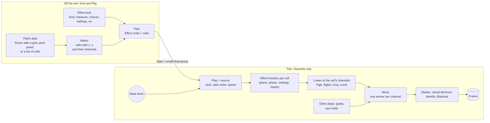
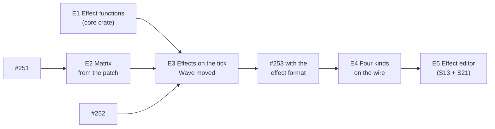

# Effects: functions that paint a matrix through the one mixer

Owner answer `matrix-effects` (24 Nov): effects (Wave, Stripes, Plasma, Sparkle) are their own concept in the engine and are part of version 1. "Effect" is the word on every screen. Replaces one line of the channel design (ch-6: "the engine has no wave, pattern, palette or swatch"). Everything else of [channel-model.md](channel-model.md) stands. Approved by the planner on 24 Nov; built in five steps (section 8). E1, the math, is the crate `effects`.

## 1. The idea in one picture

| An effect is | An effect is not |
|---|---|
| a kind of look: one of four built-in functions over a matrix | a script, a plugin, user code |
| a play when started: a source with rank, start order, speed | a second output path, a layer, its own mixer |
| offers per channel into the one mixer | known to Master, Blackout, holds, routes or Explain's rules |
| a pure function of place, phase, settings and inputs | stateful: nothing is kept between frames, Sparkle included |
| run on a matrix of cells built from Patch data | aware of a fixture or a light |
| described by settings metadata the engine publishes | a recipe the screens compile into curves |

## 2. The data

### Matrix and cell (built off the tick, lives in the plan)

| Matrix field | Type | Limit |
|---|---|---|
| `cells` | ordered list of `Cell` | 1 to 10,922 per look (the work limit at 6 per cell, section 6) |
| `width`, `height` | `u16` | largest `x` + 1, largest `y` + 1. At most 1,024 each |
| `fixed` | list of `(lane, word)` | lanes offered a fixed value: dimmers that carry a cell's colour at full, extra emitters (amber, UV, lime) at 0 |

| Cell field | Type | Limit |
|---|---|---|
| `x`, `y` | `u16` | 0 to 1,023. `y` 0 is the top row |
| `kind` | `Rgb`, `Rgbw`, `Cmy`, `Level` | closed set. `Level` is a dimmer with no colour |
| `lanes` | 3, 4, 3 or 1 lanes in kind order | a lane is a channel `u32` and a word bit (a pair is offered as one 16-bit word) |

| A matrix comes from (`on`) | Cells | Follows |
|---|---|---|
| `Fixture{id}`: a mode with a grid (QLC+ `Layout`), or a pixel strip (one row) | its heads, cell `i` at `(i mod width, i / width)` | the fixture: move, mode change |
| `Panel{id}`: a pixel panel (#222) | its pixels by columns, rows and wiring | the panel: `ChangePanel` rebuilds it |
| `Cells[{fixture, head, x, y}]`: a list | as written. The screens expand a group to one row in group order | each fixture. A group edit changes no effect (ch-5 holds) |

- A cell's kind comes from the head's colour compound (channel design, compounds). A head with no `Rgb`, `Rgbw` or `Cmy` compound and a dimmer is `Level`. Neither: refused `NoCell{fixture, head}`.
- A dimmer that carries the colour of any cell goes into `fixed` once, at full. A shared master dimmer is never two lanes.

### Effect kind and settings metadata (published by the engine)

| `EffectKind` | Settings (ids) |
|---|---|
| `Wave` | `spread`, `direction` |
| `Stripes` | `size`, `direction` |
| `Plasma` | `scale` |
| `Sparkle` | `density`, `rate`, `fade`, `seed`, `background` |

| Setting descriptor field | Type | Notes |
|---|---|---|
| `id` | short stable name | the show file and `SetEffect` use it |
| `name` | words for the screen | "Spread", "Stripe width" |
| `unit` | `Beats`, `Percent`, `Cells`, `PerBeat`, `Times`, `Choice`, `Seed` | the screens pick the control from it: buttons for a `Choice`, a fader otherwise (the fixture metadata rule) |
| `min`, `max`, `default` | `u16` | every value is one `u16` |
| `choices` | names in order | only for `Choice` |

Common to every kind: `measure` (unit `Beats`, 1 to 32, default 4, today's `Period`) and `colours` (1 to 4 `Rgb` words, or `from` a step that lends colours).

### Effect look and effect play

| Effect look (Project, saved) | Type | Limit |
|---|---|---|
| `kind` | `EffectKind` | |
| `measure` | beats | 1 to 32 |
| `colours` | 1 to 4 `Rgb`, or `from: look` | the look is a step with `colours`. None: refused `EmptyPalette` |
| `settings` | by id | each in its range. Missing: its default. Unknown: refused `NoSuchSetting` |
| `on` | one of the three above | missing: a draft, `Start` refused `NoTarget` |
| `recipe` | opaque text, 64 KiB | as for every look: the screens' notes (which group the cells came from) |

An **effect play** is a play like any other (#250 L3): a source entry (rank, start order, start time, speed) and the look's plan, an `Effect` node naming the look's settings slot with one binding per cell. Kept: the frozen moment (the beat count since the start, never wrapped), resampled each frame (#250 D3).

- Effects play inside sequences, as today's Wave (looks.md ways 4 and 5): "Opener: UV, then Plasma". A transition fades per channel word.
- An effect over a group runs on the cells list the screens saved. A group edit changes no byte (ch-5, cx-5): the effect keeps its cells until Apply. Panels and gridded fixtures follow their source.

### What lives where

| Thing | Off the tick | Tick holds | API | Show file |
|---|---|---|---|---|
| Kinds and setting metadata | constants in the effects crate | the kind dispatch | `EffectKinds` read | kind and setting ids |
| Effect look | definition in refs | nothing | `PutLook`, `Looks` pages | `looks[].effect` |
| Matrix | built from `on` and the patch at compile | cells in the plan | cells only through Patch pages | never (derived) |
| Setting values | the look, saved by `PutLook` | one 64 B slot per look (kind, measure, colours, settings): the live values. `SetEffect` changes them; `PutLook` and reopening the show set them back to the saved ones | `SetEffect` (live), `PutLook` (saved). The picture of state shows the live values | `settings`: the saved values |
| Phase, Sparkle choice | | computed every wake from clock, seed, cell and the beats since the start | plays with `started` | never |
| Panel geometry | Project | | `AddPanel`, `ChangePanel`, `RemovePanel` | `panels` section (new) |
| Live music inputs | not in version 1 | nothing. When they come, the painter gains one argument | none | none |

## 3. The four kinds

Shared rules, so tests can be written from this page:

| Rule | Definition |
|---|---|
| Beats `B` | beats since the start of the play x speed, never wrapped. The caller's (the tick's) one input of time |
| Phase `t` | `frac(B / measure)`, once per play per wake |
| Travel coordinate `e` | `direction` Right: `e = x`. Left: `e = -x`. Down: `e = y`. Up: `e = -y`. `D` is `width` for Right and Left, `height` for Down and Up |
| Ramp `R(u)` over `k` colours | `p = frac(u) x k`, `i = floor(p)`, `w = p - i`: `colour[i] x (1 - w) + colour[(i + 1) mod k] x w` per component, cyclic |
| Words and bytes | colours are 16-bit words. Every product is rounded half up once. A byte lane takes the high byte (`word >> 8`, as today). A pair lane takes the word |
| Brightness `b` (0 to 1) | baked into the colour: `c x b`. Carrying dimmers stay full (D13 of #227, cx-4) |
| Lowering | `Rgb`: r, g, b. `Rgbw`: `w = min(r, g, b)`, then r, g, b less `w` (today's shared white). `Cmy`: `65535 - r`, and so on. `Level`: `max(r, g, b)` |
| Inputs | none in version 1. No kind reads music |

In integers (the crate `effects`): time, phases, turns and weights are Q32, `2^32` is one.

| Quantity | Rule |
|---|---|
| `B` | Q32 beats: `1 << 32` is one beat |
| Phase `t` | `floor(B / measure)` mod `2^32`: floored, never reaches 1 |
| Travel and place | `spread x position / (100 x D)` and `scale x x / W`, `scale x y / H` as Q32 turns, floored. `position` is `x` or `y`, never negative: Right and Down subtract the shift from `t`, Left and Up add it. Turns wrap |
| Ramp | `p = u x k`, `i = p >> 32`, `w` the low 32 bits. Word `(colour[i] x (2^32 - w) + colour[i + 1] x w + 2^31) >> 32`: one rounding, half up |
| Stripes | in Q32 cells modulo one repeat `k x size`: `v = e - t x k x size`, `band = floor(v / size)`. `e` is `x mod repeat`, or `repeat - x mod repeat` going back |
| Sine | `1 + sin` in Q16 (0 to 131072) from a table of 257 entries, linear between them, rounded half up. Plasma's `u = (sum of the four) x 2^13`: exact |
| Sparkle | `B x rate` wraps in 64 bits: `n` is its high 32 bits, `f` its low 32. Fade: word `(colour x (2^32 - f) + 2^31) >> 32` |
| Panics | none: divisors are non-zero by type, every product fits 64 bits |

Every fraction in the hand-worked tables below is dyadic, so Q32 gives them exactly. A fraction that is not (measure 3, beat ½) can move a byte at an exact half: green 127 where exact fractions give 128. That row is a test. E3 keeps one phase per play and lists in its commit any byte of `waves_on_the_wire` that moves, with this reason.

### Wave (today's wave, moved)

`u = frac(t - spread x e / D)`, colour `R(u)`, `b = 1`.

| Setting | Unit | Range | Default |
|---|---|---|---|
| `spread` | Percent | 0 to 100 (0: all cells together, a colour fade) | 100 |
| `direction` | Choice | Right, Left, Down, Up | Right |

Today's wave is direction Left: its offset `spread x index / count` is added to the time. The v11 `Wave` maps to it, so `waves_on_the_wire` keeps its bytes.

### Stripes

`band = floor((e - t x k x size) / size) mod k`, colour `colour[band]`, hard edges, `b = 1`. One measure moves the stripes by one whole repeat (`k x size` cells).

| Setting | Unit | Range | Default |
|---|---|---|---|
| `size` | Cells | 1 to 64 | 4 |
| `direction` | Choice | Right, Left, Down, Up | Right |

### Plasma

`S(a) = (1 + sin 2πa) / 2`, with `a1 = s·x/W + t`, `a2 = s·y/H - t`, `a3 = s·(x/W + y/H) + t`, `a4 = s·(x/W - y/H) - t`, `s = scale`.
`u = (S(a1) + S(a2) + S(a3) + S(a4)) / 4`, colour `R(u)`, `b = 1`.

| Setting | Unit | Range | Default |
|---|---|---|---|
| `scale` | Times | 1 to 8 (sine periods across the matrix) | 1 |

- Sine from a fixed Q16 table of a quarter turn (257 entries in the source), linear between entries. Exact at quarter turns. A test checks every entry against the formula, rounded, and points between entries within 2.

### Sparkle

Slot `n = floor(B x rate)`, time in slot `f = frac(B x rate)`. The slot counts from the start of the play, so Sparkle never loops visibly; the rest of every kind stays on the phase.
`key = seed XOR (cell x 0x9E3779B1) XOR (n x 0x85EBCA6B)` (wrapping 32-bit, `cell` the index in the matrix), `h = fmix32(key)` (MurmurHash3's public-domain finaliser).
Lit when `100 x (h AND 0xFFFF) < density x 65536` (exact, no rounding). Colour `colour[(h >> 16) mod k]`. `b = 1 - f` with fade On, else 1. Unlit: black, or no offer when `background` is Through.

| Setting | Unit | Range | Default |
|---|---|---|---|
| `density` | Percent | 1 to 100 | 10 |
| `rate` | PerBeat | 1 to 8 | 4 |
| `fade` | Choice | Off, On | On |
| `seed` | Seed | 0 to 65535 | 1 |
| `background` | Choice | Black, Through | Black |

### Hand-worked tables: 4 by 2 RGB matrix, no dimmer

Cell `i = y x 4 + x`. Measure 4 beats, speed Normal, started on beat 0, so beat 1 is `t = 1/4`. Each entry is the cell's R, G, B bytes. Values were worked from the formulas above with exact fractions, outside the Rust code.

Colours: `RED` = (65535, 0, 0), `BLUE` = (0, 0, 65535), `GREEN`, `WHITE` alike. Purple `P` = (128, 0, 128): the half-way word 32768.

**Wave**, colours RED, BLUE, spread 100, Right. Both rows are equal.

| Beat | x 0 | x 1 | x 2 | x 3 |
|---|---|---|---|---|
| 0 | 255,0,0 | P | 0,0,255 | P |
| 1 | P | 255,0,0 | P | 0,0,255 |
| 2 | 0,0,255 | P | 255,0,0 | P |

**Stripes**, colours RED, BLUE, size 2, Right. Both rows are equal.

| Beat | x 0 | x 1 | x 2 | x 3 |
|---|---|---|---|---|
| 0 | 255,0,0 | 255,0,0 | 0,0,255 | 0,0,255 |
| 1 | 0,0,255 | 255,0,0 | 255,0,0 | 0,0,255 |
| 2 | 0,0,255 | 0,0,255 | 255,0,0 | 255,0,0 |

**Plasma**, colours RED, GREEN, BLUE, WHITE (a two-colour ramp cannot tell `u` from `1 - u`), scale 1. In brackets: `u`.

| Beat | Row | x 0 | x 1 | x 2 | x 3 |
|---|---|---|---|---|---|
| 0 | 0 | 0,0,255 (1/2) | 255,128,128 (7/8) | 0,0,255 (1/2) | 128,128,0 (1/8) |
| 0 | 1 | 0,0,255 (1/2) | 0,128,128 (3/8) | 0,0,255 (1/2) | 128,128,255 (5/8) |
| 1 | 0 | 0,0,255 (1/2) | 0,128,128 (3/8) | 0,255,0 (1/4) | 0,128,128 (3/8) |
| 1 | 1 | 255,255,255 (3/4) | 128,128,255 (5/8) | 0,0,255 (1/2) | 128,128,255 (5/8) |
| 2 | 0 | 0,0,255 (1/2) | 128,128,0 (1/8) | 0,0,255 (1/2) | 255,128,128 (7/8) |
| 2 | 1 | 0,0,255 (1/2) | 128,128,255 (5/8) | 0,0,255 (1/2) | 0,128,128 (3/8) |

**Sparkle**, colours RED, BLUE, density 50, rate 1, fade On, seed 7, background Black. `-` is black. Beat ½ is half-way through slot 0.

| Beat | Slot, f | Row 0: cells 0 to 3 | Row 1: cells 4 to 7 |
|---|---|---|---|
| 0 | 0, 0 | -, -, -, 255,0,0 | -, 0,0,255, 0,0,255, 0,0,255 |
| ½ | 0, ½ | -, -, -, 128,0,0 | -, 0,0,128, 0,0,128, 0,0,128 |
| 2 | 2, 0 | -, 255,0,0, -, 0,0,255 | 0,0,255, 0,0,255, -, - |

| `h` (hex) for the test writer | cell 0 | 1 | 2 | 3 | 4 | 5 | 6 | 7 |
|---|---|---|---|---|---|---|---|---|
| slot 0 | 18c9aec4 | f6b7bbec | ad04f4bc | 6420408b | d13aa416 | e5d10be5 | 85896276 | 16cd0396 |
| slot 2 | 1b23fe5c | 653805ba | 13e0f44c | d7517cce | 61d157f3 | b03b4bfd | dcc9c64c | 2ba997cb |

**Lowering**, one colour on each cell kind:

| Colour words | Rgb | Rgbw | Cmy | Level |
|---|---|---|---|---|
| 65535, 0, 0 | 255,0,0 | 255,0,0,0 | 0,255,255 | 255 |
| 32768, 0, 32768 | 128,0,128 | 128,0,128,0 | 127,255,127 | 128 |
| 65535, 65535, 65535 | 255,255,255 | 0,0,0,255 | 0,0,0 | 255 |
| 65535, 0, 0 at `b` = ½ | 128,0,0 | 128,0,0,0 | 127,255,255 | 128 |

## 4. How an effect meets the mixer

Rank, ties, release and modifiers are `who-wins.md`, unchanged (the mixer in the section 1 picture). The effect only offers: every lane of every cell, its fixed lanes, or a gap per cell.

The 4 by 2 RGB panel of section 3 on channels 0 to 23 (cell `i` at `3i`), plus PAR A (dimmer, R, G, B).

| # | Case | Expected |
|---|---|---|
| 1 | Plasma at Show, alone | section 3 bytes. `source` names the play on all 24 channels |
| 2 | Master at 128 | every colour byte `round(v x 128 / 255)`: 255 to 128. The emitters follow Master because no dimmer carries them |
| 3 | Blackout on, then off | all 24 bytes 0. The play keeps running: off shows the current phase, not the old one |
| 4 | Grab white (Manual) on cell 3's `Rgb` | cell 3 white, the rest Plasma. Release: cell 3 Plasma at the current phase |
| 5 | Raw hold 0 on cell 0's red | that byte 0, its green and blue from Plasma |
| 6 | Wave A (Show) on cells 0 to 7, later Wave B (Show) on cells 4 to 7 and a second panel | cells 4 to 7 from B (from A if A is Manual). Stop B (Reveal): A again, at A's phase |
| 7 | Sparkle, later than a Plasma, both Show | background Through: unlit cells show Plasma (a gap per cell). Black: unlit cells black |
| 8 | A chase step (Show) setting cells 0 to 3 red, started after Plasma | cells 0 to 3 red, 4 to 7 Plasma. The chase's next step that names nothing there: Plasma shows through |
| 9 | Wave on PAR A, then a chase on PAR A's dimmer only | dimmer from the chase, colour from the Wave |
| 10 | Chase first, then the Wave | dimmer 255 from the Wave (D13: full brightness), the chase is covered on the dimmer. With `highest`: 255 too |
| 11 | Sparkle, fade, at f = ½ on a dimmerless cell | colour bytes halved (baked, cx-4), as in the lowering table |
| 12 | A pixel bar with one shared dimmer and 8 heads | shared dimmer 255 once, each head's colour from its cell |
| 13 | Virtual dimmer "Rows" at 50% over the panel | colours scaled after the mix. The effect never writes a control channel |
| 14 | Identify on a panel fixture; Stop with Stay | blinks over the effect as over any source; the frozen colours stay at Show until Release |

## 5. State machine of an effect play

The play machine of the channel design (Queued, Waiting, Playing, Kept, Ended), with the effect rows. Every row is a test.

| From | Event | To | Next frame offers |
|---|---|---|---|
| (none) | `Start`, launch now | Playing | cells at `t = 0` |
| (none) | `Start` on a beat or bar | Waiting | none |
| Waiting | the boundary comes | Playing | cells at `t = 0` from that boundary |
| Waiting | `SetEffect` (live, not saved) | Waiting | none. The new value from the start |
| Waiting | `Stop` | Ended | none |
| Playing | `SetEffect{look, setting, value}` (live, not saved) | Playing | the new value, same `t`, every play of that look |
| Playing | `PutLook`: other kind, colours, measure, settings or `on` | Playing | the edited look in the frame that applies the edit, same beats since start. Live values go back to the saved ones. Channels only an old `on` had stop offering |
| Playing | a fixture of the matrix moves, changes mode, `ChangePanel` | Playing | the same edit rebuilds the cells: new channels, same `t` |
| Playing | tempo change, `SetSpeed` | Playing | `t` continues from where it is, at the new rate |
| Playing | `Stop`, policy Reveal (or `UntilStop`) | Ended | none: lower sources show |
| Playing | `Stop`, policy Stay (or `UntilRelease`) | Kept | the frozen moment (beats since the start), every frame: exactly the last frame, Sparkle included |
| Playing | repeat Once, `t` reaches the end | Kept or Ended by the policy | the last moment |
| Playing | `EndFlash`, or its connection drops (a Manual flash) | Ended | none |
| Kept | `SetEffect`, `PutLook`, a matrix fixture moves | Kept | the frozen moment, sampled with the new values, at the new channels |
| Kept | `ReleasePlay`, `ReleaseAll` | Ended | none |
| Kept | `Start` again | Playing | fresh start at `t = 0` |
| any | Master, Blackout, raw hold, Identify | unchanged | modifiers act after the mix |

| Refused, nothing changes | When |
|---|---|
| `NoTarget` | `Start` on an effect with no `on` |
| `NoMatrix` | `on: Fixture` whose mode has no grid, or a panel that does not exist |
| `NoCell{fixture, head}` | a cell with no colour compound and no dimmer (a hazer in the list) |
| `Duplicate` | two cells name one channel |
| `EmptyPalette`, `NoSuchLook`, `WrongLookKind` | no colours, or colours from a look that is missing or lends none |
| `NoSuchSetting`, `OutOfRange{setting, min, max}` | a setting the kind does not have, a value outside its range |
| `NotAnEffect` | `SetEffect` on a step or a sequence |
| `LookInUse` | `Unpatch` or a mode change that strands a cell, `RemovePanel`, `RemoveLook` of a step that lends colours, of an effect a sequence or pad uses |
| `WorkLimit`, `PlayFull` | as today. An effect too big for the work limit is refused when it is saved, as today's Wave |
| `Locked` | `PutLook` while Lock is on (owner `lock-scope`). `SetEffect` is playing, not editing: allowed with Lock on |

## 6. Real-time

| Call | Choice |
|---|---|
| Where | **on the tick**, inside the play's offer pass, as today's Wave. No helper thread. Per wake: phase once per play (exact clock to a Q32 turn), then `u32` math per cell, lower, offer |
| Why | a setting or a press is in the very next frame; one time base; stepped-clock tests stay exact; no 10,922-cell hand-off copy per wake |
| What decides | the gate below, measured in E1 before E3 starts. If a kind fails it, its booking weight rises (fewer cells admitted). A helper thread is the planner's decision |

| Cost per cell (release, Apple M class) | Estimate ns | Measured in E1: ns per cell p50, p99. Wake of 10,922 `Rgbw` cells p99, worst |
|---|---|---|
| Wave: one subtract, one ramp (3 multiplies) | 6 to 10 | 10.9, 11.7. 128 µs, 140 µs |
| Stripes: one divide, one lookup | 5 to 8 | 9.4, 10.0. 109 µs, 118 µs |
| Plasma: four table sines, one ramp | 15 to 25 | 18.1, 18.8. 205 µs, 223 µs |
| Sparkle: one fmix32, one compare, one scale | 6 to 10 | 6.6, 6.9. 75 µs, 87 µs |
| Lowering and 1 to 4 lane offers | 8 to 20 | lowering to `Rgbw` is in the numbers above; offers are E3's |
| Heaviest cell (Plasma on Rgbw) | about 45 | 18.8 without the offers |

Measured on 24 Nov with the `cost` example: 10,000 wakes at 60 a second on a thread with the engine's real-time policy, machine load about 47 on 10 cores. Plasma's wake holds under 0.5 ms for paint and lower; the full pass line (with offers, in the frame-cost example) is E3's.

| Memory | Size |
|---|---|
| Cell in the plan | 8 B + 4 B per lane: 20 B `Rgb`, 24 B `Rgbw`. 10,922 `Rgbw` cells: 262 KB of the 128 MiB plan budget |
| Settings table on the tick | 1,024 looks x 64 B = 64 KiB, at engine start |
| Per wake, per cell, per play | nothing. No scratch: Sparkle is a hash, kept plays resample |

| Work limit | Rule |
|---|---|
| Booking | an effect cell books what a static step books per light: 6 units with the terminal sample. One `WORK_LIMIT` (#250 D5) |
| Consequence | 10,922 cells of any kind fit, the biggest admitted show. Today a Wave books 16 per pixel and stops at 4,096 |
| Follows | the cells of what plays, never the 1,024-universe ceiling |
| `OFFERS` (#255) | lanes count: 3 per `Rgb` cell, 4 per `Rgbw` |

| Measured | How | Pass line |
|---|---|---|
| ns per cell per kind | `cargo run -q --release -p effects --example cost`: 10,922 `Rgbw` cells per kind, 10,000 wakes, p50 and p99. Paint and lower only, no offers | Plasma cell at most 1.5 x a static step's light in the frame-cost example (#250) |
| Work per wake | the frame-cost example with Plasma on 10,922 `Rgbw` cells over 16 DDP outputs | p99 under 0.5 ms |
| Lateness | `npm run scorecard`, 60 s, same show, the #255 timing gate | p99 lateness at most 1 ms |
| No allocation | `no_alloc` with effect plays, `SetEffect` bursts, a `ChangePanel` swap | zero allocations and frees on the tick |

CI asserts bytes only. Timing is the scorecard's (coding rule 8).

## 7. API and show file

| Command | Meaning |
|---|---|
| `PutLook{id?, name, definition: Effect{kind, measure, colours, settings, on}, recipe, base}` | an effect look: the editor's change. Saved, one undo step, refused while Lock is on. Replies `Saved{look}`. Refusals in section 5 |
| `SetEffect{look, setting, value}` | one setting as a live value: fixed size, in the next frame for every play of the look, works with the window closed and while Lock is on. Not saved, no undo step. `PutLook` and reopening the show set it back to the saved value. Learn can map a fader or a controller to it |
| `Start`, `Stop`, `Flash`, `EndFlash`, `ReleasePlay` | unchanged. An effect plays like any look |
| `AddPanel`, `ChangePanel`, `RemovePanel` | as #222, but the geometry is Project data the engine reads. `ChangePanel` rebuilds every effect on it in the same edit |
| `PutLook` for a step | gains optional `colours` (1 to 4 `Rgb`): what the step lends to effects ("Colours from" in the catalog) |
| Read `EffectKinds` | every kind with its setting descriptors (section 2). The editor is built from it |
| Read `Looks`, `Patch` pages, `Explain` | effect definitions as saved; panels with columns, rows, wiring; origin Look gains the cell index |

Show file, `looks` entry and the new `panels` section:

| Field | Value |
|---|---|
| `effect.kind` | `Wave`, `Stripes`, `Plasma` or `Sparkle` |
| `effect.measure` | 1 to 32 beats |
| `effect.colours` or `effect.colours_from` | 1 to 4 `[r, g, b]` words, or a step's id |
| `effect.settings` | `{ "spread": 100, "direction": "Right" }`: ids and values, choices by name. The app writes every setting |
| `effect.on` | `{ "panel": 1 }`, `{ "fixture": 3 }` or `{ "cells": [ { "fixture": 4, "head": 1, "x": 0, "y": 0 } ] }` |
| `panels[]` | `id`, `name`, `columns`, `rows`, `wiring`, `pixel`, `order`, `fixtures` (in order) |

| #253 changes | |
|---|---|
| Look format | gains `effect`, step `colours`. `Pattern`, `WaveTarget`, `Palette`, `PutPattern` go |
| Show file | gains `panels`. "A pixel panel is fixtures plus a group with a recipe" goes |
| Example show | look 3 "Row breathe" becomes a Wave effect on the Rows strip (fixture 3, one row). S13's "Plasma as a Wave" becomes a Plasma |
| Evidence | adds: a Wave and a Plasma effect reopen with the same bytes; moving a panel fixture moves its cells |

| For the screens | |
|---|---|
| Goes | building curves and offsets for waves, palette links and spread in recipes, the "wave" recipe kind, Apply for waves |
| Stays | curves for hand-made shapes (a pan sweep), steps, sequences, groups as screen lists, recipes as the editor's notes, Apply for steps |
| New | expand a group to a cells list (one row, group order); the effect editor from `EffectKinds` |

## 8. Tickets

| # | Ticket | Owner sees or tries | Owns | Needs | Beside the switch |
|---|---|---|---|---|---|
| E1 | **Effect functions.** New `no_std` crate `effects`: four kinds, ramp, sine table, fmix32, lowering, setting metadata. Table tests from section 3. Lands this document | `cargo run -p effects --example preview -- plasma 80x4`: his four rows as coloured blocks in the terminal, moving on a counted beat. Plus ns per cell per kind | `crates/effects/`, workspace `Cargo.toml` (members line), `scripts/layers.mjs` (one entry) | nothing | yes, now |
| E2 | **Matrix from the patch.** `rig::matrix(on, patch)`: cells, kinds, fixed lanes, refusals | a printout of his example show's panel as cells (x, y, channels) | `rig/src/matrix.rs`, `rig/tests/matrix.rs`, one line of `rig/src/lib.rs` | #251 (compounds, rules), E1 (cell kinds) | yes, beside #252 |
| E3 | **Effects on the tick, Wave moved.** `Effect` node replaces `Node::Wave`; settings table; offers per lane; booking 6 per cell; v11 `Wave` maps to Wave Left | nothing new. `waves_on_the_wire` keeps its bytes; the frame-cost numbers for Plasma | `engine-core/src/{evaluate,wave,lib}.rs` (wave goes), `engine/src/{front,tick}.rs`, `looks/src/pattern.rs`, tests, docs | #252, E1, E2 | no: a chain link between #252 and #253 |
| E4 | **Four kinds on the wire.** `SetEffect`, `EffectKinds`; the section 3 tables as DDP bytes on a 4 by 2 panel; section 4 rows | the four kinds on his WLED rows through the engine with a scripted show (no button yet) | `engine-core/src/api.rs`, `engine-server/`, `ui/src/engine-api.ts`, new `engine-server/tests/effects_on_the_wire.rs` | #253 | no: chain link, one at a time with #254 on `api.rs` |
| E5 | **Effect editor.** S13's Wave part and S21's kinds, one slice: shape, measure, colours, settings from metadata, runs on, Play on lights. Renames the catalog's "pattern" rows to "effect" | in the app: Plasma on the rows, a fader changes Stripe width live | `ui/src/screens/looks/` (effect editor), `e2e/effects.spec.ts` | E4, S10, S12, the owner's approval of one generic "Effect setting" row in the catalog (buttons for a choice, a fader otherwise) | screens slice |

- E1 and #250 stay independent: L3 does not wait for E1 and does not call it. E3 moves the wave.
- E1's `cost` example measures on `rt-thread`, a dev-dependency of `effects`. When E3 makes `engine-core` depend on `effects`, that is a dev-dependency cycle: Cargo allows it and builds a second copy of `effects` for the example. Keep it, or move the example to `engine` then.
- E2 after #251, E3 between #252 and #253, #253 takes the format table of section 7, E4 after #253.
- #255 runs its 60 s gate with the Plasma show of section 6.
- Not in version 1: scripts, user-made effects, music inputs, effects on position channels.

## 9. What it replaces in existing docs

E1 adds a pointer to this page at `channel-model.md` line 270 and under the decision row of `theory.md`. Each change below lands with the ticket that changes the behaviour.

| File | Lines | Change |
|---|---|---|
| `docs/design/channel-model.md` | 13, 20, 27, 44 | screens build curves for hand-made shapes only; sources gain effect plays; the tick knows effect kinds and cell kinds (`Rgb`, `Rgbw`, `Cmy`, `Level`), still no fixture, light or head; ch-6 row: the engine plays curves and effects |
| | 264, 269, 270, 341 | the 8,192-pixel wave as curves, "a wave is Linear segments", "no wave, pattern, palette or swatch": replaced by this design. Palette link and spread leave the recipe |
| | 358, 379, 397, 409, 413 | `PutLook` gains `Effect`, plus `SetEffect`, `EffectKinds`; wave types become effect types; show file gains `panels`; `wave.rs` moves to `effects`; `Pattern::Wave`, `WaveTarget`, Palette become the effect look |
| `docs/design/theory.md` | 120, 162, 177, 384 | layer table as above; recipe "(group, order, palette, spread)" keeps group and order; "a pattern (generated motion)" is an effect built into the engine; "a light, fixture or colour in the engine core" (X2) becomes "a light or fixture": the tick knows cell kinds and lowering (E3) |
| | 370, 412 | new kind of effect: one more kind in a closed set, with its metadata; the decision row becomes `matrix-effects` |
| `docs/design/looks.md` | 25, 138, 153 | Pattern becomes Effect; open point 3 answered by section 3 |
| `docs/design/show-file-format.md` | 21 to 22, 101, 178, 211, 216 to 236 | `panels` section; example look 3; panels as data; "the order patterns run in"; `effect` and step `colours` fields |
| `docs/design/who-wins.md` | 7 | "steps, sequences, patterns": steps, sequences, effects |
| `docs/design/controls.md` | 262, 1552 to 1555 | `SetPattern` and the pattern editor rows: shape, measure, colours, runs on, plus settings from metadata |
| `.claude/decisions/crew/plans/screens-recut.md` | 102, 110, 232 | S13 and S21 cut again as E5 |
| Issues | #227, #223, #222, #253 | #227 and #223's Wave part fold into E4 and E5; #222 panel geometry as data; #253 the table in section 7 |
