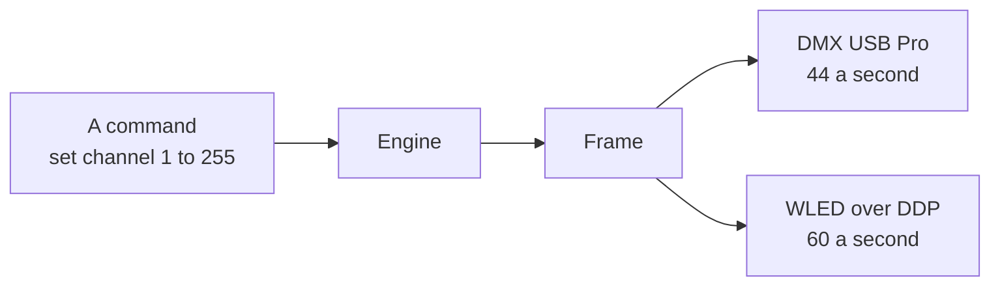
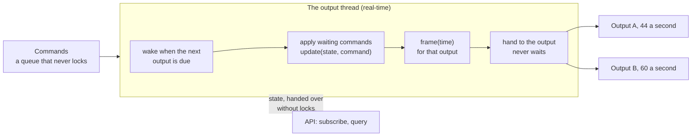
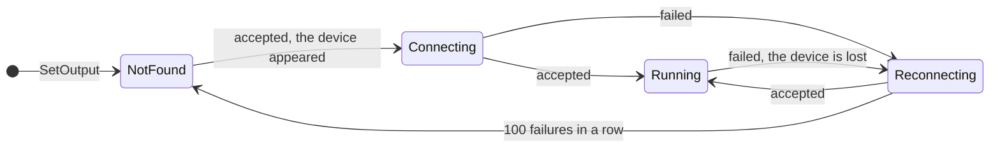
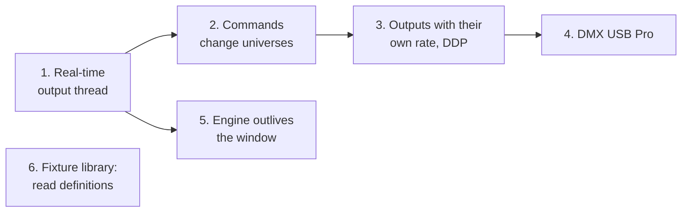

# Engine, first slice: from a command to light

The stack is confirmed (2026-11-18, issue #25). This is the first buildable slice of the engine. No product UI: that waits for the storyboard catalog (#102).

## What it proves

A command goes in through the API, and real light comes out of two different outputs at two different rates, with exact timing.

## Decisions it builds on

| Decision | From |
|---|---|
| Rust engine, web UI, Tauri shell | #25 |
| The engine is its own process and outlives the window | #25 |
| The output thread runs with the real-time policy | #23, #25 |
| A press is in the very next frame | #24, #25 |
| The rate belongs to each output | [theory.md](theory.md), idea 1 |
| Everything is a command. State flows one way | [../coding.md](../coding.md), rule 2 |

## The real-time core: one thread, many outputs

| Choice | Why |
|---|---|
| **One** real-time thread serves every output | no state is shared between threads, so nothing needs a lock |
| It wakes when the next output is due | each output keeps its own rate. No global tick |
| Commands are applied right before a frame | a press is in the very next frame of every output |
| Handing a frame to an output never waits | a slow or lost device cannot hold up the others. A frame that cannot be handed over is dropped and counted |
| Buffers belong to the caller | the core crate stays without `alloc` |

## Where the code goes

| Crate | Kind | Holds |
|---|---|---|
| `engine-core` | core: no `std`, no `alloc` | state, commands, `update`, `frame(time)`, the schedule of what is due |
| `engine` | action | the output thread, the command queue, the hand-over of state |
| `rt-thread` (new, tiny) | action | the one place that asks the system for real-time priority. The only `unsafe` |
| `outputs` (new) | action | DDP, DMX USB Pro, a mock. Each: hand over a frame, report its state |
| `fixture-library` (new) | calculation, may use the heap | reads fixture definitions |
| `engine-server` | action | the API: `send`, `subscribe`, `query` |

The allowed edges are added to `scripts/layers.mjs` with each crate.

## An output is a state machine

Every output counts frames accepted, dropped and failed. "On time on the host" is not enough: the first DMX USB Pro run of the spike was minutes behind on the wire while the host numbers looked perfect.

## The six tickets

| # | Ticket | Ends in | Parent |
|---|---|---|---|
| 1 | Real-time output thread | tick lateness under 1 ms at p99 on a Mac, shown in the scorecard | #27 |
| 2 | Commands change universes | a command sent over the API shows up in the very next frame | #26 |
| 3 | Outputs with their own rate, DDP | a WLED device at 60 and a second output at 44 from one engine | #44 |
| 4 | DMX USB Pro output | a real adapter, unplug and replug survive | #42 |
| 5 | Engine outlives the window | kill the window, the lights go on. A hidden window does not slow them | #26 |
| 6 | Fixture library: read definitions | QLC+ fixture files become a searchable model | #41 |

## Not in this slice

| Later | Why |
|---|---|
| Lights instead of channels (Rig, patch) | needs the fixture library first |
| Looks, the Mixer's who-wins table | needs the Rig |
| Any product screen | waits for the storyboard catalog (#102) |
| Art-Net, sACN, Open DMX | same shape as DDP and the Pro, once those two stand |
