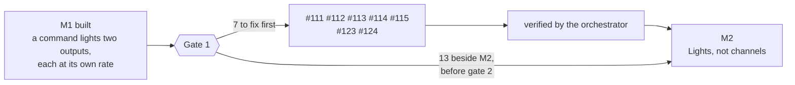
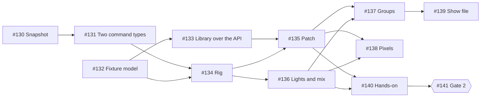

# Gate 1: review after M1, and the design of M2

Issue #109. Reviewed commit `63d9fd1`, by a fresh session that read the repository, the issues and its own measurements only.

## Verdict: fix first

| | |
|---|---|
| What holds | the seam between core, engine and outputs. Timing: p99 lateness 0.1 to 0.4 ms, and 0.7 ms at the limits the API allows. `npm test` green |
| What does not | the engine can stop waking for minutes (#111). Any web page can stop it (#112). The DMX adapter fails in three ways no test reaches (#113, #114, #115) |
| Why the tests did not see it | no test removes the last output, none sets the adapter through the API, six depend on timing (#123), and the scorecard counts wrong (#124) |

## Findings, most severe first

Each has a failing scenario that was run, or a number that was measured. All are labelled `gate-finding`.

| Issue | Severity | Finding | Evidence |
|---|---|---|---|
| #111 | critical | the engine stops waking after the last output is removed | 30 s at 60 a second, removed: 10.8 s of nothing. 60 and 44: 40.0 s. `Stop` took 24.1 s |
| #112 | high | any web page can command or stop the engine | a handshake from a foreign origin is answered 101 |
| #113 | high | a DMX USB Pro output cannot be replaced or added again | the new port is opened while the old device holds it, exclusive |
| #114 | high | a lost adapter can come back as another adapter | found by position on every reconnect |
| #115 | high | a stalled adapter shows Running for ever | no deadline on a full driver queue. A test pins it |
| #116 | medium | a device that is not there yet is refused, not shown as not found | `CannotOpen`, no output in the state |
| #117 | medium | `SetOutput` accepts what a kind cannot do | 4 universes on one adapter: accepted, 1 sent |
| #118 | medium | a misspelled field is accepted | `"Rate": "30"` runs at 60 |
| #119 | medium | a DDP output flaps and never opens its socket again | nothing listening: Running in 49 of 60 looks, 188 accepted, 47 failed |
| #120 | medium | the state does not say what an output is | a window that adopts an engine cannot know the device |
| #121 | medium | the shell: quit can hang, a second window can stop an engine in use | no timeout before the kill, no single instance |
| #122 | medium | a fixture file of 11 kB takes 513 MB | two entities in a DOCTYPE |
| #123 | medium | tests still depend on timing, the check does not see them | six tests, one that cannot fail |
| #124 | medium | the scorecard reports wrong numbers | `engine-core`: 126 lines reported, 660 counted |
| #125 | low | the tick thread spins | 4.5% of a core with no output, 31% with 16 |
| #126 | low | 28 public names nobody uses, two checks that check spelling | |
| #127 | low | the fixture search misses and misranks | "rgb" does not find "(RGB)" |
| #128 | low | docs that no longer say what the code does | nine places |
| #129 | low | small things | |
| #142 | low | 24 wrong changes the tests would not catch | mutation testing |

## The seven parts

| Part | Answer |
|---|---|
| 1. Rules | held wherever a check sees them. Beyond the checks: an error where rule 6 asks for a state (#116), wrong values accepted (#117, #118), a second copy of state forced on clients (#120), device swaps decided beside `update` |
| 2. Design | the modules are deep where it counts: `outputs` hides bytes and devices behind one operation. Two shapes will not carry a patch: the state leaves the tick thread field by field, and one command type serves clients and the engine's own events. Both are the first tickets of M2 (#130, #131) |
| 3. Generality | see below |
| 4. Truth | #128 |
| 5. Numbers | see below |
| 6. Tests | the tables are good where they exist. Missing: the last output removed, the adapter through the API, a stalled or absent or swapped adapter. #123 and #142 |
| 7. Next slice | [lights-slice-2.md](lights-slice-2.md), tickets #130 to #141 |

## Generality: did the second output fit

| Question | Answer |
|---|---|
| What #106 changed outside `crates/outputs` | one row in the list of kinds (`kinds.rs`, 3 lines), the generated type, tests, docs, one check |
| Logic in the core, the output thread, the API | none changed |
| So | yes, the interface held: an adapter is a `Device` that takes a frame |
| What the interface did not carry | replace (#113), not there yet (#116), what a kind can take (#117), and what "accepted" means: the device's own thread took it, not the wire |

The port thread is the right answer for a device that can stall. It stays private to the adapter until a second serial kind exists.

## Numbers: the baseline for gate 2

| Number | Before M1 (`50e7d43`) | After M1, as the scorecard prints it | After M1, counted file by file |
|---|---|---|---|
| Lines in calculation crates | 25% (64 of 251) | 42% (641 of 1539) | 51% (1175 of 2310) |
| Public items: `engine-core`, `engine`, `outputs` | 11, 6, none | 17, 15, 9 | 70, 15, 32. Names with re-exports: 94, 55, 36 |
| Escape hatches: allow, expect, lint-disable, unsafe | 0, 1, 0, 5 | 1, 7, 0, 14 | the same. In the product: 4 unsafe, all in `rt-thread` |
| Tick lateness p99 | 12.6 ms | 0.1 ms (60 a second), 0.4 ms (44), worst 0.4 | release build: 0.1 and 0.2 ms, worst 0.3 |
| Intervals off by more than 2 ms, 60 s | not counted | 0 | 0 |
| Send to frame p95 | none | 22.0 and 22.1 ms, two runs. Limit 27.7 | counts the wake, not the frame (#124) |
| Mutation score | none | 87%: 215 caught, 24 missed, 8 timed out, 36 did not compile | matches the raw files |

At the limits (release build, a MacBook Pro with an M1 Max, real-time granted, 20 to 30 s each):

| Outputs, universes each | Worst p99 | Worst | Off beat, dropped, failed | CPU of one core |
|---|---|---|---|---|
| none | | | | 4.5% |
| 2, 1 | 0.2 ms | 0.3 ms | 0 | 11% |
| 16, 1 | 0.3 ms | 0.3 ms | 0 | 31% |
| 1, 64 | 0.1 ms | 0.1 ms | 0 | 9% |
| 16, 64 | 0.7 ms | 1.1 ms | 0 | 54% |

## M2 at a glance

| Question on the decision page | Recommended |
|---|---|
| 40. Two fixtures on the same addresses | refuse, with the reason |
| 41. A small show file in M2 | yes, patch and groups only |
| 42. A raw channel against a light | raw wins until released |
| 43. How much of a light in M2 | intensity and colour mixing. Wheels and pan and tilt next |

## Not verified

| | |
|---|---|
| Hardware | no adapter and no WLED device were used. #113, #114 and #115 come from the code and from the serial driver's documented behaviour. The sleep check of #106 was not run |
| Other systems | Linux, Windows and CI were not run |
| Long runs | lateness was measured for 20 to 60 s, while other work ran on the same machine |
| The catalog (#102) | not part of M1, not reviewed |
| Refuted by a run, so not findings | `Stop` with three subscribers (all closed clean, 20 ms). `Stop` with a client that never reads (41 ms). A blocking device open (1.5 ms without an adapter). The real-time thread losing its priority at 16 outputs (0 off beat) |
