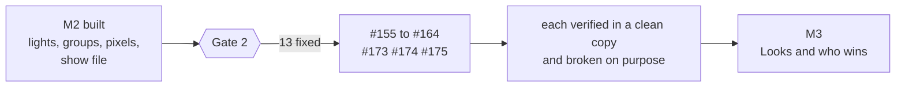
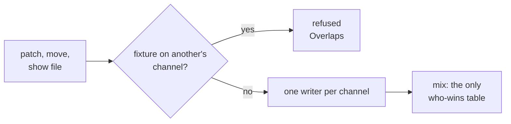
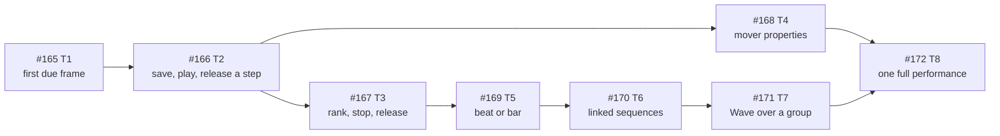

# Gate 2: review after M2, and the design of M3

Issue #141. Reviewed commit `3cd3ce0`, by a fresh session (Codex gpt-6.2-sol, xhigh, read-only) that read the repository, the issues and the supplied timings. Every finding was then verified by the orchestrator with a failing test (or, for two, a failing break) before it was filed.

## Verdict: pass, after the fixes

| | |
|---|---|
| What holds | one place decides between two values (the Mixer, `mix.rs`). Adding pixels (RGBW, 300 lights) changed nothing in the resolver, the tick loop or the output code |
| What did not | a patch the output cannot fully send (#155), two heads on one channel decided outside the Mixer (#156), a torn picture (#158), a comment that hides a DOCTYPE from the fixture guard (#161) |
| Two were regressions of gate 1 fixes | #161 (of #122) and #162 (of #121) |
| Why the tests did not see it | the pixel test used RGBW only, the DOCTYPE guard read text and not the prolog, the shell lock was keyed by address, not by engine |

## Findings, most severe first

Each has a failing scenario. All are labelled `gate-finding`.

| Issue | Id | Severity | What broke | Fix | Status |
|---|---|---|---|---|---|
| #155 | G1 | must | DDP RGB on universes 1 to 2 sends 1023 bytes. 171 RGB pixels at 1:512 accepted, byte 1024 never sent. Also 1 RGB light at 2:510 | `eb632bf` the patch is refused at the command, `outputs` says what a kind sends | closed |
| #156 | R1 | should | two heads naming one dimmer: head 1 full gives 0, only the later head had a writer | `28cea85` every head gets a writer, then decision 48 (`a678055`) made the case impossible | closed |
| #161 | R3 | should | `<!-- <!DOCTYPE x> -->` before a real DOCTYPE with an entity: admitted, maker "Evil". Entity bomb behind it still stopped by roxmltree | `6e342f1` the DOCTYPE is looked for in the real prolog | closed |
| #162 | R4 | should | one engine on `0.0.0.0`, windows via `127.0.0.1` and the LAN address: quitting the second stops the engine the first uses | `ebbf189` one lock per port for every address of this machine | closed, see not verified |
| #158 | D1 | should | a picture said output 1 Running in the state and gone from the project: 49 of 673 pictures | `5f803d1` each picture pairs a snapshot with its project and patch | closed. After: 0 torn of 291 (34 before) |
| #159 | D2 | should | a rename in a 60 MiB show held the front lock and wrote the show twice: replies 61 to 140 ms, another client waited | `4b9d039` the size check sums kept parts, a definition is encoded once | closed |
| #160 | R2 | should | red `Default="200"`, only intensity set: `[255,0,0,0]`, wanted `[255,200,0,0]` | `13e9fbf` intensity and colour are each held or not | closed |
| #157 | N1 | should | output 2 handed 3 ms into its wake reports 123 ns late | `9e92f89` each take is stamped on its own | closed |
| #163 | V1 | should | the picture cannot say what colour a PAR holds | `fe08741` the picture carries every light's held parts | closed |
| #164 | V2 V3 N2 T2 T3 | later | stale output diagram, theory says only M1 built, scorecard counts a private `pub`, group test accepts half a command, a counter that cannot fail | `29c04a1` | closed |
| | T1 | later | refusal timing test: PLAUSIBLE only. First `Failed` at send 1 in 40 of 40 tries, about 100 times inside the window | none | not a finding |
| #173 | | decision | decision 48, see below | `a678055` | closed |
| #175 | | must | a Rust test failed sometimes after #174: a send loop ended before the refusal came, and a free port was taken between pick and bind | `62bb58b` paced until the outcome, the engine prints the port it holds | closed |
| #174 | | measured | at 16 outputs of 64 universes the takes run in a row on the tick: lateness p99 1.8 ms, wanted under 1 ms (#130 box 6) | `e2b8edb` each output sends on its own real-time thread | closed |

## The Mixer result

| Where it was decided | Now |
|---|---|
| rig: the later of two heads owns a channel | gone. Patches never overlap, and a channel two heads name is the fixture's own (a shared dimmer, a strobe): the fixture is a light, one writer |
| fixture: one shutter fallback, RGBW as the minimum of three | kept, from the definition. Not a choice between two values |
| set and release replace a hold, UI deltas replace a byte | replacement, not a contest |
| mix.rs row 48 | removed, with its rows. `who-wins.md` and the Mixer table say why |

Decision 48: patches never overlap, one writer per channel. No command changes a mode, so nothing more to guard.

## Numbers: gate 1 against now

The reviewer's own table is in the notes. After #174 measured at 62bb58b on a busy MacBook (load about 48); a quiet-Mac rerun stays with the owner.

| Number | Gate 1 (counted) | Now | After #174 |
|---|---|---|---|
| Lines in calculation crates | 51% (1175 of 2310) | 56% (3714 of 6594) | 54% (3924 of 7259) |
| Public items: `engine-core`, `engine`, `outputs` | 70, 15, 32 | 197, 69, 25 | 88, 63, 25 (scorecard counts only reachable items since #164) |
| New crates | | `rig` (22 items, 811 lines), `show-file` (5, 220) | `rig` 9, 867; `show-file` 5, 268 |
| Escape hatches: allow, expect, lint-disable, unsafe | 1, 7, 0, 14 | 7, 19, 0, 14. Product `unsafe`: 4, all in `rt-thread` | 7, 21, 0, 14 |
| Tick lateness p99, 60 s | 0.2 ms | after #157 stamps each take | 63 µs, 0 off beat |
| Lateness p99, 16 outputs of 64 universes | 0.7 ms | 1.8 ms (#130 box 6) | 0.6 ms (worker, calmer machine); 1.3 ms here under load 48; 0 off beat in both |
| Send to frame p95 | 22.0 ms | 21.8 ms, after `take` | 21.7 ms |
| Mutation score | 87% | | not run for the whole repo; per commit in the closing comments |

The jump of the 16 by 64 row is not a regression: gate 1 stamped the wake, not the take (#157). The 105 µs of one DDP take, 23 sends inline, is why #174 exists.

## M3 at a glance

Spec: [looks-slice-3.md](looks-slice-3.md). Tickets #165 to #172, all blocked by #141.

## Not verified

| | |
|---|---|
| #162 | the fix is shell-only. The LAN scenario (`gate2-verify-R4`, needs `en0` and a hand-started engine) was not added to the repo or run after the fix. The unit table of addresses passes. An identity issued by the engine was the first proposal and is not built |
| Windows | folder sync of the show file, Linux and CI were not run |
| #119 | the by-hand box (a DDP output with a listener started late) is open |
| #140 | parked by the owner, no real rig. Hands-on evidence for M2 comes from the adapter-only checks of #106 |
| Hardware and corpus | no adapter, no WLED device, no full QLC+ fixture corpus. The reviewer's sandbox could not run `cargo`, so its findings were source traces until verified |
| Mutation | no mutation run for M2 |
