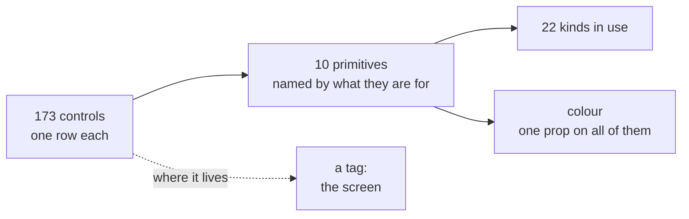

# The kit: ten primitives, and what every control is made of

Written by `node scripts/write-kit-doc.mjs` from `ui/src/controls` and `ui/src/catalog/compose.ts`. Change the data there, never this file.
The catalog shows the same as live pages, primitives first: `npm run catalog`.

| Rule |  |
| --- | --- |
| A primitive is named by what it is for | never by where it is used |
| A control is a primitive with props | or a few together: a stepper is two Buttons and a Status |
| Colour is a prop | the same six on every primitive. Row colours only say whose a thing is |
| The behaviour table stays the truth | `kit` on a row names the primitive and the kind. What the control does, sends and shows is the row |

## The primitives

| Primitive | Is for | Kinds | Controls | Carried inside |
| --- | --- | --- | --- | --- |
| **Button** | Do it, or switch it | action, toggle | 86 | 7 |
| **Pad** | Play a look | one | 3 | – |
| **Fader** | Set one value | one | 8 | – |
| **XY** | Set two values at once | one | 2 | – |
| **Picker** | Choose one of a few | tabs, segments, cards, list | 30 | – |
| **Field** | Give a value in words or in steps | text, search, steps | 16 | – |
| **Status** | Read a state. Never pressed: no control is one, many carry one | lamp, pill, flag, value | – | 29 |
| **Item** | A thing where it lives: pick it, open it, take it out | row, tile, cell, entry, chip, strip | 19 | – |
| **Block** | A thing placed in time or on a grid: arrange it | bar, frame | 5 | – |
| **Handle** | The edge of a thing: only dragged | edge, corner | 4 | – |

## Colour

| Colour | Means | Token |
| --- | --- | --- |
| plain | nothing special | an outline, paper when on |
| paper | now, or the one main action | `--paper` |
| manual | your hands | `--layer-manual` |
| show | the show | `--layer-show` |
| autopilot | the autopilot | `--layer-autopilot` |
| danger | blackout, recording, trouble | `--danger` |
| mute, ok, warn | a lamp only: ready, connected, look here | `--mute`, `--ok`, `--warn` |

## Every control, by primitive and kind

Fixed props are the ones that never change for the control. Its words, its state and its value come from the row.

### Button, action (60)

| Control | Name | Where | Colour | Fixed props | Carries |
| --- | --- | --- | --- | --- | --- |
| Trouble chip | `top.trouble` | Top bar | danger | holds: 4 lines |  |
| Tap | `top.tap` | Top bar | plain | fires: down |  |
| Tempo source | `top.tempo.source` | Top bar | manual | fires: down |  |
| Blackout | `top.blackout` | Top bar | danger | fires: down, held: short press and hold, holds: 3 lines |  |
| Undo | `top.undo` | Top bar | plain | holds: 2 lines |  |
| Cancel Learn | `top.learn.cancel` | Top bar | plain |  |  |
| Release one | `console.running.release` | Console | manual | fires: down, holds: 3 lines |  |
| Stop one | `console.running.stop` | Console | show | fires: down, holds: 2 lines |  |
| Release all | `console.running.release-all` | Console | manual | fires: down |  |
| Add page | `console.pages.add` | Console | plain |  |  |
| Surprise me | `console.surprise` | Console | plain | fires: down |  |
| Edit surface | `console.edit-surface` | Console | plain |  |  |
| Done editing | `console.done-editing` | Console | plain |  |  |
| Go | `console.cue.go` | Console | plain | fires: down, holds: 3 lines |  |
| Back | `console.cue.back` | Console | plain | fires: down, holds: 2 lines |  |
| Remove widget | `console.widget.remove` | Console | plain |  |  |
| Sections look right | `songs.sections-look-right` | Songs | plain |  |  |
| Undo last pass | `songs.recorded.undo-last-pass` | Songs | plain |  |  |
| Clear recorded | `songs.recorded.clear` | Songs | plain |  |  |
| Rename section | `songs.section.rename` | Songs | plain | holds: 3 lines |  |
| Split section | `songs.section.split` | Songs | plain |  |  |
| Merge with next | `songs.section.merge` | Songs | plain |  |  |
| Fill empty sections | `songs.fill-empty` | Songs | plain |  |  |
| New group | `looks.library.new-group` | Looks | plain |  |  |
| Rename group | `looks.library.group.rename` | Looks | plain |  |  |
| Delete group | `looks.library.group.delete` | Looks | plain |  |  |
| Breadcrumb | `looks.crumb` | Looks | plain |  |  |
| Back to the outer sequence | `looks.back` | Looks | plain |  |  |
| Put on Console | `looks.put-on-console` | Looks | plain |  |  |
| Set a property | `looks.step.set` | Looks | plain |  |  |
| Clear a property | `looks.step.clear` | Looks | plain |  |  |
| Remove a colour | `looks.step.colour.remove` | Looks | plain | glyph: ×, own: #ff3b30 |  |
| Add a colour | `looks.step.colour.add` | Looks | plain | glyph: +, own: #ffb300 |  |
| Open an item | `looks.seq.open` | Looks | plain |  |  |
| New style | `looks.autopilot.new-style` | Looks | plain |  |  |
| Use this style | `looks.autopilot.use-style` | Looks | plain |  |  |
| Delete style | `looks.autopilot.delete-style` | Looks | plain |  |  |
| Remove rule | `looks.autopilot.rule.remove` | Looks | plain |  |  |
| Add a rule | `looks.autopilot.add-rule` | Looks | plain |  |  |
| Add lights | `patch.add-lights` | Patch | plain | holds: 2 lines |  |
| Move to a free address | `patch.details.move-to-free` | Patch | plain |  |  |
| Leave for now | `patch.add.leave` | Patch | plain |  |  |
| Next | `patch.add.next` | Patch | plain | holds: 3 lines |  |
| Yes, that is this one | `patch.add.confirm` | Patch | plain |  |  |
| Nothing flashed | `patch.add.nothing-flashed` | Patch | plain |  |  |
| Back | `patch.add.back` | Patch | plain |  |  |
| Start over | `patch.add.start-over` | Patch | plain |  |  |
| Add the panel | `patch.panel.add` | Patch | plain |  |  |
| Zero | `dmx.channel.zero` | DMX | plain | fires: down |  |
| Full | `dmx.channel.full` | DMX | plain | fires: down |  |
| Release the channel | `dmx.channel.release` | DMX | plain | fires: down |  |
| Release in the list | `dmx.held.release` | DMX | plain | fires: down |  |
| Release channels | `dmx.held.release-all` | DMX | plain | fires: down |  |
| Tap, on In/Out | `inout.tempo.tap` | In/Out | plain |  |  |
| Test a mapping | `inout.mapping.test` | In/Out | plain | holds: 3 lines |  |
| Remove a mapping | `inout.mapping.remove` | In/Out | plain |  |  |
| Release | `how.release` | How it works | plain |  |  |
| Walk: Back, Next, Again | `how.walk.step` | How it works | plain | holds: 4 lines |  |
| Trace a press | `modules.trace` | Modules | plain |  |  |
| Screen that uses a module | `modules.jump` | Modules | plain |  |  |

### Button, toggle (26)

| Control | Name | Where | Colour | Fixed props | Carries |
| --- | --- | --- | --- | --- | --- |
| LIVE switch | `top.live` | Top bar | plain | mark: knob, size: large, holds: 2 lines |  |
| DJ link indicator | `top.indicator.dj` | Top bar | plain | mark: lamp, quiet, lamp: ok |  |
| Recording indicator | `top.indicator.recording` | Top bar | danger | mark: lamp, quiet |  |
| Autopilot indicator | `top.indicator.autopilot` | Top bar | autopilot | mark: lamp |  |
| Lock indicator | `top.indicator.lock` | Top bar | plain | mark: lamp, quiet |  |
| Learn | `top.learn` | Top bar | plain | held: short press and hold, holds: 3 lines |  |
| Fold Running | `console.running.fold` | Console | plain | mark: chevron, quiet |  |
| Autopilot on or off | `console.autopilot.on` | Console | autopilot | holds: 2 lines |  |
| Library filter | `songs.filter` | Songs | plain |  |  |
| Play from a section | `songs.play-from` | Songs | plain | fires: down, holds: 3 lines |  |
| Mute recorded | `songs.recorded.mute` | Songs | show | holds: 2 lines |  |
| Mute show | `songs.show.mute` | Songs | show |  |  |
| Widen the library | `looks.library.widen` | Looks | plain | holds: 3 lines |  |
| Fold a group | `looks.library.group.fold` | Looks | plain | mark: chevron, quiet |  |
| Which fixtures | `looks.step.fixtures` | Looks | plain |  |  |
| Lights it may use | `looks.autopilot.lights` | Looks | plain |  |  |
| Pixel panel in the list | `patch.universes.panel` | Patch | plain | mark: chevron, quiet |  |
| Add a pixel panel | `patch.add-panel` | Patch | plain |  |  |
| Flash it | `patch.details.flash` | Patch | plain | fires: down |  |
| Patched only | `dmx.filter.patched` | DMX | plain |  |  |
| Changing | `dmx.filter.changing` | DMX | plain |  |  |
| Test an output | `inout.out.test` | In/Out | plain | fires: down, holds: 3 lines |  |
| Edit a mapping | `inout.mapping.edit` | In/Out | plain | holds: 3 lines |  |
| Mapping feedback | `inout.mapping.feedback` | In/Out | plain | holds: 3 lines |  |
| Record | `how.record` | How it works | plain | holds: 2 lines |  |
| Replay on Show | `how.replay` | How it works | plain | holds: 2 lines |  |

### Pad (3)

| Control | Name | Where | Colour | Fixed props | Carries |
| --- | --- | --- | --- | --- | --- |
| Look pad | `console.pad` | Console | plain |  | Status.flag + Status.pill |
| Play on lights | `looks.try` | Looks | plain |  | Status.flag + Status.pill |
| Pad to try | `how.pad` | How it works | plain |  | Status.flag + Status.pill |

### Fader (8)

| Control | Name | Where | Colour | Fixed props | Carries |
| --- | --- | --- | --- | --- | --- |
| Fader | `console.fader` | Console | plain |  | Status.value |
| Step dimmer | `looks.step.dimmer` | Looks | plain |  | Status.value |
| Step spin | `looks.step.spin` | Looks | plain |  | Status.value |
| Spread | `looks.seq.spread` | Looks | plain |  | Status.value |
| Transition | `looks.seq.transition` | Looks | plain |  | Status.value |
| How wild | `looks.autopilot.wild` | Looks | plain |  | Status.value |
| Channel fader | `dmx.channel.fader` | DMX | plain |  | Status.value |
| Master to try | `how.master` | How it works | plain |  | Status.value |

### XY (2)

| Control | Name | Where | Colour | Fixed props | Carries |
| --- | --- | --- | --- | --- | --- |
| Movers position | `console.xy` | Console | plain |  |  |
| Step position | `looks.step.position` | Looks | plain |  |  |

### Picker, tabs (3)

| Control | Name | Where | Colour | Fixed props | Carries |
| --- | --- | --- | --- | --- | --- |
| Workspace tabs | `top.workspaces` | Top bar | plain |  |  |
| Console pages | `console.pages` | Console | plain |  |  |
| Universe tabs | `dmx.universe` | DMX | plain |  |  |

### Picker, segments (13)

| Control | Name | Where | Colour | Fixed props | Carries |
| --- | --- | --- | --- | --- | --- |
| Speed | `console.speed` | Console | plain | fires: down |  |
| Looks or Autopilot | `looks.part` | Looks | plain |  |  |
| Type filter | `looks.library.type` | Looks | plain |  |  |
| Item speed | `looks.seq.speed` | Looks | plain |  |  |
| Loop or once | `looks.seq.repeat` | Looks | plain |  |  |
| Runs on | `looks.pattern.runs-on` | Looks | plain |  |  |
| Wiring | `patch.panel.wiring` | Patch | plain |  |  |
| Pixel type | `patch.panel.pixel` | Patch | plain |  |  |
| Brightness among equals | `dmx.who-wins.brightness` | DMX | plain | size: small |  |
| Manual control ends | `dmx.who-wins.manual-ends` | DMX | plain | size: small |  |
| When a look ends | `dmx.who-wins.look-ends` | DMX | plain | size: small |  |
| Follows | `inout.follows` | In/Out | plain |  |  |
| Pick a walk | `how.walk` | How it works | plain |  |  |

### Picker, cards (5)

| Control | Name | Where | Colour | Fixed props | Carries |
| --- | --- | --- | --- | --- | --- |
| Gobo | `looks.step.gobo` | Looks | plain |  |  |
| Pattern shape | `looks.pattern.shape` | Looks | plain |  |  |
| Pick a model | `patch.add.model` | Patch | plain |  |  |
| Pick a mode | `patch.add.mode` | Patch | plain |  |  |
| Tempo feed | `inout.tempo.feed` | In/Out | plain |  |  |

### Picker, list (9)

| Control | Name | Where | Colour | Fixed props | Carries |
| --- | --- | --- | --- | --- | --- |
| Autopilot style | `console.autopilot.style` | Console | plain |  |  |
| Add to a group | `looks.groups.add` | Looks | plain |  |  |
| Colours from | `looks.pattern.colours` | Looks | plain |  |  |
| Rule: when | `looks.autopilot.rule.when` | Looks | plain |  |  |
| Rule: pick one from | `looks.autopilot.rule.pick` | Looks | plain |  |  |
| Rule: fit | `looks.autopilot.rule.fit` | Looks | plain |  |  |
| Never dark | `looks.autopilot.never-dark` | Looks | plain |  |  |
| Colour order | `patch.panel.order` | Patch | plain |  |  |
| Mapping device | `inout.mapping.device` | In/Out | plain |  |  |

### Field, text (7)

| Control | Name | Where | Colour | Fixed props | Carries |
| --- | --- | --- | --- | --- | --- |
| Section name | `songs.section.name` | Songs | plain |  |  |
| Group name | `looks.library.group.name` | Looks | plain |  |  |
| Style name | `looks.autopilot.style-name` | Looks | plain |  |  |
| Panel name | `patch.panel.name` | Patch | plain |  |  |
| Columns and rows | `patch.panel.size` | Patch | plain |  |  |
| Start universe | `patch.panel.start` | Patch | plain |  |  |
| Note or controller number | `inout.mapping.message` | In/Out | plain |  |  |

### Field, search (4)

| Control | Name | Where | Colour | Fixed props | Carries |
| --- | --- | --- | --- | --- | --- |
| Search songs | `songs.search` | Songs | plain |  |  |
| Search looks | `looks.library.search` | Looks | plain |  |  |
| Search universes | `patch.universes.search` | Patch | plain |  |  |
| Search the fixture library | `patch.add.search` | Patch | plain |  |  |

### Field, steps (5)

| Control | Name | Where | Colour | Fixed props | Carries |
| --- | --- | --- | --- | --- | --- |
| Item width | `looks.seq.width` | Looks | plain |  | Button.action + Status.value + Button.action |
| Pattern measure | `looks.pattern.measure` | Looks | plain |  | Button.action + Status.value + Button.action |
| Move earlier or later | `patch.fixtures.move` | Patch | plain |  | Button.action + Status.value + Button.action |
| Address | `patch.details.address` | Patch | plain |  | Button.action + Status.value + Button.action |
| Proposed address | `patch.add.address` | Patch | plain |  | Button.action + Status.value + Button.action |

### Item, row (10)

| Control | Name | Where | Colour | Fixed props | Carries |
| --- | --- | --- | --- | --- | --- |
| Add a widget | `console.drawer.add` | Console | plain |  | Status.pill |
| Song in the library | `songs.song` | Songs | plain |  | Status.pill |
| Add look to section | `songs.looks.add` | Songs | plain |  | Status.pill |
| Look in the library | `looks.library.look` | Looks | plain |  | Status.pill |
| Sequence item | `looks.seq.item` | Looks | plain |  | Status.pill |
| Style in the list | `looks.autopilot.style` | Looks | plain |  | Status.pill |
| Universe in the list | `patch.universe` | Patch | plain |  | Status.pill |
| Light in the list | `patch.fixtures.light` | Patch | plain |  | Status.pill |
| Held channel in the list | `dmx.held.channel` | DMX | plain |  | Status.pill |
| Output row | `dmx.output.row` | DMX | plain |  | Status.pill |

### Item, tile (2)

| Control | Name | Where | Colour | Fixed props | Carries |
| --- | --- | --- | --- | --- | --- |
| Connection box | `looks.connection` | Looks | plain |  |  |
| Module on the map | `modules.node` | Modules | plain |  |  |

### Item, cell (1)

| Control | Name | Where | Colour | Fixed props | Carries |
| --- | --- | --- | --- | --- | --- |
| Channel cell | `dmx.channel` | DMX | plain |  | Status.value |

### Item, entry (3)

| Control | Name | Where | Colour | Fixed props | Carries |
| --- | --- | --- | --- | --- | --- |
| Menu bar item | `menubar.item` | Menu bar | plain |  | Status.lamp |
| Open window | `menubar.open-window` | Menu bar | plain |  |  |
| Stop engine | `menubar.stop-engine` | Menu bar | plain |  |  |

### Item, chip (2)

| Control | Name | Where | Colour | Fixed props | Carries |
| --- | --- | --- | --- | --- | --- |
| Remove look from section | `songs.section.remove-look` | Songs | plain |  | Button.action |
| Remove from group | `looks.groups.remove` | Looks | plain |  | Button.action |

### Item, strip (1)

| Control | Name | Where | Colour | Fixed props | Carries |
| --- | --- | --- | --- | --- | --- |
| Now strip | `top.now-strip` | Top bar | plain |  | Status.flag + Status.pill |

### Block, bar (4)

| Control | Name | Where | Colour | Fixed props | Carries |
| --- | --- | --- | --- | --- | --- |
| Section | `songs.section` | Songs | show |  |  |
| Item bar | `looks.seq.bar` | Looks | plain |  |  |
| Pixel run in the grid | `patch.grid.panel` | Patch | plain |  |  |
| Light in the grid | `patch.grid.light` | Patch | plain |  |  |

### Block, frame (1)

| Control | Name | Where | Colour | Fixed props | Carries |
| --- | --- | --- | --- | --- | --- |
| Widget edit frame | `console.widget.frame` | Console | plain |  |  |

### Handle, edge (3)

| Control | Name | Where | Colour | Fixed props | Carries |
| --- | --- | --- | --- | --- | --- |
| Section edge | `songs.section.edge` | Songs | plain |  |  |
| Item width handle | `looks.seq.bar.edge` | Looks | plain |  |  |
| Order grip | `patch.fixtures.order` | Patch | plain |  |  |

### Handle, corner (1)

| Control | Name | Where | Colour | Fixed props | Carries |
| --- | --- | --- | --- | --- | --- |
| Widget resize handle | `console.widget.resize` | Console | plain |  |  |
