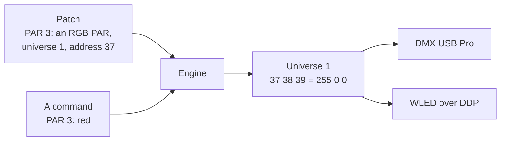
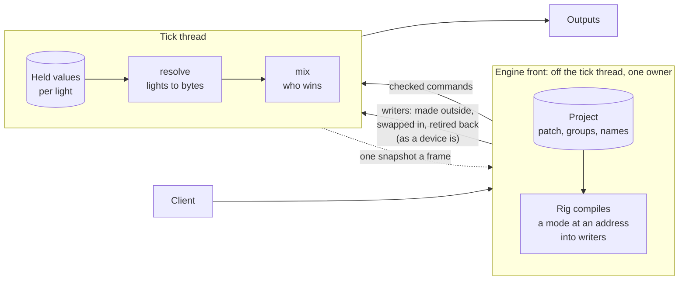
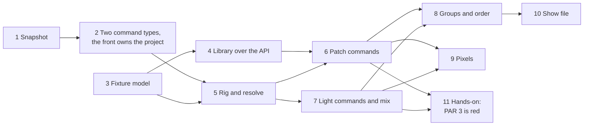

# Lights, not channels: the second slice

Designed at gate 1 (#109). Milestone M2. Open choices are on the decision page, questions 40 to 43: this page shows the recommended answers.

## What it proves

You name a light and say what it does. Addresses exist in one place, the Rig.

## What real fixtures ask for

Counted with the fixture library on the 1 782 QLC+ definitions (5 238 modes, 69 871 channels).

| How a mode makes light | Modes | In this slice |
|---|---|---|
| dimmer and red, green, blue | 2 034 | yes |
| red, green, blue without a dimmer | 1 003 | yes: the colour is dimmed |
| dimmer and cyan, magenta, yellow | 225 | yes |
| dimmer only | 563 | yes |
| dimmer and a colour wheel | 850 | intensity yes, colour in the next slice |
| colour wheel without a dimmer | 277 | next slice |
| neither (lasers, fog, effects) | 285 | raw channels |

| Also | Modes | In this slice |
|---|---|---|
| has pixels: a bar, a panel | 893 | yes: each pixel is a light |
| has a shutter or strobe channel | 3 109 | yes: open by default, or the light stays dark |
| has a 16 bit channel | 1 364 | yes |

## Two changes to the engine first

Gate 1 found two shapes that will not carry a patch. They are the first two tickets.

| Today | After | Why |
|---|---|---|
| the state leaves the tick thread field by field: a flag, packed words per output, one atomic per channel, the frame number beside it | one snapshot: the reader sends an empty box through a queue, the tick thread copies its state into it and sends it back | a new field needs no code. No lock, no `unsafe`, nothing allocated on the tick thread. One picture per frame for all subscribers |
| one `Command` type for what a client sends and for the engine's own events (`Tick`, `Handed`, `Attach`), with three type parameters | two types: a client command, and an engine command that only `check` can make | a patch adds commands that name lights. They are checked against the project, not against a number |

## Two owners of state

| | Project | Now |
|---|---|---|
| Holds | patch, groups, names: text and lists | held values per light, held raw channels, the schedule |
| Owner | the engine front | the tick thread |
| Changes | by a command, checked and applied by the front | by a checked command, applied before the next frame |
| Kept in the show file | yes (question 41) | no |

- The front is the only writer of the project and the only sender to the tick thread. So a command that names a light is checked against the patch as it is at that place in the queue. A check is never stale.
- A light keeps its number while it is patched. Swapping the writers moves no held value.

## A light

| | |
|---|---|
| A fixture | one or more lights. A PAR is one. A bar of 8 pixels is 8, and the bar itself for what they share (a master dimmer) |
| Properties in this slice | intensity, colour. Each is held or not mentioned, on its own (who-wins rule 1) |
| Values | intensity: 0 to 1 in 16 bits. Colour: red, green, blue, 16 bits each |
| Not mentioned | intensity 0. Other channels at the default the definition gives, shutters open |

## From a mode to writers

The Rig turns a mode at an address into writers. A writer says: which light, what to take, how, where. The core runs them and knows no fixture.

Example: a generic RGBW PAR with a dimmer, patched at universe 1, address 37, told "red, intensity 80%".

| Address | Channel | Writer | Byte |
|---|---|---|---|
| 37 | dimmer | intensity | 204 |
| 38 | red | red, less the white | 255 |
| 39 | green | green, less the white | 0 |
| 40 | blue | blue, less the white | 0 |
| 41 | white | the smallest of red, green, blue | 0 |

| Mode has | Intensity goes to | Colour goes to |
|---|---|---|
| dimmer and RGB | the dimmer | red, green, blue |
| RGB, no dimmer | nothing: it scales the colour | red, green, blue, each times the intensity |
| white beside RGB | the dimmer | white takes the part all three share |
| cyan, magenta, yellow | the dimmer | each is full minus its colour |
| a 16 bit pair | coarse and fine | coarse and fine |
| a shutter | | a constant: open |

## Who wins, in this slice

Three rows, one function (`mix`), one place (`engine-core`). M3 adds manual, show and autopilot to the same table.

| Rank | | Wins over |
|---|---|---|
| 1 | blackout | everything |
| 2 | a raw channel held on the DMX screen (question 42) | the light that writes that channel, until released |
| 3 | a held value of a light | its default |

## Commands (API version 2)

| Command | Does | Refused when |
|---|---|---|
| patch (name, maker, model, mode, universe, address) | adds a fixture, the reply carries its number | no such fixture or mode, past the end of the universe, addresses taken (question 40) |
| move (fixture, universe, address) | new address, held values stay | as above |
| unpatch (fixture) | removes it, its held values go | no such fixture |
| rename (fixture, name) | | no such fixture |
| set light (a light, a fixture or a group; intensity or colour) | holds that property | no such target |
| release light (target, property) | lets it go | no such target |
| set group (name, members in order) | makes or replaces a group | a member that is not patched |
| remove group (name) | | |
| search (text) | answers the matching fixtures of the library | |

The picture a client gets grows by the project (patch and groups) and the held values per light.

## The tickets

| # | Ticket | Ends in | Parent |
|---|---|---|---|
| 1, #130 | The state leaves the tick thread as one snapshot | a new field of the state needs no code in the hand-over | #26 |
| 2, #131 | Client commands and engine commands are two types, the front owns the project | no type parameter, no command that only the engine may send in the client's list | #26 |
| 3, #132 | Fixture model: what the Rig needs | every fine byte, defaults, "open" and "no function" are in the model, counted on the real library | #41 |
| 4, #133 | The fixture library over the API | the engine loads a folder of definitions, a request searches it | #41 |
| 5, #134 | Rig: a mode becomes writers, the core resolves | table tests on real definitions: bytes for a colour and an intensity | #50 |
| 6, #135 | Patch commands | patch an RGB PAR at 37, colour red: 255 0 0 at 37 to 39 on DDP and on the fake adapter | #50 |
| 7, #136 | Light commands and `mix` | intensity and colour of a light, a raw channel on top, blackout over all | #58 |
| 8, #137 | Groups and order | a group is set like a light, its order is in the state | #56 |
| 9, #138 | Pixels | a strip of N pixels is N lights, end to end on DDP | #50 |
| 10, #139 | Show file, small (if question 41 says yes) | patch and groups survive an engine restart | #31 |
| 11, #140 | Hands-on: "PAR 3: red" on the real rig | the owner sees it | #50 |

Then gate 2 (#141). Gate 1 and its findings: [gate-1.md](gate-1.md).

## Not in this slice

| Later | Why |
|---|---|
| Colour wheels, pan and tilt, gobos, zoom | the next slice. The model keeps what they need |
| Amber, UV and lime in the colour mix | red, green, blue and white first |
| Fades, looks, steps, patterns | M3 |
| Any product screen | waits for the storyboard catalog (#102) |
| Guided patch, RDM | #54 |
| Undo | #40 |
| OFL and GDTF definitions | the same model, later |

## What gate 2 checks first

| | |
|---|---|
| `mix` | the only code that decides between two values for one channel |
| `resolve` | knows writers, not fixtures: no mode, no maker, no colour model in the core |
| the front | never waits for the tick thread, the tick thread never waits for the front |
| the Rig | the only crate that knows an address belongs to a fixture |
