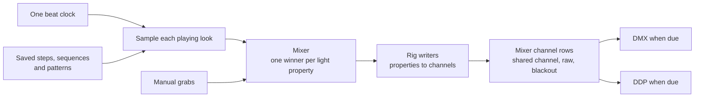
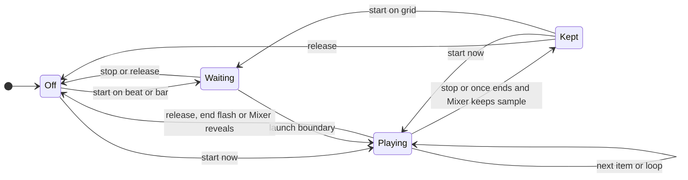
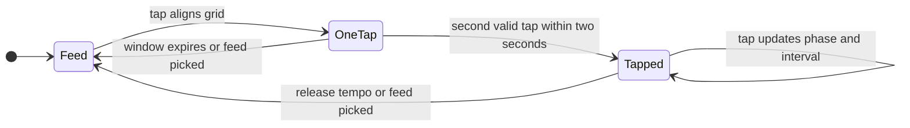
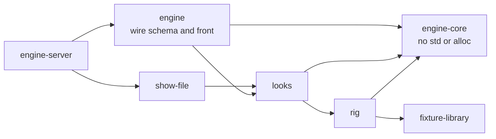

# Looks and who wins

| Milestone | What a person can see |
|---|---|
| M3, engine and API | A row of PARs runs a colour sequence over a moving wave, turns red on the next frame when you press a pad, returns to the current step on Release, and shows the wave where it has reached when the sequence ends. |

**Gate 2 blocks every ticket.** The review used `3cd3ce0`. During this pass, committed HEAD reached `eb632bf`, including changes for #155, #157 and #161. Gate #141 and findings #155 through #164 were still open when checked. Their verification belongs to Gate 2. [Gate 2](https://github.com/abossard/bossylights/issues/141)

## What plays

| Name | M3 contract |
|---|---|
| Look | A saved step, sequence or pattern with a stable ID, name and kind. A play has its own rank, start order and instance ID. |
| Step | Sparse values for a light, fixture or ordered Rig group. Omitted colour lets another source through. Explicit black claims colour. A step may also supply one to four ordered RGB swatches. |
| Sequence | An ordered list of look references. Each width is a positive multiple of 1/16 beat, default one beat. Items touch end to start. The measure is the sum of widths. An empty step gives an explicit rest. |
| Use | Speed ½, 1 or 2, loop or once, and spread from 0 to 100%. Each reference owns its settings. Two parents can use the same child at different speeds. |
| Pattern | **Wave** is the proposed first pattern. It runs over an ordered Rig group or a fixture matrix, with a period of 1 to 32 beats and inline swatches or a colour-step reference. |
| Beat clock | One continuous elapsed beat count drives every play. A separate beat and bar grid schedules launches. The internal feed starts at 124 BPM, four beats per bar. |
| Tap and rank | Tapping takes over tempo for **all** plays. A Manual look takes over only the light properties it supplies. A headless client can start a look at Show or Autopilot rank. |

### A playing sequence

| Boundary | Sample |
|---|---|
| Start | An immediate play shows local beat zero in its applying frame. A quantized play starts at its actual grid crossing. A late wake samples how far it has progressed since then. |
| Duration | A standalone step holds until stopped or released. A sequence pass lasts its measure and a Wave pass its period, divided by use speed. A nested once-use holds its terminal sample until its parent item ends. |
| Item edge | Items own `[start, end)`. Freeze the outgoing child’s own left-limit sample at the edge. During the incoming transition, blend common continuous values toward the incoming child’s **current** sample. |
| Entry | New properties enter, omitted ones fall through and discrete slots cut at entry. Transition defaults to 0%. The first pass has no predecessor. A loop uses the outgoing end of its last item. |
| Spread | For a timed use, offset local phase by `spread × i/n` of one pass. Loop wraps and once clamps. For a step item, delay entry by that fraction of its width and fit its transition into the remaining width. |
| Stop and end | Stop samples the source at the stop event. Natural completion samples immediately before the end, even between wakes. A rest supplies nothing to keep. A covered source still advances. |
| Edit | A same-kind replacement keeps elapsed time and start order. Re-evaluate all live references in one frame. A shortened once-use can end on that frame. Kept values stay frozen. |

`i` starts at zero in saved target order. Rig expands heads in definition order and keeps the first occurrence of a repeated light. For a matrix Wave, use `column / width` in place of `i/n`. A fixture’s shared master has no cell.

### The beat source

| Event | Clock and pending launches |
|---|---|
| Tap | Stamp at FIFO admission in the engine’s monotonic epoch. Use the last valid interval, 200 ms through 2 s inclusive. Ignore bounce. After a longer gap, one tap starts a fresh interval at the current tempo. |
| Phase | A valid tap marks a beat. At an exact beat keep its number, otherwise advance the grid to the next beat number. Elapsed play time stays continuous. One tap alone leaves feed BPM in charge. |
| Lapse or release | Lapse ends `OneTap`. Silence leaves `Tapped` in charge. `ReleaseTempo` in `Tapped` resumes the latest feed BPM at the current grid phase. A BPM-only feed supplies no separate downbeat. |
| Waiting | Launch at the first matching beat or bar on or after the request. Process crossings, taps and commands in time order. A reset can supply the requested crossing once. A late wake jumps directly to crossed launches and ends. |
| Equal times | Finish expiring plays, activate due launches, then apply commands at that instant in FIFO order. An exact-grid request qualifies immediately. Among starts at the same instant, the Mixer uses their original FIFO order. |

## The tick boundary

| Owner | Kind and thread | Data or action |
|---|---|---|
| `looks`, new crate | Data and calculations, off tick | Own authored looks. Check the reference graph and compile indexed instructions, timings, ordered targets and worst-case costs. |
| `rig` | Calculation, off tick | Bind targets, capabilities, matrix cells and discrete selections to checked writers. Use Gate 2’s byte-coverage, shared-head and default contracts. |
| `engine::api` and `engine::Sender` | Wire data and admission, off tick | Own the single Rust `Request`, `Command` and `Reply` schema, including variable-length lists. The front owns the admitted project and queue reservations. |
| `engine-core` | Data and calculations, on tick | Own fixed-size checked IDs, instructions, clock, playback and property values. `mix.rs` decides winners. `resolve.rs` translates the winning values using Rig’s writers. |
| `engine`, `outputs` | Actions, on tick | Read time, drain the admitted commands, sample once and hand the frame to each due output without waiting. The existing idle wake serves the engine without outputs. |
| `show-file`, `engine-server`, free thread | Codec calculation and actions, off tick | Encode the project, serve `/api`, publish pictures, save accepted bytes and reclaim retired storage. |

Dependency arrows point from user to dependency. Register them in `scripts/layers.mjs` first.

Move the existing `ts-rs` generation check to the wire owner. Enable shared Rust schema derives for generation. `UPDATE_TS=1 cargo test -p engine` regenerates `ui/src/engine-api.ts`. `npm test` checks the committed result. Core has no dependency on the allocating compiler.

| Boundary | Required guarantee |
|---|---|
| Prepare an edit | On #159’s path, capture the immutable base revision. Validate, compile and encode the prospective revision off the sender lock. A second client can still admit a press. |
| Admit | Under the short sender lock, recheck the base, including Rig and output configuration, and the work already promised in FIFO order. Reserve everything, enqueue one swap, then advance the front revision. A stale base or failed reservation changes nothing. |
| Apply one wake | Take the outstanding snapshot request, capture the published FIFO tail, then read the common frame time. Drain exactly that prefix. A press before the cutoff belongs to this frame, one after it to the next. Each device receives the result on its own next due handoff. |
| Timestamps | Enqueue, frame and handoff use one epoch. An event published just after a cutoff cannot act before the last sampled frame. Keep its original timestamp for tap intervals. Use #157’s separate per-output handoff stamp for measurement. |
| Own storage | Allocate plans, scratch, snapshots and play slots off tick. A reserved slot follows `pending → waiting/playing → kept or retired → reclaimed`. Keeping uses the same slot. A release, cancellation or natural end returns its generation exactly once. |
| Guarantee returns | Reserve a return entry for each live generation and each replaceable plan bundle before admission. Return old storage by move. Reuse credit only after off-tick reclamation. Release and cancellation need only FIFO room, even with every play slot occupied. |
| Bound the whole wake | Charge every admitted prefix for command and group expansion, swaps, clears, terminal samples, nested evaluation, both transition endpoints and mixing. Add the bounded writer and channel passes, snapshot copy, counters and every due device handoff. Reserve release work in advance. |
| Bound the backlog | Proposed starting limits are 32 roots including kept plays, depth 8, 64 items per sequence and 65,536 variable visits per wake. Bound outstanding plan, scratch and retirement **bytes** too. Checked arithmetic rejects excess before allocation or enqueue. T8 sets the shipping limits from the full workload. |
| Publish | Extend #158 and #163. Pin each authored revision while queued, applied, named by an outstanding snapshot, or needed by an undelivered picture or delta. Reclaim after the last reference off tick. A slow reader can skip frames and still receive a coherent picture. |

## The Mixer’s table

Every decision below belongs to **`crates/engine-core/src/mix.rs`**. Playback supplies each source’s own sample and asks the Mixer what to keep at an end.

| Decision | Rule | Why |
|---|---|---|
| Property | One winner per light for brightness, colour, position, zoom or a gobo wheel. RGB and wheel colour are representations of **one colour**. Pan and tilt travel together. | A lower rank cannot change half a position or tint a Manual colour. |
| Rank | **Manual > Show > Autopilot > fixture default.** Absence falls through. Zero and black participate. | A hand can darken a light while the Show continues underneath. |
| Equal rank | Latest effective start wins. FIFO breaks equal-start ties. Sampling, editing, looping and moving an existing grab preserve its order. | An older chase cannot reclaim a light at every step. |
| Brightness setting | Optionally take the highest 16-bit brightness **within the winning rank**. Equal values use start order for winner readback. | A bright Autopilot cannot overpower a dim Manual hold. |
| Manual end | `UntilRelease` keeps the source’s own sample. `UntilStop` removes it at `StopLook` or `EndGrab`. `EndFlash` and explicit release remove the addressed instance immediately. | Latching a pad, ending a flash and lifting a direct control have distinct outcomes. |
| Show or Autopilot end | `Reveal` removes the contribution. `Stay` freezes it at its original rank and order until released or restarted. | Release reveals the source underneath at its current position. |
| Channel | Blackout forces zero. A held raw byte, including zero, wins over resolved light. No row between two lights: patches never overlap and a channel two heads name is one property of the fixture, so every channel has one writer (decision 48, #173). | DMX is resolved at the look stage: who wins is decided per light property, never per channel. |

The three settings are saved. An edit takes effect on the applying frame. Switching to `UntilStop` or `Reveal` clears the corresponding stopped holds. [Owner’s five rules](who-wins.md)

## Commands, refusals and readback

Use the existing `/api` socket and `/version` handshake. Bump the post-Gate-2 API version for the changed `ReleaseAll` contract, to v3 if Gate 2 leaves it at v2.

| Command | Effect | Refusal or scope |
|---|---|---|
| `PutStep`, `PutSequence`, `PutPattern` | Create or replace `(id, name, definition)`. A sequence stores widths and references. Wave stores target, period and swatches or a step ID. | `WrongLookKind`, missing reference or target, cycle, conflicting assignments, unsupported binding, invalid timing or limit exceeded. |
| `RemoveLook(id)` | Remove an unused definition. | `LookInUse` names a referencing definition or an admitted, waiting, playing or kept use. |
| `StartLook(id, rank, when, use)` | Return a generation-tagged play ID. Default Manual, now, normal speed. A fresh start replaces the same `(rank, look)` use. Different ranks run independently. | Unknown look, invalid use, `PlayFull`, `WorkLimit` or `QueueFull`. A standalone step refuses `Once`. |
| `StopLook(play)`, `ReleaseHold(play)`, `EndFlash(play)` | Stop under the end rule, clear one contribution, or end one Manual flash. Stop while waiting cancels. | An ended generation is a harmless no-op, including an old finger-up after restart. `EndFlash` addresses Manual only. |
| `SetProperty(target, value)`, `UpdateGrab(grab, value)`, `EndGrab(grab)` | A new direct grab returns its ID. Updates preserve its priority. `EndGrab` applies the Manual end rule. Existing intensity and colour sets enter the same Manual path. | Refuse a missing target or unsupported value. A stale gesture cannot end or update its replacement. A one-shot set stays until an explicit end or release. |
| `ReleaseProperty(target, property)`, `ReleaseChannels`, `ReleaseAll` | Clear direct holds on that property, all raw channels, or all Manual plays, direct holds and raw channels respectively. | Idempotent. Property release leaves Manual look instances alone. Show, Autopilot, blackout and tempo have separate controls. |
| `SetMixRules(brightness, manualEnd, otherEnd)` | Save all three settings atomically. | Unknown setting, stale prepared revision or failed admission. |
| `SetInternalTempo(bpm)`, `TapTempo`, `ReleaseTempo` | Set the internal feed, align or take over by hand, or give tempo back. | M3 proposes 30 to 300 BPM. Taps take no client timestamp. |

**Validate reverse edits.** Check patch, group, palette and look edits against the whole proposed graph and every queued, live or retained use. Rebind a valid group reorder atomically. Refuse changes that invalidate types, targets, frozen bindings or reserved work. Unpatch clears removable direct holds before a light number can be reused.

**Read one revision.** `Query` and the first `Subscribe` return `Picture` with saved looks, settings, applied revision, beat/source, play IDs and states, and held properties. `Changed` carries performance from that frame and authored changes since **that subscriber’s last delivered picture**. Held raw `universes` are not emitted DMX.

**Save one revision.** Show-file v2 adds looks and rules. Read v1 with empty looks and default rules. Check both input size and canonical v2 size against 64 MiB. Save the exact admitted bytes in revision order through the existing atomic writer. Preserve `NotSaved` retry and `LeftAlone`. Restart with performance idle.

## Tickets

All eight briefs belong to **M3**, with label `ready-for-agent`, their named map parent and the listed issue dependencies. **#141 is a blocker on every brief.** The handoffs below identify which findings each worker consumes. #161 stays in the gate’s parser queue.

| Ticket | Parent | M3 blockers | Direct Gate 2 handoffs |
|---|---|---|---|
| T1 Observe the first due frame | #26 | None | #157, #164 |
| T2 Save, play and release a step | #64 | T1 | #155, #156, #158, #159, #160, #162, #163, #164 |
| T3 Apply rank, stop and release | #72 | T2 | #156, #158, #160, #163 |
| T4 Send mover properties to a fixture | #50 | T2 | #156, #160 |
| T5 Launch on a beat or bar | #45, also #73 | T3 | #157 |
| T6 Play linked sequences | #69 | T5 | #158, #159 |
| T7 Run Wave over a group or matrix | #59 | T6 | #155, #156, #160 |
| T8 Prove one complete performance | #27 | T4, T7 | #155, #157, #164 |

**File ownership.** Paths below are relative to `crates/` unless marked root. T2, T3, T5, T6 and T7 take the shared API files in that order. T4 can run beside T3, T5, T6 or T7 after T2 freezes the property and binding interfaces.

| Owner | Files |
|---|---|
| Shared API files | `engine/src/{api,lib,snapshot}.rs`, `engine-core/src/{api,lib,project}.rs`, `engine-server/src/lib.rs`, root `docs/engine.md` and generated `ui/src/engine-api.ts` |
| T1 | `engine/src/{lib,wake}.rs`, test-support entries in `engine/Cargo.toml` and `engine-server/Cargo.toml`, `engine-server/tests/{patch.rs,common/mod.rs,m3_wake.rs}` |
| T2 | Shared files, new `looks/`, `rig/src/{lib,patch,targets}.rs`, `engine-core/src/{property,mix,resolve,playback}.rs`, `show-file/`, `engine-server/src/show.rs`, `engine-server/tests/{show,m3_step}.rs` |
| T2 registration | Root `Cargo.toml`, `Cargo.lock`, `scripts/layers.mjs` and manifests of `looks`, `rig`, `engine-core`, `engine`, `engine-server` and `show-file`. Later slices use these dependency edges. |
| T3 | Shared files, `engine-core/src/{mix,playback}.rs`, `looks/src/rules.rs`, `show-file/src/lib.rs`, `engine-server/tests/m3_mix.rs` |
| T4 | `rig/src/{lib,capabilities}.rs`, `engine-core/src/resolve.rs`, `rig/tests/{modes,m3_properties}.rs`, `engine-server/tests/m3_mover.rs` |
| T5 | Shared files, `engine-core/src/{clock,playback}.rs`, `engine-server/tests/m3_tempo.rs` |
| T6 / T7 | Shared files, `looks/src/{lib,compile}.rs`, `engine-core/src/evaluate.rs`, `show-file/src/lib.rs`, in order. T6 adds `looks/src/sequence.rs`, playback and `m3_sequence.rs`. T7 adds `looks/src/pattern.rs`, `engine-core/src/wave.rs` and `m3_wave.rs`. Both wire tests live in `engine-server/tests/`. |
| T8 | `engine/tests/{no_alloc,m3_capacity}.rs`, `engine-server/tests/m3_night.rs`, `engine-server/examples/{lateness,send_to_frame}.rs` and root `scripts/{print-scorecard,scorecard,scorecard.test}.mjs` |

Every ticket runs `npm test`. Each `m3_*` wire test sends commands through `/api` and decodes DMX USB Pro frames. Each ticket table-tests the transitions and refusal paths it introduces and exercises its new tick path under the allocation **and free** counters.

### T1. Observe the first due frame

- [ ] Drive the production wake with a test-only monotonic clock. Record each due handoff, its outcome, every complete PTY frame and each DDP frame in order.
- [ ] `m3_wake` admits raw level 91 on either side of the cutoff. At 44 and 60 Hz, each healthy, drained output carries it on its first eligible handoff and wire frame. Exercise a full adapter queue separately and observe `Dropped`.

### T2. Save, play and release a step

- [ ] Play and release a Manual step. Tables distinguish absent, black and zero. Refused edits, stale preparation and exhausted credits preserve the project, file and next frame. A paused compile allows another client’s press through.
- [ ] Query and subscribe while revision B overtakes A’s snapshot. Each picture joins matching definitions and holds. Read v1, reject a canonical v2 one byte over the cap, and use `VERSION + 1` for the untouched newer-file test.
- [ ] `m3_step` patches Generic RGB at 1:37, supplies full intensity and plays red. Read `255 0 0`, then release. Restart without the library, attach an output, verify idle black, **restore intensity**, and replay the saved step to the same bytes.

### T3. Apply rank, stop and release

- [ ] Table-test every decided Mixer row in both candidate orders. Cover same-boundary starts, stale flash and grab ends, and every play slot occupied while releases and cancellations succeed.
- [ ] `m3_mix` reads blue Autopilot, green Show, red Manual, then green and blue on release. A second PAR stays blue. Test explicit zero, blackout, `ReleaseChannels` and `ReleaseAll` independently.
- [ ] On DMX, switch two same-rank brightness values from latest to highest. Exercise `Stay` and `Reveal`, both Manual end settings, stopped holds after a settings edit, and a direct grab released over a still-playing Manual look.

### T4. Send mover properties to a fixture

- [ ] Bind normalized position and zoom, static wheel colour, and gobo by **wheel and slot**. Use the lower midpoint of a declared static range. Refuse unsupported selections, including black on a wheel without black. On hybrid fixtures the winning colour must bind its companion channels to known neutral values, or the binding is refused.
- [ ] `m3_mover` at address 1 reads Elation EVC MH `12-CH` position `12 34 56 78` hex and zoom `80` hex at channel 9. The same zoom gives `7f` on Martin Rush MH6 Wash.
- [ ] On Shehds `14 Channel`, red writes channel 6 = 7. `Static Gobo / Gobo 2` writes channel 7 = 24 and leaves channel 8 at default. A transition cuts directly to the slot.

### T5. Launch on a beat or bar

- [ ] Table-test every beat-source state/event pair, bounce, exactly two seconds, lapse, lost phase, a cancelled wait and two taps drained together. Cross two distinct pending boundaries in one late wake and verify their start order on DMX.
- [ ] `m3_tempo` starts at 120 BPM. Taps at 0 and 750 ms give 80 BPM and 1.5 elapsed beats at the second tap. The next tapped beat is 1500 ms. Release there gives a feed beat at 2000 ms. Assert old colour before each requested launch and new colour on its boundary.
- [ ] A bar launch waits through intervening beats. An off-grid tap moves a pending crossing exactly once while an already running play’s elapsed position stays continuous.

### T6. Play linked sequences

- [ ] Table-test 1/16- and two-beat widths, nested ×2, spread, rests, loop wrap and once ending between wakes. Test both endpoints of a transition from a moving nested sequence and a stop during a rest.
- [ ] `m3_sequence` reads red, half-red/half-blue, then blue. Manual covers an advancing child. Release reads its current step. Replacing a shared step changes both running parents without restarting either.
- [ ] Admit `Start → edit → Start` before one wake. Refuse a cycle, kind change or over-budget expansion as a whole. Exercise a plan swap while all reserved plays naturally finish or become kept.

### T7. Run Wave over a group or matrix

- [ ] For `k` swatches, take cyclic phase `p` from elapsed beats divided by period plus spread. Blend swatch `floor(kp)` to its successor, wrapping last to first, rounded to nearest RGB16. Table-test `k = 1, 2, 3, 4`, wrap, reverse group order and palette edits. Wave requires continuous colour on every target.
- [ ] `m3_wave` uses a 2×2 mode with out-of-address-order heads. Cell `(x,y)` binds head `y × width + x`. At full spread read red/blue on **both** rows, then blue/red half a period later. The shared master byte stays 173.
- [ ] Reordering a group reverses its two colours at fixed phase. Replacing a referenced palette changes both a live Wave and a sequence using it. Removing its last swatch is refused and the next DMX frame keeps the previous palette.

### T8. Prove one complete performance

- [ ] `m3_night` runs a four-beat red/blue Wave beneath a **once** Show sequence, green then amber. Grab red during green, release during amber, then read blue at beat two when Show ends. Verify the first eligible DMX and DDP frames at their independent deadlines.
- [ ] Restart that single-universe show. A fresh client discovers the linked sequence, palette-backed Wave and a non-default Mixer setting, with plays, taps and holds idle. Restore intensity, replay both looks and verify the DMX trace.
- [ ] At admitted limits, burst commands, swap plans, finish 32 plays together and stall reclamation. Count zero tick allocations and frees. The next oversized command is refused, release still works and reclamation permits retry.
- [ ] `npm run scorecard` compares matched 60-second runs on the same reference Mac after #157. Use 10,000 RGB pixels, 44/60 Hz outputs, a snapshot reader and the same seeded press/edit schedule. Compare an M2 direct-colour rig with M3 running Wave, sequence and Manual grabs. Report each output’s handoff lateness p99, send-to-handoff p95 and drops.
- [ ] Before fixing the caps, repeat at the worst admitted workload. Each output must reach p99 lateness below 1 ms and p95 send-to-handoff below its period + 5 ms. Reduce the caps and rerun if needed. CI checks bytes and frame order. [M1 timing target](engine-slice-1.md) · [Scorecard target](../../scripts/scorecard.mjs)

## Risks and scope

| Open point | Recommendation and boundary |
|---|---|
| Q44 kit tabs, preview and effect chooser; Q45 Learn | Leave both with storyboard #102. M3 exposes saved looks, real-output playback and readback. [Storyboard handoff](https://github.com/abossard/bossylights/issues/102#issuecomment-6993023464) |
| Q46 press behind its own slow open; Q47 concurrent opens | Recommend independent admission of performance commands. The current socket can await its own open. M3 tests the cutoff after admission and uses an already attached adapter. Either opening policy can feed that FIFO. [Open findings on device opens](https://github.com/abossard/bossylights/issues/146) |
| Q48 shared physical channel | Highest value is the recommendation. Existing fixture-order behaviour is provisional. Use the verified #156 seam and keep the owner’s eventual choice in `mix.rs`. [Shared-head finding](https://github.com/abossard/bossylights/issues/156) |
| Q49 outputs in the show file | Use #155’s byte-coverage check against the outputs available at validation. Today the server loads before attaching outputs. Use fully streamed, single-universe restart fixtures. Leave spanning-fixture restore and output persistence together for the owner. [Show-file handoff](https://github.com/abossard/bossylights/issues/139#issuecomment-7003402941) |
| Pattern choice and look primitives | Recommend Wave as the first engine pattern. Later slices can add more shapes, side-by-side items within one sequence, and linked palettes beyond Wave. Authored look groups are many-to-many labels. M3 Rig groups are ordered light targets. [Look model](looks.md) |
| Later milestones | Product screens wait for #102. M5 supplies show recording, autopilot choices, MIDI and controllers. External tempo feeds and master controls have later slices. M3 uses original Apache-2.0 code. |
| Gate evidence | The ordered adapter and DDP scenario is runnable without hardware. The owner parked the physical-rig run. This revision is a read-only spec and ticket briefs. No files or issues were changed, and no builds or tests ran. [Hardware decision](https://github.com/abossard/bossylights/issues/141#issuecomment-7006108962) |

