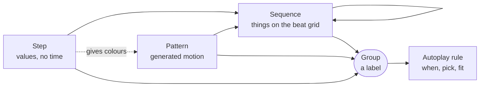
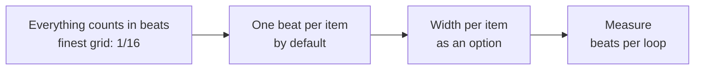
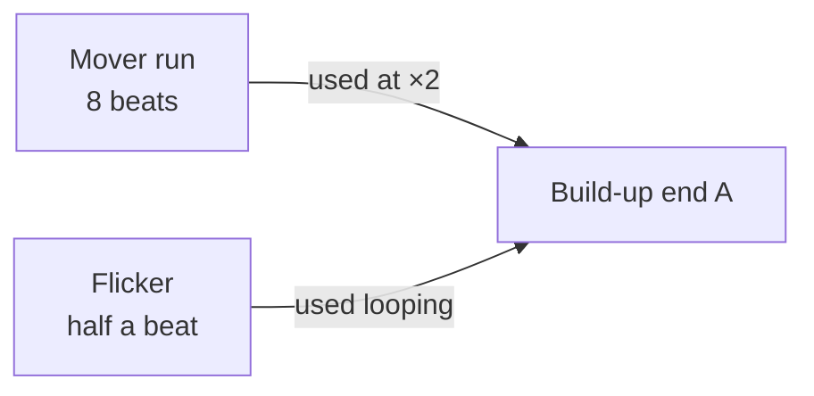
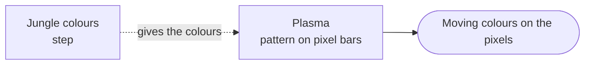
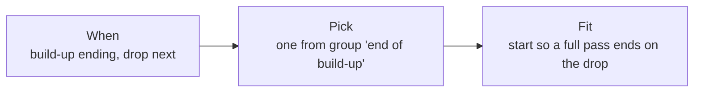

# Looks: steps, sequences, patterns

Agreed with the owner on 2026-11-17 (all five primitives rated yes). Nothing is built. A **look** is the everyday word for anything you can play: a step, a sequence or a pattern.

## The whole model in one picture

## Five primitives

| Primitive | Is | Example |
|---|---|---|
| **Step** | values only: colour, position, gobo, dimmer, spin. Knows nothing about time | "Left low", "Red", "Leaf gobo" |
| **Sequence** | puts steps and other sequences on the beat grid | "Mover run", "Colour chase" |
| **Pattern** | generated motion over a fixture group or a pixel matrix | "Plasma", "Wave" |
| **Use settings** | set at every place a thing is used: speed, loop or once, spread | "Mover run at ×2, looping" |
| **Group** | a label. One thing can be in many groups | "end of build-up" |

There are no folders, no variants and no containers.

## Timing

| Term | Meaning | Default |
|---|---|---|
| Width | how long an item lasts | 1 beat |
| Transition | how much of the width is the move, the rest is hold | 0%, a cut |
| Measure | beats per loop of a sequence | the sum of its items |
| Tempo | from VirtualDJ, audio or a tap | 124 BPM |

Even spacing is the default. Uneven spacing is an option, set by changing a width.

## Six ways to use and stack them

### 1. A step alone

| Beat | 1 | 2 | 3 | 4 |
|---|---|---|---|---|
| Warm wash (step) | holds | holds | holds | holds |

### 2. Steps in a sequence

| Beat | 1 | 2 | 3 | 4 | 5 | 6 | 7 | 8 |
|---|---|---|---|---|---|---|---|---|
| Colour chase | red | amber | green | blue | red | amber | green | blue |

Measure 4 beats, then it loops.

### 3. The same steps with other timing

| Beat | 1 | 2 | 3 | 4 | 5 | 6 | 7 | 8 |
|---|---|---|---|---|---|---|---|---|
| Colour chase | red | amber | green | blue | red | amber | green | blue |
| Lazy chase | red | red | red | amber | green | green | green | blue |

The four steps exist once. Each sequence times them its own way.

### 4. A sequence inside a sequence

Change "Mover run" and every sequence that uses it follows.

### 5. A matrix pattern with colours from a step

Swap the step and the motion stays. DDP, Art-Net and sACN are only the cable.

### 6. Stacking by property

| Beat | 1 to 3 | 4 to 6 | 7 to 8 |
|---|---|---|---|
| Manual: Red alert (colours only) | | **red** | |
| Show: Colour chase (colours) | chase | covered | chase |
| Show: Mover run (movement) | runs | runs | runs |

A step that sets only colours covers only colours. Let go and the layer below returns.

## Autoplay rules

Rules need song sections. A song that is not analysed has no drop to aim at, so those rules do not fire.

## Where each idea comes from

| Idea | Source |
|---|---|
| Steps with a width, even by default | grandMA3 Phaser |
| Transition as a share of the width | grandMA3 Phaser |
| Measure: beats per loop | grandMA3 |
| Re-use by reference | every console (presets, palettes) |
| Speed, loop and spread per use | grandMA3 recipe lines |
| A sequence inside a sequence | QLC+ chaser of chasers, video and game tools |
| Pattern on pixels with swappable colours | WLED, LedFx, QLC+ RGB Matrix |
| Rules that pick from a group and line up an ending | game music tools |

## For QLC+ users

| QLC+ | Here |
|---|---|
| Scene | Step |
| Palette | a step that sets one kind of property |
| Chaser, Sequence | Sequence |
| Collection | a sequence whose items run side by side |
| EFX, RGB Matrix, HUE Matrix | Pattern |
| Show | the Show timeline |
| Folders | Groups |

## Limits to be honest about

- A mover has a top speed. At ×2 it may not reach every step. The app warns, it does not hide it.
- 1/16 beat at 124 BPM is about one DMX frame. Finer makes no sense.

## Still open

| # | Question |
|---|---|
| 1 | Testing in the editor: the plan is a "Try on lights" button and no animated preview. This got a "no" once without a reason. |
| 2 | Five of the six ways above are not rated yet (only way 4 is). |
| 3 | Which patterns ship first, and how a pattern is tuned (size, direction, density). |
