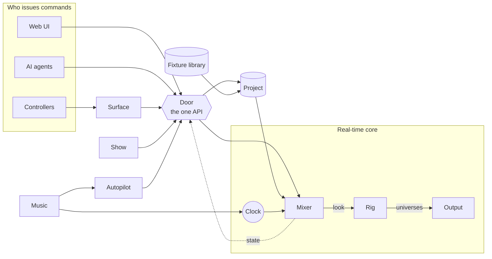
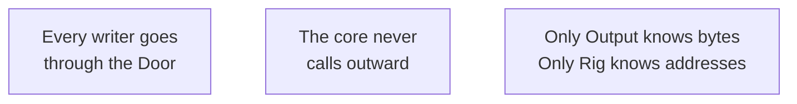
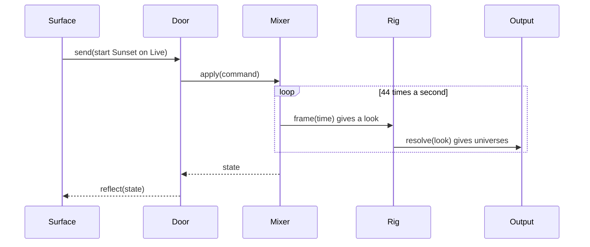
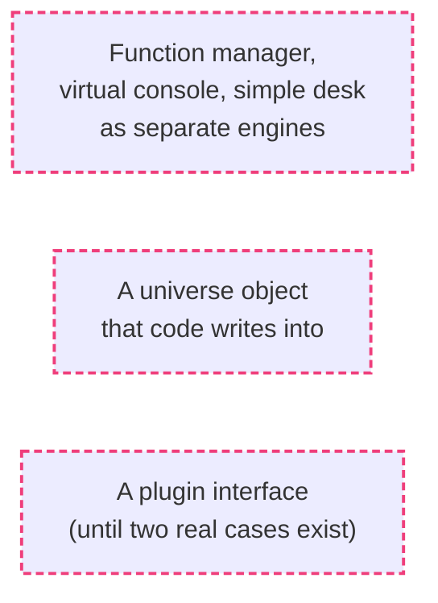

# Module boundary map

Draft for review. Nothing is built. Read [theory.md](theory.md) first. Questions are at the end.

## The rule: deep modules

```
   shallow module                deep module
┌────────────────────┐          ┌────────┐
│     interface      │          │interface│   small: what others must know
├────────────────────┤          ├────────┤
│   little inside    │          │        │
└────────────────────┘          │  a lot │   large: what others never see
                                │ inside │
   costs a lot,                 │        │
   hides little                 └────────┘
                                 costs little,
                                 hides a lot
```

John Ousterhout: the interface is the cost, what it hides is the benefit. So: few modules, tiny interfaces.

## The map



| Arrow | Meaning |
|---|---|
| solid | commands and data flow this way only |
| dotted | state snapshots coming back |

**Three rules**



## The twelve modules

The bar shows depth: interface size on the left, what it hides on the right.

| Module | Whole interface | Hides | Depth |
|---|---|---|---|
| **Door** | `send` `subscribe` `query` | transports (UI, MCP, OSC), versions, permissions | ▮▮▮ → ▮▮▮▮▮▮ |
| **Mixer** | `apply` `frame` | layers, fades, launch on beat, flash, release, masters, blackout, preview | ▮▮ → ▮▮▮▮▮▮▮▮ |
| **Sources** | `evaluate` | chases, movement maths, pixel matrices, audio scripts, palettes, laser shapes | ▮ → ▮▮▮▮▮▮▮▮ |
| **Clock** | `now` `follow` | tap, audio beat, MIDI clock, DJ position, timecode, smoothing | ▮▮ → ▮▮▮▮▮▮ |
| **Rig** | `fixtures` `groups` `resolve` | addresses, modes, 16-bit, colour mixing, pan/tilt limits, curves, fixture swap | ▮▮▮ → ▮▮▮▮▮▮▮▮▮ |
| **Fixture library** | `search` `model` | QLC+, OFL and GDTF file formats | ▮▮ → ▮▮▮▮▮ |
| **Output** | `devices` `send` | USB timing, reconnects, Art-Net, sACN, DDP, laser DAC | ▮▮ → ▮▮▮▮▮▮▮ |
| **Project** | `read` `edit` `undo` `redo` | file format, autosave, migration, history | ▮▮▮▮ → ▮▮▮▮▮▮ |
| **Surface** | `layout` `press` `reflect` | widgets, pages, MIDI learn, controller profiles, pad colours | ▮▮▮ → ▮▮▮▮▮▮▮ |
| **Show** | `record` `play` `edit` | tracks, clips, nested song shows, quantize, section blocks | ▮▮▮ → ▮▮▮▮▮▮ |
| **Music** | `playing` `analyse` | VirtualDJ protocols, analysis pipeline, beat grids, confidence | ▮▮ → ▮▮▮▮▮▮ |
| **Autopilot** | `start` `stop` | choosing looks, not repeating, staying out of Live's way | ▮▮ → ▮▮▮▮▮ |

## How a press travels



## Which screen uses which module

Screens are thin. Each is a view of one or two modules through the Door.

| Screen | Surface | Mixer | Show | Music | Autopilot | Project | Rig | Library | Output | Clock |
|---|:-:|:-:|:-:|:-:|:-:|:-:|:-:|:-:|:-:|:-:|
| Live | ● | ● | | | | | | | | |
| Autopilot | | ● | | ● | ● | | | | | |
| Show | | | ● | | | | | | | ● |
| Songs | | | ● | ● | | | | | | |
| Looks | | ● | | | | ● | | | | |
| Patch | | | | | | | ● | ● | | |
| DMX | | ● | | | | | ● | | ● | |
| In/Out | ● | | | | | | | | ● | ● |

## What gets no module



## Questions for you

| # | Question | Option A (my lean) | Option B |
|---|---|---|---|
| 1 | Is a Door with three operations believable? | Yes, commands are data | No, it hides a giant "do anything" |
| 2 | Can you play something that is not saved? | No, everything playable lives in Project | Yes, scratch sources exist |
| 3 | Where does controller mapping live? | In Surface, next to the widgets | In In/Out, like QLC+ profiles |
| 4 | Music and Autopilot | Two modules: knowing vs deciding | One module |
| 5 | Which module will be hardest to keep narrow? | | |

Answer with the number and A or B, here or in [issue #100](https://github.com/abossard/bossylights/issues/100).
