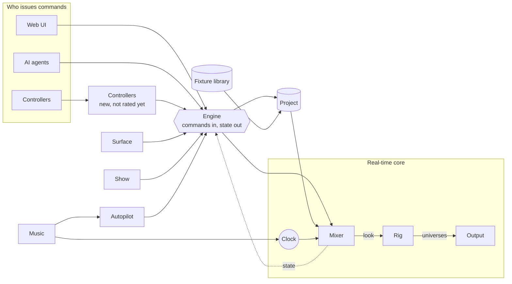
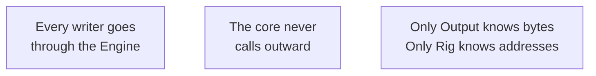
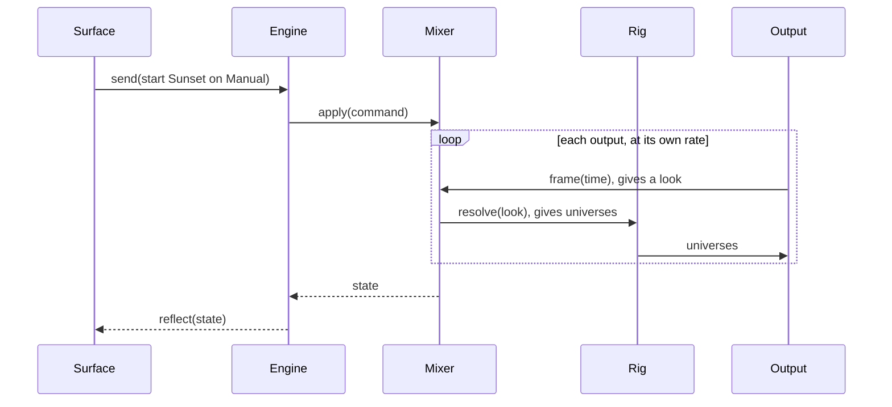
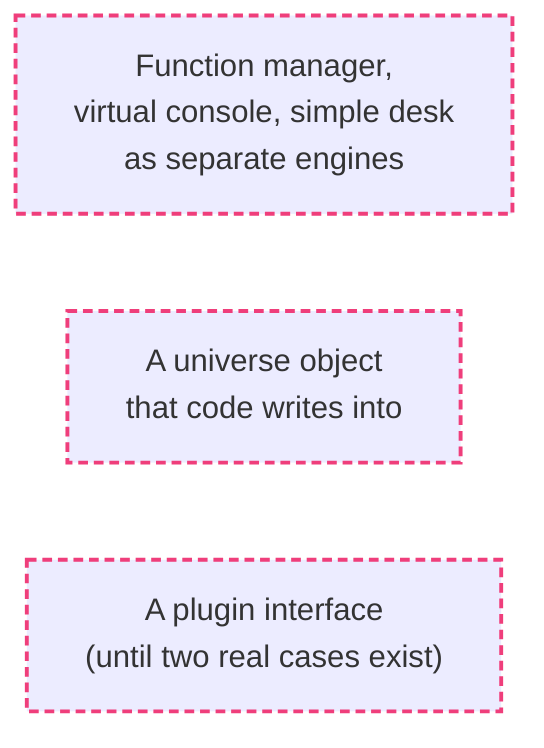

# Module boundary map

Draft for review. Nothing is built. Read [theory.md](theory.md) first. Questions are at the end.

## The rule: deep modules

```
   shallow module                deep module
┌────────────────────┐          ┌────────┐
│     interface      │          │interface│   small: what others must know
├────────────────────┤          ├────────┤
│   little inside    │          │        │
└────────────────────┘          │  a lot │   large: what others never see
                                │ inside │
   costs a lot,                 │        │
   hides little                 └────────┘
                                 costs little,
                                 hides a lot
```

John Ousterhout: the interface is the cost, what it hides is the benefit. So: few modules, tiny interfaces.

## The map



| Arrow | Meaning |
|---|---|
| solid | commands and data flow this way only |
| dotted | state snapshots coming back |

**Three rules**



## The thirteen modules

The bar shows depth: interface size on the left, what it hides on the right.

| Module | Whole interface | Hides | Depth |
|---|---|---|---|
| **Engine** | `send` `subscribe` `query` | a listed set of commands, transports (UI, MCP, OSC), versions, permissions | ▮▮▮ → ▮▮▮▮▮▮ |
| **Mixer** | `apply` `frame` | the who-wins rules (one table), fades, launch on beat, flash, release, masters, blackout | ▮▮ → ▮▮▮▮▮▮▮▮ |
| **Sources** | `evaluate` | chases, movement maths, pixel matrices, audio scripts, palettes, laser shapes | ▮ → ▮▮▮▮▮▮▮▮ |
| **Clock** | `now` `follow` | tap, audio beat, MIDI clock, DJ position, timecode, smoothing | ▮▮ → ▮▮▮▮▮▮ |
| **Rig** | `fixtures` `groups` `resolve` | addresses, modes, 16-bit, colour mixing, pan/tilt limits, curves, fixture swap | ▮▮▮ → ▮▮▮▮▮▮▮▮▮ |
| **Fixture library** | `search` `model` | QLC+, OFL and GDTF file formats | ▮▮ → ▮▮▮▮▮ |
| **Output** | `devices` `send` | USB timing, the rate of each device (44 for DMX, 60 for DDP by default), reconnects, Art-Net, sACN, DDP, laser DAC | ▮▮ → ▮▮▮▮▮▮▮▮ |
| **Project** | `read` `edit` `undo` `redo` | file format, autosave, migration, history | ▮▮▮▮ → ▮▮▮▮▮▮ |
| **Surface** | `layout` `press` | widgets, pages | ▮▮ → ▮▮▮▮▮ |
| **Controllers** (new, not rated yet) | `devices` `learn` `mappings` | MIDI, OSC, controller profiles, pad colours sent back | ▮▮▮ → ▮▮▮▮▮▮ |
| **Show** | `record` `play` `edit` | tracks, clips, nested song shows, quantize, section blocks | ▮▮▮ → ▮▮▮▮▮▮ |
| **Music** | `playing` `analyse` | VirtualDJ protocols, analysis pipeline, beat grids, confidence | ▮▮ → ▮▮▮▮▮▮ |
| **Autopilot** | `start` `stop` | choosing looks, not repeating, staying out of your hands' way | ▮▮ → ▮▮▮▮▮ |

All who-wins rules live in the Mixer, in one table. No screen and no other module decides between two values for the same light. See [who-wins.md](who-wins.md).

## How a press travels



## Which screen uses which module

Screens are thin. Each is a view of one or two modules through the Engine.

| Screen | Surface | Controllers | Mixer | Show | Music | Autopilot | Project | Rig | Library | Output | Clock |
|---|:-:|:-:|:-:|:-:|:-:|:-:|:-:|:-:|:-:|:-:|:-:|
| Console | ● | | ● | | | | | | | | |
| Songs | | | ● | ● | ● | | | | | | ● |
| Looks (with autopilot settings) | | | ● | | | ● | ● | | | | |
| Patch | | | | | | | | ● | ● | | |
| DMX | | | ● | | | | | ● | | ● | |
| In/Out | | ● | | | | | | | | ● | ● |

## What gets no module



## Answers from reviews 1 and 2

| # | Question | Decided |
|---|---|---|
| 1 | Is a Door with three operations believable? | not under that name. It is now called **Engine**, and it accepts a listed set of commands, not "anything" |
| 2 | Can you play something that is not saved? | no. Everything playable lives in Project, and what you try is saved by itself |
| 3 | Where does controller mapping live? | review 2: in In/Out, like QLC+ profiles. So mapping leaves Surface and becomes the Controllers module. Learn still works on every control in the app |
| 4 | Music and Autopilot | two modules: knowing and deciding |
| 5 | Hardest module to keep narrow | open |

Details: [review-1.md](review-1.md), [review-2.md](review-2.md).
