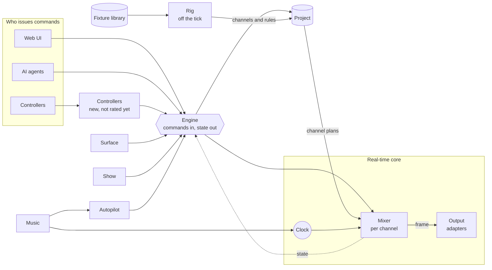
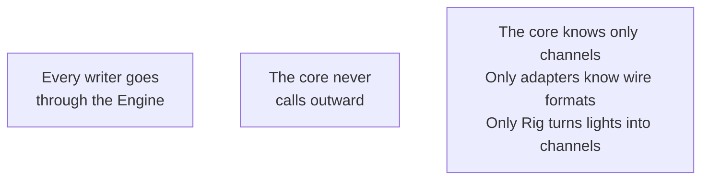
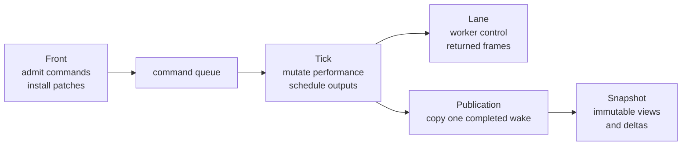
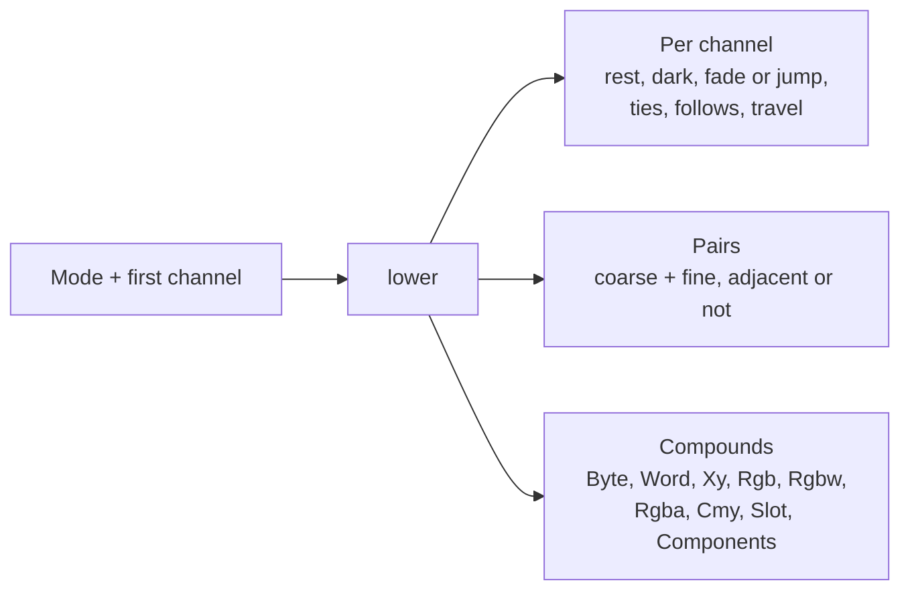
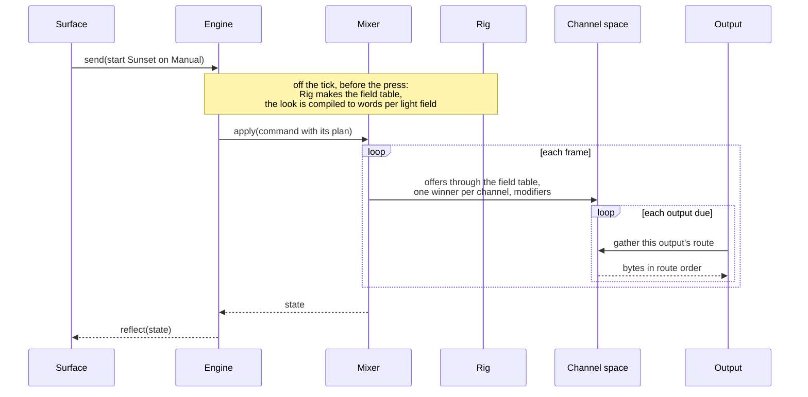
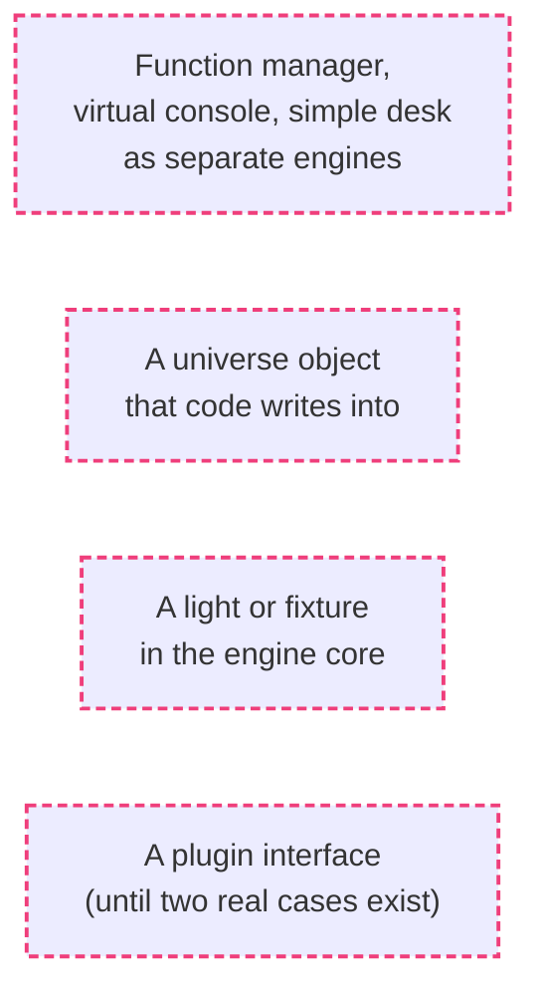

# Module boundary map

Read [theory.md](theory.md) first: the engine knows channels, the Rig and the screens know lights. Answers from the reviews are at the end.

| Module | State |
|---|---|
| Engine, Mixer (per channel, #250), Sources (steps, sequences, Wave), Clock, Rig, Fixture library, Output (DMX USB, DDP), Project | built |
| Rig rules from the file, Master | built (#251) |
| Typed grabs, rules in Patch, virtual dimmers | designed (#251) |
| Surface, Controllers, Show, Music, Autopilot | design |

## The rule: deep modules

```
   shallow module                deep module
┌────────────────────┐          ┌────────┐
│     interface      │          │interface│   small: what others must know
├────────────────────┤          ├────────┤
│   little inside    │          │        │
└────────────────────┘          │  a lot │   large: what others never see
                                │ inside │
   costs a lot,                 │        │
   hides little                 └────────┘
                                 costs little,
                                 hides a lot
```

John Ousterhout: the interface is the cost, what it hides is the benefit. So: few modules, tiny interfaces.

## The map



| Arrow | Meaning |
|---|---|
| solid | commands and data flow this way only |
| dotted | state snapshots coming back |

**Three rules**



## The thirteen modules

The bar shows depth: interface size on the left, what it hides on the right.

| Module | Whole interface | Hides | Depth |
|---|---|---|---|
| **Engine** | `send` `subscribe` `query` | a listed set of commands, transports (UI, MCP, OSC), versions, permissions | ▮▮▮ → ▮▮▮▮▮▮ |
| **Mixer** | `apply` `frame` | the who-wins rules (one table, per channel), fades, launch on beat, flash, release, raw holds, modifiers (Master, Blackout, virtual dimmers) | ▮▮ → ▮▮▮▮▮▮▮▮ |
| **Sources** | `evaluate`: channel bytes and words at a time | chases, movement maths, pixel matrices, audio scripts, palettes, laser shapes (built off the tick into plans) | ▮ → ▮▮▮▮▮▮▮▮ |
| **Clock** | `now` `follow` | tap, audio beat, MIDI clock, DJ position, timecode, smoothing | ▮▮ → ▮▮▮▮▮▮ |
| **Rig** | `fixtures` `groups` `lower` | addresses, modes, pairs, compounds, colour mixing, pan/tilt limits, fixture swap, the default rules of each channel | ▮▮▮ → ▮▮▮▮▮▮▮▮▮ |
| **Fixture library** | `search` `model` | QLC+, OFL and GDTF file formats | ▮▮ → ▮▮▮▮▮ |
| **Output** | `take` bytes, a route, a rate | USB timing, the rate of each device (44 for DMX, 60 for DDP by default), reconnects, switching lanes, Art-Net, sACN, DDP, laser DAC | ▮▮ → ▮▮▮▮▮▮▮▮ |
| **Project** | `read` `edit` `undo` `redo` | file format, autosave, migration, history | ▮▮▮▮ → ▮▮▮▮▮▮ |
| **Surface** | `layout` `press` | widgets, pages | ▮▮ → ▮▮▮▮▮ |
| **Controllers** (new, not rated yet) | `devices` `learn` `mappings` | MIDI, OSC, controller profiles, pad colours sent back | ▮▮▮ → ▮▮▮▮▮▮ |
| **Show** | `record` `play` `edit` | tracks, clips, nested song shows, quantize, section blocks | ▮▮▮ → ▮▮▮▮▮▮ |
| **Music** | `playing` `analyse` | VirtualDJ protocols, analysis pipeline, beat grids, confidence | ▮▮ → ▮▮▮▮▮▮ |
| **Autopilot** | `start` `stop` | choosing looks, not repeating, staying out of your hands' way | ▮▮ → ▮▮▮▮▮ |

### Inside the Engine



| Owner | Keeps |
|---|---|
| **Front** | project, patch, saved looks, command admission, prepared output openings, the grab book (what each grab holds, the held lights of the picture) |
| **Tick** | mutable performance state, the field table, grab boxes, kept plays' frozen moments, cutover stamps, scheduling, frame measurements |
| **Lane** | worker control, queued frames, returned-frame accounting |
| **Snapshot** | immutable performance, channel levels, health and revision reads |
| **`lib.rs`** | crate exports and composition only |

### Rig: a mode becomes channels (channel model, #239)

`rig::channels::lower` is a calculation off the tick. Since #250 L1 it gives every patched channel its rest, dark, fade and pair on the tick, and the writers join a fine only where it pairs. Since #251 also what each channel follows, and the follower index: the channels that follow a modifier, a pair as one word, so the modifier pass visits only those.

The field table (`rig::FieldPlan`, #250 L3) is the interim step from a light index to channels: each light's fields (a channel, or a pair as one word), which fade, the dimmer channels. Swapped whole per patch edit, so a Move keeps a playing look. #253 replaces it with fixture refs.



| Hides | Rule |
|---|---|
| which channels follow Master and Blackout | from the function: dimmers, emitters no dimmer carries, a shutter with a closed range (Blackout only). A shared dimmer beside head dimmers follows Blackout only. Fog and unknown channels stay independent |
| where a pair is | only when certain, from the file: what the fine acts on, then its preset, then the coarse right before it. Any other fine stays a single byte, joined by the user in Patch. The definition is the truth: no rule for one fixture |
| what a typed value is set on | one compound per head, every channel in one Byte or Word |
| the helpers | `word_split`, `word_join`, `to_native`, `rgb_to_rgbw`, `slot_byte`, `degrees` |

All who-wins rules live in the Mixer, in one table. No screen and no other module decides between two values for the same channel. See [who-wins.md](who-wins.md).

## How a press travels

Built (#250). A plan names lights by index; the field table gives their channels each frame.



## Which screen uses which module

Screens are thin. Each is a view of one or two modules through the Engine.

| Screen | Surface | Controllers | Mixer | Show | Music | Autopilot | Project | Rig | Library | Output | Clock |
|---|:-:|:-:|:-:|:-:|:-:|:-:|:-:|:-:|:-:|:-:|:-:|
| Console | ● | | ● | | | | | | | | |
| Songs | | | ● | ● | ● | | | | | | ● |
| Looks (with autopilot settings) | | | ● | | | ● | ● | | | | |
| Patch | | | | | | | | ● | ● | | |
| DMX | | | ● | | | | | ● | | ● | |
| In/Out | | ● | | | | | | | | ● | ● |

## What gets no module



## Answers from reviews 1 and 2

| # | Question | Decided |
|---|---|---|
| 1 | Is a Door with three operations believable? | not under that name. It is now called **Engine**, and it accepts a listed set of commands, not "anything" |
| 2 | Can you play something that is not saved? | no. Everything playable lives in Project, and what you try is saved by itself |
| 3 | Where does controller mapping live? | review 2: in In/Out, like QLC+ profiles. So mapping leaves Surface and becomes the Controllers module. Learn still works on every control in the app |
| 4 | Music and Autopilot | two modules: knowing and deciding |
| 5 | Hardest module to keep narrow | the **Mixer**: every who-wins rule lives in it ([who-wins.md](who-wins.md)) |
| 6 | Words on the desk | Playback, Patch, Show file, Looks, Tempo |
| 7 | Songs and shows | a song has one show |

Details: [review-1.md](../history/review-1.md), [review-2.md](../history/review-2.md).
