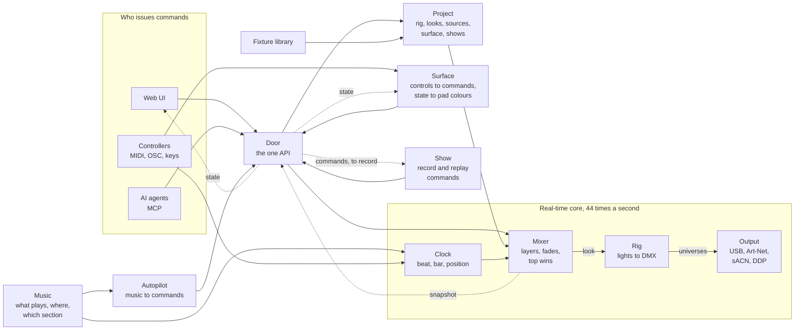

# Module boundary map

Status: draft for review. Nothing here is built. Read [theory.md](theory.md) first.

John Ousterhout's rule: a good module is **deep**. It hides a lot behind a small interface. The cost of a module is its interface (what everyone else must know), the benefit is what it hides. So the map below has few modules, each interface is a handful of operations, and for each one the question is "what does nobody else have to know?".

## The map

Two flows cross the whole system. Commands go in from the left. Frames come out on the right. The dashed box is the real-time core.

Rules of the map:

- Arrows point one way. Nothing in the real-time core calls anything outside it.
- Every writer goes through the Door. There is no side entrance.
- Only Output knows what a DMX byte is. Only Rig knows what an address is.

## The modules

Each entry: what it is for, its interface (all of it), and what it hides.

### Door

- **For:** the single way in and out of the engine.
- **Interface:** `send(command)`, `subscribe(topic) -> snapshots`, `query(question) -> answer`.
- **Hides:** transports (WebSocket for the UI, MCP for agents, OSC), versioning, permissions, turning commands into either a project edit or a performance action.
- **Depth check:** three operations cover every screen, every controller and every agent. If a feature needs a fourth, the feature is wrong.

### Mixer

- **For:** answering "what should every light do right now".
- **Interface:** `apply(command)`, `frame(time) -> look`.
- **Hides:** the three layers, fades in and out, launch on the beat, flash and hold, release, masters, blackout, preview.
- **Depth check:** callers say "start", "stop", "set level". They never learn how two things are blended.

### Sources (inside Project)

- **For:** everything that can play.
- **Interface:** `evaluate(time, clock, inputs) -> look`. One function.
- **Hides:** chaser steps, movement maths, pixel matrices, audio-reactive scripts, palettes, generated looks, laser shapes.
- **Depth check:** ten QLC+ function types become one interface with one operation.

### Clock

- **For:** one shared sense of time.
- **Interface:** `now() -> { beat, bar, tempo, position }`, `follow(feed)`.
- **Hides:** tap tempo, beat tracking from audio, MIDI clock, DJ software position, timecode, smoothing, drift, picking between feeds.

### Rig

- **For:** knowing the lights.
- **Interface:** `fixtures()`, `groups()`, `resolve(look) -> universes`.
- **Hides:** addresses, modes, 16-bit channels, colour mixing for RGB, CMY and colour wheels, pan and tilt limits and inversion, channel curves, swapping a fixture for another model.
- **Depth check:** the largest pile of ugly detail in the product sits behind one function.

### Fixture library

- **For:** describing fixture models.
- **Interface:** `search(text)`, `model(id) -> { modes, heads, attributes }`.
- **Hides:** the QLC+, Open Fixture Library and GDTF file formats and their quirks.

### Output

- **For:** getting universes to hardware.
- **Interface:** `devices()`, `send(universes)`.
- **Hides:** USB timing and reconnects, Art-Net, sACN, DDP, rates, discovery, the laser DAC later.

### Project

- **For:** what the user made.
- **Interface:** `read(path)`, `edit(change)`, `undo()`, `redo()`. Saving is automatic.
- **Hides:** the file format, autosave, migration between versions, undo history.

### Surface

- **For:** the live console the user designs.
- **Interface:** `layout()`, `press(control) -> command`, `reflect(state) -> control states`.
- **Hides:** widget types, pages and frames, MIDI learn, controller profiles, pad colours and blinking.
- **Depth check:** a Launchpad and the screen are two views of the same layout. Neither knows about the other.

### Show

- **For:** time-ordered commands.
- **Interface:** `record(commands)`, `play(position) -> commands`, `edit(change)`.
- **Hides:** tracks and clips, nested song shows inside a recorded set, quantizing, the mapping from song sections to blocks that the Song Director edits.

### Music

- **For:** knowing what is playing.
- **Interface:** `playing() -> { song, position, section, energy }`, `analyse(file) -> sections`.
- **Hides:** VirtualDJ's protocols, the analysis pipeline, beat grids, confidence.

### Autopilot

- **For:** running the lights with nobody at the desk.
- **Interface:** `start(style)`, `stop()`. It only ever issues commands.
- **Hides:** how it chooses looks for a section and an energy level, how it avoids repeating itself, how it stays out of the way of the Live layer.

## Which screen talks to which module

The screens are thin. Each one is a view of one or two modules through the Door.

| Screen | Reads | Sends |
|---|---|---|
| Live console | Surface, Mixer snapshot | presses |
| Autopilot | Autopilot, Music, Mixer snapshot | start, stop, style |
| Show (timeline, recorder, runner) | Show, Clock | record, play, edits |
| Songs (Song Director) | Show, Music | edits to section blocks |
| Looks | Project (sources, palettes), Mixer preview | edits, preview commands |
| Patch | Rig, Fixture library | edits |
| DMX control | Rig, Mixer snapshot, Output | raw-channel commands on Live |
| In/Out | Output, Clock, Surface (controllers) | device settings |

## What deliberately has no module

- **"Function manager", "virtual console", "simple desk"** as separate engines. They are screens over Sources, Surface and Mixer.
- **A universe object that parts of the program write to.** Universes exist only as the return value of `Rig.resolve`.
- **A plugin interface.** Outputs and sources are added in code until two real cases show what a plugin needs.

## Questions for review

1. Is **Door** with three operations believable to you, or does it smell like one giant "do anything" function?
2. **Sources live inside Project**, so playing something means the Mixer reads the project. Should playing be possible for things that are not saved?
3. **Surface owns controller mapping.** In QLC+ that sits in input/output profiles. Does moving it here match how you think about your Launchpad?
4. **Music and Autopilot are separate.** Music knows what plays, Autopilot decides what to do about it. Is that the right cut for the EDM analysis work?
5. Which module do you expect to be the hardest to keep narrow?
