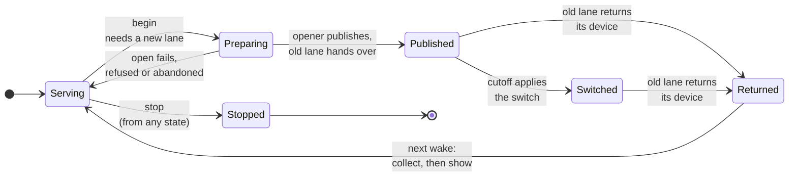

# Output cutover: one lane to the next

A restart or reroute that needs a new lane (#248) moves an output from the lane that sends now (old) to a lane prepared off the tick (new). Four rounds of fixes found the same gap: something of the old lane was lost or something of the new lane showed early. This page is the one machine for that move. Code: one type for the state, one transition function (a calculation), effects returned as data.

Three actors move it: the opener (off the tick: opens, publishes, completes the handoff, answers the writer), the old lane's thread, and the tick. Only the tick changes what readers see.

| State | Old lane | New lane | Tick hands due frames to | Readers see | Writer |
|---|---|---|---|---|---|
| Serving | the only lane | | it | its run | |
| Preparing | sends every due frame | opening off the tick | old | old run | waits |
| Published | sends the frames it holds, then returns its device | held, sends nothing | old (none: the cutoff comes first, see T5) | old run | waits |
| Switched | as Published | held: keeps the newest frame | new | old run | waits |
| Returned | parked, device given back, boxes on their way back | released: sends what it holds | new (once switched) | old run | `Accepted` |
| Stopped | device going back | freed | nobody | nothing new | `Stopping` |

## The rule

| # | Rule |
|---|---|
| R1 | Every frame handed to the old lane comes back exactly once (sent, failed, or passed over as `Dropped` under newest-wins). A frame queued behind a write in flight is sent by the old lane before it returns its device, not dropped |
| R2 | Every result the old lane returns is counted exactly once, on the old run (status, counters, lateness, outage, presses), before the new run is visible. The tick keeps the old lane until its last box is back. On a reused adapter its status and failures carry into the new run. The old run's counters (handed, drops, lateness, presses) end at the last snapshot before T9: what T9's own wake collects is counted on the old run and leaves with it, no reader sees it. Only status and outages carry |
| R3 | No reader (state, project, health, a second client) sees the new run before the writer's `Accepted`. The new run is visible from the snapshot of the first wake after the old lane returned (T9), never earlier |
| R4 | An outage of a reused adapter that crosses the switch ends with exactly one `OutputLost` and one `OutputAvailable` for a health reader, also across the new generation and also when the reader missed the samples in between |
| R5 | Until publication, nothing visible changes: the old lane sends every due frame, a press accepted meanwhile reaches the first due frame on the old run, a refusal or failed open changes nothing |
| R6 | The tick never waits, locks or allocates in any transition (`no_alloc` covers each one). The opener waits, bounded: the fence (T5) for at most the one wake past its cutoff; T8 for the old lane's write in flight and then one more, its newest frame (the older ones go back `Dropped`), since an adapter takes bytes and never waits (theory.md, idea 10); then the old device's `finish_route`. A DMX USB Pro's `finish_route` waits for the adapter's answer: bounded by `dmx_usb_pro::FINISH_WITHIN` (defined in #262; past it the opener goes on) once #262 lands, unbounded before. Every wait also ends when the tick or the old lane's thread is gone. Returning the device, releasing the new lane and `Accepted` need no wake: a held clock cannot stall them |

## Transitions

| # | State | Event (actor) | Next | What happens |
|---|---|---|---|---|
| T1 | Serving | `begin` needs a new lane (opener) | Preparing | new lane opens off the tick (waits for freed devices as today) |
| T2 | Serving, Preparing | wake (tick) | same | old lane gets the due frame (in Serving: the only lane) |
| T3 | any but Stopped | old lane: a frame back (tick collects) | same | counted on the old run (R2). In Serving the ordinary count; in Returned the last collection, done by T9's wake |
| T4 | Preparing | open fails, the switch is refused, or the opening is abandoned (opener: an `Opening` or `Opened` dropped before `finish`) | Serving | new lane freed off the tick (an abandoned one on the free-a-device thread, taken back by the front's next edit, which also gets the opener back and puts the project back); an already lost reused adapter keeps `Reconnecting` and is watched for its return |
| T5 | Preparing | publish (opener) | Published | after a wake already past its cutoff has handed its frame, the old lane is told to hand over after the frames it holds. The next cutoff carries the switch, so no later frame goes to the old lane |
| T6 | Published | cutoff applies the switch (tick) | Switched | the new lane takes the output's due frames, held; the old lane stays with the tick for collection; readers still see the old run |
| T6 after T8 | Returned | cutoff applies the switch (tick) | Returned | the old lane returned before the cutoff carried the switch: the switch is applied now (T9's step 1), and the same wake's T9 shows it. Each step of the tick and the front acts on the effect this table returns, never on the command's shape |
| T7 | Switched | wake (tick) | Switched | due frame to the new lane, held (newest wins in its boxes) |
| T8 | Published or Switched | old lane sent the frames it holds (newest sent, older passed over `Dropped`) and returns its device (old lane, opener) | Returned | the opener hands a reused device to the new lane with its failure state, releases the new lane (it sends the frame it holds at once, no wake) and answers `Accepted` |
| T9 | Returned | wake (tick) | Serving | in this order, one wake: (1) apply the switch if T6 has not; (2) collect every old box and count it (R2); (3) retire the old lane; (4) make the new run visible in state, project, generation and health, carried status on reuse. Readers see the new run from this snapshot on |
| T10 | any but Stopped | old adapter fails on a send it holds (old lane) | same | as T3 with `Failed`; on reuse the new run starts `Reconnecting` with the failures carried |
| T11 | any but Stopped | adapter returns | same | recorded on the lane's run; after a reuse, one `OutputAvailable` per carried outage (R4) |
| T12 | Preparing to Returned | `begin` for the same output (opener) | waits | the next switch starts from the accepted lane. Two waits, both off the tick: the server waits before it prepares the edit, up to 10 s (`CUTOVER_WAIT`), then refuses `Opening`; `Opening::open` waits again for callers of the engine itself, up to 1 s (`FREE_WITHIN`), then `CannotOpen { why: Unavailable }`. The engine's wait also covers a switch begun between the server's wait and admission |
| T13 | any | stop | Stopped | old device goes back, new lane freed, nothing sent after stop; a waiting writer gets `Stopping`. Every lane reads the engine's life ([engine.md](../engine.md#engine-life)) before each send, so this holds also for a lane the front no longer lists (a removed output whose remove the tick has not applied yet) |
| T14 | Stopped | publish (opener) | Stopped | refused before anything is queued: the prepared lane goes to the free thread, the opener goes back to the front, the project goes back to what it was (`OpenFailed`), the writer gets `Stopping`. A stop that lands after the switch was queued is T13: the opener's T8 sees it and the writer gets `Stopping` |
| | any other pair | | same | nothing: for instance a cutoff that sees a switch its peer already made, or any other event in Stopped. Repeating that effect would run it twice |

Tests walk every pair of state and event (`crates/engine/src/cutover.rs`), one row each, parameterized where rows share a shape. A row that cannot happen says why in its test.

## Held new lane

Between T6 and T8 the tick writes the new lane's due frames into two buffers, and the opener seals the newest at T8. One atomic word says which frame the lane keeps (`Held` in `crates/engine/src/lane.rs`, one transition function, tests walk every pair).

| Word \ event | Write (tick) | Seal (opener, T8) | Take (new lane, released) | Stop (T13) |
|---|---|---|---|---|
| Empty | write buffer 0, Published(0) | SealedEmpty | nothing | the lane sends nothing; its buffers go with it to the free thread |
| Published(b) | write the other buffer, publish it | Sealed(b) | nothing (not sealed) | as above |
| Sealed(b) | refused: the frame goes on the ordinary queue, after the sealed one | same | send buffer b, Taken | as above: a sealed frame is not sent |
| SealedEmpty | refused: queue | same | nothing | as above |
| Taken | refused: queue | same | nothing | as above |

The race: a seal between Write's buffer copy and its publication makes the publication fail. The older frame stays sealed and is sent first, the newer one goes on the queue (R1).

## Lane recovery

Each lane holds one recovery state and one watch mark in one atomic (`crates/engine/src/recovery.rs`, one transition function, tests walk every pair). The old `failed` flag, the `watch_loss` flag and "a device that does not reconnect itself" standing in for "no device" are gone.

| State \ event | SendFailed (lane) | SendAccepted (lane) | Replaced (lane: a reopened device took the old one's place) | Filled (lane: a device went into a lane with none) | WorkerGone (opener: the recovery worker could not be asked) |
|---|---|---|---|---|---|
| Healthy | Lost | same | same | same | same |
| Lost | same | Healthy | Healthy | same | Stranded |
| Missing | same (no device) | same (no device) | same (nothing to replace) | Lost, until a send is accepted | Stranded |
| Stranded | same | Healthy | Healthy | same | same |

| State | The recovery worker opens a device | Stop (T13) |
|---|---|---|
| Healthy | no | the lane ends, the state is not read again |
| Lost | only for a device that does not reopen itself | as above |
| Missing | yes | as above |
| Stranded | no worker | as above |

An open that fails changes nothing: the worker tries again on its next pass (every 100 ms).

| Watch \ event | Carry (T8 on reuse: the old lane's state, `Missing` if its device did not come back; a carried Lost, Missing or Stranded is watched) | RestartRefused (T4 with a reused source) | anything else |
|---|---|---|---|
| Unwatched | Watched when the carried state is not Healthy, or the old lane was watched | Watched | same |
| Watched | same | same | same |

A watched lane is the recovery worker's: health reads the mark on every failed frame back (until core's status table takes it, #260). Changed from before: a reused adapter carried Lost is now watched and reopened by the worker; before, only one missing or already watched was.
