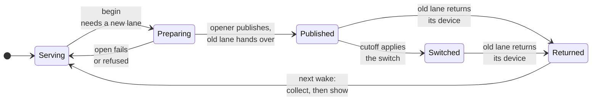

# Output cutover: one lane to the next

A restart or reroute that needs a new lane (#248) moves an output from the lane that sends now (old) to a lane prepared off the tick (new). Four rounds of fixes found the same gap: something of the old lane was lost or something of the new lane showed early. This page is the one machine for that move. Code: one type for the state, one transition function (a calculation), effects returned as data.

Three actors move it: the opener (off the tick: opens, publishes, completes the handoff, answers the writer), the old lane's thread, and the tick. Only the tick changes what readers see.

| State | Old lane | New lane | Tick hands due frames to | Readers see | Writer |
|---|---|---|---|---|---|
| Serving | the only lane | | it | its run | |
| Preparing | sends every due frame | opening off the tick | old | old run | waits |
| Published | sends the frames it holds, then returns its device | held, sends nothing | old (none: the cutoff comes first, see T5) | old run | waits |
| Switched | as Published | held: keeps the newest frame | new | old run | waits |
| Returned | parked, device given back, boxes on their way back | released: sends what it holds | new (once switched) | old run | `Accepted` |

## The rule

| # | Rule |
|---|---|
| R1 | Every frame handed to the old lane comes back exactly once (sent, failed, or passed over as `Dropped` under newest-wins). A frame queued behind a write in flight is sent by the old lane before it returns its device, not dropped |
| R2 | Every result the old lane returns is counted exactly once, on the old run (status, counters, lateness, outage, presses), before the new run is visible. The tick keeps the old lane until its last box is back. On a reused adapter its status and failures carry into the new run |
| R3 | No reader (state, project, health, a second client) sees the new run before the writer's `Accepted`. The new run is visible from the snapshot of the first wake after the old lane returned (T9), never earlier |
| R4 | An outage of a reused adapter that crosses the switch ends with exactly one `OutputLost` and one `OutputAvailable` for a health reader, also across the new generation and also when the reader missed the samples in between |
| R5 | Until publication, nothing visible changes: the old lane sends every due frame, a press accepted meanwhile reaches the first due frame on the old run, a refusal or failed open changes nothing |
| R6 | The tick never waits, locks or allocates in any transition (`no_alloc` covers each one). The opener may wait, bounded. Returning the device, releasing the new lane and `Accepted` need no wake: a held clock cannot stall them |

## Transitions

| # | State | Event (actor) | Next | What happens |
|---|---|---|---|---|
| T1 | Serving | `begin` needs a new lane (opener) | Preparing | new lane opens off the tick (waits for freed devices as today) |
| T2 | Preparing | wake (tick) | Preparing | old lane gets the due frame |
| T3 | Preparing, Published, Switched | old lane: a frame back (tick collects) | same | counted on the old run (R2) |
| T4 | Preparing | open fails, or the switch is refused (opener) | Serving | new lane freed off the tick; an already lost reused adapter keeps `Reconnecting` and is watched for its return |
| T5 | Preparing | publish (opener) | Published | after a wake already past its cutoff has handed its frame, the old lane is told to hand over after the frames it holds. The next cutoff carries the switch, so no later frame goes to the old lane |
| T6 | Published | cutoff applies the switch (tick) | Switched | the new lane takes the output's due frames, held; the old lane stays with the tick for collection; readers still see the old run |
| T7 | Switched | wake (tick) | Switched | due frame to the new lane, held (newest wins in its boxes) |
| T8 | Published or Switched | old lane sent the frames it holds (newest sent, older passed over `Dropped`) and returns its device (old lane, opener) | Returned | the opener hands a reused device to the new lane with its failure state, releases the new lane (it sends the frame it holds at once, no wake) and answers `Accepted` |
| T9 | Returned | wake (tick) | Serving | in this order, one wake: (1) apply the switch if T6 has not; (2) collect every old box and count it (R2); (3) retire the old lane; (4) make the new run visible in state, project, generation and health, carried status on reuse. Readers see the new run from this snapshot on |
| T10 | Published or Switched | old adapter fails on a send it holds (old lane) | same | as T3 with `Failed`; on reuse the new run starts `Reconnecting` with the failures carried |
| T11 | Serving, after a reuse | adapter returns | Serving | one `OutputAvailable` per carried outage (R4) |
| T12 | Preparing to Returned | `begin` for the same output (opener) | waits | the next switch starts from the accepted lane: its open waits (off the tick, bounded) until this one is Serving |
| T13 | any | stop | end | old device goes back, new lane freed, nothing sent after stop; a waiting writer gets `Stopping` |

Tests walk every row of this table, one row each, parameterized where rows share a shape. A row that cannot happen says why in its test.
