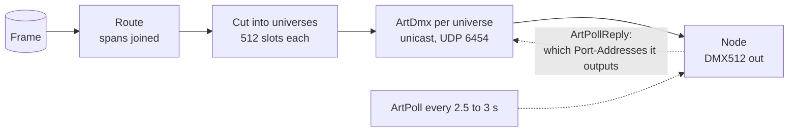
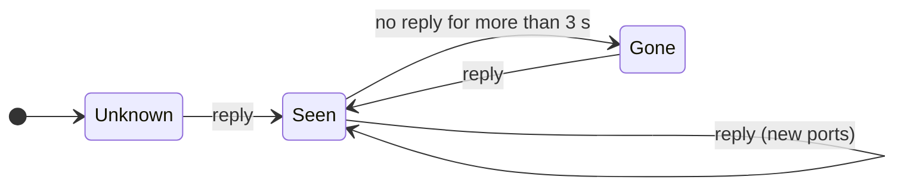

# Art-Net 4: the wire, from Artistic Licence's spec

Status: ArtDmx built in `crates/outputs/src/artnet.rs` (#289). Discovery (ArtPoll, our ArtPollReply, the node table, ArtDmx to subscribers) in `crates/outputs/src/artnet/` (#291). Neither is reachable in the app before #211. This page is our summary of the official spec, in our words. Page numbers are the ones printed in the spec's footer.

## Source

| | |
|---|---|
| Official | [Art-Net 4 specification](https://art-net.org.uk/downloads/art-net.pdf), protocol V1.4, document revision 1.4dp, 2025-10-23. Same file on [artisticlicence.com](https://artisticlicence.com/WebSiteMaster/User%20Guides/art-net.pdf) |
| Licence | royalty-free to use and build. The protocol and document are copyright Artistic Licence; "Art-Net" is their trademark |
| Duties | every product carries a registered **OEM code** (free, [form](https://art-net.org.uk/oem-code-zone/#apply-for-oem-code), asks for an ESTA manufacturer code). The user guide carries the line `Art-Net™ Designed by and Copyright Artistic Licence` (p. 9; the website adds "Engineering Ltd") |

## Packets we need

Every packet starts with the 8 bytes `Art-Net` and a zero, then a 16-bit opcode, **low byte first**. Other fields differ, so each is listed.

| Opcode | Packet | We |
|---|---|---|
| `0x2000` | ArtPoll: who is there | send every 2.5 to 3 s, and answer |
| `0x2100` | ArtPollReply: who I am, which Port-Addresses I output | read; send one for ourselves |
| `0x5000` | ArtDmx: one universe of DMX | send |
| `0x5200` | ArtSync: show the universes sent so far, all at once | not in v1 |

### ArtDmx: 18 bytes, then the slots

| Byte | Field | Value |
|---|---|---|
| 0 to 7 | id | `Art-Net` and `0x00` |
| 8 to 9 | opcode | `0x00 0x50` |
| 10 to 11 | protocol version | `0`, `14` (high byte first) |
| 12 | sequence | 0 = off; else 1 to 255, then 1 again |
| 13 | physical | where the data came from. Ours: 0, constant per output |
| 14 | sub-uni | Port-Address bits 7 to 0 |
| 15 | net | Port-Address bits 14 to 8 |
| 16 to 17 | length | **high byte first**. Even, 2 to 512 |
| 18 on | slots | no start code (always 0 for ArtDmx) |

### Port-Address: where a universe goes

| Bit 15 | Bits 14 to 8 | Bits 7 to 4 | Bits 3 to 0 |
|---|---|---|---|
| 0 | Net, 0 to 127 | Sub-Net, 0 to 15 | Universe, 0 to 15 |

- 15 bits: 1 to 32,767. **0 is deprecated** since revision DP (sACN has no universe 0).
- "Universe 1" is not defined by the spec. QLC+ sends its universe 1 as Port-Address 0, to broadcast.

### ArtPoll (22 bytes) and ArtPollReply (239 bytes)

| ArtPoll byte | Field |
|---|---|
| 12 | flags: targeted mode, send a reply on change, diagnostics |
| 13 | lowest diagnostics priority wanted |
| 14 to 17 | Port-Address range, with targeted mode |
| 18 to 21 | ESTA code, OEM code of the sender |

| ArtPollReply byte | Field | Tells us |
|---|---|---|
| 10 to 13 | IP | where to send its ArtDmx |
| 18, 19 | NetSwitch, SubSwitch | Port-Address bits 14 to 8 and 7 to 4 |
| 26, 44 | short name (18), long name (64) | what to show in the list |
| 172 to 173 | NumPorts | 0 to 4 ports in this reply |
| 174 to 177 | PortTypes | bit 7: this port outputs DMX from Art-Net |
| 190 to 193 | SwOut | Port-Address bits 3 to 0 of each output port |
| 200 | Style | 0 node, 1 controller |
| 211 | BindIndex | page of a node with more than 4 ports, same IP |
| 226 to 227 | RefreshRate | most ArtDmx a second it takes. 0 to 44 means 44 |

A port's Port-Address: `(Net & 0x7F) << 8 | (Sub-Net & 0x0F) << 4 | (SwOut[i] & 0x0F)`. A node is keyed by IP and BindIndex (0 or 1: the root). Receivers take 207 bytes or more, an ArtPoll 14 bytes or more; missing fields are 0 (p. 17, 36).

### Our ArtPoll: 22 bytes (p. 18 to 19)

| Byte | Field | Ours |
|---|---|---|
| 0 to 9 | id, OpPoll low first | `Art-Net\0`, `00 20` |
| 10 to 11 | protocol version, high first | `00 0E` |
| 12 | flags | `00`: no targeted mode, reply only when polled, no diagnostics |
| 13 | lowest diagnostics priority | `00` |
| 14 to 17 | target top, bottom | `00 00 00 00` |
| 18 to 19 | ESTA code, **high first** | `7F F0` (prototype range, until the owner's code) |
| 20 to 21 | OEM code, high first | `00 FF` (OemUnknown, until the owner's code) |

### Our ArtPollReply: 239 bytes, every other byte 0 (p. 36 to 44)

| Byte | Field | Ours |
|---|---|---|
| 8 to 9 | OpPollReply, low first | `00 21` |
| 10 to 13 | IP | our address toward the poller |
| 14 to 15 | Port, **low first** | `36 19` |
| 20 to 21 | OemHi, Oem | `00 FF` |
| 24 to 25 | ESTA code, **low first** | `F0 7F` |
| 26 to 43, 44 to 107 | short name, long name | `Bossylights` and zeros |
| 172 to 173 | NumPorts | 0: a controller with no ports |
| 200 | Style | 1, StController |
| 211 | BindIndex | 1, root |
| 212 | Status2 | `0x08`: 15-bit Port-Addresses |

### Reading a packet

| Packet | We |
|---|---|
| ArtPoll, 14 bytes or more, version 14 or more | answer with our reply, unicast to the poller's IP |
| ArtPoll in targeted mode (flags bit 5) | stay quiet: we have no port in any range (p. 17) |
| ArtPoll under version 14 | ignore (p. 18) |
| ArtPollReply, 207 bytes or more | the node's output ports: each port whose PortTypes bit 7 is set (NumPorts may be ignored, p. 39). Port-Address 0 takes nothing |
| anything else | ignore |

## Discovery

| Part | Rule |
|---|---|
| One per engine | one socket on 6454 (`SO_REUSEADDR`, `SO_REUSEPORT`, broadcast). Two of ours would split the replies |
| Poll | every 2.5 s, to the directed broadcast of each interface that is up (`broadcasts()`) |
| Answer | every poll, ours too: a controller replies to its own poll (p. 16). So the list shows Bossylights itself |
| ArtDmx | each universe to every Seen node that lists its Port-Address, from the output's own socket. Nobody lists it: nothing sent, the output still runs. `nodes()` shows who takes what; #211 shows "no node takes universe n" |
| Port taken | another program holds 6454 without sharing it: discovery does not start, the output sends to the typed address only |
| Output thread | reads a snapshot of (Port-Address, node) made on the discovery thread; the old one goes back to be freed there |

| Known limit | |
|---|---|
| One unreachable node | its send error ends that frame (the lane's rule); it leaves 3 s after its last reply |
| One lost reply | the node is Gone at 3 s and gets no ArtDmx until it replies again; it holds its last frame meanwhile |
| 6454 shared with another program | Linux spreads unicast replies across the sockets: some nodes can be missing from our list |
| Gone nodes | stay listed as Gone |
| No random reply delay | the spec's "should" is for large systems of nodes; we are one controller |

## Rules

| Rule | Value | Page |
|---|---|---|
| Transport | UDP only, port 6454 both ways | 10, 12 |
| ArtDmx | **unicast only**, to nodes that list that Port-Address in their reply. Nobody listed: send nothing. Broadcast never | 62 to 63 |
| ArtPoll | directed broadcast to 2.255.255.255 and 10.255.255.255 (or the subnet in use); 255.255.255.255 should not be used | 10, 15 to 16 |
| ArtPollReply | unicast; everyone answers a poll, controllers too | 16, 25 |
| Poll interval | 2.5 to 3 s. No reply within 3 s: the node is gone | 16 |
| Rate | at most the node's RefreshRate; a DMX gateway is 44 | 33, 64 |
| Unchanged data | send again about every 0.8 to 1 s (written for node inputs) | 62 |
| Node, no data | keeps sending its last DMX frame | 62 |
| Merge | the same Port-Address from two IPs is merged, at most two; a lost source is held 10 s | 64 to 66 |
| Old nodes | ignore protocol version under 14 | 18 |

## What we will send

| | Ours | Spec |
|---|---|---|
| ArtDmx | one per universe of the route, every frame, unicast | ✅ |
| Cut | the joined route in 512-slot universes; the last one padded to an even length | ✅ |
| Port-Address | the output's first Port-Address, then +1 per universe; 1 to 32,767 | ✅ 0 refused |
| Sequence | 1 to 255 per universe, skipping 0 | ✅ |
| Rate | 44, or lower. Every frame is sent, so unchanged data repeats at the rate | ✅ |
| Where | every node subscribed to the Port-Address (discovery); the typed address when 6454 is not ours to share | ✅ |
| ArtPoll, our ArtPollReply | every 2.5 s, and an answer to every poll | ✅ |
| OEM code | `0x00FF` and ESTA `0x7FF0` until the owner's registration | required in ArtPoll and ArtPollReply, not in ArtDmx |

## Sequence: one counter per universe

A fixed array of 128 counters, one per universe of a route, made at open. A counter steps when its universe's packet is written, also if that send then fails: a gap forward is fine for a receiver, a repeat is not. A device that sends another route carries its counters on.

| counter \ event | its universe is sent | another universe is sent | a frame without it |
|---|---|---|---|
| 0 (never sent) | 1 | 0 | 0 |
| n, 1 to 254 | n + 1 | n | n |
| 255 | 1 | 255 | 255 |
