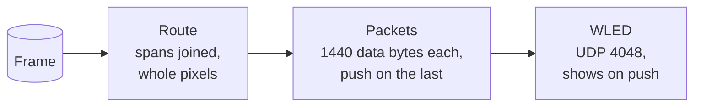

# DDP: the wire, from the 3waylabs spec and WLED

Status: built (`crates/outputs/src/ddp.rs`). This page is our summary of the official spec, in our words. The machines inside the adapter: [outputs.md](outputs.md).

## Source

| | |
|---|---|
| Official | [Distributed Display Protocol](http://www.3waylabs.com/ddp/), 3waylabs, protocol version 1, page updated 2022-09-05 |
| Receiver we target | WLED: [DDP docs](https://kno.wled.ge/interfaces/ddp/), [realtime settings](https://kno.wled.ge/features/settings/). Its source is EUPL: behaviour read, nothing copied |
| Licence | the spec calls DDP an open protocol anyone may use and build. No licence or copyright named for the page or its sample code: read, never copy |

## A packet

All numbers big endian.

| Byte | Field | Value |
|---|---|---|
| 0 | flags | `V V x T S R Q P`: version `01` (`0x40`), T timecode follows, S storage, R reply, Q query, P push |
| 1 | sequence | low 4 bits: 1 to 15, 0 = not used |
| 2 | data type | `C R TTT SSS`: TTT 001 RGB, 011 RGBW; SSS 011 = 8 bits. So `0x0B` RGB, `0x1B` RGBW. 0 = undefined, allowed |
| 3 | id | 1 default output, 246 control, 250 config, 251 status, 254 DMX, 255 all |
| 4 to 7 | offset | where this data starts in the display's buffer, bytes |
| 8 to 9 | length | data bytes that follow |
| 10 to 13 | timecode | only with T |
| 10 (or 14) on | data | |

## Rules

| Rule | Value | Source |
|---|---|---|
| Port | UDP 4048 at the display, any source port | spec, Port Numbers |
| Most data in one packet | 1440 bytes (480 RGB or 360 RGBW pixels), fits one Ethernet frame | spec, Code |
| Push | show the buffer now. One display: P on the last packet of a frame. Many displays: data without P, then one P packet with no data to all | spec, Protocol Operation |
| Order | packets in any order; the buffer is not cleared between frames | spec, Protocol Operation |
| Rate, keep-alive, timeout | none in the spec | |
| Discovery | ask id 251 (status) at an address; an answer means a display. Broadcast discovery is not decided | spec, Discovery |

## WLED as the receiver

| | |
|---|---|
| Listens | always on UDP 4048 (the docs still say to switch on DDP mode) |
| Pixel size | RGBW when TTT is 011, otherwise RGB. 8 bits always |
| Push | until the first P of a session, every packet shows. After it, only P packets show |
| Fastest | shows a frame only after more than 15 ms (about 62 a second) |
| Timeout | no packet for 2.5 s (setting, up to "never"): back to its own effects |
| Ignored | query, reply, status, config, control. Pixel count comes from its JSON API, not from DDP |

## What we send

| | Ours | Spec / WLED |
|---|---|---|
| Flags | `0x40`, `0x41` on the last packet | ✅ |
| Sequence | 1 to 15, then 1; the same for every packet of a frame | ⚠ the spec counts per packet. WLED checks only the push packet, so it takes ours (gap D3) |
| Type | `0x0B` or `0x1B` from the output's colour | ✅ |
| Id | 1 | ✅ |
| Packets | 1440 data bytes, whole pixels, the route joined | ✅ |
| Rate | 30, 44 or 60 | under WLED's 62, far over its 2.5 s timeout |
| Discovery, query, timecode | not sent | optional |

## Gaps for the planner

| # | Gap | Effect | Recommended |
|---|---|---|---|
| D1 | two WLEDs on one show each get their own P, not one shared P | each shows its frame as it lands, under 1 ms apart on a LAN | keep. Shared push only if the owner sees tearing |
| D2 | no discovery | the user types the address | later: list WLEDs by their JSON API, not by DDP |
| D3 | one sequence number per frame, the spec says one per packet | a receiver that checks every packet sees repeats; WLED does not | keep. Counting per packet changes bytes and `ddp_loopback.rs`: its own ticket, only if a receiver needs it |
