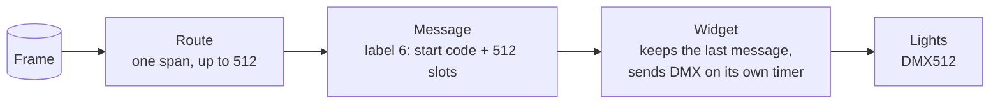

# DMX USB Pro: the wire, from ENTTEC's API

Status: built (`crates/outputs/src/dmx_usb_pro.rs`). This page is our summary of the official API, in our words. The machines inside the adapter: [outputs.md](outputs.md).

## Source

| | |
|---|---|
| Official | [DMX USB Pro API, v1.44](https://cdn.enttec.com/pdf/assets/70304/70304_DMX_USB_PRO_API.pdf), linked from the [product page](https://www.enttec.com/product/dmx-usb-interfaces/dmx-usb-pro-professional-1u-usb-to-dmx512-converter/). No date printed; PDF made 2021-02-17 |
| Also read | [user manual](https://cdn.enttec.com/pdf/assets/70304/70304_DMX_USB_PRO_USER_MANUAL.pdf), [datasheet](https://cdn.enttec.com/pdf/assets/70304/70304_DMX_USB_PRO_DATASHEET.pdf), [support FAQ](https://support.enttec.com/dmx/usbdmx-dmx-usb-pro-70304/dmx-usb-pro-api) |
| Licence | none stated. ENTTEC offers it as a developer API to build into your own software. No copyright line, no terms. Its example code has no licence: read, never copy |

## A message (both directions)

| Byte | Field | Value |
|---|---|---|
| 0 | start | `0x7E` |
| 1 | label | what the message is (below) |
| 2 to 3 | data length | little endian, 0 to 600 |
| 4 to 3 + n | data | n bytes |
| 4 + n | end | `0xE7` |

No checksum, no escaping: the length frames the data. An unknown label is ignored without an answer (API p.2).

## Labels

| Label | Way | Does | Data |
|---|---|---|---|
| 3 | to widget | ask its settings | 2 bytes: how much user memory to read (0) |
| 3 | from widget | its settings | firmware (2), break, mark after break, rate, user memory |
| 4 | to widget | set break, mark, rate. Kept in flash | user memory size (2), break, mark, rate, user memory |
| 5 | from widget | DMX it received (input mode) | status, then start code and slots |
| **6** | to widget | **send DMX**: the widget repeats it until the next | start code + 24 to 512 slots (25 to 513 bytes) |
| 7, 11 | to widget | RDM (firmware variety 2) | |
| 8, 9 | both | receive DMX only on change | |
| 10 | both | serial number: 4 bytes BCD, low byte first | none / 4 |
| 1, 2 | to widget | firmware update | |

**Any request other than 6 or 3 stops the output** and turns the port to input until the next label 6 (API p.4). Read the serial before sending DMX, or send label 6 right after.

## Rates and timing

| | Value | Source |
|---|---|---|
| Break | 9 to 127 steps of 10.67 µs. Default 9 (96 µs) | API p.3, manual p.6 |
| Mark after break | 1 to 127 steps of 10.67 µs. Default 1 | API p.3, manual p.6 |
| Output rate | 1 to 40 DMX frames a second, 0 = as fast as it can. Default 40 | API p.3 |
| Host faster than the widget | newer message replaces the older one, nothing queues | FAQ |
| One host message = one DMX frame? | no, the widget's timer is free running | FAQ |
| Baud rate | ENTTEC: a dummy on a virtual COM port. Our measurement: the widget link drains about 5 kB/s at 57 600, so we open at 500 000 | API p.1; [dmx-timing spike](../spikes/dmx-timing.md) |

## Finding the adapter

| | |
|---|---|
| USB identity | FTDI `0403:6001` (only in ENTTEC's example code). Shared by many FTDI cables |
| What tells it apart | ENTTEC: send label 3, a Pro answers with label 3. We take `0403:6001` named "DMX USB PRO" or with no product name, skip `/dev/tty.*`, and order by USB serial number |
| Stable identity | the widget's serial (label 10), the number on its case |

## What we send

| | Ours | Spec |
|---|---|---|
| Message | label 6, length 513, start code 0, 512 slots (route zero-padded) | 25 to 513 bytes ✅ |
| Universe size | always 512 | API: the length sets the size; FAQ: always 512 goes out. Sending 512 avoids the question |
| Rate | 44 a second, or lower | the widget sends at most 40 (its default). At 44 about 4 messages a second are replaced before they go out |
| Labels 3, 4, 10 | never sent | optional |
| Reading | nothing read back | optional |

## Gaps for the planner

| # | Gap | Effect | Recommended |
|---|---|---|---|
| U1 | we send 44, the widget outputs at most 40 | a press waits for the widget's next period (at most 25 ms), never lost | keep 44 (the newest wins). Note it in Patch's rate help |
| U2 | the adapter is found by USB identity and name, not by asking label 3 | any FTDI `0403:6001` with no product name, or one named "DMX USB PRO", would be taken | ask label 3 once at open, before the first label 6 |
| U3 | the adapter is numbered by USB serial, not by the widget serial | not measured whether the two orders agree; only matters with two adapters | keep |
