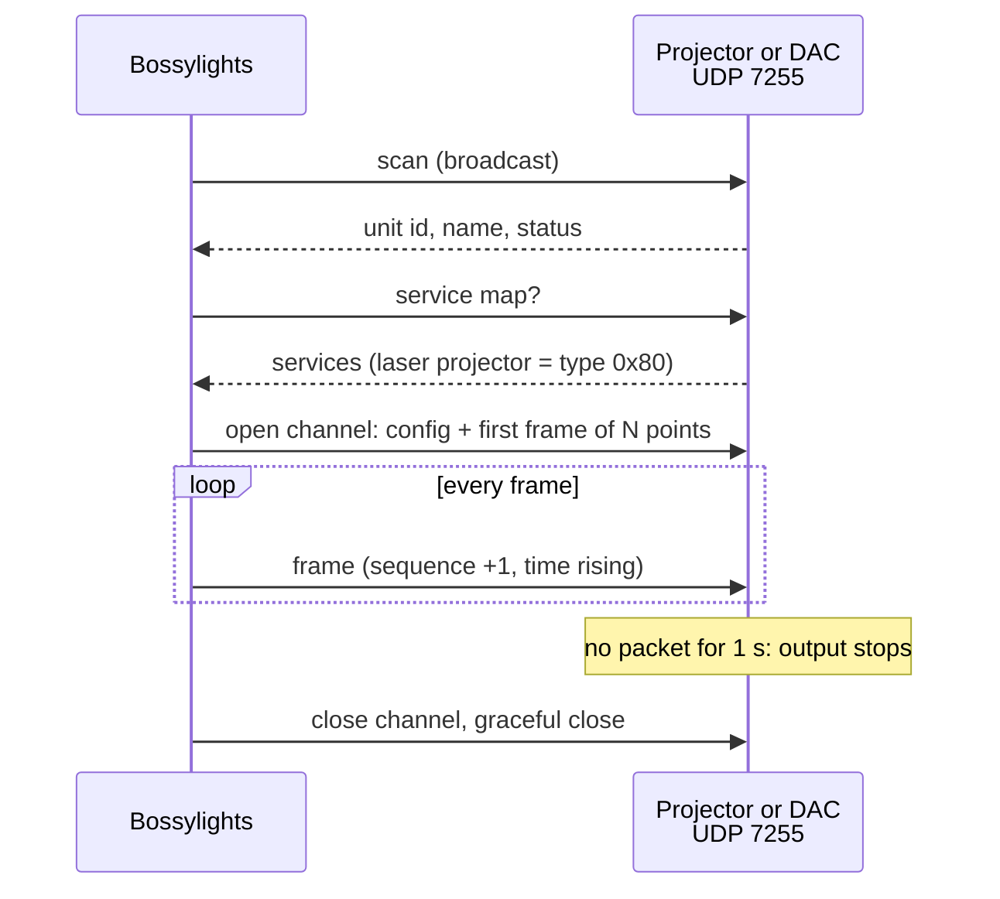
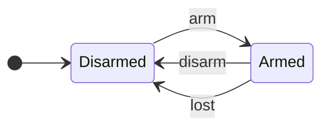
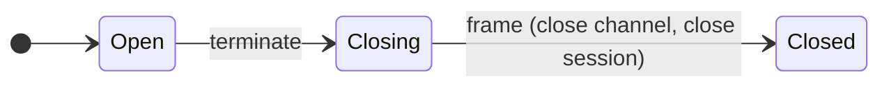

# IDN (ILDA Digital Network): the wire for lasers

Status: bytes built, not reachable in the app. This page is our summary of ILDA's documents, in our words. "S" is IDN-Stream rev 002, "H" the IDN-Hello draft.

## Source

| Document | State | Link |
|---|---|---|
| IDN-Stream rev 002, July 2025 | adopted | [PDF](https://www.ilda.com/resources/StandardsDocs/ILDA-IDN-Stream-rev002.pdf) |
| IDN-Hello, draft 2022-03-27 (discovery and the UDP transport) | **draft**, reports version 0.1 | [PDF](https://www.ilda.com/resources/StandardsDocs/IDN-Hello-2022-03-27-draft.pdf) |
| ILDA Image Data Transfer Format rev 011 (`.ild` files) | adopted | [PDF](https://www.ilda.com/resources/StandardsDocs/ILDA_IDTF14_rev011.pdf) |
| Index | | [ilda.com technical standards](https://www.ilda.com/technical.htm) |
| Licence | "an open standard anyone may implement" ([ilda.com/idn.htm](https://ilda.com/idn.htm)). The PDFs are © ILDA, no licence, no patent statement. Never copy their text |

| Software | What | Licence |
|---|---|---|
| [OpenIDN](https://gitlab.com/laser_light_lab_uni_bonn/OpenIDN-Laser-DAC-Framework) (University of Bonn) | a **receiver**: takes IDN, drives a Helios or Ether Dream DAC, runs on a Raspberry Pi. HeliosPRO is built on it | BSD-style (3 clauses, no SPDX tag). It bundles `etherdream.c` under GPL or LGPL: never take that file |
| [DexLogic samples](https://github.com/DexLogic/idn-C-helloScan) (an IDN author) | sender and discovery samples | MIT |
| [laser-dac-rs](https://github.com/ModulaserApp/laser-dac-rs) | Rust: Helios, Ether Dream, IDN, LaserCube | MIT in its Cargo.toml; no LICENSE file in the repo |

## IDN-Hello: every packet

| Byte | Field | Value |
|---|---|---|
| 0 | command | below |
| 1 | flags | bits 3 to 0: client group, 0 by default |
| 2 to 3 | sequence | requests: echoed back. Streaming: +1 per packet |

All numbers big endian. Port **UDP 7255**, the answer comes from the port asked.

| Command | Does |
|---|---|
| `0x08`, `0x09` | ping, its answer |
| `0x10`, `0x11` | scan (broadcast, multicast or unicast), its answer (40 bytes): status, unit id, host name (20 bytes) |
| `0x12`, `0x13` | service map, its answer: 24-byte entries of service id, type, flags, name |
| `0x40` | a channel message (empty: keep the link) |
| `0x41` | the same, asking for an acknowledge (`0x47`) |
| `0x44` | graceful close: finish, close channels, close the link |
| `0x46` | abort. **Not a safety function** (H 6.2.3) |

Scan status bits: 7 malfunction, 6 offline, 5 excluded, 4 occupied, 0 takes realtime streams.

## IDN-Stream: a channel message

| Byte | Field | Value |
|---|---|---|
| 0 to 1 | total size | 8 to 65,280 |
| 2 | channel | bit 7 set, bit 6 "config follows", bits 5 to 0 the channel id |
| 3 | chunk type | `0x01` wave samples, `0x02` a whole frame, `0x03`/`0xC0` frame fragments, `0x00` void |
| 4 to 7 | timestamp | µs, rising, never ahead of the send time |
| then | config (optional) | count of 32-bit tag words, flags (bit 1 close, bit 0 open), service id (0: default), service mode |
| then | tags | 16 bits each, what one sample holds |
| then | chunk header | flags (bit 0 "once" for frames), duration in µs (24 bits) |
| then | samples | |

| Service mode | Means |
|---|---|
| `0x01` continuous | gapless samples; we must never run dry |
| `0x02` **discrete** | frames: each replaces the last, the last repeats on its own |
| `0x05`, `0x06` | a DMX512 universe over IDN |

### One sample, the default colour set (7 bytes)

| Tags | Bytes | Value |
|---|---|---|
| `4200 4010` | X, 16 bits | **signed**, + is right |
| `4210 4010` | Y, 16 bits | signed, + is up |
| `527E` | red, 638 nm | 0 off to 255 |
| `5214` | green, 532 nm | |
| `51CC` | blue, 460 nm | |
| `0000` | void | pads the tags to whole 32-bit words |

At least X, Y and one colour. Shutter comes from the channel being open, not from the samples.

### The fields, bit by bit

| Field | Bits | Source |
|---|---|---|
| Content ID (bytes 2 to 3) | `8000` channel message, `4000` config follows, `3F00` channel id, `00FF` chunk type | S 2.1 |
| Config flags | bits 5 to 4 data match (0 here), bit 1 close, bit 0 routing (open and route the channel). Word count, service id and mode are 0 without routing | S 2.2 |
| Chunk header flags | bits 5 to 4 config match (0 here), bit 0 once: draw the frame one time, then wait at home (0, 0) | S 6.2 |
| Empty frame | a frame chunk with no samples, duration 0: voids the repeating frame | S 6.2 |
| Discrete mode shutter | opens with the first channel in the mode, closes when the last closes. An empty frame leaves it open | S 3.3 |
| Close | a void chunk (`C000`) with config flags close only, then Hello `44` | S 2.2, H; DexLogic sender, MIT |

## Rules

| Rule | Value | Source |
|---|---|---|
| A projector plays | at least 100,000 samples a second | S 3.1 |
| Points a second, typical | not in ILDA's papers. Samples use 30,000; OpenIDN advises at most 50,000 for a Helios | code, README |
| Frame | at least 2 samples; the first is the invisible start point. Duration = (N - 1) / points a second | S 6.2 |
| Empty frame | clears the repeat | S 6.2 |
| Config | send again every 200 to 250 ms; change it at most every 100 ms | S 2.2 |
| Link | no packet for **1 s**: link and session close, **output stops** | H 7.2 |
| Session timeout | exists, no value given | H 6.1 |
| Size | one Ethernet frame holds about 205 points; a discrete frame may use IP fragments | S 6.1, 6.2 |

## What we send

`crates/outputs/src/idn.rs`. Not reachable in the app yet: the wiring ticket adds the kind.

| | Ours | Spec |
|---|---|---|
| Route | 7 channels a point: X coarse and fine, Y coarse and fine, red, green, blue. At most 9,321 points | ✅ one message |
| X, Y | the channel word (0 to 65,535, centre 32,768) with its top bit flipped: 0 is -32,768, 65,535 is 32,767 | ✅ signed |
| Frame | one discrete frame per engine frame, one datagram, IP fragments when bigger than the link | ✅ S 6.2 |
| First point | its colour sent as 0 | ✅ invisible anyway |
| Duration | (points - 1) x 1,000,000 / points a second, rounded down. Points a second: the output's setting, 1,000 to 100,000 (the longest frame stays inside the 24-bit duration), 30,000 by default | ✅ |
| Once | never: a frame shorter than the engine's period would go dark between frames | |
| Config | in every frame message, never changed: routing, default service, discrete, the 8 tags | ✅ at least every 200 ms |
| Timestamp | µs since the output opened, read once per frame, wraps | ✅ rising, never ahead |
| Sequence | Hello sequence from 0, +1 per datagram, wraps | ✅ |
| Where | one projector at a typed address, port 7255 on a real network | ✅ no scan yet |
| Stop | close channel, then close session, back to back | ✅ graceful close |

### Laser safety (r-laser-safe)

The one exception to "the last good frame stays" (`docs/coding.md` rule 6): a laser goes dark on doubt.

| Case | We send |
|---|---|
| Opened | empty frames: disarmed until Arm |
| Armed, 2 points or more | the frame |
| Armed, fewer than 2 points | an empty frame |
| Disarmed | empty frames |
| A send failed: nobody listens, or the socket broke | disarmed: empty frames after the link is back, until Arm |
| The engine stops sending | nothing: the projector stops by itself after 1 s (H 7.2) |
| The cable is pulled (no send error) | still armed: the projector stops after 1 s; when the cable is back the frame is drawn again. Accepted only while IDN is not reachable; #341 disarms on a missing acknowledge before the wiring ticket |
| Terminate | close channel, close session (the shutter closes, S 3.3) |

### The arm machine

One atomic shared by the output and its `Arm` handle. A table test walks every pair.

| arm \ event | arm | disarm | lost (a send failed: not there, broken) |
|---|---|---|---|
| Disarmed | Armed | Disarmed | Disarmed |
| Armed | Armed | Disarmed | Disarmed |

### The channel machine

As sACN's stream. `terminate` is called off the output thread when the output is removed or the engine stops; it sends the closing frame itself.

| channel \ event | frame | terminate |
|---|---|---|
| Open | Open, a frame or an empty frame | Closing, 1 closing frame left |
| Closing | Closed, close channel and close session | Closing, 1 left |
| Closed | Closed, nothing sent (the engine is told Accepted: nothing failed; unreachable, the output is gone) | Closed, 0 left |

## Other laser DACs

| DAC | Link | Official code | For us |
|---|---|---|---|
| HeliosPRO, LaserCube Ultra MK2 and Pro | IDN | | one IDN sender drives them |
| OpenIDN on a Pi + Helios | IDN in, USB out | BSD-style | the same sender |
| Helios | USB | SDK MIT | possible later |
| Ether Dream | TCP 7765, own protocol | GPL or LGPL: no code | own code from its protocol page only |
| LaserCube network | own protocol, no official document | GPL-3.0 app | IDN mode instead |
