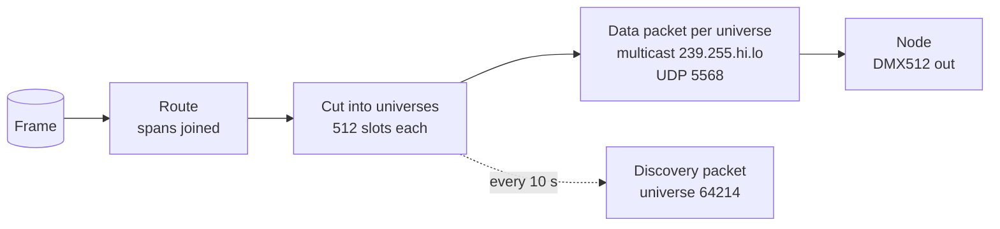

# sACN (ANSI E1.31): the wire

Status: not built. This page is our summary, in our words. The standard sits behind a sign-in, so every row below is checked against ETC's Apache-2.0 reference library and the Wireshark decoder, not against the standard's text. Rows nothing confirmed are marked ❔.

## Source

| | |
|---|---|
| Official | ANSI E1.31-2025, approved 2026-01-05 (adds IPv6 to its summary), from [ESTA's published documents](https://tsp.esta.org/tsp/documents/published_docs.php). E1.31-2018 is superseded |
| Licence | free download after an email sign-in, under [ESTA's EULA](https://tsp.esta.org/tsp/documents/docs/EULA.pdf): one copy on one computer, no passing on. **Never commit the PDF or its text.** No patent flag on ESTA's list |
| Checked against | [ETC sACN library](https://github.com/ETCLabs/sACN/tree/92cfafccc9a9a22efa404a068da8940657939f64) (Apache-2.0, implements 2018), [EtcPal](https://github.com/ETCLabs/EtcPal/tree/da14d39a1d1a2d47a481288dd2f9826aaab0cf88) (its ACN root layer), [ETC's docs](https://etclabs.github.io/sACNDocs/head/index.html), [Wireshark's decoder](https://gitlab.com/wireshark/wireshark/-/blob/master/epan/dissectors/packet-acn.c) (GPL: read for field order only) |
| Not checked | what the 2025 edition changes on the wire |

## Addressing

| | Value |
|---|---|
| Port | UDP 5568 |
| Universes | 1 to 63,999. 0 and 64,000 and up are refused by ETC (❔ the word "reserved") |
| Multicast, IPv4 | `239.255.{universe high byte}.{universe low byte}` |
| Multicast, IPv6 | `ff18::8300:{universe in hex}` |
| Unicast | allowed by ETC beside or instead of multicast (❔ the standard's wording) |
| Discovery universe | 64,214, so `239.255.250.214` |

## A data packet: 126 bytes, then the slots (638 for 512)

All numbers big endian. "Flags and length" is `0x7` in the top 4 bits, then the length from that field to the end of the packet.

| Byte | Field | Value |
|---|---|---|
| 0 to 1 | preamble size | `0x0010` |
| 2 to 3 | postamble size | `0x0000` |
| 4 to 15 | packet id | `ASC-E1.17` and three `0x00` |
| 16 to 17 | root flags and length | `0x726E` for 512 slots |
| 18 to 21 | root vector | `0x00000004`: data |
| 22 to 37 | CID | the sender's 16-byte UUID |
| 38 to 39 | framing flags and length | `0x7258` for 512 slots |
| 40 to 43 | framing vector | `0x00000002`: data packet |
| 44 to 107 | source name | UTF-8, ends with a zero, 64 bytes |
| 108 | priority | 0 to 200, default 100 |
| 109 to 110 | sync address | 0: not synchronised |
| 111 | sequence | per universe, +1 per packet, wraps |
| 112 | options | `0x80` preview, `0x40` stream terminated, `0x20` force sync |
| 113 to 114 | universe | 1 to 63,999 |
| 115 to 116 | DMP flags and length | `0x720B` for 512 slots |
| 117 | DMP vector | `0x02`: set property |
| 118 | address and data type | `0xA1` |
| 119 to 120 | first address | `0x0000` |
| 121 to 122 | address increment | `0x0001` |
| 123 to 124 | value count | slots + 1 (the start code) |
| 125 | start code | `0x00` |
| 126 on | slots | 0 to 512 |

## Rules

| Rule | Value | Confirmed by |
|---|---|---|
| Sequence, receiver | drops a packet whose number is 0 to 19 behind the last (a repeat too) | ETC receiver |
| Data loss | no packet for 2.5 s: the source is gone | ETC (names the standard's constant) |
| Unchanged data | keep sending. ETC: 4 packets after a change, then one every 800 ms (❔ the standard's numbers) | ETC source |
| Stop | 3 packets with "stream terminated", then silence. The receiver drops the source at once | ETC source and receiver |
| Rate | no limit found (❔). ETC sends every 23 ms | ETC |
| Priority | a higher priority wins. Equal priority: ETC merges highest level wins (❔ whether the standard says so) | ETC docs |
| Preview bit | for visualisers, not for live output | ETC quotes the standard |
| Discovery | every 10 s, to universe 64,214: pages of up to 512 universes, sorted (❔ whether every source must) | ETC source |
| CID | a 16-byte UUID (❔ RFC 4122, ❔ the same for the device's life) | ETC |

Sync packet (49 bytes, root vector `0x00000008`, vector `0x00000001`, sequence, sync address) and the discovery packet (root vector `0x00000008`, vector `0x00000002`, name, page, last page, universes) are in the ETC sources above. ETC leaves sync sending unfinished.

## What we will send

| | Ours | Spec |
|---|---|---|
| Data packet | one per universe of the route, every frame | ✅ |
| Cut | the joined route in 512-slot universes; the last may be shorter | ✅ any count 0 to 512 |
| Universe | the output's first universe, then +1; 1 to 63,999 | ✅ others refused |
| Where | multicast by default; unicast to a typed address as the other choice | ✅ |
| Sequence | one counter per universe | ✅ |
| Rate | 44, or lower. Every frame is sent, so unchanged data repeats at the rate | ✅ far inside 2.5 s |
| Priority | 100 | ✅ default |
| Source name | `Bossylights` and the output's number | ✅ |
| CID | one UUID per engine, kept | see the plan |
| Stop or reroute | 3 terminated packets per universe | ✅ |
| Discovery | every 10 s (second step) | ❔ required |
| Sync, preview | not sent | optional |
