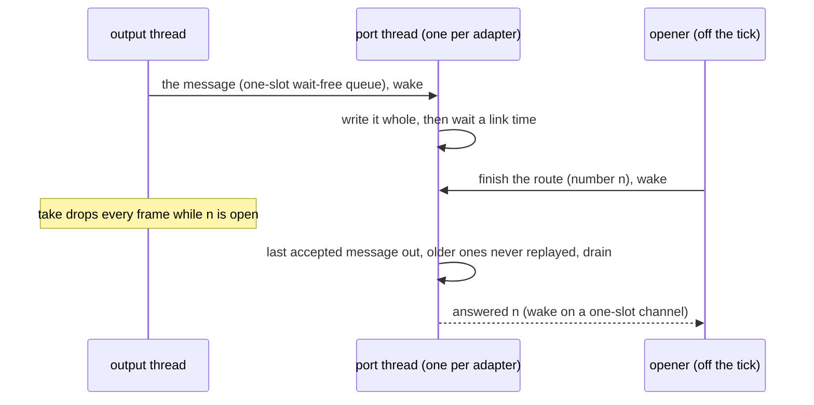
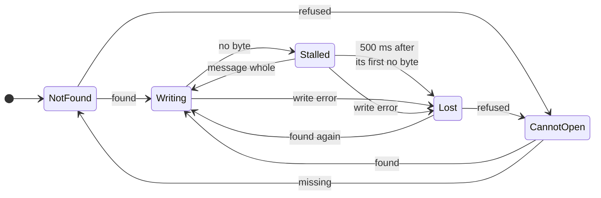
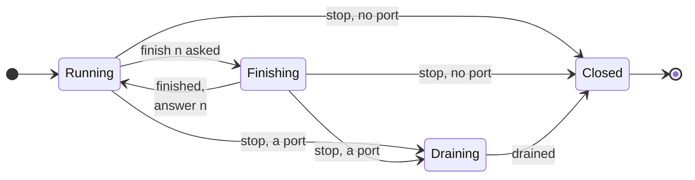
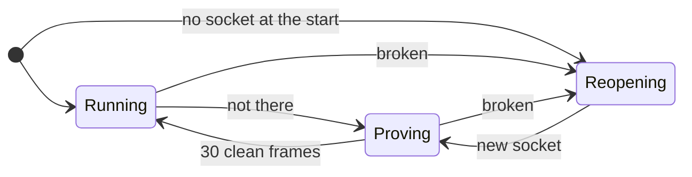
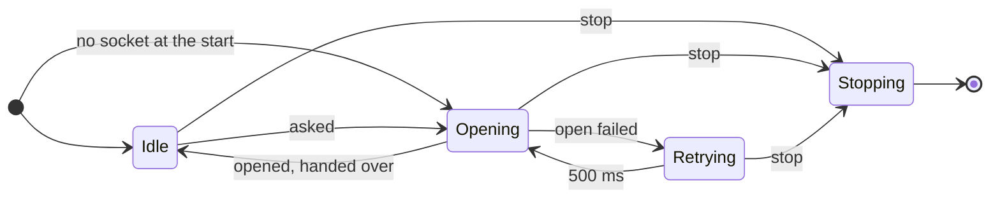

# Outputs: the machines inside each adapter

An adapter takes bytes and never waits ([theory, idea 10](theory.md)). What waits lives on the adapter's own thread, as the machines below. Each table is every pair of state and event; the tests walk each row (`crates/outputs`). "n/a" rows cannot happen and say why.

The wire of each kind, from its official spec: [DMX USB Pro](outputs-dmx-usb-pro.md), [DDP](outputs-ddp.md), [Art-Net](outputs-artnet.md), [sACN](outputs-sacn.md), [IDN for lasers](outputs-idn.md).

## DMX USB Pro

| Who | Does |
|---|---|
| output thread | `take`: one-slot queue, wake. Never calls the serial driver: a vanishing device holds it up for many milliseconds |
| port thread | every driver call: asks the widget its settings at each new port, writes, drains, looks for the adapter every 500 ms while it has no port |
| opener | asks a route finish and waits for the answer, at most `FINISH_WITHIN` |

### Link: the port thread's link to the adapter

| link \ seen | Bytes | NoBytes | Whole | Error(e) | Found | Missing | Refused(e) |
|---|---|---|---|---|---|---|---|
| NotFound | NotFound | NotFound | NotFound | Lost{e} | Writing | NotFound | CannotOpen{e} |
| CannotOpen{w} | same | same | same | Lost{e} | Writing | NotFound | CannotOpen{e} |
| Writing | Writing | Stalled{now} | Writing | Lost{e} | n/a: no look with a port | n/a | n/a |
| Stalled{s} | Stalled{s}, Lost{ETIMEDOUT} from s + 500 ms | as Bytes | Writing | Lost{e} | n/a | n/a | n/a |
| Lost{w} | Lost{w} | Lost{w} | Lost{w} | Lost{e} | Writing | Lost{w}: still unplugged | CannotOpen{e} |

Bytes never restart a stall's clock: a port that trickles a byte now and then is still lost after 500 ms.

### Not found or cannot open

A find error is one of two things. `lost_with` keeps the cause of `Lost` and `CannotOpen`; read today by the hardware check (`engine-server/examples/dmx_usb_pro.rs`) and its test. The API learns it with #265.

| find gives (its code) | seen | means |
|---|---|---|
| a port | Found | |
| ENOENT, ENXIO, ENODEV | Missing | no adapter (open(2)) |
| EACCES, EPERM | Refused(e) | the adapter is there, no permission (open(2)) |
| EBUSY | Refused(e) | another program holds it (TIOCEXCL: tty_ioctl(4), termios(4)) |
| any other | Refused(e) | |

The serial crate keeps only the kind of an open error (its `From<Error> for io::Error`), so a kind stands for the code std's `decode_error_kind` maps to it: PermissionDenied is EACCES, NotFound ENOENT, ResourceBusy EBUSY, any other EIO.

### Ask: the widget's settings, at each new port

One turn of the port thread: no port, it looks; a port not asked yet, one try; else one message. A try clears the input, writes label 3 (`7E 03 02 00 00 00 E7`) as the Link machine writes any message, then reads what comes for at most 50 ms (`ANSWER_WITHIN`). A stop or a finish ends the wait at once, as it ends a look, so the bound below holds: a request is "the message being written". Label 3 does not stop the widget's DMX output (API p.4: only a request other than 6 or 3 does), so the lights keep their last frame while it asks.

| ask \ heard | an answer in range | out of range, garbled or none in time | a stop or a finish | the write loses the port |
|---|---|---|---|---|
| Try 1 | Read: settings kept | Try 2 | Try 1 again after it: a cut try does not count | Lost: nothing kept |
| Try 2 | Read: settings kept | Done: nothing kept, the port stays in use | Try 2 again after it | Lost: nothing kept |
| Read | n/a: no more tries on this port | n/a | n/a | Lost: the kept settings are cleared |
| Done | n/a: no more tries on this port | n/a | n/a | Lost |

A port found (at open, or found again) starts at Try 1 with nothing kept. Two tries: the widget ignores the first "get parameters" after another program's run, and answers the second in 3 ms ([dmx-timing spike](../spikes/dmx-timing.md), "What failed"). In range (API p.3): break 9 to 127 and mark after break 1 to 127 steps of 10.67 µs, rate 0 to 40. While it asks, `take` keeps one frame queued and drops the rest: at most 100 ms at a port open.

### Life: the port thread's life

| life \ heard | Stop, a port | Stop, no port | Finish(n) | Finished | Drained |
|---|---|---|---|---|---|
| Running | Draining | Closed | Finishing{n} | n/a: nothing to finish | n/a: no drain running |
| Finishing{a} | Draining. Only after the opener gave up: while it waits it holds the device, so no drop | Closed (same) | n/a: not listened for while finishing. A newer ask stays asked and starts the next finish | Running, answer a | n/a |
| Draining | Draining | Draining | n/a: drop owns the device, no finish after it | n/a | Closed |
| Closed | Closed | Closed | Closed | Closed | Closed |

### Finishing: one turn

| the port thread sees | does | then |
|---|---|---|
| a port, nothing unsent, a message queued | writes it: the old route's last accepted frame | stays Finishing |
| a port, otherwise | drops `unsent` and the queue, drains | Empty: Finished. Stuck or Failed(e): clears the driver, Lost{ETIMEDOUT or e}, Finished |
| no port | drops `unsent` and the queue | Finished |

A message that lost its port belongs to the old route: it never replays on the new one.

### Drain: one look at the driver

TIOCOUTQ answers the bytes in the output queue (tty_ioctl(4); on macOS `sys/ttycom.h`, termios(4)). An error answers nothing about them.

| driver holds | since the drain began | answer |
|---|---|---|
| 0 | any | Empty |
| more | under 500 ms | look again in 1 ms |
| more | 500 ms or more | Stuck |
| an error e | any | Failed(e): not drained |

### The opener's wait

| its finish \ woke by | an answer | the time ran out | the port thread ended |
|---|---|---|---|
| still open | wait on (an answer to a finish it gave up on) | gives up | done |
| answered | done | done | done |

`take` answers `Dropped` while any finish is open (`gate`: lost fails, then an open finish or a full queue drops), so a give-up is safe: no frame of the next route meets the old one.

**The bound.** `FINISH_WITHIN = 3 x (STALLED_FOR + QUEUE_FULL + LINK_TIME)`, about 1.55 s: the message being written when the finish is asked, the one queued behind it, then the drain. Not covered: a USB port listing that hangs while the adapter is lost. Then the opener gives up and the output keeps dropping frames until the port thread answered.

## Every UDP output (DDP, Art-Net, sACN, IDN)

One lane (`udp.rs`) for every protocol over UDP. A protocol only cuts a frame into packets and writes them.

### Health: what the engine sees, frame by frame

| health \ event | Sent | Failed(Busy) | Failed(NotThere) | Failed(Broken) | NewSocket |
|---|---|---|---|---|---|
| Running | Running, Accepted | Running, Dropped | Proving{0}, Failed | Reopening, ask a socket, Failed | n/a: no socket asked |
| Proving{c} | Proving{c+1}, Running at 30, Failed until then | Proving{c}, Dropped | Proving{0}, Failed | Reopening, ask, Failed | n/a |
| Reopening | Reopening, Failed | Reopening, Dropped | Reopening, Failed | Reopening, Failed (asked once) | Proving{0}, Failed |

### The socket thread

The one owner of every reopen, also of a socket the system refused when the output was set. One atomic ask from the output thread: nothing, a socket, or stop (a stop is never overwritten).

| phase \ turn | asked | opened | open failed(e) | wait over | stop |
|---|---|---|---|---|---|
| Idle | Opening | n/a | n/a | n/a | Stopping |
| Opening | Opening: the same ask | Idle | Retrying{e} | n/a | Stopping |
| Retrying{e} | Retrying{e}: the same ask | n/a | n/a | Opening | Stopping |
| Stopping | Stopping | Stopping | Stopping | Stopping | Stopping |

`Retrying{e}` keeps the cause; no reader outside the crate yet (#265 carries causes to the API).
