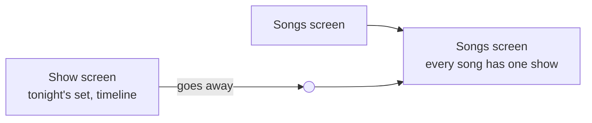

# Review 1: what the owner said, and what changes

Review of the mockups on 2026-11-17. Source: the export from the review layer.

## Verdicts

| Screen | Verdict | Rating |
|---|---|---|
| Console | Approve | 4 / 5 |
| Show | Change | 3 / 5 |
| Songs | Approve | 5 / 5 |
| Looks | not reviewed | |
| Patch | Approve | 4 / 5 |
| DMX | not reviewed | |
| In/Out | Approve | 4 / 5 |
| How it works | Approve | 5 / 5 |
| Modules | Approve | 5 / 5 |

## The big one: song = show

| Before | Now |
|---|---|
| A Show screen and a Songs screen | one screen: **Songs** |
| "Tonight's set" | gone. The app does not know the set in advance |
| Show = a recorded night with nested songs | one show per song, nothing else |
| Recording writes a set | recording writes into the show of the song that plays: a new layer, or an update |
| Recording keeps pad presses | it keeps fader moves too |
| Editing happens afterwards | if the song plays and LIVE is on, it is a live editor |
| Sections come from the analysis | they can also be moved, split, merged and renamed |
| No search | search and filters |

## Changes per screen

| Screen | You said | Change |
|---|---|---|
| Console | the rig view is too much | removed |
| Console | decks are 1 and 2 | renamed from A and B |
| Console | "on air" is wrong | "Playing" |
| Console | too many capital letters | sentence case. Capitals only for LIVE and NOW |
| Console | recording should be red when on | red |
| Console | speed should have tap | a Tap button beside the tempo, always visible |
| Patch | no map needed, rather a DMX view | the map is replaced by a universe grid |
| Patch | many universes for pixel screens | a universe list with fill bars, and "Add a pixel panel" that spreads over universes |
| In/Out | MIDI mapping must work across the whole app | a global **Learn** button. Every button and value can be mapped. In/Out holds the list to edit |
| Modules | "Door" is not a good name | renamed to **Engine** |

## No map anywhere

| Before | Now |
|---|---|
| Rig view on Console, rig map on Patch | neither |
| "Left to right" came from positions on a map | it comes from the **order** of the fixtures in a group |
| 2D rig view was a must | moved to later |

## Answers to the theory questions

| # | Question | Answer |
|---|---|---|
| 1 | Who wins inside a layer? | the top layer wins for everything |
| 2 | How many layers? | **the user can add layers** (this changes idea 5) |
| 3 | What does recording store? | commands, including fader moves |
| 4 | Where do raw channels live? | only on the DMX screen |
| 5 | DJ software and audio disagree on the beat | the feed you picked wins |
| 6 | What is Song Director? | an editor for a show whose blocks follow song sections |
| 7 | Anything missing from QLC+? | Song Director is the thing. No separate Show needed |

## Answers to the module questions

| # | Question | Answer |
|---|---|---|
| 1 | Is a Door with three operations believable? | no as named: it reads like "do anything". Renamed to **Engine**, with a listed set of commands |
| 2 | Can you play something that is not saved? | the question was unclear. Decision: everything you try is saved by itself, so the question disappears |
| 3 | Where does controller mapping live? | in Surface, next to the widgets |
| 4 | Music and Autopilot | two modules: knowing and deciding |
| 5 | Hardest module to keep narrow | not answered |

## Still to decide

| # | Question | Option A (recommended) | Option B |
|---|---|---|---|
| 1 | New name for "Door" | decided by the owner: **Engine** | |
| 2 | Name of the merged screen | **Songs**. A song has a show. The middle layer stays "Show" | Shows |
| 3 | Desk words for the other modules | Mixer to **Playback**, Rig to **Patch**, Project to **Show file**, Sources to **Looks**, Clock to **Tempo** | keep the current names |

## Not reviewed yet

- Looks
- DMX
- The merged Songs screen, once it is rebuilt
