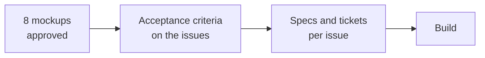

# Review 3: all eight screens approved

Review of the rebuilt mockups on 2026-11-18. Source: the export from the review layer.

## Verdicts

| Screen | Review 1 | Review 2 | Review 3 |
|---|---|---|---|
| Console | Approve 4 | Change 4 | **Approve 5** |
| Songs | Approve 5 | Change 4 | **Approve 5** |
| Looks | not reviewed | Change 4 | **Approve 5** |
| Patch | Approve 4 | Approve 4 | Approve 4 |
| DMX | not reviewed | Approve 5 | Approve 5 |
| In/Out | Approve 4 | Approve 5 | Approve 5 |
| How it works | Approve 5 | Approve 5 | Approve 5 |
| Modules | Approve 5 | Approve 5 | Approve 5 |

## Where the criteria went

| Screen | Issues with criteria from this review |
|---|---|
| Console | #74, #72 |
| Songs | #96, #47, #85, #94, #95, #99, #68 |
| Looks | #64, #58, #63, #59, #69, #60, #71, #87, #86 |

## Not shown in any mockup

| Issue | What is missing |
|---|---|
| #70 Cue lists | only a widget in the Console drawer. Needs its own design |
| #62 Audio-reactive colour scripts | patterns are the place, but picking and tuning a script is not designed |
| #95 Follow timecode | the mockup shows the choice only. Formats and offsets need a spec |

## Approved with the screens, not answered as questions

| # | Question | What the approved screen shows |
|---|---|---|
| 1 | Songs: does a new pass add to the Recorded row or replace it? | it adds |
| 2 | Modules: a Controllers module of its own? | yes, it is on the map |
| 3 | Looks: autopilot rules as "when, pick, fit" inside a style? | yes |

## Still open

| # | Question |
|---|---|
| 1 | Which module will be hardest to keep narrow? Never answered |
| 2 | Name of the merged thing: song or show? The screen is called Songs, the row is called Show |
| 3 | Desk words for the modules (Mixer, Rig, Project, Sources, Clock) |
| 4 | Laser model (#21), stack confirmation after the spikes (#25) |

## A note on the export

The export of this round came from a browser that still held the answers of review 1. Its old comments (rig view, decks, capital letters, MIDI) are already done. Where its answers differ from review 2, review 2 counts: controller mapping lives in In/Out.
