# The first screens

| Slice | What a person can see |
|---|---|
| Screens 1 | The app opens on a real show of the owner's rig, with or without hardware. Every workspace but Songs is real: DMX, In/Out, Patch, Looks and Console. A press on a pad shows on the DMX screen. With a USB DMX adapter or a WLED strip connected, the same press lights the real fixture. Nothing on screen is a placeholder. It lands in four waves, each reachable and complete (see "Rollout"). |

Sources: the approved mockups (`mockups/`, review 3), the control catalog (`docs/design/controls.md`, gate #102), `docs/design/screens.md`, `DESIGN.md`, and the owner's answers on the decisions page (2026-11-20). Every element in every situation is decided in the catalog. This doc decides the order, the data, the commands, the tests and the tickets. Reviewed by an Opus checker and by Copilot (`docs/agents/peer-runs.md`).

## The channel model (D20)

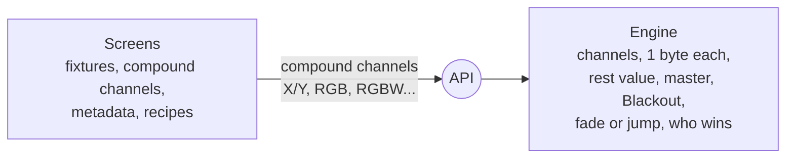

| Screens do | Engine does |
|---|---|
| keep fixtures, groups, channel names and what a channel is for; one fader for coarse and fine; the recipe of a look; "Apply to new fixtures" | play channel values and curves; arbitrate with who-wins; output bytes |

The API is designed in `docs/design/channel-model.md` (#239). Tickets that need it carry `#239` as a blocker and are re-read against it before they start.

## Controls from metadata (D21)

| The channels of a fixture form | Control |
|---|---|
| a colour (RGB, RGBW, CMY, a colour wheel) | colour picker |
| pan and tilt, coarse and fine | one X/Y pad |
| a gobo, prism or mode wheel with named ranges | named slot picker, names from the fixture file |
| dimmer, iris, focus, zoom, haze, fan, speed | fader |
| a channel of unknown type with named ranges | its ranges as buttons |
| a channel of unknown type without ranges | fader, with the channel's name; never a raw number only |

Every screen that shows or sets a fixture (Patch details, the step editor, the XY pad, DMX "Who decides it", Console widgets) takes its control from this table and the fixture's metadata. Compound types that the engine API knows (D20) are used where the metadata matches; every channel stays addressable on its own where it does not. The same applies to outputs: the Out column and the DMX screen are built from the output's adapter. A DMX, Art-Net or sACN output shows 512-slot universes; a DDP output shows a byte stream with pixel offsets and no universe limit.

## Rollout

Tickets marked #239 wait for the channel model design (`docs/design/channel-model.md`, D20) and its build tickets. Where this doc names a light, a property, a Look target, a fixture, a group, a patch or a panel in an engine command (D20 moves fixtures, groups, patch and panels to the screens; T38 is re-cut by #239), that command is a placeholder for the channel-model API: the ticket is re-read against it before it starts, never guessed.

Each wave ends with something a person can use. Nothing is reachable before the thing it leads to works.

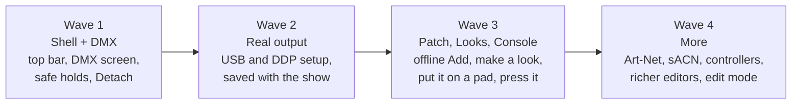

| Wave | A person can | Not reachable yet (so not shown) |
|---|---|---|
| 1 | open the app on the example setup, watch live values on DMX, hold a channel, Blackout, LIVE, Lock, Undo, show files, detach DMX | the trouble chip opens nothing, no Now strip, no In/Out, Patch, Looks, Console |
| 2 | connect a USB adapter or a WLED box, see it saved with the show, see it saved with the show | Patch, Looks, Console |
| 3 | add lights without hardware, make a look, put it on the Console, press it and see the bytes | Art-Net, sACN, controllers, Learn |
| 4 | the rest | |

## Decisions it builds on

| # | Decided 2026-11-20 | What it means here |
|---|---|---|
| D1 | The example setup is the owner's own rig | a hand-written, readable show file (T3, D14), in the repo, with generic names. No workspace file, song or personal detail is committed |
| D2 | Live DMX values, seen in the app | only on the DMX screen. No rig view, no lights strip, no output panel on the Console |
| D3 | Workspaces detach into their own window | only whole workspaces. Closing the window puts the workspace back. Nothing else |
| D4 | One trouble chip | the four lamps show only On, Ready or Off. The reason shows once, in the red-outlined chip, which opens In/Out |
| D5 | LIVE and Lock work | DJ link, Recording and Autopilot lamps are hidden until their feature exists |
| D6 | Console in full | pages and edit mode, saved in the show file |
| D7 | Looks in full | without the Autopilot part, which waits for songs |
| D8 | Patch and In/Out in full | including controllers, Learn, mappings, audio in, VirtualDJ link, OSC, Art-Net and sACN |
| D9 | Build in playable waves | shell with DMX first, then real output setup (USB, DDP) saved with the show, then offline Patch and a Looks to Console path, then Art-Net, sACN, controllers and richer editors. Changed after review from "dependency order, controllers with In/Out" |
| D10 | Example setup, not a demo | everything is real and working: the owner's real fixtures, a real show file, real looks. Nothing plays at start. The word "demo" is not used |
| D11 | Nothing half working | everything reachable works end to end against the real engine, as designed. What is not built is not reachable. Slices grow by complete pieces. No goal of a timed first run |
| D12 | Flash and Identify in who wins | each gets a row above Manual, under Blackout. Blackout still wins |
| D13 | A pattern makes the lights bright | the pattern writes full-brightness colour on the channels it colours. There is no implicit virtual dimmer (D22): a fixture without a dimmer has brightness baked into its colour, and the user can make a virtual dimmer on the Console |
| D14 | The example setup is our own format | not a QLC+ import and not QLC+ compatible. A readable show file in the Bossylights format, written from the owner's rig. The format is written down first |
| D15 | A simple layout file | the workspaces and their regions are arranged in a plain JSON file the user edits. No UI for it |
| D16 | No Test output, Identify only (owner, 2026-11-20) | the cable check is Identify on one fixture, from Patch (wave 3). Identify drives only the channels the fixture metadata marks as brightness or colour (the screens choose, the engine just plays channel values), never haze, strobe, sound, motors or gobos |
| D17 | Per-kind output fields (owner) | DDP asks address and RGB or RGBW; USB asks which adapter |
| D18 | Haze (owner) | the Haze fader sets the haze channel directly. A held channel, kept until Release; no Haze group or look |
| D19 | Pixel rows (owner) | one WLED box, 4 universes, 320 channels (80 RGBW pixels) per row. DDP offsets follow the channels actually used (0, 80, 160, 240 pixels), not a fixed 128-pixel stride |
| D20 | The channel model (owner, #239) | the engine knows channels only, 1 byte each, with compound types in the API (X/Y, RGB, RGBW, CMY and more); coarse and fine are two channels in the engine and one fader in the UI. The screens know fixtures, compound channels and channel metadata. A look stores channels; the screens keep the recipe and offer "Apply to new fixtures" when a fixture joins a group. Old show files are not read (D14 format only) |
| D21 | Controls come from fixture metadata (owner, 2026-11-20) | there are thousands of fixtures, alike but not the same; no fixture shape is assumed. Which control shows is chosen from the channel metadata, in the approved visual language. Outputs are protocol adapters (DMX, Art-Net, sACN, DDP), not 512-slot universes everywhere |
| D22 | Channel rules (owner, 2026-11-20) | each channel is won on its own: a look sets the channels it cares about. Coarse and fine move as one 16-bit value and one control. Which channels follow dimmer and Blackout comes from the fixture file; fog and unknown channels start independent; every rule is shown and editable in Patch. No implicit virtual dimmer; the user can create one on the Console. "Apply to new fixtures" appends the new fixtures at the end of a running Wave, existing ones keep their timing, with a preview first. One global space of 1,024 universes; an output takes any range |

Earlier answers that bind this slice: Undo takes back project changes only, never a play. The show file keeps the outputs. Controls fire on the way down, editors on the way up. A short press latches, a hold is dark or flashes while held. Release all on the Console gives back everything; DMX says "Release channels". Lock covers layout, pads, pages, Learn and mappings. Closing the window leaves the engine running, with a menu bar item. MIDI: APC mini mk2, Launchpad Mini MK3 and MIDImix with no setup, a Launchpad is switched into Programmer mode and back, faders use pickup, Blackout, master, page keys and Lock are global. Learn picks itself on a hold.

### Small choices, confirmed by the owner

| # | Question | Answer | Where it lands |
|---|---|---|---|
| A1 | Keys with Songs missing | numbers stay: 1 Console, 3 Looks, 4 Patch, 5 DMX, 6 In/Out; key 2 waits for Songs | T8 |
| A2 | Output rates | 30, 44, 60 as the engine has them: the In/Out setup's 40 goes, 60 comes in | T14 |
| A3 | "Search with pictures" in Add lights | a drawing per kind of fixture: QLC+ files carry no product photo | T21 |
| A5 | The fixture library | ships inside the app (QLC+ folder, Apache-2.0, with its licence) | T3 |
| A7 | Where mappings run | in the engine, so a controller works with the window closed | T16 |

## Changes to the approved catalog

Each is a consequence of a decision or of a rule. The catalog rows change in the ticket named.

| Control | Catalog says | This slice | Why | Ticket |
|---|---|---|---|---|
| Lamp words (`DESIGN.md` lamp section) | a reason takes the place of the lamp word | the reason is in the trouble chip only; the screen reader still hears it on the lamp | D4 | T8 |
| `top.indicator.dj`, `.recording`, `.autopilot` | four lamps | hidden | D5 | T8 |
| `console.running.stop` | stops a Show or Autopilot look | sends `StopLook`. Under the "it stays" rule the look stays, shown as kept with Release | `SkipLook` needs song sections | T31 |
| `patch.details.move-to-free` | shows while a fixture clashes | gone: a clash is always refused | no invalid state | T21 |
| `patch.details.remove` | the looks stay for later | refused while a look uses the fixture, naming the looks | no invalid state | T21 |
| `dmx.channel.fader` | off when the output is lost | works with no output and with a lost output | D2: DMX is the check with no hardware | T11 |
| `looks.part`, `looks.back` | Looks or Autopilot switch, a Back button | not shown | D7; the breadcrumb does Back | T24 |
| `inout.out.rate` | 30, 40, 44 | 30, 44, 60 | A2 | T14 |
| `inout.out.test` | every channel at half for three seconds | removed: no Test output, Identify does the check | D16 | T14 |
| `patch.add.identify` (flash step) | the flash is the only way to finish Add | Add works without it; the flash is a check, offered only when the universe has a working output, never under LIVE or Blackout | no dead end offline | T22 |
| `console.fader` | sends `SetMaster` or `SetGroupLevel` | a channel fader (widget kind of T29) sends `SetChannel` for Haze; Release all gives it back | D18 | T29 |
| `inout.out.setup` | kind, universes, rate | plus the fields of the kind (D17) | the engine needs them | T14 |
| `top.now-strip` | Open Console button | appears with the Console | no dead navigation | T31 |
| `top.trouble` | opens In/Out | status only until In/Out exists, then opens it | no dead navigation | T14 |
| `patch.group.move` | move a fixture between groups | one atomic step | one group rewritten is not a move | T38 |

## the example setup

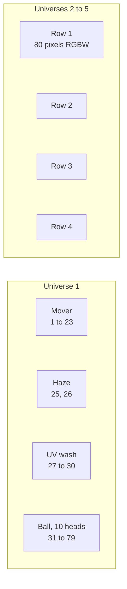

| Name | Library model and mode | At |
|---|---|---|
| Mover | Varytec Hero Spot Wash 140 2in1 RGBW+W, "23 Channel" | 1 / 1 |
| Haze | Stairville Hz-200 DMX, "Default" | 1 / 25 |
| UV wash | Cameo Thunderwash 600 UV, "4 Channel" | 1 / 27 |
| Ball | Stairville Beam Ball 100 Quad LED, "49-Channel" | 1 / 31 |
| Row 1 to Row 4 | strip, 80 pixels RGBW (320 channels) each, one WLED box, one universe per row | 2 / 1 to 5 / 1 |

One WLED box takes the four universes over one DDP output (D19): row n starts at pixel 80 x (n - 1), because the output counts the channels each universe carries (320), not 128 pixels per universe. The test asserts all four row offsets. The Ball's library definition is pinned by file hash and its licence line is kept with the library (A5). The Haze fader (D18) holds channel 1/25 directly.

All four definitions read cleanly. The engine refuses to patch the Mover today (`Unsupported { property: Colour }`, `crates/rig/src/capabilities.rs`): T2 fixes that first.

| Group (in order) | Members | Used by |
|---|---|---|
| All | Mover, UV wash, Ball, Row 1 to 4 | Standby |
| Whites | Mover, Ball, Row 1 to 4 | White |
| Rows | Row 1 to 4 | Pixel colours, Plasma, Rows fader |
| Ball heads | Ball | Ball colours, Ball fader |
| Washes | Mover, UV wash | Washes fader |

| Look on a pad | Kind | Made of |
|---|---|---|
| Standby | step on All: low warm white | |
| White | step on Whites: full white | |
| Pixel colours | step on Rows: four swatches, swatch n on Row n | |
| Plasma | Wave on Rows, 8 beats, colours from Pixel colours (Plasma kind after T28) | Pixel colours |
| Ball colours | sequence, loop, one beat each | 4 saved steps: Ball red, Ball blue, Ball green, Ball amber |
| UV on | step on UV wash: full | |
| Mover sweep | sequence, loop, two beats each | 4 saved steps: Mover left, up, right, down |

Fifteen saved looks, seven on pads (the pads come with the Console page, T29). No outputs: the engine computes every frame without one, so the DMX screen shows it all (D2). The Console page Main is added to the generator by T29: a pad per look above, six faders (Master, Rows, Ball heads, Washes, Speed, Haze channel), the XY pad on the Mover.

## First launch

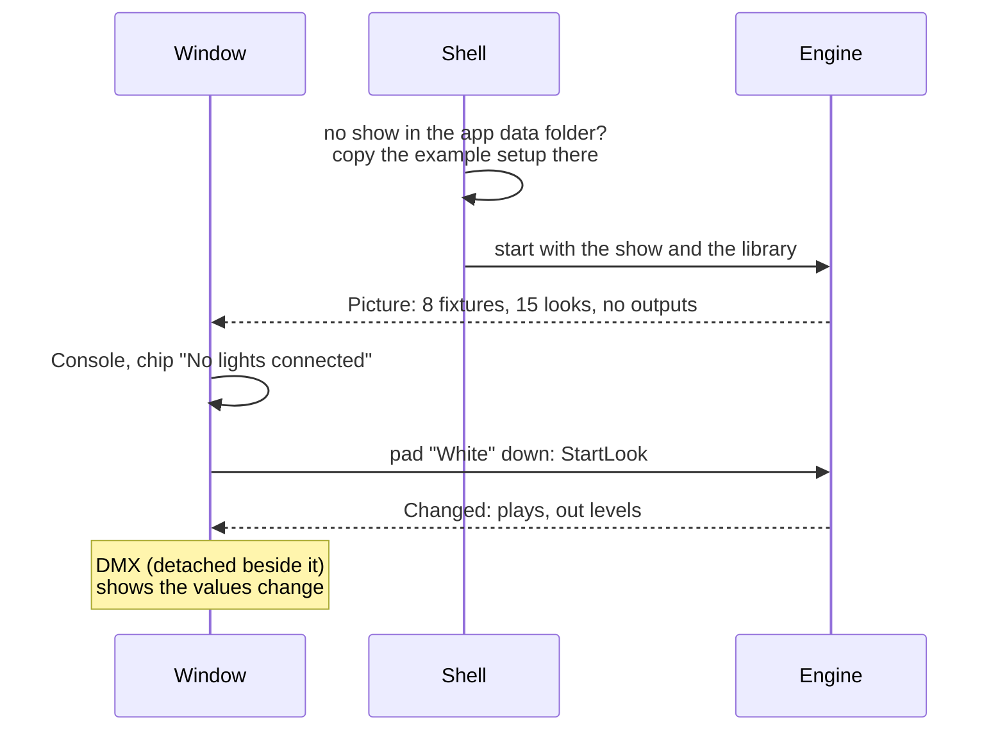

Nothing plays at start. The shell copies the example only when there is no show. A newer bundled example replaces an untouched older copy (same bytes as a shipped version) and never an edited one. Until the Console lands, the app opens on the first workspace that exists, and each screen is checked on DMX. "In the next frame" is proved by a wire test on the stepped engine, not in the browser: the browser may skip a snapshot.

## Growing by complete pieces (D11)

Only what works is reachable. A tab, a column, a button or a card appears in the ticket that makes it work end to end, never before: no stub tab, no "coming soon", no disabled-for-later.

| Appears with | What becomes reachable |
|---|---|
| T8, T35 | the top bar: show menu, LIVE, Lock lamp, tempo with Tap, Blackout, Undo, Redo, the trouble chip as status only |
| T11 | the DMX tab (the app opens here until T31) |
| T9 | Detach on every tab that exists (DMX); the menu bar item |
| T14 | the In/Out tab: Out column, Clock with the feeds that exist (internal, Tap); the trouble chip now opens In/Out |
| T21 | the Patch tab; Add lights ends with Add, with no flash needed |
| T22, T23 | the optional flash step and the mode picker; Add a pixel panel |
| T24 | the Looks tab: library, step editor (colour, position, dimmer), sequences, Wave, Play on lights |
| T31, T32 | the Console tab with Running, pads, faders, XY, master readout; the Now strip on other screens (its Open Console button). The app opens on the Console |
| T34 | Put on Console and Connections in Looks (the way from a look to a pad) |
| T20 and later | the In column, Mappings, Learn, other clock feeds |
| T25 to T28, T33 | look groups, gobo and spin, moving an item, other pattern kinds, Edit surface |

A key for a workspace that does not exist yet does nothing. Shared append-only files (`scripts/layers.mjs`, `ui/src/workspaces.ts`) take one line per ticket; that is the only file two tickets may touch together.

## Two lanes to the engine

The engine reads one socket's commands in order and waits for an output to open before the next one. A press must never wait behind an edit.

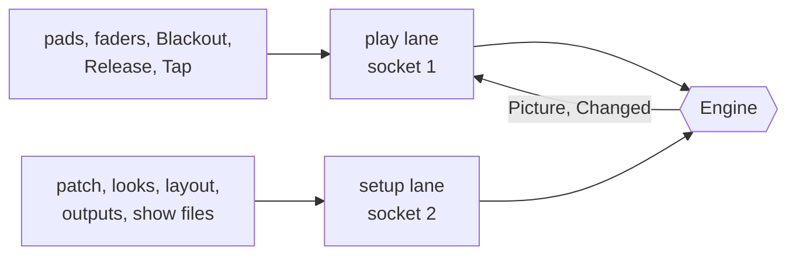

`ui/src/engine.ts` opens both, reads the picture on the play lane, and hands back the reply of each command (`Started`, `Grabbed`, `Saved`, `Refused`) and the answer of each request (`Search`, `Fixture`, `Explain`).

## The shell (step 0)

Regions and controls as in `controls.md` "Top bar" and "Menu bar", with D4 and D5 applied.

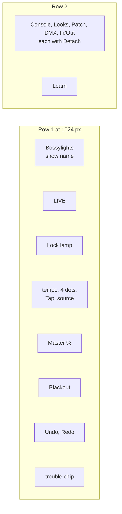

### The trouble chip

A calculation over the current connection and picture, not a memory: when one reason clears, the next one shows. It keeps the width of its longest reason. Until In/Out exists (T14) it is status only and does nothing when pressed; from T14 a press opens In/Out.

| Rank | Reason shown | True when |
|---|---|---|
| 1 | Engine not connected | `connection()` is not `connected` |
| 2 | Output lost: <device> | an output of the current picture is `Reconnecting` or `NotFound`. Read from the current output generation only; a remembered `OutputLost` event is never used (replacement and removal send no recovery event) |
| 3 | No lights connected | every `project.outputs` entry is null |
| none | the chip is gone | none of the above |

A broken layout file (D15) is a second line in the chip's tooltip and in In/Out once it exists, never hidden by rank 3: faults of the layout and the show file stay discoverable while a higher reason shows.

A DDP output says "sending", never "connected": UDP gives no answer from the lights.

### Detach and the menu bar (D3)

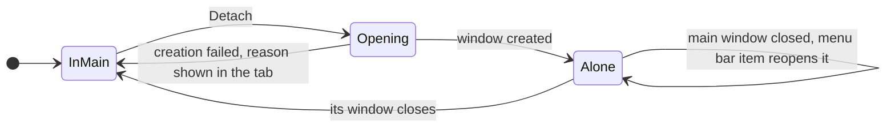

- Each window opens its own two lanes to the same engine, so both windows show the same frame.
- The main window keeps the tab, marked "In its own window". The detached window has the top bar and only its workspace.
- Places of detached windows are kept in the layout file (D15), never in the show file.
- In the browser (`npm run ui`) Detach opens a new browser window on `#/<workspace>?alone`.
- Closing the main window leaves the engine and the lights running; the menu bar item reopens it. A detached window's chip, once In/Out exists, brings the main window forward on In/Out, or reopens it.
- "Stop engine" is off while LIVE is on (`menubar.stop-engine`). The guard is in the engine, not the menu: `Stop` is refused with `Live` while LIVE is on, so a stale menu or a second client cannot stop the lights. The shell's exit sends `Stop` and treats a refusal as "keep running".

### Holds have an owner

A hold is dark or on only while a finger or a deliberate latch keeps it. Today `Blackout { on }` is one boolean for everybody: A holds, B holds, A lets go and the lights come back while B still holds. A window lost before pointer-up would leave it on for ever.

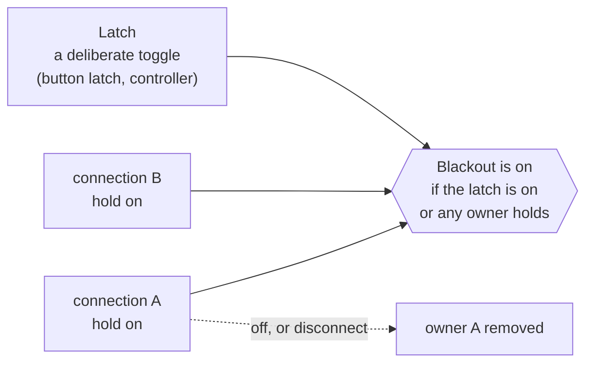

| Rule | Meaning |
|---|---|
| Latch | one engine-wide flag, set and cleared by `SetBlackoutLatch { on }`. Survives disconnects |
| Hold | one entry per (connection, control): `Blackout { on }` from a connection adds or removes only its own entry. Flash and grabs are the same: owned by the connection that started them. Channel holds (`SetChannel`) are not: they are project state kept until Release, so closing a detached DMX window keeps them |
| Disconnect, cancel | every finger hold of a lost connection (Blackout, flash, grab) is removed in the next frame. A latch and channel holds stay |
| Release all | removes every hold of every owner, including raw channel holds, never the latch |
| Stop, `SetOutput`, `RemoveOutput` | refused with `Live` while LIVE is on; a pending output open or show switch checks LIVE again at commit |

Tests (wire, stepped, loopback with two connections): A on, B on, A off keeps the output dark; B disconnects while holding, the lights come back; a latched Blackout stays after its sender disconnects. Owned by T36.

### Reads and commands

| Control | Reads | Sends |
|---|---|---|
| `top.live` | NEW `state.live` | NEW `SetLive { on }` |
| `top.indicator.lock` | NEW `state.lock { armed, in_effect }` | NEW `SetLock { on }` |
| `top.tap`, `top.tempo.source` | `state.clock` (`bpm`, `source`, `beat`) | `TapTempo`, `ReleaseTempo` |
| Master readout | NEW `state.master` | (the Console fader sets it) |
| `top.blackout` (Blackout machine) | `state.blackout { latched, holders }` | `Blackout { on }` (hold, owned by the sender), `SetBlackoutLatch { on }` |
| `top.undo`, `top.redo` | NEW `undo`, `redo`: the label of the step or null | NEW `Undo`, `Redo` |
| `top.show`, `.name`, `.new`, `.open`, `.save-as` | `show`, NEW `show_name` | NEW `RenameShow`, `NewShow`, `OpenShow`, `SaveShowAs` (the file picker is T37) |
| `top.workspaces`, keys (A1) | screen state | nothing |
| `top.now-strip` (from T31) | `state.plays`, `state.clock`, `looks` | nothing (Open Console) |
| `top.learn` | NEW `learn` | NEW `StartLearn`, `CancelLearn` (T20) |

| New command | Semantics | Refused |
|---|---|---|
| `SetLive { on }` | the night runs. Not saved. LIVE on ends a running Identify. LIVE off ends what Lock does | never |
| `SetLock { on }` | arms Lock. In effect only while LIVE is on: then every command that changes what a press does is refused | NEW `Locked` for those commands |
| `SetMaster { level }` | scales every intensity after the Mixer, under Blackout. Not a hold. Not saved, like tempo | never |
| `Undo`, `Redo` | one step of the project: patch, groups, looks, look groups, pages and widgets, outputs, mix rules, mappings. A play or a hold is never a step. Undo works under Lock, as the catalog says | NEW `NothingToUndo`, `NothingToRedo`; a step whose reverse is refused (a look that plays) is refused and stays in the history |
| `RenameShow { name }` | the file is renamed. One Undo step | `NotACommand` for an empty name |
| `NewShow`, `OpenShow { file }` | staged: the new show is read and checked first; the open show, its patch, its outputs and the DMX stay as they are until the switch commits. At commit the outputs hand over: a device both shows use is closed and reopened for the new show, and the old show is restored if the new open fails. LIVE and holds are checked again at commit. The open show is saved first | NEW `Live` while LIVE is on, NEW `Held` while anything is held (catalog: "Release what you hold first"), NEW `CannotRead { why }`, `NotAShow`, `OutputUnavailable { output }`: the old show keeps running |
| `SaveShowAs { file }` | writes a copy that becomes the open show only after the write succeeded. Works while LIVE is on | NEW `CannotWrite { why }`: the open show and its path stay |
| `Stop` | the engine exits | NEW `Live` while LIVE is on |

## Step 1: DMX

Regions and controls as in `controls.md` "DMX". It is the check for every other screen while no hardware is connected (D2).

| Region | Reads | Sends |
|---|---|---|
| Universe tabs (`dmx.universe`); a DDP output shows one stream with pixel offsets | NEW `out` per output frame (512 slots for DMX, Art-Net, sACN), `health`, `state.outputs` | nothing |
| Grid by fixture (`dmx.channel`) | NEW `out`, `patch` with NEW channel names | nothing |
| Filters patched only, changing | `patch`, the last two frames of `out`, NEW `held` (a held channel counts as changing) | nothing |
| Channel fader, Zero, Full, Release | NEW `held` | `SetChannel`, `ReleaseChannel` |
| "Who decides it" | NEW request `Explain { channel }`, answered by the Mixer: `Decided { origin, channel, winner, under }`, `origin` is Look, Raw (an unpatched byte) or Fixed (a fixed byte). The engine knows channels only (D20); the screens turn a channel into a fixture name from their metadata | nothing |
| Held by hand, Release channels | NEW `held` | `ReleaseChannel`, `ReleaseChannels` |
| Output state per universe | `state.outputs`, `health` | nothing |
| Who wins (three settings) | `state.rules` | `SetMixRules` with one field changed |

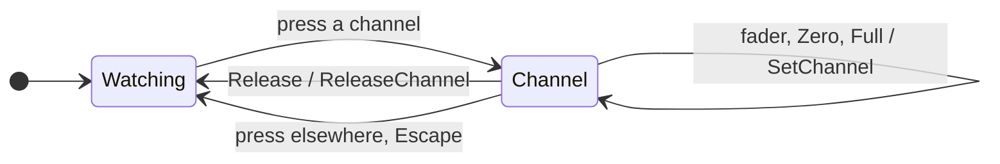

- Today `universes` and `channels` carry only the raw holds. NEW `out` in `Picture`, and in `Changed` only the universes that changed.
- The example setup has about 1 360 live channels. The UI paints once per animation frame, never per message.

## Step 2: In/Out

Regions and controls as in `controls.md` "In/Out", with the Learn and Tempo machines.

| Column | Reads | Sends | Engine today |
|---|---|---|---|
| Out: cards, setup | `project.outputs`, `state.outputs`, `health` | `SetOutput`, `RemoveOutput` | USB DMX, DDP. NEW Art-Net, sACN |
| Clock: feeds | `state.clock`; later NEW `feeds[] { feed, bpm, confidence, signal }` | `TapTempo`, `ReleaseTempo`; later NEW `SetTempoFeed { feed }` with each feed's own consumer | internal feed and taps |
| In: controllers (wave 4) | NEW `controllers[] { name, profile, state }` | nothing | none |
| In: audio | NEW `audio { inputs, input, level, bpm }` | NEW `SetAudioInput { input }` | none |
| In: VirtualDJ | NEW `dj { state, decks[2] }` | nothing | none |
| In: OSC | NEW `osc { on, port, last }` | NEW `SetOsc { on, port }` | none |
| Mappings, Learn | NEW `mappings[]`, `learn` | NEW `StartLearn { control }`, `CancelLearn`, `UpdateMapping`, `TestMapping`, `RemoveMapping` | none |

- An output card being set up lives on the screen only, until it has everything its kind needs (D17): USB DMX: the adapter, universes, rate. DDP: address, RGB or RGBW, universes, rate (the output counts the channels each universe carries, D19). Then `SetOutput` sends it. The engine refuses an incomplete one. Art-Net and sACN add their own fields when built (T12).
- The output opens off the tick thread and is saved with the show. A restart reopens it. A rate-only change restarts the output without losing the show.
- NEW refusal `UniverseTaken`: a second output cannot stream a universe another output streams (`inout.out.universes`).
- There is no Test output (D16). Identify is published with the output generation, so a replaced output never shows an old blink.
- Every learnable control has an address (T10): a top bar id, a page, widget and pad, a DMX channel, a Looks control. Learn, mappings and OSC use it.
- MIDI, audio, VirtualDJ, OSC and tempo feeds are new engine parts. Each gets a short engine spec first (the map rule: spec, then tickets), and the spec ticket ends by opening its build tickets. Each build ticket carries an output assertion for its own input path (a note in, a fader, an OSC message: the DMX bytes change), not only for Learn. Follows is not exposed until a song or playhead consumes it (next slice).

## Step 3: Patch

Regions and controls as in `controls.md` "Patch", with the Add lights and Drag machines.

| Region | Reads | Sends |
|---|---|---|
| Universe list | `patch` (fill and count per universe) | nothing |
| Universe grid, drag | `patch`; a clash shows red while dragging | `Move` on drop |
| Fixture list and order | `patch`, `groups` | `SetGroup` with the members in the new order |
| Details | `patch`, `groups`, NEW `state.identify`, the channel rules of the fixture (D22) | `Rename`, `Move`, NEW `SetFixtureMode`, `SetGroup`, NEW `Identify`, `Unpatch`, the channel-model rule commands (#239) |
| Channel rules (in Details) | which channels follow master and Blackout, which are independent; each row shows its source (file or changed) | the channel-model rule commands (#239) |
| Add lights | request `Search`, request `Fixture`, `patch` | `Patch`, NEW `Identify { Probe }` |
| Pixel panel | `patch` with NEW `panel` | NEW `AddPanel`, `ChangePanel`, `RemovePanel` |

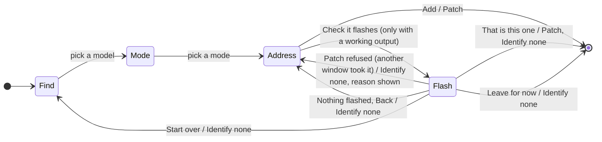

Add always works. The flash is Identify's check, offered only when the address is on a universe with a working output, not under LIVE or Blackout. Leaving the screen, losing the connection or the output, or the address being taken ends the probe (`Identify none`); a probe also ends by itself after 30 seconds. A probe uses the channels of the mode you picked, so it blinks the channels its metadata marks as brightness or colour only (D16).

| New command | Semantics | Refused |
|---|---|---|
| `Identify { Fixture or Probe { mode, address } or None }` | the fixture blinks brightness or colour about twice a second, through the Mixer row of D12, nothing else (D16). One at a time. Not saved. A Probe blinks an address before it is patched, with the picked mode's own safe channels. A fixture with nothing safe to blink (haze) is refused | as `Patch` for a Probe; NEW `NothingToBlink`, `Live`, `Blackout` |
| `SetGroup` with several groups (T38): `CreateGroup { name, members }`, `MoveFixtures { fixtures, from, to }` | a new group, and a move that takes a fixture out of one group and puts it in another in one step. A fixture in several groups names the source group | `NoSuchGroup`, `Overlaps`, `LookInUse` |
| `SetFixtureMode { fixture, mode }` | keeps number, name and groups | `NoSuchMode`, `Overlaps`, `PastTheEnd`, `NotStreamed`, `NotSent`, `LookInUse` when a look targets a light the new mode loses |
| `AddPanel { name, columns, rows, wiring, pixel, order, start }` | one strip fixture per universe from address 1, whole pixels (170 RGB or 128 RGBW per universe), heads in wiring order, colour order applied | `Overlaps`, `PastTheEnd`, `NoSuchUniverse` |
| `ChangePanel { panel, ... }` | the same fields, in one step: the panel never half exists | as `AddPanel`, `LookInUse` |
| `RemovePanel { panel }` | unpatches every fixture of the panel | NEW `NoSuchPanel`, `LookInUse` |
| `Unpatch`, `Move` of one panel fixture | | NEW `PartOfPanel` |

The DIP switches and the free address are calculations in the UI.

## Step 4: Looks

Regions and controls as in `controls.md` "Looks", with the Play on lights and Drag machines. The button says "Play on lights" (catalog decision 28).

| Region | Reads | Sends |
|---|---|---|
| Library, type filter, search, widen | `looks`, NEW `look_groups` | nothing |
| Apply to new fixtures (appends, preview first, D22) | the look's recipe, `groups` | the channel-model commands (#239) |
| New, rename, copy, delete | `looks` | `PutStep`, `PutSequence`, `PutPattern`: with no look number the engine picks one and answers NEW `Saved { look }`; with a number it edits that look. `RemoveLook` |
| Look groups, chips, drag onto a group | NEW `look_groups` | NEW `PutLookGroup { id, name, looks }`, `RemoveLookGroup { id }` |
| Step editor (controls chosen by D21) | `groups`, `patch`, channel metadata, named slots and pictures in the `Fixture` reply | `PutStep` with NEW several targets and NEW `Spin` |
| Sequence editor | `looks` | `PutSequence` with NEW item start |
| Pattern editor | `looks`, `groups`, `patch[].layout` | `PutPattern` with NEW kinds Plasma, Stripes, Sparkle |
| Play on lights | `state.plays` | NEW `PlayPreview { look }`, `EndPreview` (T39): its own play identity (look, Preview), arbitrated like Manual |
| Put on Console | NEW `console` | NEW `PutOnConsole { look }` |
| Connections | `looks`, NEW `console`, `groups` | nothing (jumps) |

- A preview never takes over a play of the same look: with White already on from the Console, Play on lights on White adds a preview play beside it, and ending it leaves the Console's play as it was. Tested across the Console and Looks windows.
- A new look can be saved as a draft with no target yet (the approved New step path on an empty show). A draft cannot play: `StartLook` and `PlayPreview` answer NEW `NoTarget` (T24). It plays once a group, fixture or panel is chosen.
- A pixel panel (T23) is one logical target for patterns: its fixtures form one grid in wiring order, so a pattern runs across the universe seam (a 40 x 4 RGBW panel is 128 + 32 pixels, no seam in the picture). A pattern test checks the bytes on both sides of the seam.
- Every edit sends the whole look. Running parents change in the frame that applies it.
- `RemoveLook` is refused with `LookInUse` while a sequence, a pad or a running play uses it. A look group only lists looks: removing a look takes it out of its groups in the same step.
- Look groups (collections of looks) are not fixture groups. The glossary gets "look group".

## Step 5: Console

Regions and controls as in `controls.md` "Console", with the Look pad, Console layout and Drag machines.

| Region | Reads | Sends |
|---|---|---|
| Running: three rows, clock-time ruler as approved, NOW line | `state.plays`, `state.clock`, `looks` | `ReleaseHold`, `StopLook`, `ReleaseAll` |
| Hold notice (reserved line) | NEW per play: the lights and properties it holds; NEW `grabs`; `held` | nothing |
| Pages | NEW `console.pages` | NEW `AddPage`, `RenamePage`, `MovePage`, `DeletePage` |
| Pads (8 x 4) | `state.plays`, `looks`, `console` | `StartLook`, `StopLook`, `EndFlash` |
| Faders (Haze is a channel fader, D18) | `state.master`, NEW group levels, NEW speed, `held` | `SetMaster`, NEW `SetGroupLevel { group, level }`, `SetSpeed { speed }`, `SetChannel` for Haze |
| XY pad (only where the fixture's metadata has a pan and tilt pair) | NEW `grabs` | `SetProperty` (Position), `UpdateGrab`, `EndGrab`, `ReleaseProperty` |
| Edit mode | `console` | NEW `AddWidget`, `PlaceWidget`, `RemoveWidget`, `SetWidgetTarget`, `SetWidgetWords` |

| Row with nothing in it | Word shown |
|---|---|
| Manual | "Nothing held". Release all off. Release all is on whenever anything is held, plays or raw channel holds (`held`) |
| Show | "No song plays" |
| Autopilot | "Autopilot off". Its switch and style wait for the autopilot |

- The ruler shows clock time as in the approved mockup. Each play carries NEW `started_ms`, the engine time it began, so a new subscriber draws it right after a tempo change; the UI never rebuilds history from the current tempo.
- A play started at Show or Autopilot rank by another client shows in its row with Stop.
- Cue list and Surprise me are not in this slice (cue lists are not designed; Surprise me was removed).
- Every layout command is refused with `Locked` while LIVE and Lock are on. Pads, faders and XY still play. `DeletePage` is refused on the last page; it removes its widgets and their mappings in one step.
- The pad needs its play id when the finger lifts. A lift before the `Started` reply queues the `EndFlash`.

## Tests

Every feature has an end-to-end test that checks DMX.

| Kind | Harness | Proves |
|---|---|---|
| Wire, stepped | `crates/engine-server/tests/common/mod.rs` (`serve`, `Heard` for a fake DMX USB Pro, stepped wakes); T4 moves `until_ddp` and `until_dmx` there | the exact frame, "in the next frame" |
| Browser | NEW `e2e/engine.ts` (T3): one engine per test file with a temporary copy of the example setup, the library; a DDP receiver per universe that joins packets by offset | what the person sees and the bytes that go out, eventually |
| No output | the same, with no output added | the DMX screen alone, as on first launch |

| Screen | Browser test | DMX checked |
|---|---|---|
| Shell | an empty data folder opens the example setup; chip "No lights connected"; Blackout held is dark while held; a second window holding Blackout keeps it dark after the first lets go; Undo takes back a rename; LIVE with Lock refuses an edit; Open of a broken file keeps the show running | Row 1 bytes 0 under Blackout, back after; DMX unchanged after a refused Open |
| Detach | detach DMX; Blackout in the main window shows in it; close it, it is back; close the real shell while nonzero DMX flows, the bytes keep coming, reopen; with LIVE on, Stop is refused | DDP keeps flowing with no window |
| DMX | the example setup's fixtures on universe 1 and the rows on 2 to 5; a fader on 1/27 holds it; Release channels gives it back; Explain names the winner for a patched, an unpatched and a fixed byte | the byte equals the value on screen |
| In/Out | add a DDP output and a USB output with their own fields, the card runs, the chip goes, a restart reopens them; Identify a fixture on it; remove it, the chip is back; a second output on the same universe is refused | Identify blinks only brightness or colour bytes, Haze, strobe and sound bytes unchanged; the four row start pixels 0, 80, 160, 240 |
| Patch | on the example setup: drag Haze to 1/100; on an empty show with no output: Add lights ends with Add, then a group is made and the fixture put in it; with an output: Check it flashes, Leave for now stops it; a 40 x 4 RGBW panel in GRB order | Haze bytes at 100; the flashing byte alternates and only brightness or colour; the first pixel is G, R, B, W |
| Looks | on an empty show: New step as a draft, no play until it has a target; then red on Rows, Play on lights; White playing from the Console while Play on lights on White ends: the Console's play stays; a sequence at Double; a pattern over the panel seam | Row bytes red while playing, back after; the Console's bytes intact |
| Console | press White, then Ball colours; hold for a flash; every starter pad from a released frame; master to half; Haze fader holds 1/25 and Release all gives it back; Speed; XY drag; a raw channel hold enables Release all; speed change keeps a ruler bar right | bytes follow each press; intensities halve; 1/25 equals the fader |
| Edit mode (wave 4) | edit a page and restart the engine | the layout survives |

## Tickets

All tickets: label `ready-for-agent`, parent the spec issue of this doc, blockers set as issue dependencies. Every ticket adds its own new ui files to `scripts/layers.mjs` (its own lines only). Tickets with `#239` among their blockers need the channel-model API; the graph below leaves that edge out. T-numbers keep their issue (T0 = #199 … T35 = #234); T36 to T39 are new after the review.

**Shared API files** (`crates/engine-core/src/{api,lib}.rs`, `crates/engine-server/src/lib.rs`, `ui/src/engine-api.ts`, `docs/engine.md`) are taken one ticket at a time, in this chain. Each link is also a "Blocked by". The same rule for `crates/engine-server/src/main.rs` and `shell/src/main.rs`: T3, T6, T37, T9 and T35 never run together.

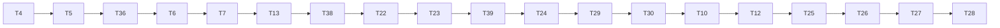

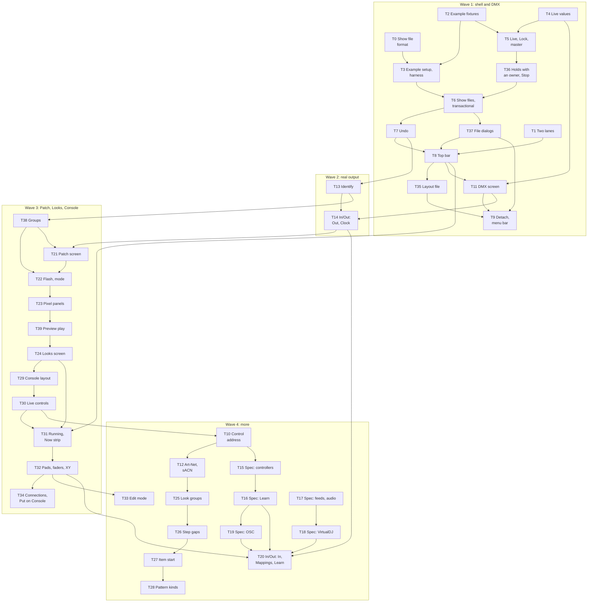

| Ticket | Map parent | Owns | Done looks like | Test | Blocked by |
|---|---|---|---|---|---|
| T0 The show file format, written down | #31 | NEW `docs/design/show-file-format.md`, `crates/show-file` (only if a field needs a clearer name) | every part of a show file (fixtures with channel metadata, groups, looks that store channels while the screens keep their recipe, outputs, later pages; new format only, no old files) named and shown with a short readable example; a person can write a show by hand (D14) | a test opens the example of the doc | #239 |
| T1 Two lanes and a full picture | #26 | `ui/src/{picture,engine,connection}.ts` and their tests, `scripts/layers.mjs` (folders `shell/`, `screens/`, `console/` as view, view may use kit, controls and its own folder) | every Picture field kept and merged; play and setup lanes; `send` returns the reply, `request` the answer | unit tables; a press on the play lane is accepted while the setup lane waits for an output to open | #239 |
| T2 The example fixtures patch and light | #50, #41 | `crates/rig/src/{capabilities,patch}.rs`, `crates/engine-core/src/resolve.rs`, the four `.qxf` in `crates/fixture-library/tests/definitions`, `crates/rig/tests/example_setup.rs` (re-cut against #239) | the four example fixtures patch at their addresses with channel metadata from the library; the Mover's colour works; a fixture with no dimmer gets its brightness in its colour (D13, D22). The Wave check moves to the Looks ticket that builds a wave recipe (#223 or #227); the Rows to the example setup (T3) | wire: each fixture's bytes for a colour and an intensity | #239 |
| T3 Example setup and test harness | #31, #50 | NEW `shell/example/example-setup.json` (hand-written, readable), `shell/src/main.rs`, `shell/tauri.conf.json`, `crates/engine-server/src/main.rs`, `playwright.config.ts`, NEW `e2e/engine.ts`, NEW `crates/engine-server/tests/example_setup.rs` | the example setup in the written-down format (fixtures, groups, 15 looks), opened by a test so it can never go stale; copy on first launch, an untouched older copy replaced by a newer example, an edited one kept; engine started with the bundled library (A5, definitions pinned by hash with their licence line) and 16 universes; nothing plays at start | wire: open the example setup, 8 fixtures, UV on lights 27 to 30; the four row start pixels (D19); upgrade replaces untouched and keeps edited; browser: a test engine per file | T0, T2 |
| T4 Live values on the wire (running) | #48 | shared API files, `crates/engine/src/snapshot.rs`, `crates/engine/src/lib.rs` (the ticker that owns the resolved buffer), `crates/engine-core/src/mix.rs` (explain only), `crates/engine-server/tests/{out,common/mod}.rs` | `out` per universe published with its frame; `held`; channel names; `Explain` answered by the Mixer for patched, unpatched raw and fixed fixture bytes | wire: `out` equals the bytes `Heard` gets; `held` lists SetChannel; Explain names the winner for each origin; a press is in the next frame while a subscriber is backpressured | none |
| T5 Live, Lock, master | #17 | shared API files, `crates/engine-core/src/mix.rs`, `crates/engine/src/lib.rs`, `tests/live_lock.rs` | SetLive, SetLock with `Locked`, SetMaster after the Mixer | wire: master half halves the Mover dimmer byte; `Locked` refuses a patch edit while LIVE and Lock are on | T2, T4, #239 |
| T36 Holds with an owner, Stop refused under LIVE | #17, #72 | shared API files, `crates/engine-core/src/mix.rs`, `crates/engine-server/src/lib.rs`, `tests/holds.rs` | "Holds have an owner" in this doc: latch, per-connection holds, release on cancel and disconnect, Release all, `Stop`, `SetOutput` and `RemoveOutput` refused with `Live` while LIVE is on, and a pending output open or show switch rechecks LIVE at commit. Channel holds are project state kept until Release; only finger holds (Blackout, flash, grabs) belong to a connection | wire, two connections: A on, B on, A off stays dark; B disconnects while holding, lights return; a latch outlives its sender; Stop, SetOutput and RemoveOutput refused under LIVE with nonzero DMX still flowing; a held channel survives its window closing | T5, #239 |
| T6 Show files, saved outputs, transactional switching | #31, #42 | shared API files, `crates/engine-server/src/{show,main}.rs`, `crates/show-file`, `crates/engine-core/src/project.rs`, `crates/outputs/src/ddp.rs`, `tests/show_switch.rs` | show name, New, Open, Save as, Rename while running with `Live`, `Held`, `CannotRead`, `NotAShow`, `OutputUnavailable`, `CannotWrite`; outputs in the show file; `UniverseTaken`; DDP offsets follow the channels each universe carries (D19); at commit the outputs hand over (old device closed, new opened, rolled back if the new one fails, so two shows on one USB adapter work); a failed switch or write leaves the open show, its path, its outputs and the DMX untouched | wire: Open switches the patch and DMX follows; a broken file and an unwritable path leave DMX unchanged; a restart reopens the outputs; a rate-only change restarts the output; two outputs on one universe refused; two shows on one adapter switch and a failed handover restores the first | T3, T36 |
| T7 Undo and Redo | #40 | shared API files, NEW `crates/engine-server/src/undo.rs`, `tests/undo.rs` | one step per project change, labels in Picture, a refused reverse stays in history | wire: Move then Undo puts the bytes back; a pad press is not undone | T6 |
| T37 Show file dialogs | #31, #17 | NEW `shell/src/dialogs.rs` (one registration line in `shell/src/main.rs`), NEW `ui/src/shell/files.ts` | the native Open and Save as pickers in the shell, a path field in the browser; every refusal of T6 shown as words next to the control | browser: a bad path shows `CannotWrite`, a broken file shows `NotAShow`, the show keeps running, DMX bytes unchanged | T6 |
| T8 Top bar and workspaces | #17, #77 | NEW `ui/src/shell/` (not `files.ts`), NEW `ui/src/{trouble,keys}.ts`, `ui/src/main.tsx`, `ui/src/controls/rows/top.ts`, `DESIGN.md` lamp lines, `e2e/shell.spec.ts` (extend), `e2e/counter.spec.ts` | the top bar of D4 and D5 fits 1024 px; tabs and keys (A1); trouble chip as status only (no action until T14); no Now strip; workspaces register in `ui/src/workspaces.ts` (T8 creates it, each screen ticket adds its one line); T8 and T11 go in one landing, the first release is after both; Blackout is a hold owned by this window, with the latch as its own control | browser Shell row | T1, T3, T7, T37 |
| T35 The layout file | #17, #18 | NEW `ui/layout.json` (the default), NEW `ui/src/shell/layout.ts` (reads and checks it), `shell/src/main.rs` (where the user's copy lives) | one plain JSON file: the workspaces in order with their keys, the regions of each workspace and where they sit, the places of detached windows. A workspace not built yet is skipped. A broken file is named in the chip's tooltip and the default is used (D15) | unit tables for the checks; browser: move a region in the file, reload, it moved; DMX bytes unchanged by a layout change | T8 |
| T11 DMX screen | #48, #72 | NEW `ui/src/dmx.ts`, NEW `ui/src/screens/dmx/`, `ui/src/controls/rows/dmx.ts`, NEW `e2e/dmx.spec.ts` | the DMX part of this doc (an output's screen follows its adapter, D21); the app opens here | browser DMX row | T4, T8, #239 |
| T9 Detach and the menu bar | #17, #107 | `shell/src/main.rs`, NEW `shell/capabilities/`, NEW `ui/src/shell/windows.ts` | D3 with the `Opening` state; menu bar item, Open window, Stop engine off while LIVE (the engine refuses too); a closed main window reopens from the menu or a detached chip | native: close and reopen the real shell with nonzero DMX flowing; browser Detach row | T11, T35, T37 |
| T13 Identify, fixture-safe | #42, #54 | shared API files, `crates/engine-core/src/mix.rs`, `tests/identify.rs`, `docs/design/who-wins.md` (D12 rows) | `Identify` (Fixture, Probe, None) as in D16: brightness and colour channels only (from metadata), previous frame back on end, Blackout wins, LIVE ends it, published with the output generation | wire on a mixed universe (Mover, Haze, UV wash, Ball, a row): only the brightness and colour bytes of the identified fixture blink, every other byte unchanged; frame restored; Blackout wins; Identify on Haze refused | T7, T36, #239 |
| T14 In/Out: Out and Clock | #42, #44, #45 | NEW `ui/src/screens/inout/`, `ui/src/controls/rows/inout.ts`, `ui/src/shell/Trouble.tsx` (action only), NEW `e2e/inout.spec.ts` | output cards with the fields of their kind (D17), setup on the screen, remove; USB and DDP saved with the show; clock with internal feed and Tap (A2); the chip opens In/Out; loss read from the current output generation | browser In/Out row; wire: the four row offsets | T11, T13 |
| T38 Fixture groups: create and move | #50, #56 | shared API files, `crates/rig/src/patch.rs`, `tests/groups.rs` | `CreateGroup`, `MoveFixtures` atomic, source named when a fixture is in several groups | wire: a move is one step and one Undo; a clash leaves both groups as they were | T13, #239 |
| T21 Patch screen | #50, #54, #56 | NEW `ui/src/patch.ts`, NEW `ui/src/screens/patch/`, `ui/src/controls/rows/patch.ts`, NEW `e2e/patch.spec.ts` | universes, grid, drag, list and order, details with controls from the fixture's metadata (D21) and the editable channel rules (D22), group create and move, Add lights steps 1 to 3 ending in Add with no output needed, kind drawings (A3) | browser: drag Haze to 1/100; on an empty show with no output Add a fixture, make a group | T14, T38, #239 |
| T22 Flash step and mode change | #54, #50 | shared API files, `crates/rig/src/patch.rs`, `tests/mode.rs`, `ui/src/screens/patch/` | the optional flash step as drawn (Identify from T13): offered only with a working output, ended by leave, disconnect, expiry or a taken address; `SetFixtureMode` | wire: the blinking byte alternates and stops on leave; browser flash step | T21, T38, #239 |
| T23 Pixel panels | #60, #56 | shared API files, `crates/rig/src/lib.rs`, `crates/show-file`, `tests/panel.rs`, `ui/src/screens/patch/` | AddPanel, ChangePanel, RemovePanel, PartOfPanel, folding runs; a panel is one logical target for patterns | wire: 40 x 4 RGBW in GRB order, bytes both sides of the universe seam; browser: the panel form | T22, #239 |
| T39 Preview play identity | #64, #58 | shared API files, `crates/engine/src/lib.rs`, `crates/engine-core/src/mix.rs`, `tests/preview.rs` | `PlayPreview`, `EndPreview`, own (look, Preview) identity | wire: White on from one connection, preview White from another, end it: the first play's bytes stay | T23, #239 |
| T24 Looks screen | #64, #58, #69, #59 | shared API files (`Saved`, create without a number, drafts), NEW `ui/src/looks.ts`, NEW `ui/src/screens/looks/`, `ui/src/controls/rows/looks.ts`, NEW `e2e/looks.spec.ts` | library, editors with controls from channel metadata (D21) for a step on one group, fixture or panel, sequence, Wave; Play on lights through the preview identity; new, copy, rename, delete; the recipe of a look is kept with it (D20) and "Apply to new fixtures" offers the look to a fixture that joins its group; a draft saves with no target and `StartLook` and `PlayPreview` answer `NoTarget` | browser Looks row; wire: two windows create two looks; a draft refuses to play | T39, #239 |
| T29 Console layout | #74, #80 | shared API files, NEW `crates/engine-core/src/console.rs`, `crates/show-file`, `shell/example/example-setup.json`, `tests/console.rs` | pages and widgets as project data, `Locked`, the last page kept, PutOnConsole, `LookInUse` for a look on a pad; one page always exists: a show with no pages (New show, or an edited older copy) gets an empty page Main on open; the example setup's Main has its seven pads and six faders | wire: a widget placed survives a restart; a pad on Main plays its look (bytes); a show with no pages opens with Main | T24, #239 |
| T30 Live controls | #79, #30 | shared API files, `crates/engine-core/src/mix.rs`, `tests/live_controls.rs` | SetGroupLevel, SetSpeed, grabs, per-play holds and `started_ms` in State | wire: group level half halves the Row bytes; Speed double halves a sequence step; `started_ms` after a tempo change | T29, #239 |
| T31 Running panel and Now strip | #72 | NEW `ui/src/console/running.ts`, NEW `ui/src/screens/console/Running.tsx`, NEW `ui/src/shell/NowStrip.tsx`, NEW `e2e/console.spec.ts` | three rows, ruler from `started_ms`, Release, Stop, Release all (on for every hold), hold notice, fold; the Now strip with Open Console | browser: press with the setup lane, Release one, bytes go back; a raw hold enables Release all | T8, T24, T30 |
| T32 Pads, faders, XY | #74, #73, #79 | NEW `ui/src/console/pads.ts`, `ui/src/screens/console/` | the page Main, the Look pad machine, faders, XY (where metadata has a pan and tilt pair); every starter pad plays | browser Console row: each starter pad from a released frame, flash, master, Haze (channel hold), Speed, XY | T31, #239 |
| T34 Connections, Put on Console | #64, #74 | `ui/src/screens/looks/Connections.tsx` | made of, used by (sequences, pads), lights, every box a jump; Put on Console | browser: make a look, Put on Console, the pad appears on Main and plays | T32 |
| T33 Edit mode | #74, #81, #84 | NEW `ui/src/console/layout.ts`, `ui/src/screens/console/` | Console layout machine, drawer, frames, drag, pages, Locked while LIVE; a virtual dimmer widget the user can create (D22, no implicit one) | browser: edit a page, restart, still there; with Lock an edit is refused, a pad plays | T32 |
| T10 Control address | #33, #74 | shared API files, NEW `crates/engine-core/src/address.rs` | one address for every learnable control (top bar, page and pad, DMX channel, Looks), as data | unit: every learnable row of the catalog has an address (pure data, no DMX of its own; the build tickets that use it assert bytes) | T30 |
| T12 Art-Net and sACN | #43 | shared API files, `crates/outputs/src/{lib,artnet,sacn}.rs`, `crates/engine-core/src/kinds.rs`, `tests/{artnet,sacn}.rs` | both kinds open and stream at 30, 44, 60, each with its fields in In/Out | wire: a loopback UDP receiver gets the data byte of each | T10 |
| T25 Look groups | #71 | shared API files, `crates/looks`, `crates/show-file`, `tests/look_groups.rs`, `ui/src/screens/looks/Library.tsx` | PutLookGroup, RemoveLookGroup, sections, widen, chips, drag onto a group | wire: groups survive a restart, DMX unchanged; browser drag | T12, T24 |
| T26 Step gaps | #58, #64 | shared API files, `crates/engine-core/src/property.rs`, `crates/engine-server/src/library.rs`, `crates/fixture-library`, `ui/src/screens/looks/StepEditor.tsx` | a step on several groups, Spin, gobo slots with names and pictures, in the editor | wire: the Mover's gobo and spin bytes | T25, #239 |
| T27 Sequence item start | #69 | shared API files, `crates/looks/src/sequence.rs`, `ui/src/screens/looks/SequenceEditor.tsx` | an item can start later than the end of the last; dragging a bar moves it | wire: the bytes stay still in the gap | T26 |
| T28 Pattern kinds | #60, #59 | shared API files, `crates/looks/src/pattern.rs`, `crates/engine-core/src/wave.rs`, `ui/src/screens/looks/PatternEditor.tsx`, `shell/example/example-setup.json` | Plasma, Stripes, Sparkle; brightness as D13; the example's Plasma uses the Plasma kind | wire: the bytes of each kind over the rows | T27, D13, #239 |
| T15 Spec: controllers | #33, #92, #82 | NEW `docs/design/controllers.md` | the three devices, Programmer mode, pickup, global keys, feedback, a virtual port for tests; build tickets opened, each with an output assertion for its own input path | a checker reads it against the code | T10 |
| T16 Spec: Learn and mappings | #33 | `docs/design/controllers.md` | StartLearn, CancelLearn, mapping commands, run in the engine (A7); build tickets opened | as T15 | T15 |
| T17 Spec: tempo feeds and audio in | #45, #35 | NEW `docs/design/tempo-feeds.md` | feeds with confidence, SetTempoFeed with each feed's consumer, SetAudioInput, a WAV file in tests; build tickets opened | as T15 | none (docs only) |
| T18 Spec: VirtualDJ link and Follows | #52, #95 | NEW `docs/design/dj-link.md` | decks, Follows, a fake sender on loopback; build tickets opened; Follows is exposed only with a song consumer | as T15 | T17 |
| T19 Spec: OSC | #34 | NEW `docs/design/osc.md` | SetOsc, an address per control, feedback; build tickets opened | as T15 | T16 |
| T20 In/Out: In, feeds, Mappings, Learn | #33, #34, #35, #52 | `ui/src/screens/inout/`, `ui/src/shell/` (Learn) | the In column, other clock feeds, the mapping table, global Learn; pages and pad feedback real on the controller | browser: a virtual MIDI note learned onto Blackout makes every byte 0; a note on a pad plays its look | T9, T14, T32, T35 and the build tickets of T15 to T19 |

## Not in this slice

| What | Why |
|---|---|
| Songs, the Show row filled, recording, autopilot, DJ link lamp | they need songs (next slice) |
| Cue lists | not designed |
| Follows selector | until a song or playhead consumes it (next slice) |
| A rig view, 2D or 3D | the owner removed it |
| Import of a QLC+ workspace | map item #88, later. The example setup is hand-written in our format, not imported |
| Audio-reactive colour scripts | after audio in |
