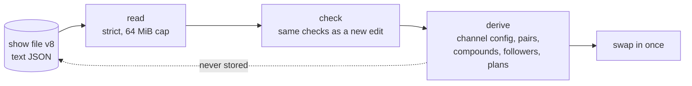

# The show file, version 8

Today the engine reads and writes version 7 (#250): the version 6 layout, with each channel's `declared` so a reopened show lowers like the saved one. This page designs the next number, version 8 (#253). Older numbers are `LeftAlone`.

Issue #199 (fourth revision), parent #198. Built by #253 (T7). Every field traces to [channel-model.md](channel-model.md), section "Show file v7". The file is written by hand or by the app (D14): our own format, not QLC+.



## Sections

| Key | Holds | Left out means | From |
|---|---|---|---|
| `show` | the number `8` | not read (`LeftAlone`) | Show file v7 |
| `outputs` | kind, rate, route spans | no outputs | Adapters |
| `modes` | each pinned mode once, by key | no modes | Show file v7 |
| `fixtures` | id, name, mode or strip, position | no fixtures | API v12 `Patch`, `PatchStrip` |
| `overrides` | per-channel rule changes, only what differs from the default | every channel at its default | Rules |
| `virtual_dimmers` | slot 2 to 7, name, followers | none (cx-4) | Rules |
| `groups` | id, name, ordered fixture ids, recipe | none | Looks, curves and recipes |
| `looks` | id, name, definition in refs, recipe | none | Looks, curves and recipes |
| `look_groups` | id, name, look ids | none | API v12, screens spec |
| `pages` | console pages and their widgets | one empty page `Main` on open | API v12, screens spec (T29) |
| `rules` | the two end policies | the defaults | Who wins |

- Strict: an unknown key anywhere is a broken file. Every section but `show` may be left out.
- The app always writes every section, in this order, one line per fixture, override, group and look.

## The example show

The test of #199 opens this block with the version 8 reader and checks the bytes it names.

```json
{
  "show": 8,
  "outputs": [
    { "id": 1, "kind": { "DmxUsbPro": { "adapter": 1 } }, "rate": 44,
      "route": [ { "universe": 1, "address": 1, "count": 512 } ] },
    { "id": 2, "kind": { "Ddp": { "address": "192.168.1.50:4048", "color": "Rgbw" } }, "rate": 44,
      "route": [ { "universe": 2, "address": 1, "count": 320 } ] }
  ],
  "modes": {
    "Stairville / Hz-200 DMX / Default": {
      "maker": "Stairville", "model": "Hz-200 DMX",
      "mode": { "name": "Default", "pixels": [], "layout": null, "degrees": null, "channels": [
        { "name": "Haze", "function": "Dimmer", "byte": "Coarse", "default": null, "direction": null,
          "declared": { "preset": null, "group": "Intensity", "colour": null, "smoke": true },
          "ranges": [ { "min": 0, "max": 255, "label": "Amount of haze 0-100 %", "does": null } ] },
        { "name": "Fan Speed", "function": "Speed", "byte": "Coarse", "default": null, "direction": null,
          "declared": { "preset": null, "group": "Speed", "colour": null, "smoke": true },
          "ranges": [ { "min": 0, "max": 255, "label": "Fan speed 0-100 %", "does": null } ] }
      ] }
    },
    "Cameo / Thunderwash 600 UV / 4 Channel": {
      "maker": "Cameo", "model": "Thunderwash 600 UV",
      "mode": { "name": "4 Channel", "pixels": [], "layout": null, "degrees": null, "channels": [
        { "name": "Dimmer", "function": "Dimmer", "byte": "Coarse", "default": null, "direction": null,
          "declared": { "preset": "IntensityMasterDimmer", "group": null, "colour": null, "smoke": false },
          "ranges": [] },
        { "name": "Strobe", "function": "Strobe", "byte": "Coarse", "default": null, "direction": "Up",
          "declared": { "preset": "ShutterStrobeSlowFast", "group": null, "colour": null, "smoke": false },
          "ranges": [] },
        { "name": "Duration", "function": "Speed", "byte": "Coarse", "default": null, "direction": null,
          "declared": { "preset": null, "group": "Speed", "colour": null, "smoke": false },
          "ranges": [ { "min": 0, "max": 255, "label": "Flash duration (1ms to 510ms)", "does": null } ] },
        { "name": "Sound", "function": "Effect", "byte": "Coarse", "default": null, "direction": null,
          "declared": { "preset": null, "group": "Effect", "colour": null, "smoke": false },
          "ranges": [ { "min": 0, "max": 5, "label": "Sound control OFF (Mic Sensitivity)", "does": null },
                      { "min": 6, "max": 255, "label": "Sound control ON Low -> High (Mic Sensitivity)", "does": null } ] }
      ] }
    }
  },
  "fixtures": [
    { "id": 1, "name": "Haze", "mode": "Stairville / Hz-200 DMX / Default", "at": { "universe": 1, "address": 25 } },
    { "id": 2, "name": "UV wash", "mode": "Cameo / Thunderwash 600 UV / 4 Channel", "at": { "universe": 1, "address": 27 } },
    { "id": 3, "name": "Row 1", "strip": { "pixels": 80, "color": "Rgbw" }, "at": { "universe": 2, "address": 1 } }
  ],
  "overrides": [
    { "fixture": 1, "channel": 2, "rest": 64 },
    { "fixture": 2, "channel": 1, "highest": true }
  ],
  "virtual_dimmers": [
    { "slot": 2, "name": "Rows", "followers": [ { "fixture": 3, "channel": 1, "count": 320 } ] }
  ],
  "groups": [
    { "id": 1, "name": "Washes", "fixtures": [2] },
    { "id": 2, "name": "Rows", "fixtures": [3] }
  ],
  "looks": [
    { "id": 1, "name": "UV on", "set": [ { "fixture": 2, "channel": 1, "byte": 255 } ] },
    { "id": 2, "name": "Spare on", "set": [ { "raw": { "universe": 1, "address": 100 }, "byte": 40 } ] },
    { "id": 3, "name": "Row breathe",
      "curves": {
        "shapes": { "breathe": { "beats": 4, "end": "Loop", "knots": [
          { "at": 0, "value": 0, "segment": "Linear" },
          { "at": 2, "value": 255, "segment": "Linear" } ] } },
        "targets": [
          { "fixture": 3, "channel": 3, "shape": "breathe", "offset": 0 },
          { "fixture": 3, "channel": 7, "shape": "breathe", "offset": 0.5 } ] },
      "recipe": "{\"kind\":\"wave\",\"group\":2,\"colour\":\"blue\",\"pixels\":2}" },
    { "id": 4, "name": "Opener",
      "sequence": [ { "look": 1, "beats": 2 }, { "look": 3, "beats": 4, "transition": 25 } ] }
  ],
  "look_groups": [
    { "id": 1, "name": "Openers", "looks": [1, 4] }
  ],
  "pages": [
    { "name": "Main", "widgets": [
      { "id": 1, "kind": "Pad", "column": 1, "row": 1, "width": 1, "height": 1, "words": "UV", "look": 1 },
      { "id": 2, "kind": "Fader", "column": 2, "row": 1, "width": 1, "height": 3, "words": "Rows", "level": { "dimmer": 2 } },
      { "id": 3, "kind": "Fader", "column": 3, "row": 1, "width": 1, "height": 3, "words": "Haze", "level": { "fixture": 1, "channel": 1 } }
    ] }
  ],
  "rules": { "manual_end": "UntilRelease", "other_end": "Reveal" }
}
```

| After open, nothing playing | Channel (universe / address) | Byte | Why |
|---|---|---|---|
| Haze fan | 1 / 26 | 64 | override `rest` |
| UV wash dimmer | 1 / 27 | 0 | default rest |
| Row 1, all 320 | 2 / 1 to 2 / 320 | 0 | default rest |
| Spare | 1 / 100 | 0 | nobody offers it |
| Press "UV on" | 1 / 27 | 255 | look 1 |

## A position and a ref

| Form | Written | Means |
|---|---|---|
| Position (Q2 on #198) | `{ "universe": 1, "address": 25 }` | universe 1 to 1,024, address 1 to 512. The engine turns it into channel `(universe - 1) x 512 + address - 1` on open |
| Fixture ref | `"fixture": 2, "channel": 1` | channel 1 is the fixture's first channel, counted as on its manual |
| Raw ref | `"raw": { position }` | one channel of the space, patched or not |
| Run of channels | a fixture ref plus `"count": n` | n channels from that one. Only in `followers` |

- A ref is written flat inside its entry (`set`, `overrides`, `targets`, `followers`, a fader's `level`).
- A ref on a 16-bit pair names the coarse channel. A ref on the fine channel, or a raw ref on either member, is refused `PairMember`.
- A look follows its fixture (q2): moving fixture 2 moves look 1. A raw ref never moves.

## Each section

### `outputs`

| Field | Value | From |
|---|---|---|
| `id` | 1 to 16 | today's output numbers |
| `kind` | `{ "DmxUsbPro": { "adapter": n } }` (1 is the first adapter by USB serial) or `{ "Ddp": { "address": "ip:port", "color": "Rgb" or "Rgbw" } }` (D17, s1-output-fields) | Adapters |
| `rate` | 30, 44 or 60 frames a second | Adapters |
| `route` | spans `{ universe, address, count }`, in stream order | Adapters, route spans |

- USB: one span, at most 512. DDP: up to 1,024 spans, 65,536 channels. The joined stream is a whole number of pixels for `color`.
- Two outputs may share channels (mirroring). A span over another output's patched use is refused `ChannelsTaken`.
- Later kinds (Art-Net, sACN) add their own `kind` entry.

### `modes`

| Field | Value |
|---|---|
| key | `"maker / model / mode"`, with ` (2)` when two pinned copies differ |
| `maker`, `model` | as the library has them |
| `mode` | the fixture-library `Mode`: `name`, `channels`, `pixels`, `layout`, `degrees`. Each channel with `name`, `function`, `byte`, `default`, `direction`, `ranges` **and `declared`** |

- Pinned: a show opens without the library and lowers the same way every time.
- `declared` is stored since version 7 (#250): the lowering reads only it for a channel's role and fine partner (#249). Without it every channel would be `Other` and no pair would form.
- A mode no fixture uses is not written.

### `fixtures`

| Field | Value |
|---|---|
| `id` | a whole number from 1, unique. Looks, groups and overrides name it |
| `name` | text |
| `mode` | a key of `modes` |
| `strip` | `{ "pixels": n, "color": "Rgb" or "Rgbw" }`: a generic strip with no library entry (`PatchStrip`). Exactly one of `mode` and `strip` |
| `at` | the position of its first channel |

- Placed with the checks of `Patch`: two fixtures on one channel are refused.
- A pixel panel (T23) is fixtures plus a group with a recipe, no section of its own.

### `overrides`

| Field | Value | Default comes from |
|---|---|---|
| ref | fixture ref or raw ref | |
| `rest` | 0 to 255 | the definition's default, else 0 |
| `dark` | 0 to 255 | the rules table (0, 255 subtractive, first Closed byte of a shutter) |
| `master`, `blackout` | true or false: follows modifier slot 0 or 1 | the rules table |
| `fade` | true fades, false jumps | the function (wheels, shutters, modes jump) |
| `highest` | true: highest wins among equals | false. "Highest wins for brightness" is a bulk edit of this flag, not a field of `rules` |

- Only fields that differ from the default. An override equal to its default is read and dropped at the next save.
- A pair has one policy: an override names the coarse channel and holds for both bytes.
- Virtual dimmer membership is never an override: it lives in `virtual_dimmers`, one place.
- A control channel cannot follow a modifier: refused.

### `virtual_dimmers`

| Field | Value |
|---|---|
| `slot` | 2 to 7. A seventh dimmer is refused `NoSlot` |
| `name` | text |
| `followers` | refs, with `count` for a run |

- Its level is not stored: on open it is its control channel at rest, 255 (full).

### `groups`

| Field | Value |
|---|---|
| `id`, `name` | as fixtures |
| `fixtures` | ordered fixture ids, the order patterns run in |
| `recipe` | optional opaque text, up to 64 KiB (a panel's wiring) |

- Changing a group changes no look (ch-5).

### `looks`

| Field | Value |
|---|---|
| `id`, `name` | as fixtures |
| `set` | static: entries `ref + "byte": 0..255`, or `ref + "word": 0..65535` on a pair |
| `curves` | `shapes` by name and `targets` (below) |
| `sequence` | items `{ look, beats, transition?, speed?, repeat? }`: `transition` 0 to 100 percent of the item, `speed` `Half`, `Normal` or `Double`, `repeat` `Loop` or `Once` |
| `recipe` | optional opaque text, up to 64 KiB. The engine never reads it |
| neither `set`, `curves` nor `sequence` | a draft: saved, and `Start` is refused `NoTarget` |

| Curve part | Value |
|---|---|
| shape | `beats` (period), `end` `Loop`, `Once` or `Latch`, `word` true for a pair (values 0 to 65535), `knots` |
| knot | `at` (beats), `value`, `segment` `Hold`, `Linear` or `Gap` (no offer until the next knot) |
| target | ref, `shape` (a name in `shapes`), `offset` (beats) |

- Times are beats, at most 3 decimals.
- A `Latch` shape's last knot is never a `Gap`.
- A sequence holds at most 64 items. A look that a sequence names exists, and no sequence names itself through others.
- Two targets on one channel in one look are refused `Duplicate`.
- Open (Q3 on #198, with the owner): which dimmer a Mover colour step sets. The file holds whatever channels the step editor names, so the answer changes no field.

### `look_groups`

| Field | Value |
|---|---|
| `id`, `name` | as fixtures |
| `looks` | ordered look ids. Removing a look takes it out of its groups in the same step |

### `pages`

| Field | Value |
|---|---|
| `name` | text, unique. At least one page: a show without pages opens with an empty `Main` |
| `widgets` | `id`, `kind`, `column`, `row`, `width`, `height`, `words`, and the target of the kind |

| Widget `kind` | Target field |
|---|---|
| `Pad` | `look`: a look id |
| `Fader` | `level`: `"Master"`, `"Speed"`, `{ "dimmer": slot }` or a channel ref (a channel `Hold`, the Haze fader, D18) |
| `Xy` | `fixture`: a fixture id with pan and tilt |

- More kinds come with T29 and T33, each a new row here first.

### `rules`

| Field | Value |
|---|---|
| `manual_end` | `UntilRelease` (default) or `UntilStop` |
| `other_end` | `Reveal` (default) or `Stay` |

## Never stored

| What | Why | Where it comes from on open |
|---|---|---|
| Channel config: `rest`, `dark`, `flags`, `follows` bytes | derived | the mode's lowering plus `overrides` and `virtual_dimmers` |
| Pair table, compounds and their ids, roles | derived | the lowering (#249) |
| Follower index, plans, channel to output slot map | derived | the front, as on a new edit |
| Channel indices | a position is readable | `at` and `route` |
| Plays, grabs, holds, Identify, tap tempo, Blackout | live state | idle |
| Master and virtual dimmer levels | live state | full |
| Places of detached windows | layout, not show (D15) | the layout file |

## Older, newer and broken files

| File | Result |
|---|---|
| has `version` (1 to 7) | `LeftAlone`: "an older show file". Bytes kept, autosave to it suppressed |
| `show` above 8 | `LeftAlone`: "a newer show file" |
| over 64 MiB, or would encode over it | `LeftAlone`: "too big" |
| unknown key, bad value, a check refused | not opened. The reason and where; the running show keeps running |

- A check refused on open is the same refusal a new edit would get (`PairMember`, `ChannelsTaken`, `NoSlot`, `Duplicate`, an overlap). Nothing half opens.
