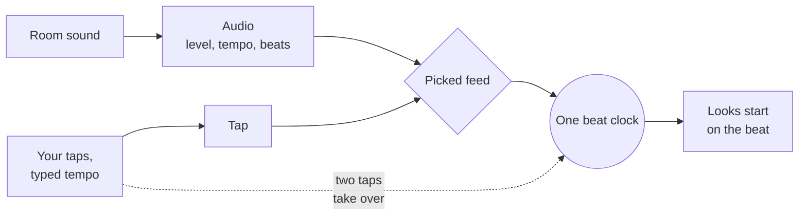
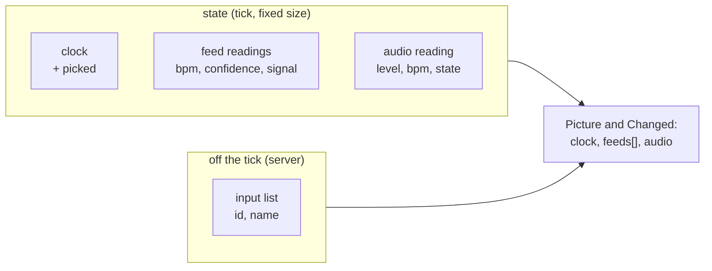
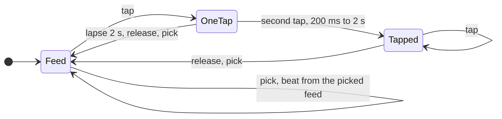
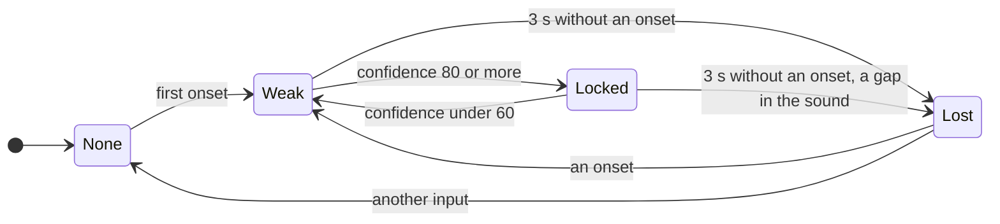
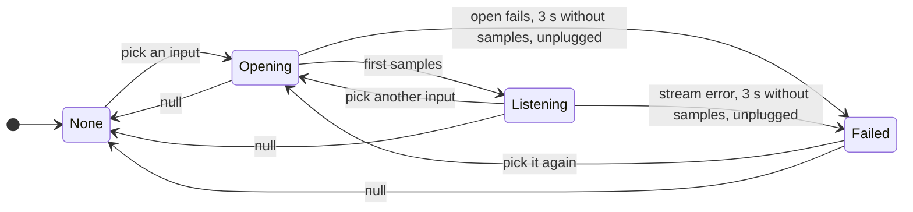
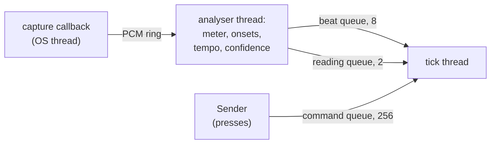
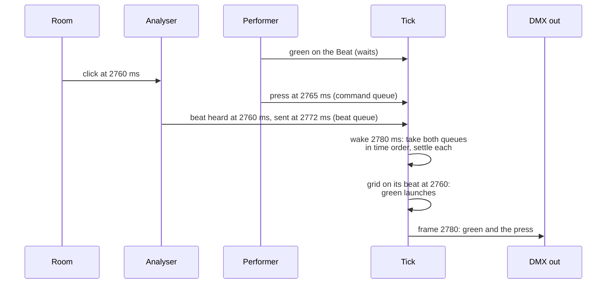
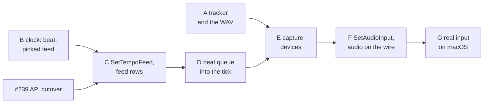

# Tempo feeds and audio in

Spec for #216 (screens T17). Map items #45 (one tempo for everything) and #35 (audio in). Parent #198.

## 1. In plain words

- You pick what sets the beat: **Tap** (your hand, or the tempo you typed) or **Audio** (the room). Later: MIDI clock, VirtualDJ, Timecode.
- Each feed shows its tempo and how sure it is. Only feeds that really work are listed.
- Audio shows a moving level meter and the tempo it hears, even when another feed is picked.
- Two taps always take over. Press "from Tap" to give the beat back.
- When the sound goes quiet, the beat keeps running at the last tempo and says "No signal". Pads still land in the very next frame.



Tempo is not channel data. Nothing here touches lights, channels, fixtures or the Mixer, so the channel rework (#239) does not change this design.

## 2. Today

| What | Where | Missing |
|---|---|---|
| One beat clock: exact tempo (`Tempo { span, beats }`), a grid of beats and bars, `Source` Feed, OneTap, Tapped | `crates/engine-core/src/clock.rs:1-19`, `:64-85`, `:106-112`, `:206-222` | a picked feed, a measured beat |
| Internal tempo: whole BPM 30 to 300, 124 at start | `clock.rs:36-62` | a measured tempo is not whole |
| A tap aligns the grid to the next beat; two taps 200 ms to 2 s apart set the tempo; one tap lapses after 2 s | `clock.rs:30-34`, `:237-243`, `:340-366` | |
| Commands `SetInternalTempo`, `TapTempo`, `ReleaseTempo` become `EngineCommand::Feed`, `Tap`, `ReleaseTempo` | `crates/engine-core/src/lib.rs:330-337`, `:430-441`, `:641-655`, `project.rs:280-282` | `SetTempoFeed`, `SetAudioInput` |
| Every command is stamped with the engine time it was sent; the tick settles the clock at that time, then at the frame. A press is in the very next frame | `crates/engine/src/lib.rs:1497-1505`, `:1825-1862`, `crates/engine/src/wake.rs:47-54` | a second producer (audio) |
| A waiting play launches at the crossing of its beat | `crates/engine-core/src/playback.rs:238-259` | |
| One command queue, `rtrb`, 256 places, one producer (the `Sender`) | `crates/engine/src/lib.rs:84-85`, `:689` | |
| The wire shows the clock as `Reading { bpm, feed, source, beat, elapsed }`; protocol version 11 | `clock.rs:125-139`, `crates/engine-core/src/api.rs:27` | `picked`, feed rows, audio |
| End-to-end tempo test on a stepped clock, decoded DMX | `crates/engine-server/tests/m3_tempo.rs` | a sound as input |
| Controls `inout.tempo.feed`, `inout.audio.input`, the Tempo machine | `docs/design/controls.md:2310`, `:2326`, `:470-511` | |
| Audio, WAV, MIDI code or dependencies | none | all |

## 3. The wire



Who owns what:

| Part | Owner | Lives in |
|---|---|---|
| Signal, confidence, a feed's tempo, the level | the analyser (it sees every onset) | sent to the tick as a reading |
| Which input is open, its generation, Opening, Listening, Failed | the tick, from commands (`SetAudioInput`, and the server's open results sent as engine commands) | `State` (fixed size, `Copy`) |
| Input names | the server | off the tick, joined when the picture is published |

The tick drops every beat and reading whose generation is not the current one. So a beat still queued after `SetAudioInput null` never moves the clock.

### Rust

`engine-core` has no `alloc`, and `Reply` derives `Copy` and `Eq` (`crates/engine-core/src/api.rs:646`). So the tick keeps exact integers, and floats appear only when serialized, as `Clock` does today (`clock.rs:426-442`).

```rust
#[derive(Clone, Copy, Debug, PartialEq, Eq, Serialize, Deserialize)]
pub enum TempoFeed { Tap, Audio, MidiClock, VirtualDJ, Timecode }

#[derive(Clone, Copy, Debug, PartialEq, Eq, Serialize)]
pub enum Signal { None, Weak, Locked, Lost }

/// One row of the Clock column. Serialized as { feed, bpm, confidence, signal },
/// bpm a number from `tempo` or null: no estimate. Never 0.
#[derive(Clone, Copy, Debug, PartialEq, Eq)]
pub struct FeedRow {
    pub feed: TempoFeed,
    pub tempo: Option<Tempo>, // `Tempo` becomes pub (ticket B)
    pub confidence: u8,       // 0 to 100
    pub signal: Signal,
}

#[derive(Clone, Copy, Debug, PartialEq, Eq, Serialize, Deserialize)]
#[serde(transparent)]
pub struct InputId(NonZeroU32); // a handle for this engine run; OS ids stay private

#[derive(Clone, Copy, Debug, PartialEq, Eq, Serialize)]
pub enum AudioFailure { Gone, Permission, UnsupportedFormat, CannotOpen, StreamFailed }

#[derive(Clone, Copy, Debug, PartialEq, Eq, Serialize)]
pub enum InputState { None, Opening, Listening, Failed { reason: AudioFailure } }

/// On the tick, in `State`.
#[derive(Clone, Copy, Debug, PartialEq, Eq)]
pub struct AudioTick {
    pub generation: u64,
    pub input: Option<InputId>,
    pub state: InputState,
    pub level: u8,          // 0 to 100
    pub row: FeedRow,       // the Audio row: tempo, confidence, signal
}

/// The wire, built by the server from `AudioTick` and its list (borrowed, no alloc
/// in engine-core): { inputs: [{ id, name }], input, state, level, bpm }.
pub struct Audio<'a> { pub inputs: &'a [AudioInput<'a>], pub tick: AudioTick }
pub struct AudioInput<'a> { pub id: InputId, pub name: &'a str }
```

| Change | Shape | Ticket |
|---|---|---|
| `Clock` | `picked: TempoFeed`, `picked_tempo: Option<Tempo>` (the picked feed's last Locked tempo, cleared when it loses lock) | B |
| `Reading` | adds `picked`. `feed` stays the internal tempo | C |
| `Reply::Picture`, `Reply::Changed` | add `feeds: FeedRow[]` and `audio: Audio`, whole each time | C, F |
| `Command` | `SetTempoFeed { feed: TempoFeed }`, `SetAudioInput { input: InputId \| null }` (null closes the input; the key is required) | C, F |
| `EngineCommand` | `PickFeed { feed }`, `AudioInput { generation, input }`, `AudioOpened { generation }`, `AudioFailed { generation, reason }` | C, F |
| `Refusal` | `FeedUnavailable { feed }`, `NoSuchAudioInput { input }` | C, F |
| `API_VERSION` | the next version after the channel rework's API cutover (#239). Not a fixed number here | C |

```ts
type TempoFeed = "Tap" | "Audio" | "MidiClock" | "VirtualDJ" | "Timecode"
type Signal = "None" | "Weak" | "Locked" | "Lost"
type FeedRow = { feed: TempoFeed, bpm: number | null, confidence: number, signal: Signal }
type InputState = "None" | "Opening" | "Listening" | { Failed: { reason: AudioFailure } }
type Audio = { inputs: Array<{ id: number, name: string }>, input: number | null,
  state: InputState, level: number, bpm: number | null }
```

| Rule | |
|---|---|
| Which feeds are listed | Tap always. Audio when this engine has a working capture path (even with no input picked). MIDI clock, VirtualDJ, Timecode only once their own spec ships a producer. A known feed that is not listed is refused with `FeedUnavailable` |
| The Tap row | the internal tempo, or the tap tempo while taps hold. Confidence 100, Locked |
| A late subscriber | gets the whole last picture: clock, every row, audio. A slow reader skips pictures and catches up from the next whole one |
| Undo | a change of feed or of input is one Undo step (`controls.md:2454`, `:2470`); a tap, a beat or an unplug is not. An Undo to an input that is gone is refused and stays in history |
| Clients never send beats | there is no command that carries a beat or a time. Only a producer inside the engine does |

## 4. The state machines

### 4a. Who sets the beat

The existing machine (`clock.rs:6-12`) stays. Two things are added: a picked feed, and a beat heard from it.



| State | tap | lapse | release | pick a listed feed | beat from the picked feed | anything from another feed |
|---|---|---|---|---|---|---|
| Feed | OneTap, align | stays | stays | Feed, take its tempo if Locked | align, take its tempo | row only |
| OneTap | as today | Feed | Feed | Feed, take its tempo if Locked | row only | row only |
| Tapped | as today | stays | Feed: `picked_tempo` if set, else the internal tempo with Tap picked, else the tapped tempo stays | Feed, take its tempo if Locked | row only | row only |

- Taps always win while they hold. A feed's beats only move the clock when `source()` is Feed. `source()`, not the stored field: a lapsed one tap stays stored as OneTap (`clock.rs:237-243`).
- Picking a feed with no lock keeps the tempo and the grid as they are: the beat runs free.
- `SetInternalTempo` sets the internal tempo always; it is the running tempo only when Tap is picked and the source is Feed or OneTap (today's `set_feed`, `clock.rs:376-386`).
- Picking the feed that is already picked is a release.

### 4b. A feed's signal



| State | onset, confidence under 60 | 60 to 79 | 80 or more | 3 s without onset | gap in samples | input changed |
|---|---|---|---|---|---|---|
| None | Weak (the first onset has no gap, so no confidence yet) | | | None | None | None |
| Weak | Weak | Weak | Locked | Lost | Lost | None |
| Locked | Weak | Locked | Locked | Lost | Lost | None |
| Lost | Weak | Weak | Weak | Lost | Lost | None |

On screen: None and Lost say "No signal"; Weak says "Listening" with its estimate; Locked shows the tempo. All numbers (80, 60, 3 s) are starting values to tune on stage.

### 4c. The audio input



| State | pick a listed input | pick null | pick an unknown id | open succeeds | open or stream fails | unplugged | late result of an older input |
|---|---|---|---|---|---|---|---|
| None | Opening | stays | refused | ignored | ignored | list only | ignored |
| Opening | same id stays, other: Opening anew | None | refused | Listening | Failed | Failed (Gone) | ignored |
| Listening | same id stays, other: Opening anew | None | refused | stays | Failed | Failed (Gone) | ignored |
| Failed | Opening (retry) | None | refused | ignored | stays | stays | ignored |

- Each pick starts a new generation. A result or a sample from an older generation is dropped.
- A failed or unplugged input keeps Audio picked: the clock runs free, the row says "No signal". Nothing switches by itself.
- A device that comes back gets a new id and waits for a pick. The desk never opens another microphone by name.
- A new device appears in the list and opens nothing.

## 5. How it is computed

### 5a. From samples to beats



The tracker is a pure calculation (samples and their times in, readings out), in a new crate `audio-in`. It is original code: aubio is GPL and not usable.

| Step | Rule (starting values) |
|---|---|
| Samples | any rate 8 to 192 kHz, 1 to 32 channels, F32, I16 or U16, mixed to mono energy (mean of squares across channels, so opposite channels still count) |
| Time of a sample | the OS capture time of the buffer's first sample (not the callback's entry, which is the buffer's end), turned into engine time (the clock the `Sender` stamps with, `wake.rs:47-54`); then sample index / rate. A jump over 20 ms, a backwards time or a dropped block is a gap |
| Level | energy per hop of `round(rate / 100)` samples, counted from the stream's start (10 ms at 8 or 48 kHz; whole samples at 11.025 kHz too); every two hops publish `round(100 × sqrt(max of the two hops))`, 0 to 100. Zero after 200 ms without a reading |
| Onset | a hop with energy at least 0.0025 that rises by at least max(0.0025, 2 × median of the last 16 hops). Onsets at least 100 ms apart. Its time is the first sample in the hop over 0.0025 |
| Tempo | the last 8 gaps between onsets. M is the lower median of the gaps between 0.2 and 2 s; inliers are gaps within 5% of M. Tempo = `k` beats in the sum of the `k` inlier gaps, kept exact as a `Tempo { span, beats }` (no rounding to whole BPM) |
| Confidence | `floor(100 × inliers / max(4, gaps kept))`. Five steady clicks give 0, 25, 50, 75, 100 |
| Half and double time | a new tempo near half or twice the locked one needs 6 steady gaps before it is taken; until then confidence is held at 59 |
| Beat | the onset that reaches Locked is a beat; after it, each onset whose gap is an inlier is a beat. Sent with its generation, its heard time and the tempo |
| Reading | every 20 ms: generation, level, signal, confidence, tempo. The tick shows the last one of the current generation |

`audio-in` depends on no crate of ours: it hands out plain integers (sample times, `span` nanoseconds and `beats`). The server turns them into the engine's records and pushes them with the producer handle that ticket D adds to `engine`.

Physical delay (sound through the air, the driver) is not measured by this. A loopback measurement on real hardware is ticket G.

### 5b. A beat moves the grid like a tap

A beat from the room is a tap that brings its own tempo. One new pure function on the clock:

`Clock::beat(self, heard: Duration, tempo: Tempo) -> Clock`

| Step | Rule |
|---|---|
| 0 | Only when `source()` is Feed and the beat's generation is current. Otherwise it updates its row only |
| 1 | Settle to `max(now, heard)`, as every command is today |
| 2 | Find the grid position at `heard` on the old tempo. The beat heard is the **nearest** whole beat (ties to the later one). Unlike a tap, which takes the next beat, a beat heard 2 ms after its crossing must not count twice |
| 3 | From now on the grid runs at `tempo`, positioned at that beat plus `(now − heard) × tempo`. It moves by at most half a beat |
| 4 | **Never back past a beat:** if the new position is below the whole beat the grid already reached at `now`, or `heard` is before the clock's last change (`from`: `count` cannot look before it, `clock.rs:410-424`), the beat updates its row only. A late beat never makes a passed beat come again |
| 5 | The elapsed count never jumps; only its rate changes (as `rebase`, `clock.rs:397-408`). Playing looks keep moving smoothly |
| 6 | Waiting plays whose beat the grid now reached launch (`launch`, `crates/engine-core/src/lib.rs:658-668`). A beat taken in time (heard after the last frame) starts them at `heard`. A beat heard before the last frame starts them at the frame time, in this frame: never in a frame already sent, and without skipping ahead |

Every other rule of the clock stays: exact tempo, `crossing` decides every launch, a same tempo changes nothing.

On the tick a beat is applied as a command is: settle at `heard`, then `beat`, then the existing `retempo` (`crates/engine-core/src/lib.rs:669-680`).

### 5c. The very next frame



| Rule | Why the press and the beat still land in the next frame |
|---|---|
| Two queues, each one producer | the analyser gets its own `rtrb` queue. A full beat queue never takes a place from a press |
| One cutoff per wake | the tick counts what is in each queue, then reads the frame time (`lib.rs:1825-1835`). What arrives later is in the next wake |
| Merged in time order | commands by their sent time, beats by their heard time; on a tie the command first |
| Bounded work | at most 8 beats, 2 readings and 256 commands per wake. A beat is a few integer operations and the existing bounded launch scan. No sorting, no loop over missed beats |
| Nothing on the tick that may wait | capture, analysis, device listing and names stay off the tick. Records are `Copy`, at most 64 bytes |

### 5d. Queues

| Queue | From, to | Size | When full |
|---|---|---|---|
| PCM ring | capture callback, analyser | 32 blocks of 256 samples | drop the new block, mark a gap. The tracker restarts after a gap |
| Beat | analyser, tick | 8 | keep the newest locally, try again; a dropped beat only delays the next |
| Reading | analyser, tick | 2 | keep the newest locally |
| Commands | `Sender`, tick | 256 (today) | `QueueFull` as today |
| Desired input, device list | server, capture worker | 1 each, latest wins | replaced |

One worker thread opens, closes and lists devices (once a second). One analyser thread lives as long as the engine. Neither is ever waited on by the tick.

### 5e. Layers and licences

| Item | Rule |
|---|---|
| `scripts/layers.mjs` | new `audio-in` (action, no deps on our crates) first; `engine-server` may use it. No tick crate and no ui layer may. `engine-server` already uses `engine` for the producer handle |
| `cpal` | capture, Apache-2.0 per its manifest, pinned, macOS first. Every new crate in the lock is read by `scripts/check-licences.mjs` before landing |
| `rtrb` | already in use, MIT or Apache-2.0 |
| WAV reading | a few lines of test code; no product file input |

## 6. Failure modes

| Situation | What happens |
|---|---|
| Fresh engine | Tap picked, 124 BPM, no input, Audio row None |
| Audio picked, silence | "No signal"; the beat runs free at the last tempo |
| Open fails, no permission, unplugged | Failed with its reason; the beat runs free; a pick retries |
| Switch input during an open | the older open is closed off the tick; only the new generation counts |
| Analyser stalls or a queue fills | the level drops to 0 after 200 ms and the row turns Lost after 3 s (the tick ages the last reading by its time), presses unaffected |
| A beat heard before the last frame | 5b step 5: it starts waiting plays in this frame, never rewrites a sent one |
| Half, double, drifting tempo | 5a: a doubled tempo needs 6 steady gaps; drift is followed beat by beat, at most half a beat per beat |
| Unknown input, feed not listed | refused, nothing changes |
| Counters | generation and sequence counters are `u64` and checked; at their end a new generation starts and the tracker reacquires |

What is saved: nothing (recommended, see section 9). The picked feed and the input last for this engine run: a window that reconnects sees them; a restart starts on Tap with no input.

## 7. Test plan

### The WAV

| | |
|---|---|
| File | `crates/audio-in/tests/data/click-93_75.wav`, made by `scripts/make-tempo-clicks.mjs` (`--check` compares the bytes) |
| Format | PCM, mono, 16 bit, 8000 samples a second, 10 s, 160 044 bytes |
| Content | silence; 16 clicks of 40 samples (5 ms) at ±24576, the first at 200 ms, then every 640 ms: exactly 93.75 BPM (25 beats in 16 s) |
| Licence | synthetic, made by the script: no music, no copyright |
| Known answers | onsets at 200 + 640k ms; confidence 0, 25, 50, 75, 100 on the first five; the meter reads 53 at 220 ms and 0 at 240 ms; Locked at the fifth click, 2760 ms |

### Table tests

| What | Cases |
|---|---|
| Tracker (pure) | the WAV in chunks of 1, 31, 256 and irregular sizes give the same readings; silence; a steady tone; inverted stereo; noise; 44.1 and 48 kHz; one click missing; one click 30 ms early; half and double spacing; slow drift; a gap |
| Clock `beat` | every cell of 4a; a beat just before, on and after a crossing; a beat heard before the last frame; a bar launch; equal tempo changes nothing; elapsed never jumps |
| Signal, input | every cell of 4b and 4c; 3 s minus 1 ns, exactly, plus 1 ns |
| Real time | full beat and reading queues; a parked analyser; `tests/no_alloc.rs` counts zero allocations on the tick with beats flowing; clippy bans hold |

### End to end, through the API, DMX bytes

On the stepped clock of `m3_tempo.rs` (looks 1 red, 2 green, 3 blue), with a test capture path that plays the WAV at its sample times. Due frames every 20 ms (output rate 50, `Wakes::wake_at`, `crates/engine/src/wake.rs:349`). A test hook `analysed_until(t)` waits until the analyser has taken every sample up to `t` and pushed what it found, so a beat's arrival is decided by the test, not by thread timing. If the fake adapter cannot run at 50, shift the times to its frames: the rule is the click and the press fall between two due frames and both show in the later one.

| Time (ms) | Send | Expect |
|---|---|---|
| fresh | Query | `clock.picked = "Tap"`, `bpm 124`; feeds Tap, Audio (None); `audio.input null` |
| 0 | `SetInternalTempo 120`, `TapTempo`, `ReleaseTempo` | beat 0 at 0, then one every 500 ms |
| 0 | `SetTempoFeed Audio`, `SetAudioInput 7` | Accepted; Opening, then Listening; the beat still runs at 120 |
| 0 | `StartLook 1 Now` | red |
| 220 | | `audio.level 53` |
| 2730 | `StartLook 2 Beat` | Waiting for beat 6, which the internal grid reaches at 3000 |
| 2760 | (due frame) | red |
| 2765 | `SetChannel` address 4 = 73 | Accepted |
| 2772 | `analysed_until(2772)`: the fifth click (heard 2760) is pushed | |
| 2780 | (due frame) | green and 73 in the same frame; `clock.bpm 93.75`, Audio row Locked, 100. Without audio, green would wait until 3000 |
| 3200 | `StartLook 3 Beat`; hold the sixth beat (`analysed_until` not past 3400) | blue first in the 3400 frame, not in 3380: the grid follows 2760 + 640, not the internal 3500 |
| later | `SetAudioInput null`, then `7` again | Opening with level 0 and bpm null; the old 93.75 is not shown with the new generation |

| Adversarial repeat | Expect |
|---|---|
| the fifth beat pushed only after the 2780 frame | 2780 red; green in the next frame, never earlier |
| the sixth click 30 ms early (heard 3370, pushed before 3380) | blue in the 3380 frame, before 3400 |
| a beat heard 300 ms before it is pushed, past a beat the grid already reached | its row updates, no look launches again (5b step 4) |
| two taps while Audio is picked | taps win; beats update the row only, until `ReleaseTempo` |
| the beat queue full | the press at 2765 still shows in the 2780 frame |

## 8. Build tickets

Order rules:

| Rule | Why |
|---|---|
| Shared API files (`crates/engine-core/src/{api,lib}.rs`, `crates/engine-server/src/lib.rs`, `ui/src/engine-api.ts`, `docs/engine.md`) one ticket at a time: C, then F, after #227 (T28) in the chain of `screens-slice-1.md` | one writer per file |
| C, D and F after the channel rework's API cutover (#239, its ticket "API v12 and show file v7") | that ticket rewrites `engine-core/src/*`, `engine/src/*` and every light-model test |
| B touches `clock.rs` alone. It must not run at the same time as #239's "Sources on channels" ticket, which owns `engine-core/src/*` | one writer per file |
| G joins the `engine-server/src/main.rs` chain of `screens-slice-1.md` | one writer per file |
| A needs nothing | new crate |

Each ticket starts with its failing public test.



| | Ticket | Owns | Done when | Blocked by |
|---|---|---|---|---|
| A | Tempo and level from samples | `scripts/layers.mjs` (its line), NEW `crates/audio-in/` (tracker, tests, WAV), `scripts/make-tempo-clicks.mjs`, `Cargo.toml`, `Cargo.lock` | `node scripts/make-tempo-clicks.mjs --check`; `cargo test -p audio-in --test tracker` passes the tracker tables of section 7; `node scripts/check-layers.mjs` | none |
| B | A heard beat on the clock | `crates/engine-core/src/clock.rs` (`beat`, `picked`, `picked_tempo`, `Tempo` pub); no wire change | `cargo test -p engine-core clock` passes the `beat` and 4a tables, step 4 included; elapsed never jumps; `npm test` green (no generated file changes) | none (see order rules) |
| C | Pick a feed, publish the rows | shared API files, `crates/engine-core/src/project.rs`, `crates/engine/src/snapshot.rs`, `ui/src/picture.ts`, `crates/engine-server/tests/{m3_tempo,m3_health}.rs` | `SetTempoFeed Tap`, its Undo and refusals over the API; `Reading.picked`; generated TS matches; next API version; `cargo test -p engine-server --test m3_tempo` | B, #227, #200, #206, #239 (API cutover) |
| D | Beats from a producer beside presses | `crates/engine/src/{lib,wake}.rs` (the beat and reading queues, the producer handle, the merged drain), `crates/engine/tests/no_alloc.rs` | a test producer moves a waiting look on its beat, DMX bytes checked; old-generation beats dropped; full queues never cost a press its frame; `cargo test -p engine --features test-support --test no_alloc` zero allocations | C |
| E | Capture and devices off the tick | `crates/audio-in/src/{capture,service}.rs`, `crates/engine-server/Cargo.toml`, `Cargo.lock` | `cargo test -p audio-in --test capture` (formats, capture times, hops, gaps, generations, failures); `node scripts/check-licences.mjs` | A, D |
| F | Pick an input, audio on the wire | shared API files, NEW `crates/engine-server/src/audio.rs`, `ui/src/picture.ts`, `crates/engine-server/tests/m3_tempo.rs` | the section 7 end-to-end tables pass in `m3_tempo` with `analysed_until`; `SetAudioInput` and its Undo; Audio listed only when capture works | E |
| G | The room on macOS | `crates/engine-server/src/{main,audio}.rs`, NEW `crates/engine-server/tests/room_audio.rs` (ignored by default), microphone permission text | the shipping engine lists real inputs; a loopback run records the delay from sound to DMX and the before and after bytes | F, the `main.rs` chain |

The screens: #213 (In/Out: Out and Clock) shows the feed rows and picks a feed once C lands; #219 (In/Out: In, feeds) shows the Audio row, the meter and the input picker once F lands.

Each ticket that adds an input path asserts on DMX bytes. MIDI clock (#214), VirtualDJ (#217) and Timecode plug into C and D the same way: a producer, its own queue, its own DMX test.

## 9. Decisions for the owner

On the decisions page, one question each.

| Question | Recommended | Other |
|---|---|---|
| What survives a restart? | **Nothing: a new night starts on Tap with no input.** Reconnecting windows keep the choice | save the feed with the show and the input with the app: a moved show must then handle a missing microphone |
| Audio goes quiet | **Keep the last tempo and the Audio pick, say "No signal"**. `controls.md:127` and `:2454` ("nothing drives the beat") then need aligning | fall back to the typed tempo: a quiet passage changes the tempo mid-show |
| An unplugged input comes back | **Wait for a pick** | reopen it by itself: needs stable device identity and a visible reconnect |
| Which computers get audio first | **macOS first**; others have Tap | all at once: each needs its own permission and timing tests |
| Feeds not built yet (MIDI clock, VirtualDJ, Timecode) | **Not listed until they work** | shown greyed out with a note |

## 10. What could not be checked

| Challenge first | How to settle it |
|---|---|
| Real music, not clicks: the onset rule on kick, bass and vocals | annotated room recordings; count missed, doubled and off-beat launches; tune the starting values |
| Delay from sound to light | loopback on real hardware (ticket G) |
| The nearest-beat rule against the tap's next-beat rule | the 4a and `beat` tables, and the 30 ms early click in section 7 |
| macOS permission for a headless engine | grant, deny and unplug under the desktop and the standalone launch |
| New crates under `cpal` | the licence check on the real lock (ticket E) |
| Shared files during the channel rework | recheck file names, the snapshot size and the API version when each ticket is cut |
