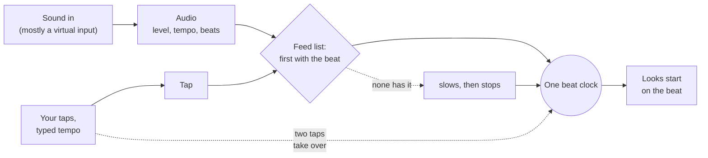
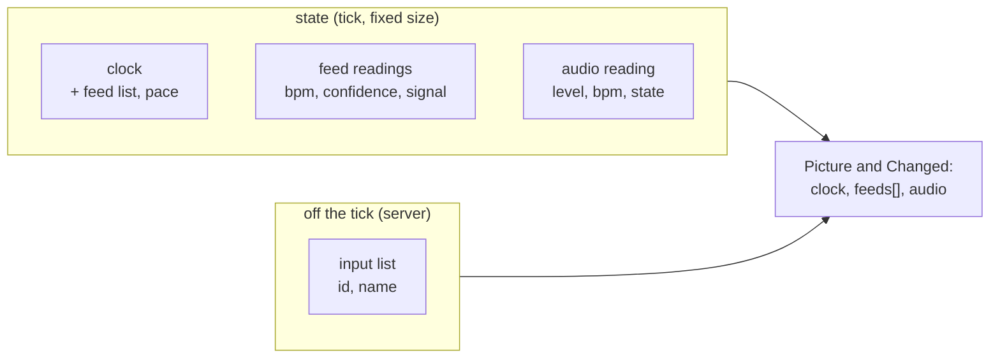
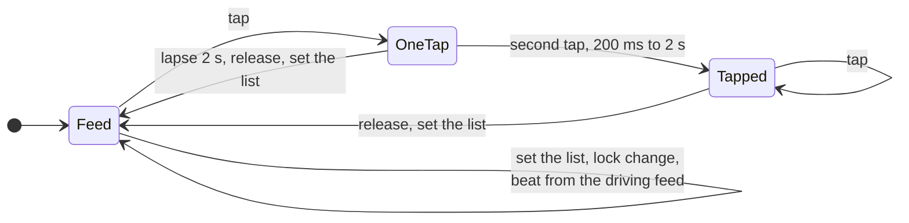
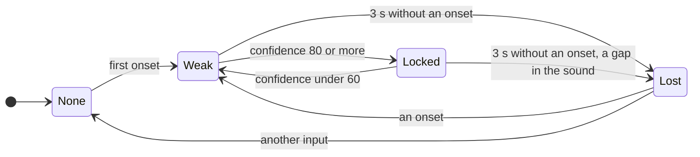
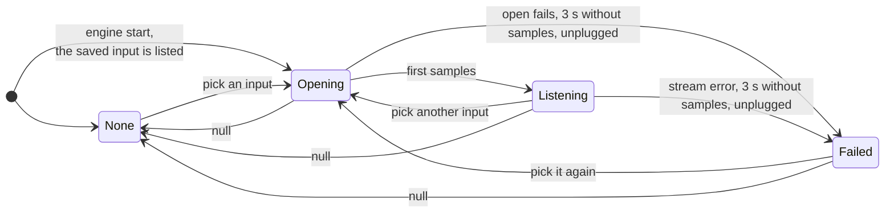
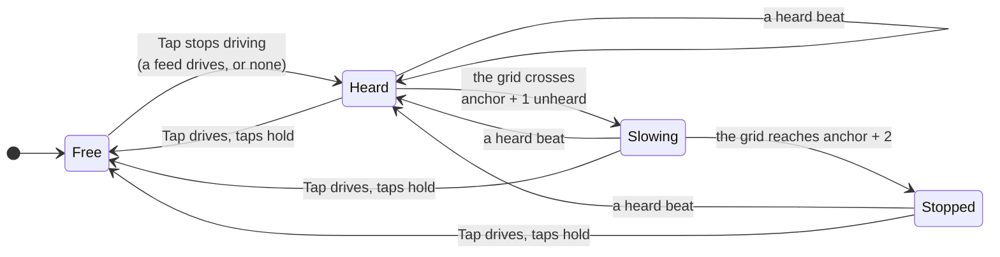
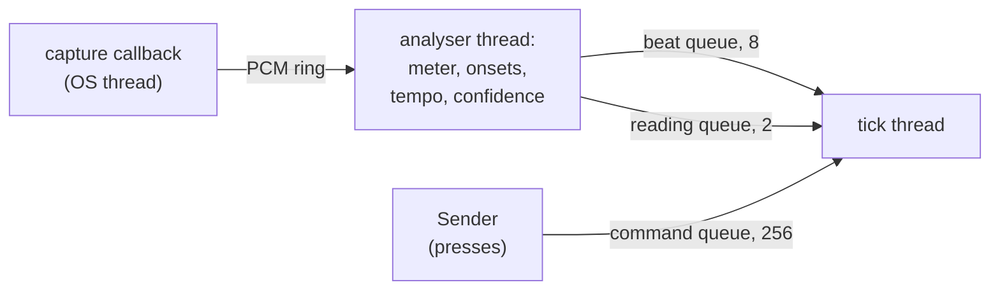
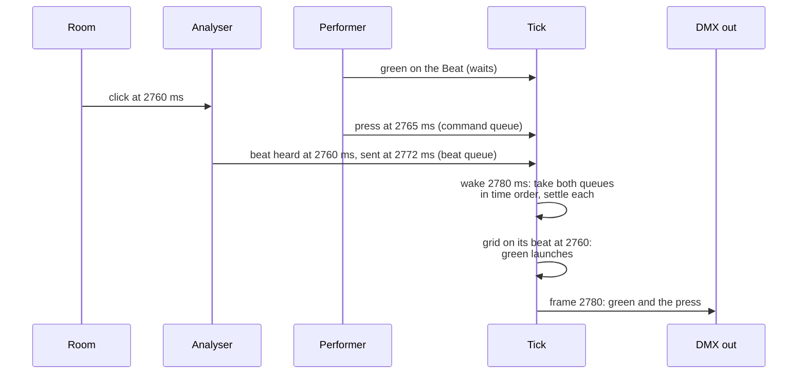
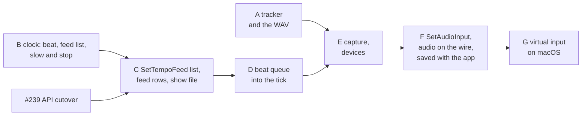

# Tempo feeds and audio in

Spec for #216 (screens T17). Map items #45 (one tempo for everything) and #35 (audio in). Parent #198.

## 1. In plain words

- You pick what sets the beat: **Tap** (your hand, or the tempo you typed) or **Audio** (sound in, mostly a virtual input from the DJ software). Later: MIDI clock, VirtualDJ, Timecode.
- You pick feeds as a **list in order**: e.g. 1 VirtualDJ, 2 Audio, then none. The first feed that has the beat sets it.
- Each feed shows its tempo and how sure it is. Only feeds that really work are listed.
- Audio shows a moving level meter and the tempo it hears, even when another feed sets the beat.
- Two taps always take over. Press "from Tap" to give the beat back.
- When the sound goes quiet, the beat **slows down and stops**, like QLC+: it never jumps to a fixed tempo. Tap at the end of the list is the only way to fall back to a tempo. Pads still land in the very next frame.
- The feed list is saved with the show; the audio input with the app.



Tempo is not channel data. Nothing here touches lights, channels, fixtures or the Mixer, so the channel rework (#239) does not change this design.

## 2. Today

| What | Where | Missing |
|---|---|---|
| One beat clock: exact tempo (`Tempo { span, beats }`), a grid of beats and bars, `Source` Feed, OneTap, Tapped | `crates/engine-core/src/clock.rs:1-19`, `:64-85`, `:106-112`, `:206-222` | a feed list, a measured beat, a beat that stops |
| Internal tempo: whole BPM 30 to 300, 124 at start | `clock.rs:36-62` | a measured tempo is not whole |
| A tap aligns the grid to the next beat; two taps 200 ms to 2 s apart set the tempo; one tap lapses after 2 s | `clock.rs:30-34`, `:237-243`, `:340-366` | |
| Commands `SetInternalTempo`, `TapTempo`, `ReleaseTempo` become `EngineCommand::Feed`, `Tap`, `ReleaseTempo` | `crates/engine-core/src/lib.rs:330-337`, `:430-441`, `:641-655`, `project.rs:280-282` | `SetTempoFeed`, `SetAudioInput` |
| Every command is stamped with the engine time it was sent; the tick settles the clock at that time, then at the frame. A press is in the very next frame | `crates/engine/src/lib.rs:1497-1505`, `:1825-1862`, `crates/engine/src/wake.rs:47-54` | a second producer (audio) |
| A waiting play launches at the crossing of its beat | `crates/engine-core/src/playback.rs:238-259` | |
| One command queue, `rtrb`, 256 places, one producer (the `Sender`) | `crates/engine/src/lib.rs:84-85`, `:689` | |
| The wire shows the clock as `Reading { bpm, feed, source, beat, elapsed }`; protocol version 11 | `clock.rs:125-139`, `crates/engine-core/src/api.rs:27` | `feeds`, `driving`, `pace`, feed rows, audio |
| End-to-end tempo test on a stepped clock, decoded DMX | `crates/engine-server/tests/m3_tempo.rs` | a sound as input |
| Controls `inout.tempo.feed`, `inout.audio.input`, the Tempo machine | `docs/design/controls.md:2310`, `:2326`, `:470-511` | |
| Audio, WAV, MIDI code or dependencies | none | all |

## 3. The wire



Who owns what:

| Part | Owner | Lives in |
|---|---|---|
| Signal, confidence, a feed's tempo, the level | the analyser (it sees every onset) | sent to the tick as a reading |
| Which input is open, its generation, Opening, Listening, Failed | the tick, from commands (`SetAudioInput`, and the server's open results sent as engine commands) | `State` (fixed size, `Copy`) |
| Input names | the server | off the tick, joined when the picture is published |

The tick drops every beat and reading whose generation is not the current one. So a beat still queued after `SetAudioInput null` never moves the clock.

### Rust

`engine-core` has no `alloc`, and `Reply` derives `Copy` and `Eq` (`crates/engine-core/src/api.rs:646`). So the tick keeps exact integers, and floats appear only when serialized, as `Clock` does today (`clock.rs:426-442`).

```rust
#[derive(Clone, Copy, Debug, PartialEq, Eq, Serialize, Deserialize)]
pub enum TempoFeed { Tap, Audio, MidiClock, VirtualDJ, Timecode }

/// The feeds in the order they are tried. 1 to 5 entries, no repeats, Tap only last.
/// The end of the list is "none". Saved with the show. Serialized as an array.
#[derive(Clone, Copy, Debug, PartialEq, Eq)]
pub struct FeedList { feeds: [TempoFeed; 5], len: u8 } // checked constructor only

/// How the beat moves now (4d).
#[derive(Clone, Copy, Debug, PartialEq, Eq, Serialize)]
pub enum Pace { Free, Heard, Slowing, Stopped }

#[derive(Clone, Copy, Debug, PartialEq, Eq, Serialize)]
pub enum Signal { None, Weak, Locked, Lost }

/// One row of the Clock column. Serialized as { feed, bpm, confidence, signal },
/// bpm a number from `tempo` or null: no estimate. Never 0.
#[derive(Clone, Copy, Debug, PartialEq, Eq)]
pub struct FeedRow {
    pub feed: TempoFeed,
    pub tempo: Option<Tempo>, // `Tempo` becomes pub (ticket B)
    pub confidence: u8,       // 0 to 100
    pub signal: Signal,
}

#[derive(Clone, Copy, Debug, PartialEq, Eq, Serialize, Deserialize)]
#[serde(transparent)]
pub struct InputId(NonZeroU32); // a handle for this engine run; OS ids stay private

#[derive(Clone, Copy, Debug, PartialEq, Eq, Serialize)]
pub enum AudioFailure { Gone, Permission, UnsupportedFormat, CannotOpen, StreamFailed }

#[derive(Clone, Copy, Debug, PartialEq, Eq, Serialize)]
pub enum InputState { None, Opening, Listening, Failed { reason: AudioFailure } }

/// On the tick, in `State`.
#[derive(Clone, Copy, Debug, PartialEq, Eq)]
pub struct AudioTick {
    pub generation: u64,
    pub input: Option<InputId>,
    pub state: InputState,
    pub level: u8,          // 0 to 100
    pub row: FeedRow,       // the Audio row: tempo, confidence, signal
}

/// The wire, built by the server from `AudioTick` and its list (borrowed, no alloc
/// in engine-core): { inputs: [{ id, name }], input, state, level, bpm }.
pub struct Audio<'a> { pub inputs: &'a [AudioInput<'a>], pub tick: AudioTick }
pub struct AudioInput<'a> { pub id: InputId, pub name: &'a str }
```

| Change | Shape | Ticket |
|---|---|---|
| `Clock` | `feeds: FeedList`; `locks`: each feed's last Locked tempo or none (5 places); `driving: Option<TempoFeed>` (the first in the list with a lock); `anchor`: the whole beat of the last heard beat; `pace: Pace` | B |
| `Reading` | adds `feeds`, `driving`, `pace`. `feed` stays the internal tempo | C |
| `Reply::Picture`, `Reply::Changed` | add `feeds: FeedRow[]` and `audio: Audio`, whole each time | C, F |
| `Command` | `SetTempoFeed { feeds: TempoFeed[] }`, `SetAudioInput { input: InputId \| null }` (null closes the input; the key is required) | C, F |
| `EngineCommand` | `SetFeeds { feeds: FeedList }`, `FeedLock { feed, tempo: Option<Tempo> }`, `AudioInput { generation, input }`, `AudioOpened { generation }`, `AudioFailed { generation, reason }` | C, D, F |
| `Refusal` | `FeedUnavailable { feed }`, `FeedRepeated { feed }`, `TapNotLast`, `NoSuchAudioInput { input }`. An empty list is `NotACommand` | C, F |
| Show file | `tempo: { feeds: TempoFeed[] }`; a new show has `["Tap"]`. The next show file version after #239's v7 | C |
| App settings | `audio.input`: the OS name and UID of the last picked input, or null. Kept by the server in its own settings file in the OS app data folder, never in the show | F |
| `API_VERSION` | the next version after the channel rework's API cutover (#239). Not a fixed number here | C |

```ts
type TempoFeed = "Tap" | "Audio" | "MidiClock" | "VirtualDJ" | "Timecode"
type Signal = "None" | "Weak" | "Locked" | "Lost"
type Pace = "Free" | "Heard" | "Slowing" | "Stopped"
// Reading adds: feeds: TempoFeed[], driving: TempoFeed | null, pace: Pace
type FeedRow = { feed: TempoFeed, bpm: number | null, confidence: number, signal: Signal }
type InputState = "None" | "Opening" | "Listening" | { Failed: { reason: AudioFailure } }
type Audio = { inputs: Array<{ id: number, name: string }>, input: number | null,
  state: InputState, level: number, bpm: number | null }
```

| Rule | |
|---|---|
| Which feeds are listed | Tap always. Audio when this engine has a working capture path (even with no input picked). MIDI clock, VirtualDJ, Timecode only once their own spec ships a producer. A list naming a known feed that is not listed is refused with `FeedUnavailable` |
| The feed list | 1 to 5 feeds in order, no repeats (`FeedRepeated`), Tap only last (`TapNotLast`: Tap is always Locked, so a feed after it would never be tried). No Tap at the end means "then none": the beat slows and stops (4d) |
| Opening a show | its list is taken as saved. A feed this engine does not list stays in the list and counts as no signal, like an unplugged input. The UI shows it as "not on this computer" |
| The Tap row | the internal tempo, or the tap tempo while taps hold. Confidence 100, Locked |
| A late subscriber | gets the whole last picture: clock, every row, audio. A slow reader skips pictures and catches up from the next whole one |
| Undo | a change of the feed list or of input is one Undo step (`controls.md:2454`, `:2470`); a tap, a beat, a lock change or an unplug is not. An Undo to an input that is gone is refused and stays in history |
| Clients never send beats | there is no command that carries a beat or a time. Only a producer inside the engine does |

## 4. The state machines

### 4a. Who sets the beat

The existing machine (`clock.rs:6-12`) stays. Three things are added: a feed list, the driving feed (the first in the list with a lock), and a beat heard from it.



| State | tap | lapse | release | set the list | a feed in the list gains or loses its lock | beat from the driving feed | anything from another feed |
|---|---|---|---|---|---|---|---|
| Feed | OneTap, align | stays | stays | Feed, then as a lock change | a feed drives: its tempo at the grid phase now (as `ReleaseTempo` today, no jump); a Slowing or Stopped grid stays so until that feed's first beat. Tap drives: the internal tempo at the grid phase now, Free. No driver: from Free, the anchor is the whole beat reached now and the pace Heard (4d); otherwise the pace and anchor stay | align, take its tempo, anchor, Heard | row only |
| OneTap | as today | Feed | Feed | Feed, as a lock change | recorded | row only | row only |
| Tapped | as today | stays | Feed, as a lock change from Free: the driver's tempo, or the internal tempo if Tap drives, else the tapped tempo with the anchor at the whole beat reached now, Heard (4d) | Feed, as a lock change | recorded | row only | row only |

- Taps always win while they hold. A feed's beats only move the clock when `source()` is Feed. `source()`, not the stored field: a lapsed one tap stays stored as OneTap (`clock.rs:237-243`).
- A list with no lock (Audio picked in silence) does not run free: it slows and stops (4d) until a feed in it hears the beat.
- `SetInternalTempo` sets the internal tempo always; it is the running tempo only when Tap drives and the source is Feed or OneTap (today's `set_feed`, `clock.rs:376-386`).
- Setting the list that is already set is a release.
- Each feed keeps its own lock in the clock, so the driver is found by a scan of at most 5 places, no search elsewhere.

### 4b. A feed's signal



| State | onset, confidence under 60 | 60 to 79 | 80 or more | 3 s without onset | gap in samples | input changed |
|---|---|---|---|---|---|---|
| None | Weak (the first onset has no gap, so no confidence yet) | | | None | None | None |
| Weak | Weak | Weak | Locked | Lost | Lost | None |
| Locked | Weak | Locked | Locked | Lost | Lost | None |
| Lost | Weak | Weak | Weak | Lost | Lost | None |

On screen: None and Lost say "No signal"; Weak says "Listening" with its estimate; Locked shows the tempo. All numbers (80, 60, 3 s) are starting values to tune on stage.

### 4c. The audio input



| State | pick a listed input | pick null | pick an unknown id | open succeeds | open or stream fails | unplugged | late result of an older input |
|---|---|---|---|---|---|---|---|
| None | Opening | stays | refused | ignored | ignored | list only | ignored |
| Opening | same id stays, other: Opening anew | None | refused | Listening | Failed | Failed (Gone) | ignored |
| Listening | same id stays, other: Opening anew | None | refused | stays | Failed | Failed (Gone) | ignored |
| Failed | Opening (retry) | None | refused | ignored | stays | stays | ignored |

- Each pick starts a new generation. A result or a sample from an older generation is dropped.
- A failed or unplugged input keeps the feed list as it is: the Audio row says "No signal" and counts as no lock, so the next feed in the list drives, or the beat slows and stops (4d). Nothing else switches by itself.
- A device that comes back during a run gets a new id and waits for a pick (owner). During a run the desk never opens a device by name.
- At engine start only: the input saved in the app settings opens if the first device listing has it (matched by OS UID, then name). Otherwise None, and it waits for a pick like any device.
- A pick that is accepted is saved in the app settings at once (`null` too). A failed open does not change what is saved.
- Mostly the input is a virtual (loopback) device that takes the DJ software's output, not a microphone (owner). It is listed like any input; nothing filters virtual devices out.
- A new device appears in the list and opens nothing.

### 4d. When the driving feed goes quiet

Like QLC+ today (its audio mode steps only on heard beats, `engine/src/inputoutputmap.cpp`, `slotAudioTick`): no heard beat, no new beat. The beat never jumps to a fixed tempo. Tap at the end of the list is the only fallback to a tempo, and the user puts it there.



| Pace | The grid and the elapsed count | On screen |
|---|---|---|
| Free | Tap drives, or taps hold: runs at its tempo, never stops (today) | the tempo |
| Heard | runs at the driving feed's tempo up to anchor + 1, the beat it expects next | the tempo |
| Slowing | anchor + 1 passed with no heard beat: runs at **half** the tempo toward anchor + 2 | "Slowing" |
| Stopped | stands on anchor + 2 **without taking it**: the elapsed count stands still, looks freeze, plays waiting for that beat wait on | "Stopped: no signal" |

| Event | Rule |
|---|---|
| A heard beat while Slowing or Stopped | 5b as written: the nearest whole beat. Stopped on anchor + 2 means the first heard beat is anchor + 2, so a play waiting on the Beat starts on the first beat of the music again |
| The anchor | the whole beat a heard beat was placed on (5b step 2). Leaving Free with no driver (a list change that takes Tap away, a release of taps): the whole beat reached at that moment. Otherwise a lost lock or a list change keeps the anchor, so a Stopped grid stays stopped |
| Why half a tempo for one beat | a heard beat arrives 10 to 20 ms after its sound. The grid crosses anchor + 1 on time and keeps moving, so a steady track never stalls. One missed click only slows one beat; the next heard beat pulls the grid forward by at most half a beat (5b step 3) |
| Lost lock | does not stop the grid at once. The beat slows from the anchor whether the feed still says Locked (silence for under 3 s) or not |
| Tap at the end of the list | when no feed above it has a lock, Tap drives: the internal tempo at the grid phase now, Free. A Stopped grid takes the beat it stands on at once and runs on from there, no jump |

The numbers (one beat on time, one at half, then stop) are starting values to tune on stage, like those of 4b.

## 5. How it is computed

### 5a. From samples to beats



The tracker is a pure calculation (samples and their times in, readings out), in a new crate `audio-in`. It is original code: aubio is GPL and not usable.

| Step | Rule (starting values) |
|---|---|
| Samples | any rate 8 to 192 kHz, 1 to 32 channels, F32, I16 or U16, mixed to mono energy (mean of squares across channels, so opposite channels still count). A NaN or infinite F32 sample counts as 0 (silence). U16 has its zero at 32768 |
| Time of a sample | each block's own OS capture time of its first sample (not the callback's entry, which is the buffer's end), turned into engine time (the clock the `Sender` stamps with, `wake.rs:47-54`); then index in the block / rate. A jump over 20 ms against the previous block's end, a time before the previous block or a dropped block is a gap |
| Level | energy per hop of `round(rate / 100)` samples, counted from the stream's start (10 ms at 8 or 48 kHz; whole samples at 11.025 kHz too); every two hops publish `round(100 × sqrt(max of the two hops))`, 0 to 100. Zero after 200 ms without a reading |
| Onset | a hop with energy at least 0.0025 that rises over the hop before it by at least max(0.0025, 2 × median of the last 16 hops; the median of an even count is the mean of the middle two). Onsets at least 100 ms apart. Its time is the first sample in the hop strictly over 0.0025 |
| Tempo | the last 8 gaps between onsets. M is the lower median of the gaps between 0.2 and 2 s; inliers are gaps within 5% of M. Tempo = `k` beats in the sum of the `k` inlier gaps, kept exact as a `Tempo { span, beats }` (no rounding to whole BPM) |
| Confidence | `floor(100 × inliers / max(4, gaps kept))`. Five steady clicks give 0, 25, 50, 75, 100 |
| Half and double time | a new tempo near half or twice the locked one needs 6 steady gaps before it is taken; until then confidence is held at 59 |
| Beat | the onset that reaches Locked is a beat; after it, each onset whose gap is an inlier is a beat. Sent with its generation, its heard time and the tempo |
| Reading | every 20 ms: generation, level, signal, confidence, tempo. The tick shows the last one of the current generation |

`audio-in` depends on no crate of ours: it hands out plain integers (sample times, `span` nanoseconds and `beats`). The server turns them into the engine's records and pushes them with the producer handle that ticket D adds to `engine`.

The input is mostly a virtual (loopback) device fed by the DJ software (owner), so there is no air in the path; the driver's buffer delay remains. It is not measured by this. A loopback measurement on the real machine is ticket G.

### 5b. A beat moves the grid like a tap

A heard beat is a tap that brings its own tempo. One new pure function on the clock:

`Clock::beat(self, feed: TempoFeed, heard: Duration, tempo: Tempo) -> Clock`

| Step | Rule |
|---|---|
| 0 | A beat is sent only while its feed is Locked, so the tick first records the beat's tempo as that feed's lock (4a lock change; the driver may change). Then the beat moves the grid only when `source()` is Feed, it comes from the driving feed and its generation is current. Otherwise it updates its row only |
| 1 | Settle to `max(now, heard)`, as every command is today |
| 2 | Find the grid position at `heard` on the old tempo. The beat heard is the **nearest** whole beat (ties to the later one). Unlike a tap, which takes the next beat, a beat heard 2 ms after its crossing must not count twice |
| 3 | From now on the grid runs at `tempo`, positioned at that beat plus `(now − heard) × tempo`. It moves by at most half a beat |
| 4 | **Never back past a beat:** if the new position is below the whole beat the grid already reached at `now`, or `heard` is before the clock's last change (`from`: `count` cannot look before it, `clock.rs:410-424`), the beat updates its row only. A late beat never makes a passed beat come again |
| 5 | The elapsed count never jumps; only its rate changes (as `rebase`, `clock.rs:397-408`). Playing looks keep moving smoothly |
| 6 | The beat sets the anchor to its whole beat; pace Heard (4d). A grid that was Stopped on anchor + 2 takes that beat now |
| 7 | Waiting plays whose beat the grid now reached launch (`launch`, `crates/engine-core/src/lib.rs:658-668`). A beat taken in time (heard after the last frame) starts them at `heard`. A beat heard before the last frame starts them at the frame time, in this frame: never in a frame already sent, and without skipping ahead |

Every other rule of the clock stays: exact tempo, `crossing` decides every launch, a same tempo changes nothing.

On the tick a beat is applied as a command is: settle at `heard`, then `beat`, then the existing `retempo` (`crates/engine-core/src/lib.rs:669-680`).

### 5c. The very next frame



| Rule | Why the press and the beat still land in the next frame |
|---|---|
| Two queues, each one producer | the analyser gets its own `rtrb` queue. A full beat queue never takes a place from a press |
| One cutoff per wake | the tick counts what is in each queue, then reads the frame time (`lib.rs:1825-1835`). What arrives later is in the next wake |
| Merged in time order | commands by their sent time, beats by their heard time; on a tie the command first |
| Bounded work | at most 8 beats, 2 readings and 256 commands per wake. A beat is a few integer operations and the existing bounded launch scan. No sorting, no loop over missed beats |
| Nothing on the tick that may wait | capture, analysis, device listing and names stay off the tick. Records are `Copy`, at most 64 bytes |

### 5d. Queues

| Queue | From, to | Size | When full |
|---|---|---|---|
| PCM ring | capture callback, analyser | 32 blocks of 256 samples | drop the new block, mark a gap. The tracker restarts after a gap |
| Beat | analyser, tick | 8 | keep the newest locally, try again; a dropped beat only delays the next |
| Reading | analyser, tick | 2 | keep the newest locally |
| Commands | `Sender`, tick | 256 (today) | `QueueFull` as today |
| Desired input, device list | server, capture worker | 1 each, latest wins | replaced |

One worker thread opens, closes and lists devices (once a second). One analyser thread lives as long as the engine. Neither is ever waited on by the tick.

### 5e. Layers and licences

| Item | Rule |
|---|---|
| `scripts/layers.mjs` | new `audio-in` (action, no deps on our crates) first; `engine-server` may use it. No tick crate and no ui layer may. `engine-server` already uses `engine` for the producer handle |
| `cpal` | capture, Apache-2.0 per its manifest, pinned, macOS first. Every new crate in the lock is read by `scripts/check-licences.mjs` before landing |
| `rtrb` | already in use, MIT or Apache-2.0 |
| WAV reading | a few lines of test code; no product file input |

## 6. Failure modes

| Situation | What happens |
|---|---|
| Fresh engine, new show, empty app settings | list `["Tap"]`, 124 BPM, Free, no input, Audio row None |
| `["Audio"]`, silence | one beat on time, one at half the tempo, then Stopped: "Stopped: no signal", looks freeze (4d) |
| `["Audio", "Tap"]`, silence | slows and stops as above until Audio turns Lost (3 s), then Tap drives at the internal tempo |
| Open fails, no permission, unplugged | Failed with its reason; the Audio row has no lock, so the next feed in the list drives or the beat slows and stops; a pick retries |
| A show names a feed this engine does not list | kept in the list, counts as no signal |
| The saved input is not there at start | None; waits for a pick. The app settings keep it until another pick |
| Switch input during an open | the older open is closed off the tick; only the new generation counts |
| Analyser stalls or a queue fills | the level drops to 0 after 200 ms and the row turns Lost after 3 s (the tick ages the last reading by its time), presses unaffected |
| A beat heard before the last frame | 5b step 7: it starts waiting plays in this frame, never rewrites a sent one |
| Half, double, drifting tempo | 5a: a doubled tempo needs 6 steady gaps; drift is followed beat by beat, at most half a beat per beat |
| Unknown input, feed not listed | refused, nothing changes |
| Counters | generation and sequence counters are `u64` and checked; at their end a new generation starts and the tracker reacquires |

What is saved (owner, section 9): the feed list with the show; the audio input with the app (its settings file, by OS UID and name). A restart opens the show's list and reopens the saved input if it is listed. A window that reconnects sees both.

## 7. Test plan

### The WAV

| | |
|---|---|
| File | `crates/audio-in/tests/data/click-93_75.wav`, made by `scripts/make-tempo-clicks.mjs` (`--check` compares the bytes) |
| Format | PCM, mono, 16 bit, 8000 samples a second, 10 s, 160 044 bytes |
| Content | silence; 16 clicks of 40 samples (5 ms) at ±24576, the first at 200 ms, then every 640 ms: exactly 93.75 BPM (25 beats in 16 s) |
| Licence | synthetic, made by the script: no music, no copyright |
| Known answers | onsets at 200 + 640k ms; confidence 0, 25, 50, 75, 100 on the first five; the meter reads 53 at 220 ms and 0 at 240 ms; Locked at the fifth click, 2760 ms |

### Table tests

| What | Cases |
|---|---|
| Tracker (pure) | the WAV in chunks of 1, 31, 256 and irregular sizes give the same readings; silence; a steady tone; inverted stereo; noise; 44.1 and 48 kHz; one click missing; one click 30 ms early; half and double spacing; slow drift; a gap |
| Clock pace (4d) | every cell; one heard beat missing (slows one beat, the next pulls the grid forward at most half a beat, no look launches twice); a heard beat while Slowing and while Stopped; Stopped on anchor + 2 does not take it; Tap at the end takes over at the grid phase; a lost lock with `[Audio, Tap]`; elapsed never jumps |
| Feed list | 1 to 5 entries; repeats, Tap not last, an unlisted feed, an empty list refused; setting the same list is a release; a show with an unlisted feed opens |
| Clock `beat` | every cell of 4a; a beat just before, on and after a crossing; a beat heard before the last frame; a bar launch; equal tempo changes nothing; elapsed never jumps |
| Signal, input | every cell of 4b and 4c; 3 s minus 1 ns, exactly, plus 1 ns |
| Real time | full beat and reading queues; a parked analyser; `tests/no_alloc.rs` counts zero allocations on the tick with beats flowing; clippy bans hold |

### End to end, through the API, DMX bytes

On the stepped clock of `m3_tempo.rs` (looks 1 red, 2 green, 3 blue), with empty app settings and a test capture path that plays the WAV at its sample times, then silence. Due frames every 20 ms (output rate 50, `Wakes::wake_at`, `crates/engine/src/wake.rs:349`). A test hook `analysed_until(t)` waits until the analyser has taken every sample up to `t` and pushed what it found, so a beat's arrival is decided by the test, not by thread timing. If the fake adapter cannot run at 50, shift the times to its frames: the rule is the click and the press fall between two due frames and both show in the later one.

| Time (ms) | Send | Expect |
|---|---|---|
| fresh | Query | `clock.feeds ["Tap"]`, `driving "Tap"`, `pace Free`, `bpm 124`; rows Tap, Audio (None); `audio.input null` |
| 0 | `SetInternalTempo 120`, `TapTempo`, `ReleaseTempo` | beat 0 at 0, then one every 500 ms |
| 0 | `SetTempoFeed ["Audio"]`, `SetAudioInput 7` | Accepted; Opening, then Listening; `driving null`; anchor beat 0: beat 1 at 500, then half the tempo |
| 1000 | | `pace Slowing`, the grid at 1.5 |
| 1500 and 2600 | | `pace Stopped` on beat 2 (not taken); the same elapsed count in both |
| 0 | `StartLook 1 Now` | red |
| 220 | | `audio.level 53` |
| 2730 | `StartLook 2 Beat` | Waiting for beat 2, which the stopped grid stands on |
| 2760 | (due frame) | red |
| 2765 | `SetChannel` address 4 = 73 | Accepted |
| 2772 | `analysed_until(2772)`: the fifth click (heard 2760) is pushed | |
| 2780 | (due frame) | green and 73 in the same frame; `clock.bpm 93.75`, `driving "Audio"`, `pace Heard`, Audio row Locked, 100. Without audio, green would wait on: the grid stands on beat 2 |
| 3200 | `StartLook 3 Beat`; hold the sixth beat (`analysed_until` not past 3400) | blue first in the 3400 frame, not in 3380: the grid crosses beat 3 at 2760 + 640 on time, without waiting for the heard beat |
| 9800 | the last click (beat 13) | anchor 13; beat 14 at 10 440, `pace Slowing`; Stopped on beat 15 from 11 720 |
| 11 000 | `StopLook 3`, `StartLook 3 Beat` | green; blue Waiting for beat 15 |
| 12 000 | `SetTempoFeed ["Audio", "Tap"]` | Accepted; Audio still Locked (no onset for 2.2 s), still Stopped, green |
| 12 800 | `analysed_until(12800)`: Audio turns Lost | `driving "Tap"`, `pace Free`, 120 BPM; beat 15 taken: blue in the 12 800 frame, not before; beat 16 at 13 300 |
| later | `SetAudioInput null`, then `7` again | Opening with level 0 and bpm null; the old 93.75 is not shown with the new generation |

| Adversarial repeat | Expect |
|---|---|
| the fifth beat pushed only after the 2780 frame | 2780 red; green in the next frame, never earlier |
| the sixth click 30 ms early (heard 3370, pushed before 3380) | blue in the 3380 frame, before 3400 |
| a beat heard 300 ms before it is pushed, past a beat the grid already reached | its row updates, no look launches again (5b step 4) |
| two taps while `["Audio"]` is set | taps win; beats update the row only, until `ReleaseTempo` |
| the beat queue full | the press at 2765 still shows in the 2780 frame |

## 8. Build tickets

Order rules:

| Rule | Why |
|---|---|
| Shared API files (`crates/engine-core/src/{api,lib}.rs`, `crates/engine-server/src/lib.rs`, `ui/src/engine-api.ts`, `docs/engine.md`) one ticket at a time: C, then F, after #227 (T28) in the chain of `docs/history/screens-slice-1.md` | one writer per file |
| C, D and F after the channel rework's API cutover (#239, its ticket "API v12 and show file v7") | that ticket rewrites `engine-core/src/*`, `engine/src/*` and every light-model test |
| B touches `clock.rs` alone. It must not run at the same time as #239's "Sources on channels" ticket, which owns `engine-core/src/*` | one writer per file |
| G joins the `engine-server/src/main.rs` chain of `docs/history/screens-slice-1.md` | one writer per file |
| A needs nothing | new crate |

Each ticket starts with its failing public test.



| | Ticket | Owns | Done when | Blocked by |
|---|---|---|---|---|
| A | Tempo and level from samples | `scripts/layers.mjs` (its line), NEW `crates/audio-in/` (tracker, tests, WAV), `scripts/make-tempo-clicks.mjs`, `Cargo.toml`, `Cargo.lock` | `node scripts/make-tempo-clicks.mjs --check`; `cargo test -p audio-in --test tracker` passes the tracker tables of section 7; `node scripts/check-layers.mjs` | none |
| B | A heard beat on the clock | `crates/engine-core/src/clock.rs` (`beat`, `FeedList`, `locks`, `driving`, `anchor`, `Pace`, `Tempo` pub); no wire change | `cargo test -p engine-core clock` passes the `beat`, 4a, 4d (pace) and feed list tables, step 4 included; elapsed never jumps; `npm test` green (no generated file changes) | none (see order rules) |
| C | Pick a feed, publish the rows | shared API files, `crates/engine-core/src/project.rs`, `crates/engine/src/snapshot.rs`, `ui/src/picture.ts`, `crates/engine-server/tests/{m3_tempo,m3_health}.rs` | `SetTempoFeed ["Tap"]`, its Undo and every refusal of the list over the API; `Reading.feeds`, `driving`, `pace`; the list saved and opened with the show (next show file version, a list with an unlisted feed opens); generated TS matches; next API version; `cargo test -p engine-server --test m3_tempo` | B, #227, #200, #206, #239 (API cutover) |
| D | Beats from a producer beside presses | `crates/engine/src/{lib,wake}.rs` (the beat and reading queues, the producer handle, the merged drain), `crates/engine/tests/no_alloc.rs` | a test producer moves a waiting look on its beat, DMX bytes checked; readings and beats set each feed's lock on the tick; with `[test feed, Tap]` the producer falls silent: the beat slows, stops, then Tap drives once the row is Lost, DMX bytes checked; old-generation beats dropped; full queues never cost a press its frame; `cargo test -p engine --features test-support --test no_alloc` zero allocations | C |
| E | Capture and devices off the tick | `crates/audio-in/src/{capture,service}.rs`, `crates/engine-server/Cargo.toml`, `Cargo.lock` | `cargo test -p audio-in --test capture` (formats, capture times, hops, gaps, generations, failures); virtual inputs listed like any other; each input has its OS UID and name for the app settings; `node scripts/check-licences.mjs` | A, D |
| F | Pick an input, audio on the wire | shared API files, NEW `crates/engine-server/src/audio.rs`, `ui/src/picture.ts`, `crates/engine-server/tests/m3_tempo.rs` | the section 7 end-to-end tables pass in `m3_tempo` with `analysed_until`; `SetAudioInput` and its Undo; the pick saved in the app settings file, reopened at engine start when listed, None when not; Audio listed only when capture works | E |
| G | Sound in on macOS | `crates/engine-server/src/{main,audio}.rs`, NEW `crates/engine-server/tests/room_audio.rs` (ignored by default), the permission text (macOS asks for the microphone for every input, virtual ones too) | the shipping engine lists real and virtual inputs; a run through a virtual loopback input records the delay from sound out to DMX and the before and after bytes | F, the `main.rs` chain |

The screens: #213 (In/Out: Out and Clock) shows the feed rows and picks a feed once C lands; #219 (In/Out: In, feeds) shows the Audio row, the meter and the input picker once F lands.

Each ticket that adds an input path asserts on DMX bytes. MIDI clock (#214), VirtualDJ (#217) and Timecode plug into C and D the same way: a producer, its own queue, its own DMX test.

## 9. Owner answers

From the decisions page, 2026-11-20 (comment on #242).

| Question | Owner | Where in this spec |
|---|---|---|
| What survives a restart? | the feed list with the show, the audio input with the app | 3 (show file, app settings), 4c, 6 |
| Audio goes quiet | **changed**: like QLC+ on silence, the beat gets slow and looks frozen; it never goes to a fixed tempo by itself. Fallbacks can be set as a list, e.g. 1 VirtualDJ, 2 Audio, 3 none | 3 (`FeedList`), 4a, 4d |
| An unplugged input comes back | it shows in the list and waits for a pick | 4c |
| Which computers get audio first | macOS first, the others have Tap. Mostly a virtual input, not a physical microphone | 4c, 5a, ticket G |
| Feeds not built yet | not listed until they work | 3 |

`controls.md:127` and `:2454` say a feed with no signal is off and "nothing drives the beat". With 4d a list with no signal can be set and the beat slows and stops: the screens owner aligns that text when #213 is cut.

## 10. What could not be checked

| Challenge first | How to settle it |
|---|---|
| Real music, not clicks: the onset rule on kick, bass and vocals | annotated recordings through a virtual input (the usual path, no room noise); count missed, doubled and off-beat launches; tune the starting values |
| Delay from sound to light | a run through a virtual loopback input on the real machine (ticket G) |
| One beat on time, one at half, then stop (4d) | try on stage with a DJ set and its breaks; tune the counts |
| The nearest-beat rule against the tap's next-beat rule | the 4a and `beat` tables, and the 30 ms early click in section 7 |
| macOS permission for a headless engine | grant, deny and unplug under the desktop and the standalone launch |
| New crates under `cpal` | the licence check on the real lock (ticket E) |
| Shared files during the channel rework | recheck file names, the snapshot size and the API version when each ticket is cut |
