# The theory of Bossylights

> A program is the theory in its builders' heads (Peter Naur). This page is why the program is the way it is.

One current theory, rewritten on 2026-11-21. Details live in [channel-model.md](channel-model.md) (channels), [output-cutover.md](output-cutover.md) (switching an output), [who-wins.md](who-wins.md) and [modules.md](modules.md). Old plans and reviews: [docs/history](../history/).

| Part | State |
|---|---|
| Outputs at their own rate, patch, show file, looks, tempo | built |
| Channel core, routes and the DDP fix, the Rig turning a mode into channels (#247, #248, #249) | built |
| The tick on channels: plays, grabs and holds offer channel words, one winner per channel (#250) | built |
| Rules from metadata, readback, API v12 and show file v7, Identify, 1,024 universes (#251 to #255) | designed |

## The whole theory in one picture

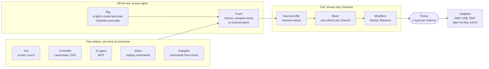

Every frame is computed fresh from what plays. The tick sees channels, never a light. Everything that happens is a command.

## Ten ideas

### 1. A frame is computed, never stored

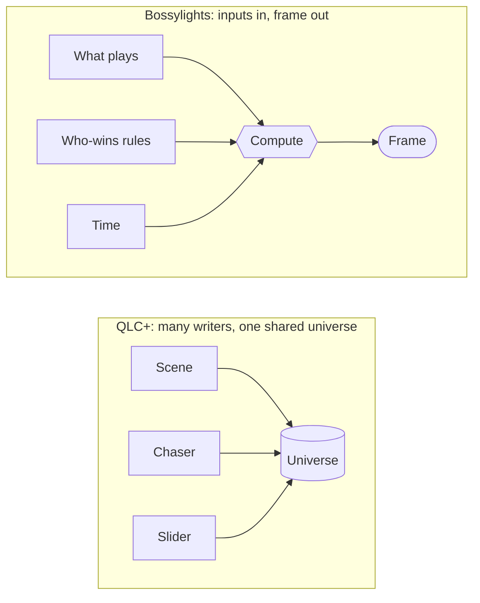

**Each output asks at its own rate.** A frame is computed for a moment in time, so nothing in it knows a rate.

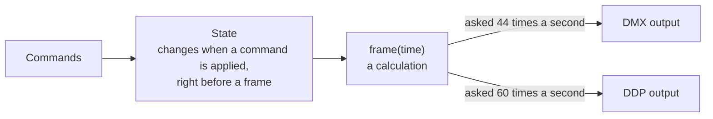

| Output | Default rate | Can be set |
|---|---|---|
| USB DMX | 44 a second | lower, for fixtures that need it |
| Art-Net, sACN | 44 a second | yes |
| DDP (WLED and other pixel controllers) | 60 a second | 30, 44, 60 |

No shared state to corrupt. Stop means "stop contributing". A press is in the very next frame.

### 2. Channels, not lights

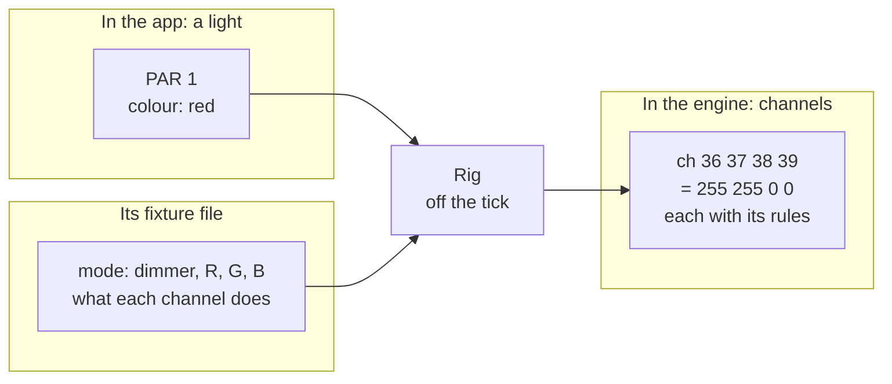

| Rule | Why |
|---|---|
| The engine is a channel manager. A light exists only in the app and in Patch | one model for every kind of fixture, nothing to special-case on the tick |
| 1 byte of value per channel | that is what DMX carries. 7 more bytes say how the channel behaves (below) |
| Coarse plus fine is one 16-bit word. It is offered, compared, faded and scaled as one, and split last | a coarse from one source and a fine from another makes a head jitter |
| Fixtures are data. No fixture shape is assumed anywhere | a new fixture is a file, never code |
| The definition is the truth | where the file and the maker's chart disagree, the lowering follows the file. The fix is the file (Patch, and upstream to QLC+), never a rule for one fixture |
| Pair only when certain | a wrong pair moves the wrong thing; a lone fine only loses precision. A fine that is not certain stays a single byte, and the user joins it in Patch |
| Every control comes from the metadata | a colour picker where channels form a colour, an X/Y pad for pan and tilt, named ranges as buttons, a fader otherwise |

**Who knows what**

| Layer | Knows | Never knows |
|---|---|---|
| Tick and engine core | channels, rules, sources, curves, bytes | fixtures, lights, colours, heads, universes, packets |
| Front and Rig (off the tick) | fixtures, modes, compounds (Rgb, Xy, Word, ...), groups | what a screen's recipe means |
| Adapters | their wire format | what a channel is for |
| Screens | lights, compounds, metadata, recipes | addresses on the wire |

Until #253 a plan or a grab still names a light by index. The field table (Rig, swapped whole per patch edit) turns the index into channels; no other tick code knows more of a light.

**One channel space.** A channel is a plain index into one space of universes of 512: 64 today, 1,024 designed (#255). "Universe 2, address 37" is only how Patch shows it. An output is a list of spans of that space (its route).

**8 bytes per channel**

| `value` | `rest` | `dark` | `flags` | `follows` | `source` | reserved |
|---|---|---|---|---|---|---|
| the byte sent | shown when nothing plays | where a modifier at 0 takes it | fade or jump, latest or highest, pair | which modifiers it follows | who set it (2 bytes) | 1 |

**Modifiers** scale a channel toward its `dark`: `out = dark + (value - dark) x m1 x ... x mn / 255^n`, one rounding.

| Rule | State |
|---|---|
| Blackout at 0 gives `dark` exactly | built: only the channels that follow it. Rest, dark, fade and pair come from the fixture file (#250) |
| Master scales: a dimmer at 70% under Master 50% sends 35% | built (#251): `SetMaster`, full at start |
| Blackout is dark while the latch is on or any connection holds; a closed connection lets go in the next frame | built (#251): `Blackout`, `SetBlackoutLatch` |
| A jump channel (wheel, shutter) is all or nothing, so it never passes through a strobe range | built (#251) |
| Which channels follow comes from the fixture file; unknown channels start independent | built (#251): a channel nobody patched follows nothing |
| Patch can change any rule | designed (#251) |

### 3. A look is data

| Light | Intensity | Colour |
|---|---|---|
| PAR 1 to 8 | 80% | amber |
| Mover L1 | not mentioned | not mentioned |

Plain data: store it, re-use it, hand it to an agent. On screen this is a **step**.

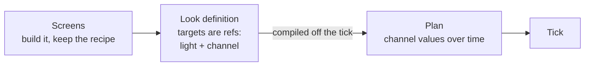

- A look names a light and its channel, never an address. Move the light and the look follows.
- The recipe (group, order, palette, spread) is the screens' business. The engine keeps it as opaque text.

### 4. Everything that moves is a source

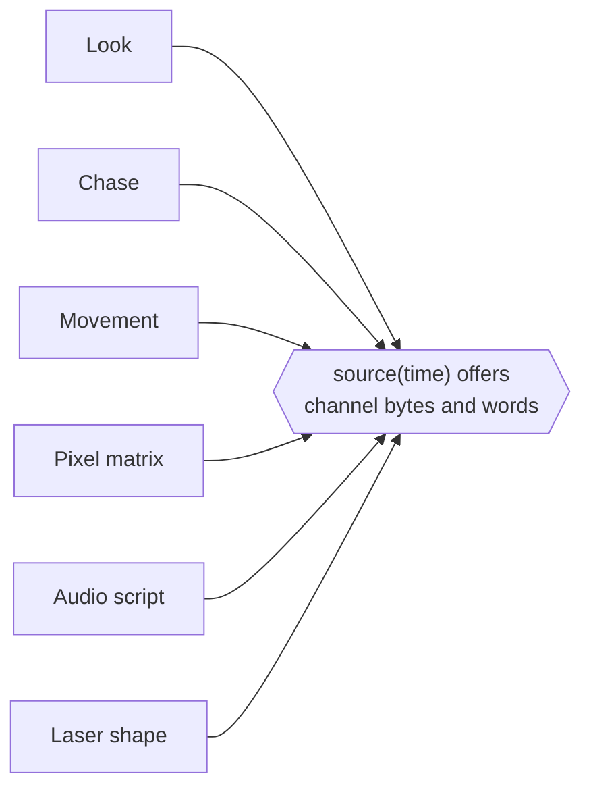

Ten QLC+ function types become one shape. On screen there are two kinds: a **sequence** (steps and other sequences on the beat grid) and a **pattern** (generated motion). Details: [looks.md](looks.md).

| Step | Plans on the tick |
|---|---|
| The tick on channels (#250, built) | today's plan tree, its values words per field of a light (a channel, or a pair as one word) |
| Flat curves (#258) | Hold, Linear and Gap knots compiled off the tick. The tick has no transition |

A source may offer nothing at a moment (a gap). Then a lower source shows through.

### 5. Who wins: one table, per channel

| Who | PAR shutter | PAR colour | Mover pan, tilt |
|---|---|---|---|
| **MANUAL** (top) | strobe | silent | silent |
| **SHOW** | silent | silent | silent |
| **AUTOPILOT** (bottom) | open | amber | sweep |
| **What goes out** | **strobe** | **amber** | **sweep** |

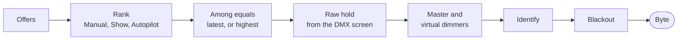

- Each channel is won on its own. A look that cares about colour sets all its colour channels, so no colour nobody chose appears.
- What you touch on the Console stays yours until Release. On a light without a dimmer, brightness lives in the colour bytes, so holding its colour holds its level too.
- The rules sit in one table in the Mixer and one panel in the app: [who-wins.md](who-wins.md).

### 6. One clock

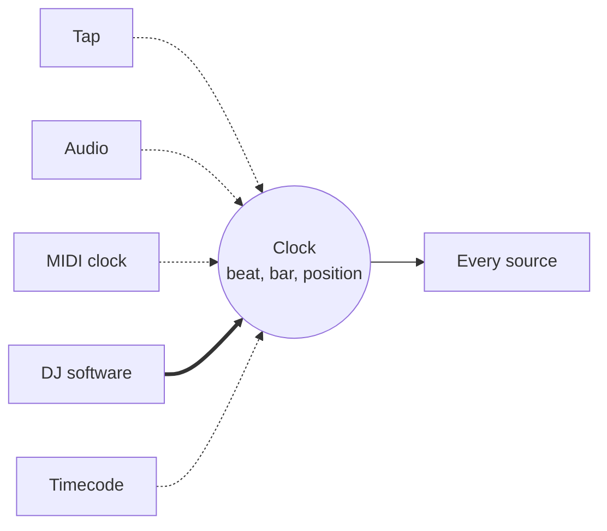

One feed drives it at a time. Launch-on-the-beat and timecode are the same thing.

### 7. Everything is a command

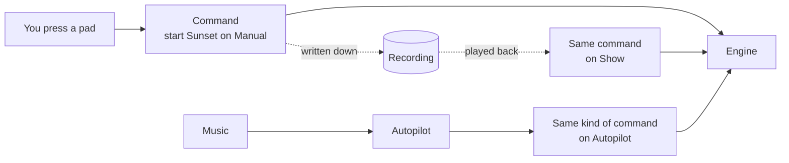

Recording, show and autopilot are three writers of one stream. That is why they combine. A fader move is a command too, so a recording keeps it.

A command that would make an invalid project is refused with its reason, and so is a later one that would break it. Never allow and flag.

### 8. Two kinds of state

| | Project | Performance |
|---|---|---|
| Saved | always, by itself | never by accident |
| Undo | yes | no |
| Recordable | no | yes |

**The LIVE switch** is part of the performance. On means the night is running: it follows the DJ software, records the set, arms the autopilot and locks the surface. Lights follow the app either way. There is no preview mode.

Derived data (channel config, pairs, compounds, plans) is never saved. It is rebuilt on open with the same checks as a new edit.

### 9. The real-time core is small and dumb

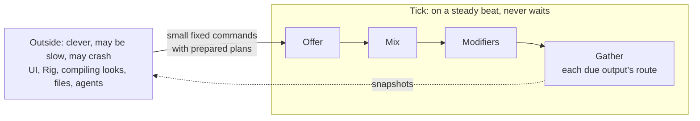

| Never on the tick or output threads | Where it happens instead |
|---|---|
| allocate, free | at engine start, or in the front before the command is sent; the free thread frees |
| lock, wait, open a device | off the tick; a press never waits for an edit or an open |
| compile, look up a light | the front and the Rig |

The engine is its own process. A frozen or closed window cannot stop the lights.

### 10. Outputs are adapters over one channel space

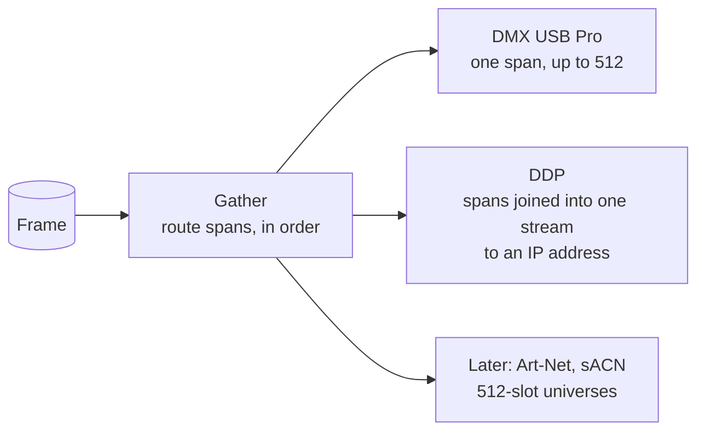

An adapter's whole job: take bytes, never wait. Switching an output to a new lane (restart, reroute) is one written state machine:

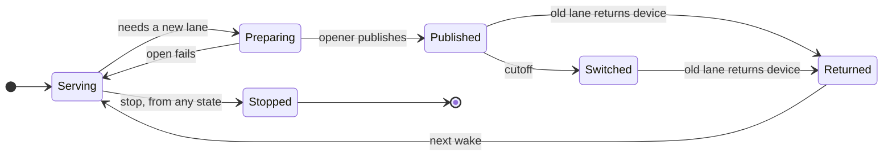

| Rule | |
|---|---|
| Nothing lost | every frame and every result of the old lane is counted once, on the old run |
| Nothing early | no reader sees the new run before the writer hears `Accepted` |
| Nothing changes on a refusal | the old lane sends every due frame until the switch |

Every transition: [output-cutover.md](output-cutover.md). The machines inside each adapter: [outputs.md](outputs.md).

## Three walks through the system

### You press a pad

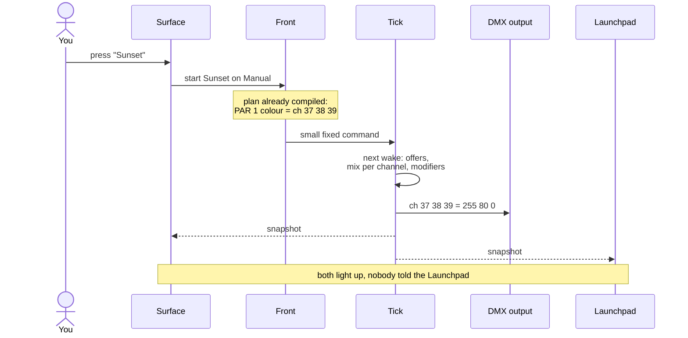

### You record a busk and play it back

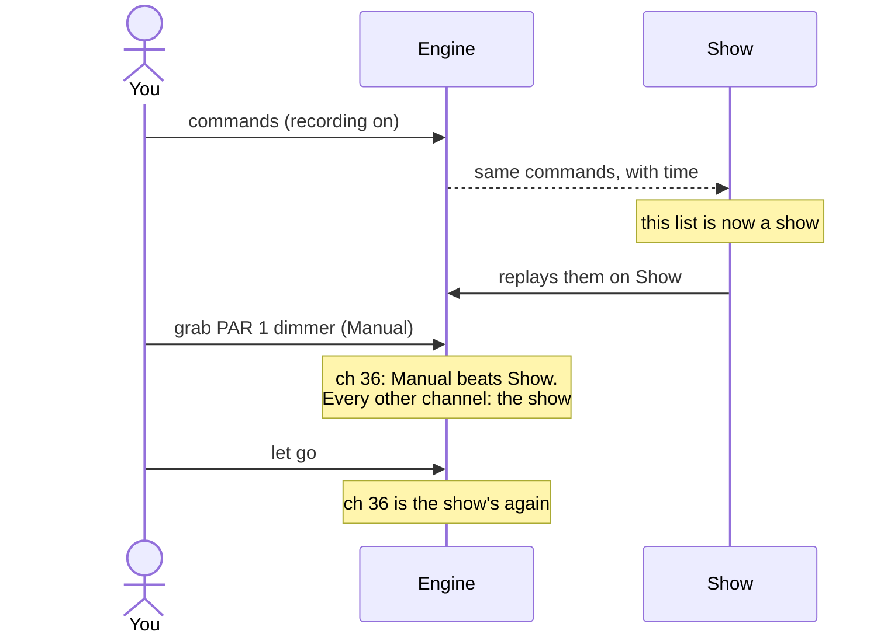

### The autopilot yields to your hand

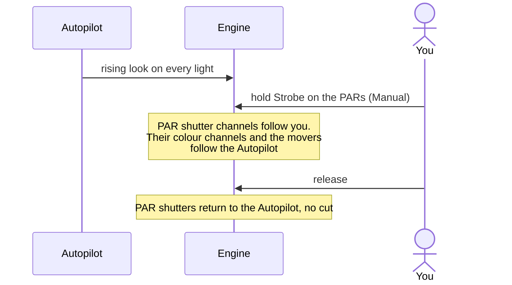

## What gets easy, what gets hard

| Change | Effort | Why |
|---|---|---|
| New fixture | easy | it is a file |
| A fixture file with an error | easy | fix the file in Patch, send it upstream |
| New output protocol | easy | one adapter: take bytes, a route, a rate |
| New kind of effect | easy | one new source, or a new curve from the screens |
| New controller | easy | one profile, mirrors the screen for free |
| Second UI or an agent | easy | another client of the Engine |
| "Just set channel 37" | easy | a raw hold from the DMX screen |
| New compound (say CMYK) | medium | API and Rig helper; the tick does not change |
| Laser shapes | medium | a source plus one output adapter |
| Change who wins | easy | one rule table in one place |
| A source reading another source | not possible | compose them into one |

## The theory says no

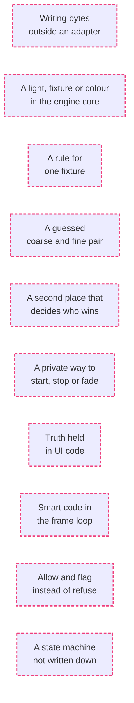

## Decisions

Owner answers live on the [decisions page](https://claude.ai/artifact/KBkqWhcVWnyKaDYtejFBoC). Q1 to Q20: [owner decisions of 2026-11-21](https://github.com/abossard/bossylights/issues/147#issuecomment-7067524514).

**The program**

| Decision | Why | Where |
|---|---|---|
| The engine is a channel manager: no light, fixtures are data | one model for every fixture; the tick stays small | #239, [channel-model.md](channel-model.md) |
| 1 byte of value, 8 bytes per channel | value plus its rules, no padding; about 10 MiB for the biggest show | #239 (q1) |
| Coarse and fine move as one 16-bit word | no jitter from a torn pair | #239 (ch-3, cx-2) |
| Each channel is won on its own | a look that cares sets all its channels | #239 (cx-1) |
| One space of 1,024 universes, outputs are spans | DDP is a stream to an IP, not universes | #239 (cx-6), #248 |
| Unknown channels start independent | follow Master or Blackout only when the file says so | #239 (cx-3) |
| No default virtual dimmer; add one in Patch | brightness of a dimmerless light is in its colour bytes | #239 (cx-4, q3) |
| A look follows its light when it moves | looks name lights, never addresses | #239 (q2) |
| Screens build curves and keep the recipe; the engine plays curves | the engine has no wave or palette | #239 (ch-5, ch-6) |
| Effects (Wave, Stripes, Plasma, Sparkle) are a kind of look in the engine, painting channels through the one mixer | the owner's wish; replaces "no wave" in the row above, built in five steps | decisions page (matrix-effects), [effects.md](effects.md) |
| A fresh show file (v7) | derived data rebuilt on open | #239 (ch-7), #253 |
| Master scales, never caps | like QLC+ and ONYX; hue stays on dimmerless lights | decisions page (cm-master-scale-or-cap, cm-master-ceiling), #251 |
| No Cmyk compound | no fixture file has a black channel; back with the first one | decisions page (cm-cmyk) |
| Pair only when certain | a wrong pair moves the wrong thing | #249 |
| The definition is the truth | no rule for one fixture; fix the file | #249 |
| A mode with a broken head is refused, with the reason; the file's good modes stay | never allow and flag | Q18 |
| A mode with no channel is refused, with the reason, by the library and by a show file | never allow and flag | owner 27 Nov, #354 |
| Switching an output is one written machine | four rounds of fixes found the same lost or early frame | #248, [output-cutover.md](output-cutover.md) |
| The tick on channels keeps the plan tree (option B); flat curves follow | one mixer lands first, the crossfade rounding is decided apart | #250, #258 |
| The rate belongs to each output | DMX and DDP need different rates | 2026-11-18 |
| Manual beats Show beats Autopilot; latest among equals, highest as a setting | the hand always wins | [review-1](../history/review-1.md) |
| No layers to manage | steps, sequences and patterns are enough | [review-1](../history/review-1.md) |
| Recording stores commands, fader moves included | three writers of one stream | [review-1](../history/review-1.md) |
| Raw channels only on the DMX screen (and the haze fader) | everything else from metadata | [review-1](../history/review-1.md) |
| A song has one show; desk words: Playback, Patch, Show file, Looks, Tempo | plain words | [review-1](../history/review-1.md) |
| Two lights on one channel are refused | one writer per channel | 2026-11-19, [who-wins.md](who-wins.md) |
| Identify only, no test output | haze, strobe and sound never move by accident | decisions page (s1-*) |
| "Light" is the app word, the engine says channel, "fixture" names only the file | one word per thing | Q8, [GLOSSARY.md](../../GLOSSARY.md) |
| The app's message types move to their own wire crate | the core knows only channels | Q16 |
| The debug page shows real status only (engine, outputs) until the approved screens | nothing half-working reachable | Q17 |

**How we build it** (owner, 2026-11-21)

| Decision | Why | Where |
|---|---|---|
| One current theory with this table; old plans and reviews in docs/history | the theory is why the program is the way it is | Q1, Q3, Q4 |
| The owner approves the theory on a picture page | visual first | Q7 |
| Order: theory, then the cleanup review against it, then the channel cut | build on an agreed theory | Q5 |
| Before code, an Opus explain-back questions the plan against the theory (behaviour or module edge changes only) | catch a wrong plan before it is code | Q2, Q6 |
| Anything with states gets its table in a design doc before code; tests walk every row | the cutover and pairing loops ended only when written down | Q15 |
| Expected answers in tests come from a source other than the code | an oracle that repeats the code proves nothing | Q13 |
| A cleanup may fix behaviour where the theory says the code is wrong, bytes listed in the commit | the theory wins | Q11 |
| Large review: Opus reads and proves, Claude applies, Opus confirms; one cleanup ticket per area | every finding proven and confirmed | Q9, Q10, #297 |
| One simple verification command, the same locally, in CI and for people | CI was red for 3 days unseen | Q12 |
| Short-lived WIP branch per ticket in its own worktree, squashed onto main after the review; branch deleted the same day | big work stays safe and off the shared main | Q14, Q19, Q20 |
