# The theory of Bossylights

Draft for review. Nothing is built. Questions are at the end.

> A program is the theory in its builders' heads (Peter Naur). This page is that theory, as pictures.

## The whole theory in one picture

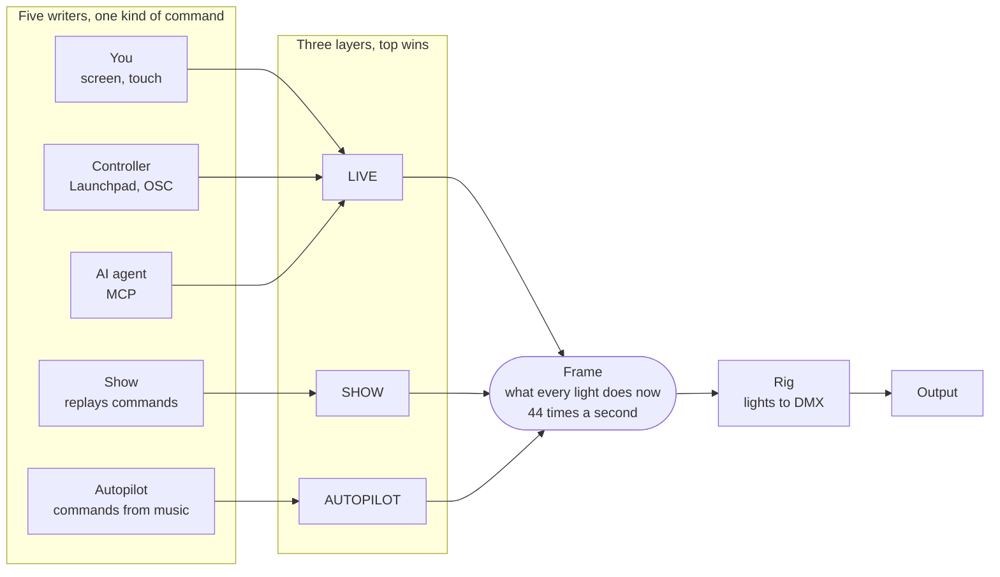

**One sentence:** every frame is computed fresh from what plays on three layers, and everything that happens is a command.

## Nine ideas

### 1. A frame is computed, never stored

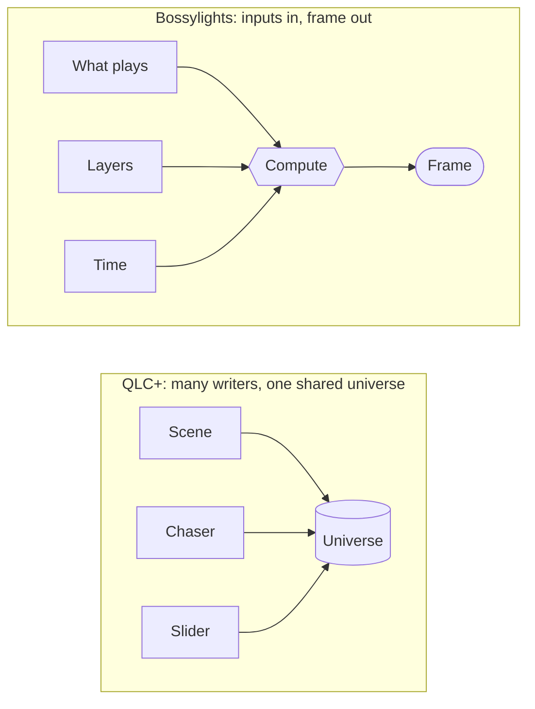

No shared state to corrupt. Stop means "stop contributing".

### 2. Lights, not channels

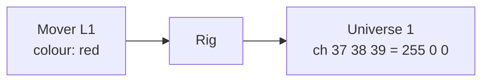

Addresses exist in one place only. You never remember a number.

### 3. A look is a value

| Fixture | Intensity | Colour |
|---|---|---|
| PAR 1 to 8 | 80% | amber |
| Mover L1 | not mentioned | not mentioned |

Plain data: store it, blend it, preview it, hand it to an agent.

### 4. Everything that moves is a source

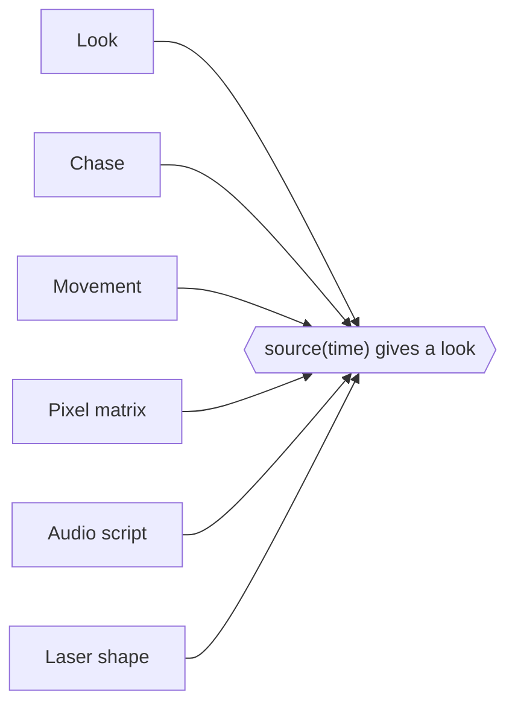

Ten QLC+ function types become one shape.

### 5. Layers: the top one that speaks wins

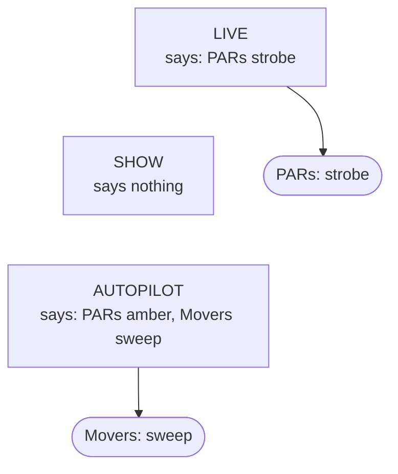

Release Live and the PARs go back to amber. This replaces HTP and LTP.

### 6. One clock

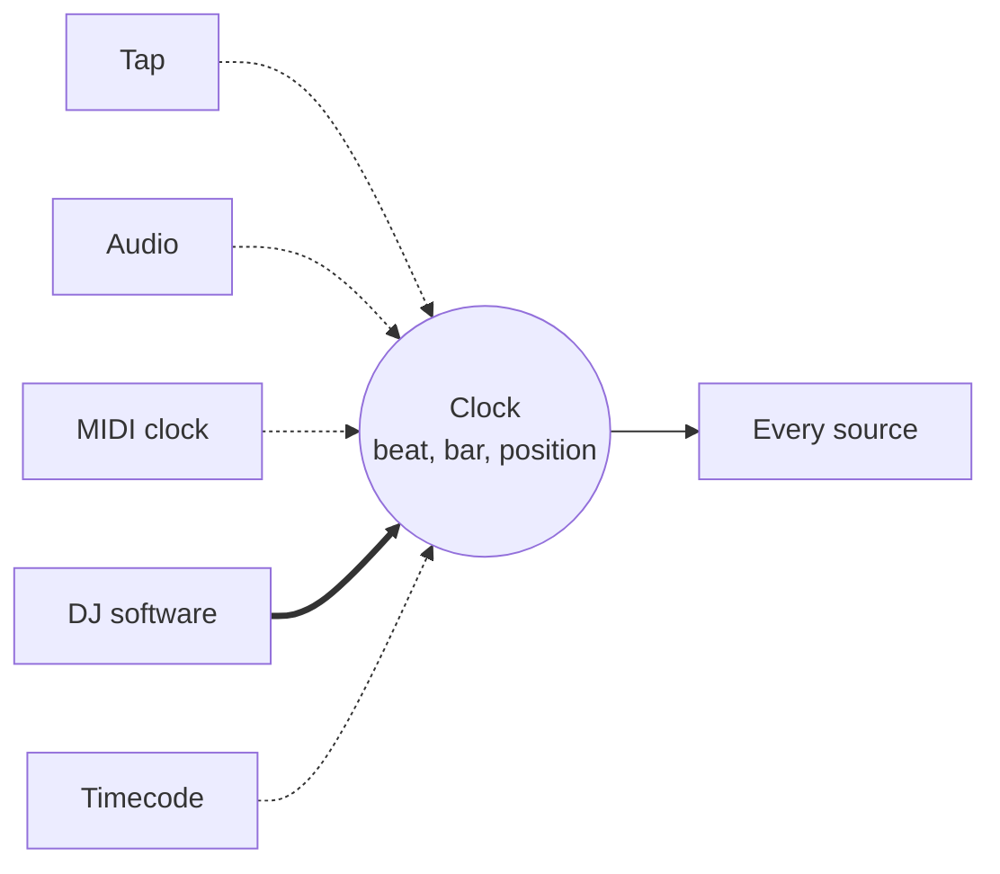

One feed drives it at a time. Launch-on-the-beat and timecode are the same thing.

### 7. Everything is a command

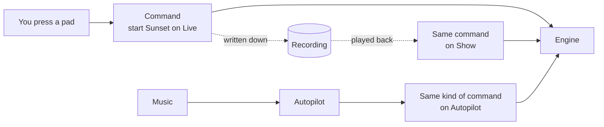

Recording, show and autopilot are three writers of one stream. That is why they combine.

### 8. Two kinds of state

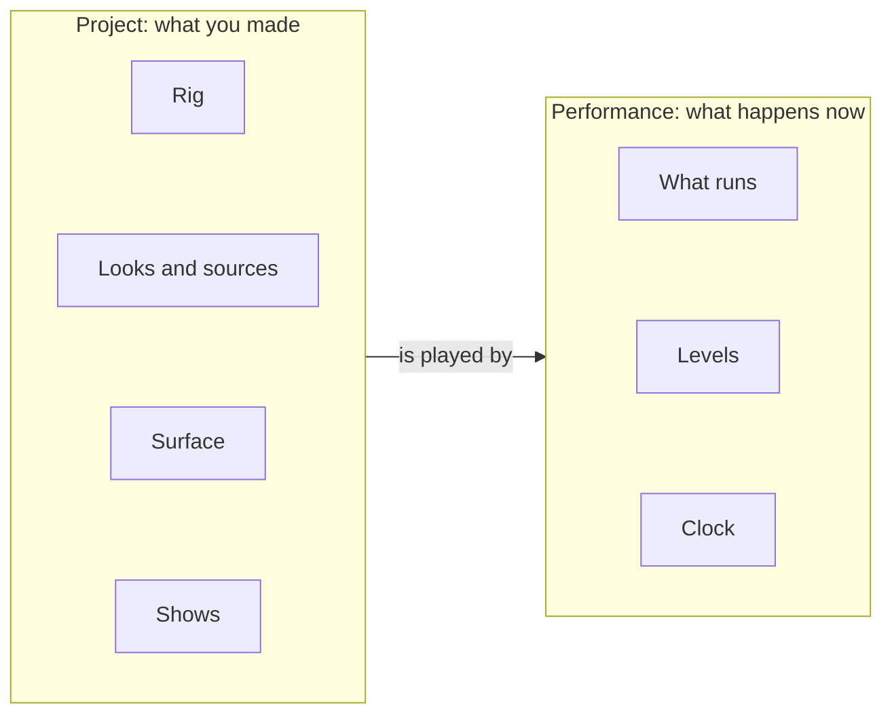

| | Project | Performance |
|---|---|---|
| Saved | always, by itself | never by accident |
| Undo | yes | no |
| Recordable | no | yes |

### 9. The real-time core is small and dumb

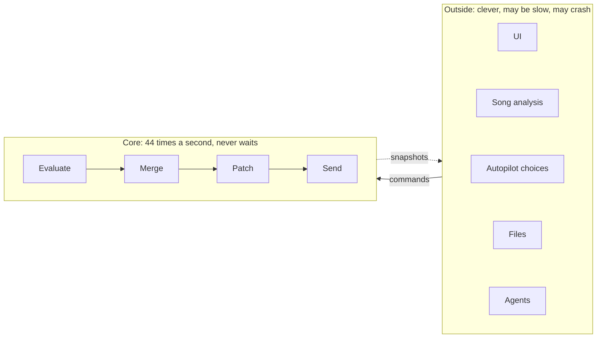

A frozen UI cannot stop the lights.

## Three walks through the system

### You press a pad

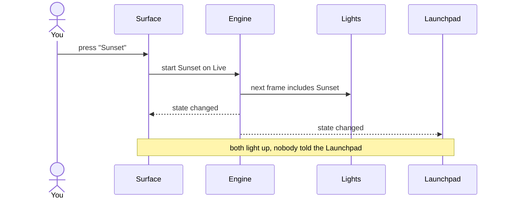

### You record a busk and play it back

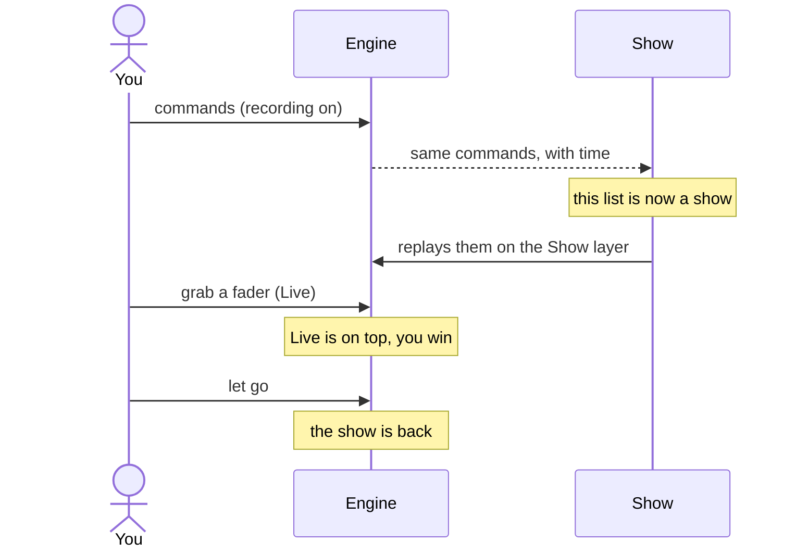

### The autopilot yields to your hand

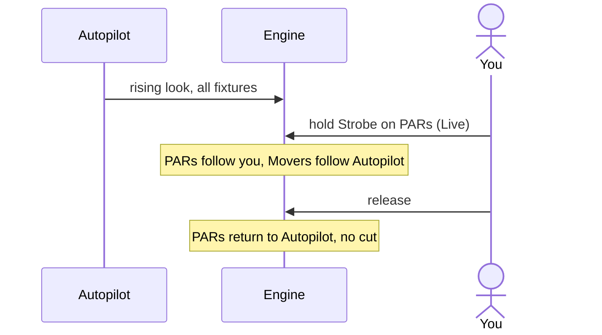

## Is the theory any good? What gets easy, what gets hard

| Change | Effort | Why |
|---|---|---|
| New output protocol | easy | one adapter behind Output |
| New kind of effect | easy | one new source |
| New controller | easy | one profile, mirrors the screen for free |
| Second UI or an agent | easy | another client of the same door |
| Laser shapes | medium | a source plus one output adapter |
| "Just set channel 37" | awkward on purpose | goes through a raw-channel attribute |
| More than three layers | hard | changes idea 5 |
| A source reading another source | not possible | compose them into one |

## The theory says no

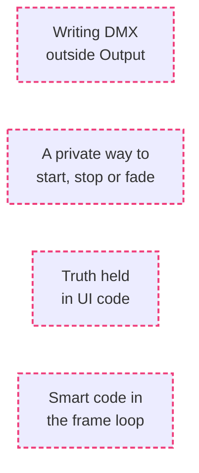

## Questions for you

| # | Question | Option A (my lean) | Option B |
|---|---|---|---|
| 1 | Who wins inside a layer? | Top layer wins for everything | Intensity adds up, so two washes are brighter |
| 2 | How many layers? | Three, fixed | The user can add layers |
| 3 | What does recording store? | Commands: editable, follows rig changes | DMX values: exact, but frozen |
| 4 | Where do raw channels live? | Only on the DMX screen | Everywhere |
| 5 | DJ software and audio disagree on the beat | The feed you picked wins | The most confident feed wins |
| 6 | What is Song Director? | An editor for a show whose blocks follow song sections | Its own thing |
| 7 | Anything you rely on in QLC+ that these nine ideas cannot say? | | |

Answer with the number and A or B, here or in [issue #100](https://github.com/abossard/bossylights/issues/100).
