# The theory of Bossylights

Draft for review. Nothing is built. Questions are at the end.

> A program is the theory in its builders' heads (Peter Naur). This page is that theory, as pictures.

## The whole theory in one picture

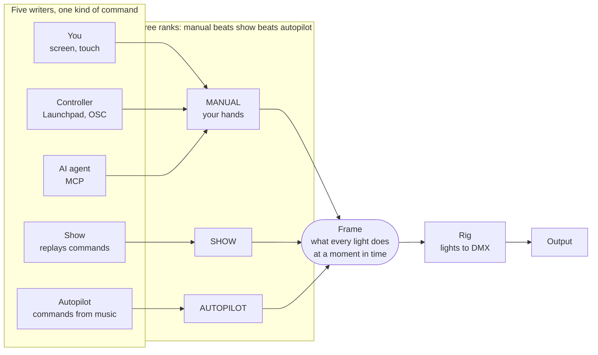

**One sentence:** every frame is computed fresh from what plays, with manual over show over autopilot, and everything that happens is a command.

## Nine ideas

### 1. A frame is computed, never stored

**Each output asks at its own rate.** A frame is computed for a moment in time, so nothing in it knows a rate.

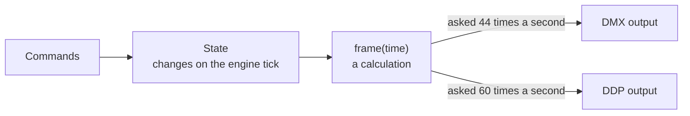

| Output | Default rate | Can be set |
|---|---|---|
| USB DMX | 44 a second | lower, for fixtures that need it |
| Art-Net, sACN | 44 a second | yes |
| DDP (WLED and other pixel controllers) | 60 a second | 30, 44, 60 |

Decided on 2026-11-18: the rate belongs to the output, with a default per protocol. There is no global frame rate.

No shared state to corrupt. Stop means "stop contributing".

### 2. Lights, not channels

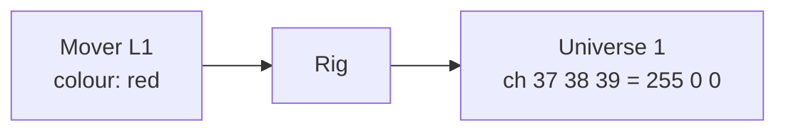

Addresses exist in one place only. You never remember a number.

### 3. A step is a value

| Fixture | Intensity | Colour |
|---|---|---|
| PAR 1 to 8 | 80% | amber |
| Mover L1 | not mentioned | not mentioned |

Plain data: store it, re-use it, hand it to an agent. On screen this is a **step**.

### 4. Everything that moves is a source

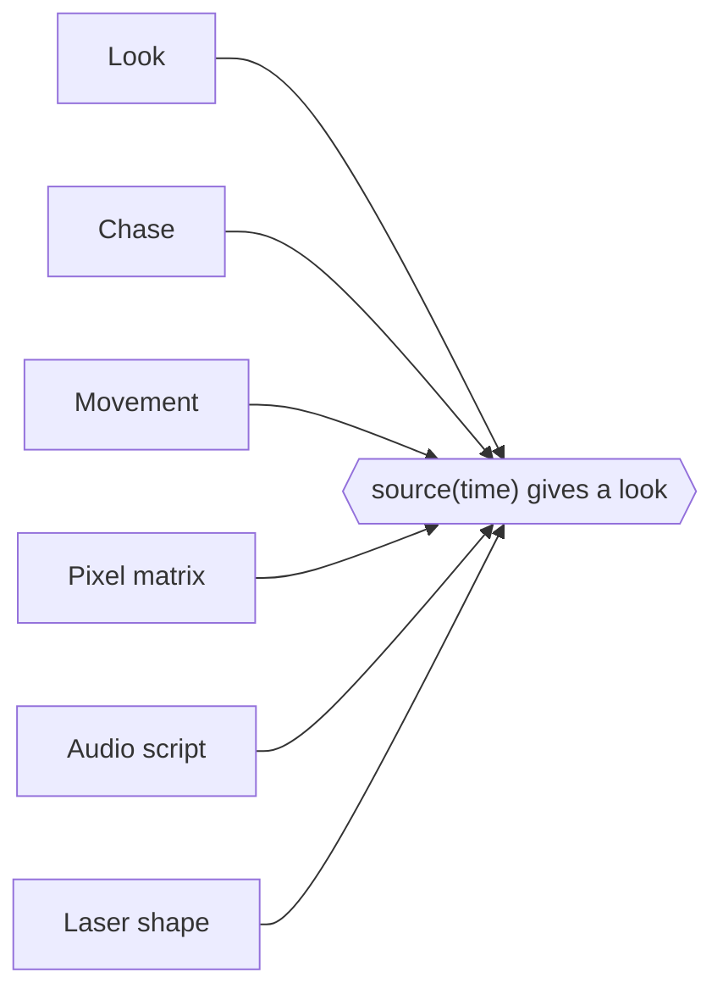

Ten QLC+ function types become one shape. On screen there are two kinds: a **sequence** (steps and other sequences on the beat grid) and a **pattern** (generated motion). Details: [looks.md](looks.md).

### 5. Who wins: one small set of rules

| Who | PARs | Movers |
|---|---|---|
| **MANUAL** (top) | strobe | silent |
| **SHOW** | silent | silent |
| **AUTOPILOT** (bottom) | amber | sweep |
| **What you see** | **strobe** (Manual speaks) | **sweep** (only Autopilot speaks) |

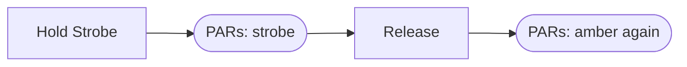

What you touch on the Console stays under your control until you press Release. Then the PARs go back to amber.

There are no layers to manage. The rules sit in one place and can be changed there: [who-wins.md](who-wins.md).

### 6. One clock

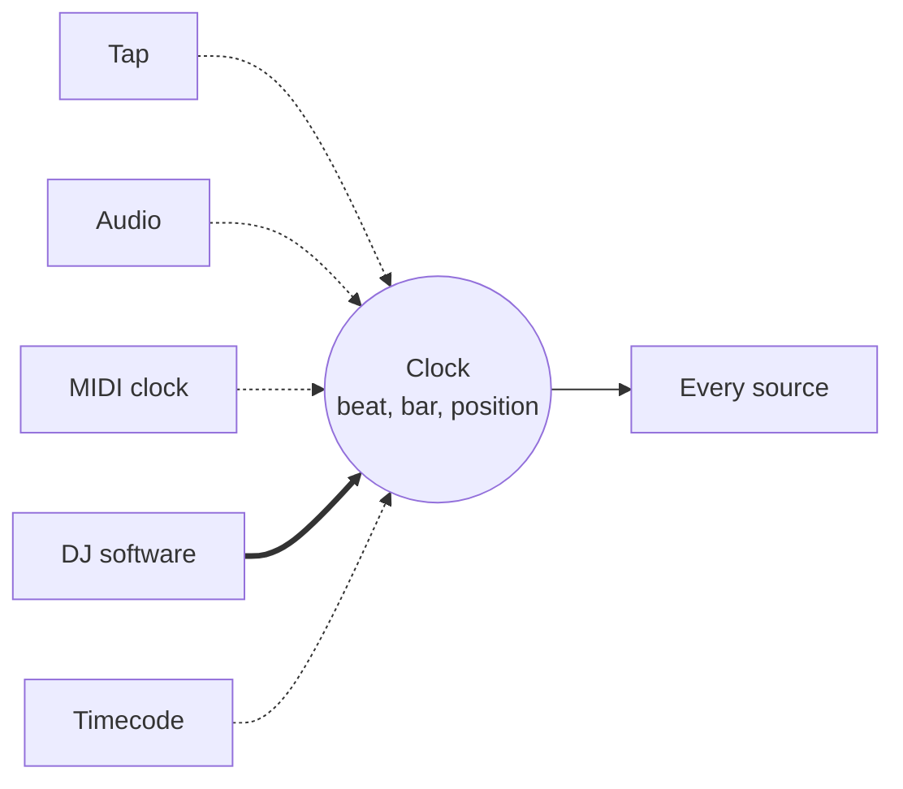

One feed drives it at a time. Launch-on-the-beat and timecode are the same thing.

### 7. Everything is a command

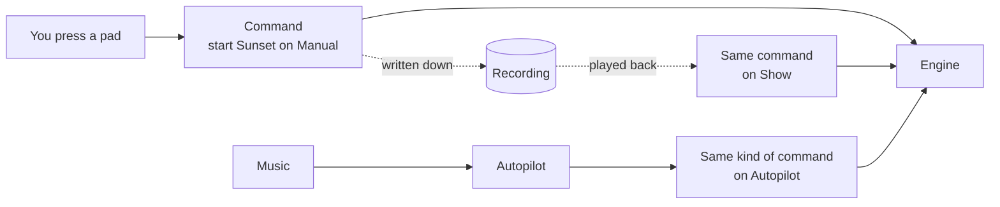

Recording, show and autopilot are three writers of one stream. That is why they combine. A fader move is a command too, so a recording keeps it.

### 8. Two kinds of state

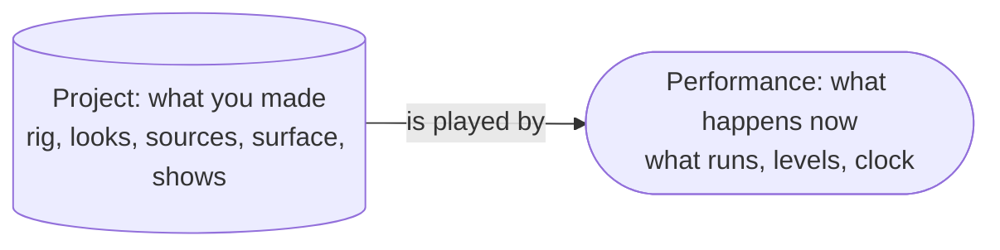

| | Project | Performance |
|---|---|---|
| Saved | always, by itself | never by accident |
| Undo | yes | no |
| Recordable | no | yes |

**The LIVE switch** is part of the performance. On means the night is running: it follows the DJ software, records the set, arms the autopilot and locks the surface. Lights follow the app either way. There is no preview mode.

### 9. The real-time core is small and dumb

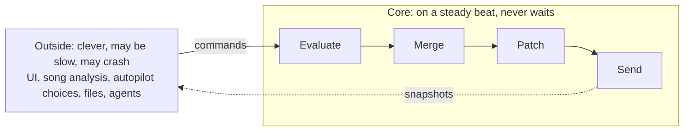

A frozen UI cannot stop the lights.

## Three walks through the system

### You press a pad

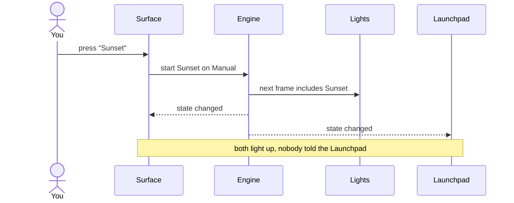

### You record a busk and play it back

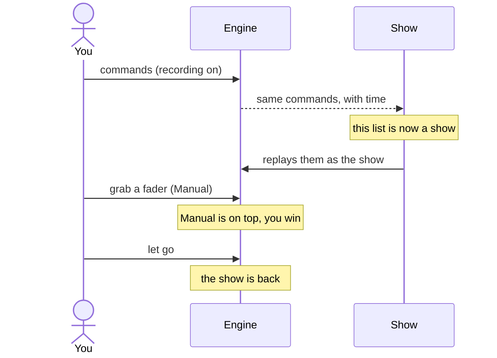

### The autopilot yields to your hand

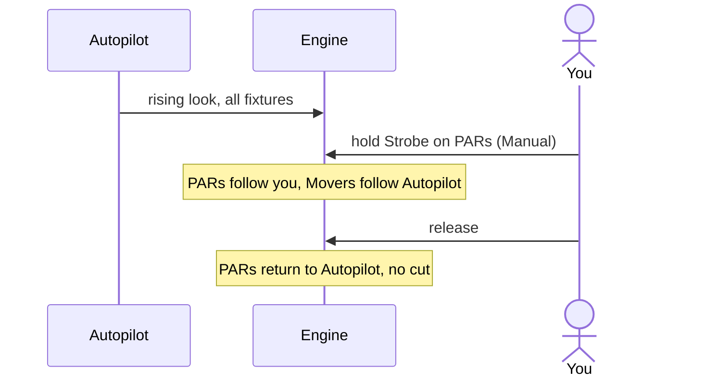

## Is the theory any good? What gets easy, what gets hard

| Change | Effort | Why |
|---|---|---|
| New output protocol | easy | one adapter behind Output |
| New kind of effect | easy | one new source |
| New controller | easy | one profile, mirrors the screen for free |
| Second UI or an agent | easy | another client of the Engine |
| Laser shapes | medium | a source plus one output adapter |
| "Just set channel 37" | awkward on purpose | goes through a raw-channel attribute |
| Change who wins | easy | one rule table in one place |
| A source reading another source | not possible | compose them into one |

## The theory says no

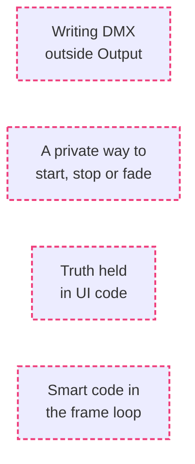

## Answers from review 1

| # | Question | Decided |
|---|---|---|
| 1 | Who wins? | manual beats show beats autopilot. Among equals the latest wins. Brightness can be set to "highest wins" |
| 2 | How many layers? | none to manage. The layer idea was dropped: only steps, sequences and patterns play |
| 3 | What does recording store? | commands, fader moves included |
| 4 | Where do raw channels live? | only on the DMX screen |
| 5 | DJ software and audio disagree on the beat | the feed you picked wins |
| 6 | What is Song Director? | the editor of a song's show. Song = show, one screen |
| 7 | Missing from QLC+? | nothing named |

Details: [review-1.md](review-1.md).
