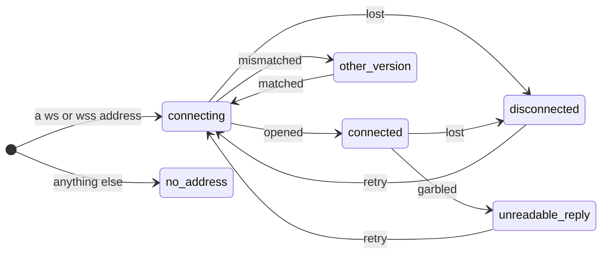

# UI states

The two state machines of the UI (docs/coding.md, rule 3). Tests walk every row: `ui/src/connection.test.mjs`, `ui/src/kit.test.mjs`.

## The UI's connection to the engine

Code: `ui/src/connection.ts`. The socket and timers that carry out the effects: `ui/src/engine.ts`.

| Effect | Does |
|---|---|
| check | asks `GET /version` |
| open | opens a socket and subscribes |
| wait | `retry` in 1 s |
| shut | cancels the retry, forgets the socket (its late close is no event) and closes it |

Effects run in their order: in `[shut, wait]` the shut cancels the old retry before the new wait.

| Event | Comes from |
|---|---|
| matched, mismatched | the answer to `GET /version` is this UI's API version, or another |
| opened | the socket opened |
| lost | the socket closed, or nothing answered `GET /version` |
| retry | the wait is over |
| garbled | a reply this UI cannot read: not JSON, not a string or an object of one key, or a `Picture` or `Changed` without its parts |
| close | the page goes |

`=` stays, nothing done.

| state \ event | matched | mismatched | opened | lost | retry | garbled | close |
|---|---|---|---|---|---|---|---|
| connecting | = [open] | other version [wait] | connected | disconnected [wait] | = | = | closed [shut] |
| connected | = | = | = | disconnected [wait] | = | unreadable reply [shut, wait] | closed [shut] |
| disconnected | = | = | = | = | connecting [check] | = | closed [shut] |
| other version | connecting [open] | = [wait] | = | = [wait] | = [check] | = | closed [shut] |
| unreadable reply | = | = | = | = | connecting [check] | = | closed [shut] |
| no address | = | = | = | = | = | = | closed |
| closed | = | = | = | = | = | = | = |

Start: a `ws:` or `wss:` address without `#` is `connecting [check]`; anything else is `no address`, and the page says which text it was given.

## A text field

Code: `ui/src/kit/editing.ts`, drawn by `ui/src/kit/Field.tsx`. A search field has no state: each letter is sent.

| State | Under the field |
|---|---|
| clean | nothing |
| refused | why the last text was refused |
| unsaved | "Not saved. Enter saves it" |

A text is judged against the old value: **same** (empty, or the old value), **refused** (with a reason), or **fits**. Every state gives the same answer to an event; the state only says what shows until the next one.

| event | state after | effect |
|---|---|---|
| a letter typed | clean | none |
| Enter, same | clean | old value back in the input |
| Enter, refused | refused | none: the text stays to be mended |
| Enter, fits | clean | the text is sent |
| Escape | clean | old value back |
| leave, field saves on leave | as Enter, but a refused text is put back | |
| leave, field saves on Enter: same | clean | old value back |
| leave, field saves on Enter: refused | refused | old value back |
| leave, field saves on Enter: fits | unsaved | none |
