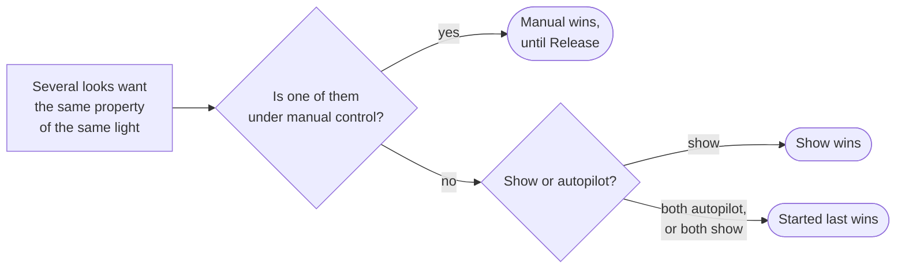
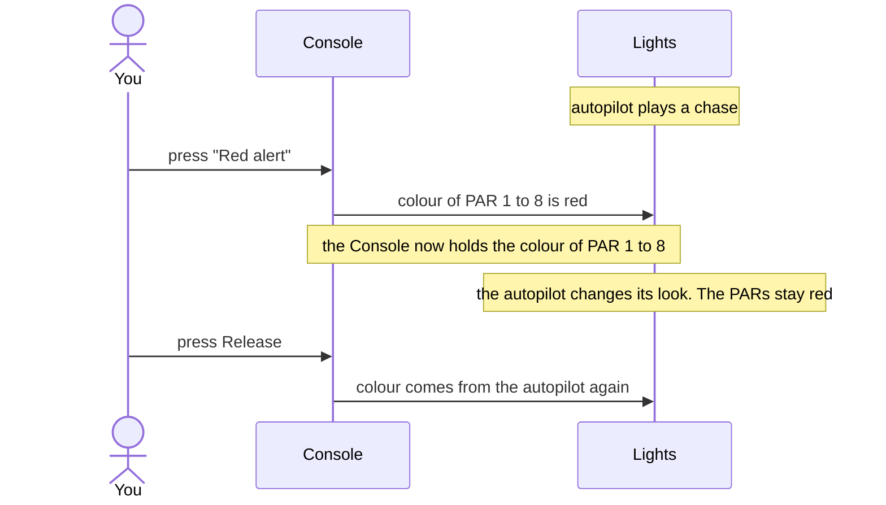
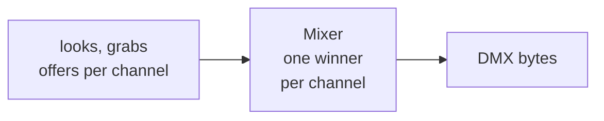
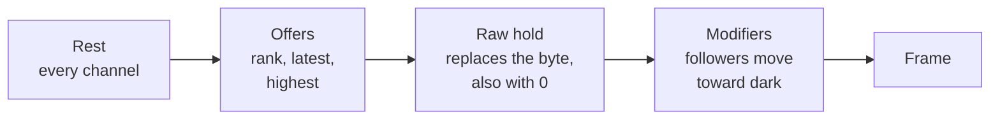

# Who wins

Decided with the owner on 2026-11-17. When several things want the same light, these rules decide. They live in **one place**, in the product and in the code, so they can be changed or extended later.

There are no layers to manage. Only the normal primitives play: steps, sequences, patterns.

## The decision in one picture

## The rules

| # | Rule | Default | Can be set to |
|---|---|---|---|
| 1 | What is decided | each channel on its own. A 16-bit pair is one value, never torn | fixed |
| 2 | Rank | manual beats show, show beats autopilot | fixed for now |
| 3 | Among equals | the one that started last wins | dimmer channels only: the highest wins |
| 4 | Manual control ends | when you press **Release** | when the pad or fader stops |
| 5 | When a show or autopilot look ends | what was underneath shows again | it stays as it was left |

## Rule 4, the busking rule

- The Console holds only what you touched. The dimmer and the movers stay with the show or the autopilot.
- The notice on the Console says what is held and carries the Release button.

## Why per property

| One property | Channels | What goes wrong per channel |
|---|---|---|
| Colour | red, green, blue | red from one look, green and blue from another: a colour nobody chose |
| Position | pan, pan fine, tilt, tilt fine | coarse from one look, fine from another: the head jitters |
| Dimmer | one | nothing |

## One writer per channel

Decided with the owner on 2026-11-19 (decision 48): DMX is resolved at the look stage. Nothing decides between two lights on one channel, because it never happens.

Since #250 (channel model T4) the rules above are applied per channel. The front lowers each look to offers on channels (a 16-bit pair as one word, never torn); the Mixer picks one winner per channel.

| Case | What happens |
|---|---|
| Two fixtures on one channel | refused at patch, move and show file open (`Overlaps`) |
| A channel two heads of one fixture name | a property of the fixture itself (a master dimmer, a strobe): one writer |
| A raw channel held, blackout | decided per channel, after the light's byte (below) |

## Per channel: the one pass

Every channel has its bytes in `engine-core/src/channel.rs`. Since #250 one function decides each one: `mix::offer` (rank, then latest, then `highest`) and `mix::channels` (raw hold, modifiers).

| Step | Byte | Source tag |
|---|---|---|
| nothing offers | the channel's rest (from the fixture definition) | `0` rest |
| a play or grab wins | its offer | `2` + its entry in the source table |
| a raw hold | the held byte | `1` raw |
| a follower | `dark + (byte - dark) x m1 x ... x mn / 255^n`, one rounding. A jump channel: `dark` at any level 0 | unchanged |

| Modifier slot | Level | Followers today |
|---|---|---|
| 0 Master | 255 (no command yet) | none |
| 1 Blackout | 0 while on, 255 while off | every channel, toward its dark byte |

## One place

| Where | What |
|---|---|
| In the app | one small panel, "Who wins", on the DMX screen. Five rows, the settings above |
| In the code | one rule table inside the Mixer. No screen and no other module decides between two values |
| In the project file | the settings travel with the show |

## What other desks do

| Desk | Brightness | Everything else | When the winner stops |
|---|---|---|---|
| QLC+ | highest wins | latest wins | brightness falls back, the rest stays |
| Avolites Titan | highest wins | latest wins, plus 5 priority levels | not checked |
| grandMA3 | latest wins, highest is a setting | latest wins inside one of 8 priority levels | falls back to what is underneath |
| Bossylights | latest wins, highest is a setting | latest wins inside one of 3 ranks | falls back, staying is a setting |

## Later, if needed

- A different rank order.
- More ranks.
- A rule per fixture group.

Each of these is a change to the one table.
