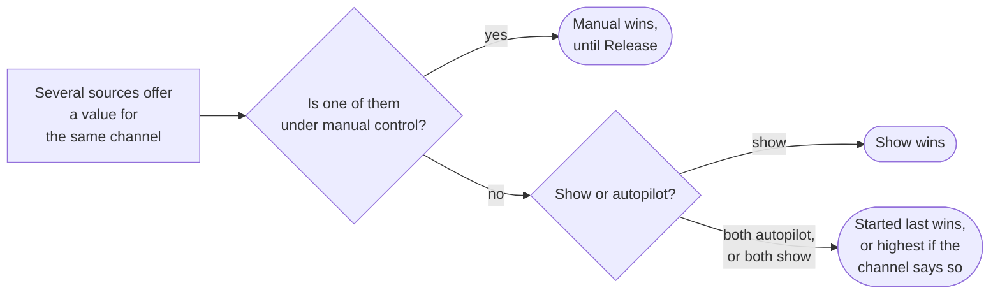
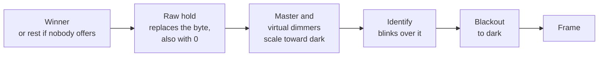
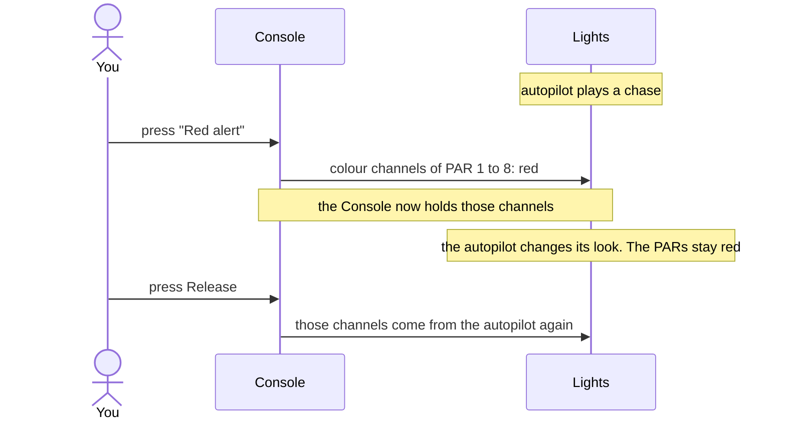

# Who wins

Decided with the owner on 2026-11-17, per channel since #239. When several things want the same channel, these rules decide. They live in **one place**, in the product and in the code, so they can be changed or extended later. Theory: [theory.md](theory.md), idea 5.

The rules below are the design. What runs today is in [Built today](#built-today).

There are no layers to manage. Only the normal primitives play: steps, sequences, patterns.

## The decision in one picture

## The rules

| # | Rule | Default | Can be set to | Today |
|---|---|---|---|---|
| 1 | What is decided | each channel on its own. A coarse and fine pair is one 16-bit word | fixed | built |
| 2 | Rank | manual beats show, show beats autopilot. A direct grab is manual | fixed for now | built |
| 3 | Among equals | the one that started last wins; first in breaks an equal instant | per channel: the highest wins (the greater distance from `dark`, so a reverse dimmer at 0 beats 255). The Who wins row sets it on every dimmer | built. A light without a dimmer has none: Highest leaves its colour latest-wins |
| 4 | Manual control ends | when you press **Release** | when the pad or fader stops | built |
| 5 | When a show or autopilot look ends | what was underneath shows again | it stays as it was left, until released | built |

## After the winner: one pass per channel

| Step | Byte | Source tag |
|---|---|---|
| nobody offers | `rest` (the file's default, an open shutter) | `0` rest |
| a source wins | its byte, or its half of a word | `2..` that source |
| a raw hold | the held byte. A held fine under a winning word: the winner's coarse, the held fine | `1` raw |
| a follower | `dark + (byte - dark) x m1 x ... x mn / 255^n`, one rounding. A jump channel: `dark` when any level is 0, else the byte | unchanged |

| Modifier slot | Level | Who follows | Today |
|---|---|---|---|
| 0 Master | a command, default 255 | dimmers, and emitters no dimmer carries (from the fixture file) | no command, always full (#251) |
| 1 Blackout | 0 while on, 255 while off | as Master, plus a shutter with a Closed range | built, every channel follows (rules from the file: #251); a channel the file has follow it goes to the file's dark (#250) |
| 2 to 7 virtual dimmers | the value of a control channel | the channels the user picks in Patch. None by default | none yet (#251) |

A source may offer nothing at a moment (a gap). Then the next one down shows through.

## Rule 4, the busking rule

- The Console holds only the channels you touched. The dimmer and the movers stay with the show or the autopilot.
- On a light without a dimmer, its level lives in the colour bytes, so "Red alert" holds colour and level together. A virtual dimmer for the group brings the split back.
- The notice on the Console says what is held and carries the Release button.

## Why per channel is enough

| Worry | Channels | Answer |
|---|---|---|
| Colour | red, green, blue | a look that cares about colour sets all its colour channels, so the same source wins all three |
| Position | pan, pan fine, tilt, tilt fine | a coarse and fine pair is one word: offered, compared, faded and scaled as one |
| Dimmer | one | nothing to worry about |

## When a source ends

| Case | Result |
|---|---|
| Manual ends | until Release: keeps its last offer. Until stop: gone when the pad or fader stops. A haze fader is a channel hold, kept until released |
| Show or Autopilot ends | reveal: gone. Stay: each channel keeps its last offer at its rank, until released |
| A new grab on the same target | replaces the earlier one, whoever made it. Ending it never brings an older grab back |
| A light moves, is unpatched or changes mode | every kept offer on its channels ends in the same edit |

## One writer per channel

Decided with the owner on 2026-11-19 (decision 48). Nothing decides between two lights on one channel, because it never happens.

| Case | What happens |
|---|---|
| Two lights on one channel | refused at patch, move and show file open (`Overlaps`) |
| A channel two heads of one light name (a master dimmer, a strobe) | one channel, one writer |

## Built today

| Part | Today | Becomes |
|---|---|---|
| Who wins | per channel: rank, then latest or highest, a pair as one word (`mix::Offers` in `engine-core/src/mix.rs`) | |
| Highest | a flag per channel, set on the dimmer channels of the field table by the Who wins row | a flag per channel in Patch (#251) |
| Sources | 1,024: 32 plays by slot, then 992 grabs. Each offers words per field of a light, through the field table | fixture refs (#253) |
| A v11 brightness | baked into the colour of a light without its own dimmer; alone it offers nothing; a colour alone shows as it is (rule B, [channel-model.md](channel-model.md)) | #253 |
| Rest | the file's rest per channel, from the lowering (#250): an open shutter, a wheel's bypass, the default; 0 where nothing is patched | overrides in Patch (#251) |
| One pass per channel: raw hold, Blackout (#247) | built | |
| Blackout | every channel follows; to the file's dark where the file has it follow (a shutter closes, CMY on a fixture without a dimmer goes to 255), else 0 | followers from the file (#251) |
| Master, virtual dimmers | none | #251 |
| Grabs and kept offers when a light moves | follow it: they hold a light index, the new field table gives the new channels. Unpatch lets its grabs go | fixture refs (#253) |
| Identify | none | #254 |

## One place

| Where | What |
|---|---|
| In the app | one small panel, "Who wins", on the DMX screen. Five rows, the settings above |
| In the code | one rule table inside the Mixer (`engine-core`). No screen and no other module decides between two values for the same channel |
| In the project file | the settings travel with the show |

## What other desks do

| Desk | Brightness | Everything else | When the winner stops |
|---|---|---|---|
| QLC+ | highest wins | latest wins | brightness falls back, the rest stays |
| Avolites Titan | highest wins | latest wins, plus 5 priority levels | not checked |
| grandMA3 | latest wins, highest is a setting | latest wins inside one of 8 priority levels | falls back to what is underneath |
| Bossylights | latest wins, highest is a setting per channel | latest wins inside one of 3 ranks | falls back, staying is a setting |

## Later, if needed

- A different rank order.
- More ranks.
- A rule per group of lights.

Each of these is a change to the one table.
