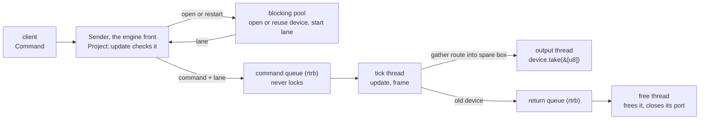
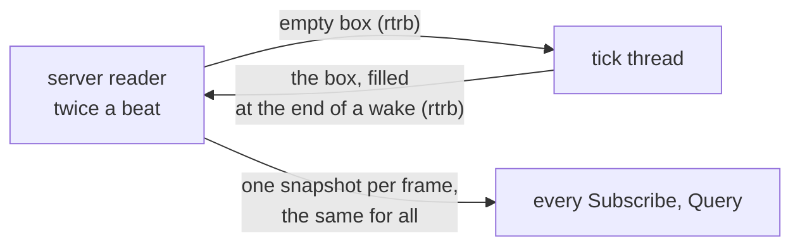
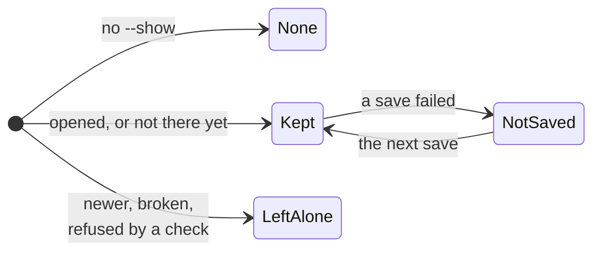
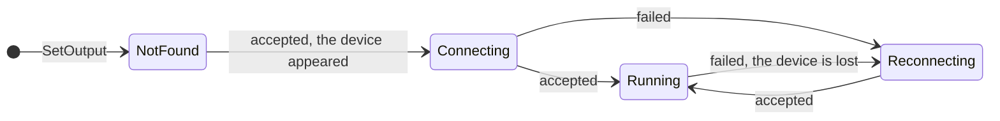
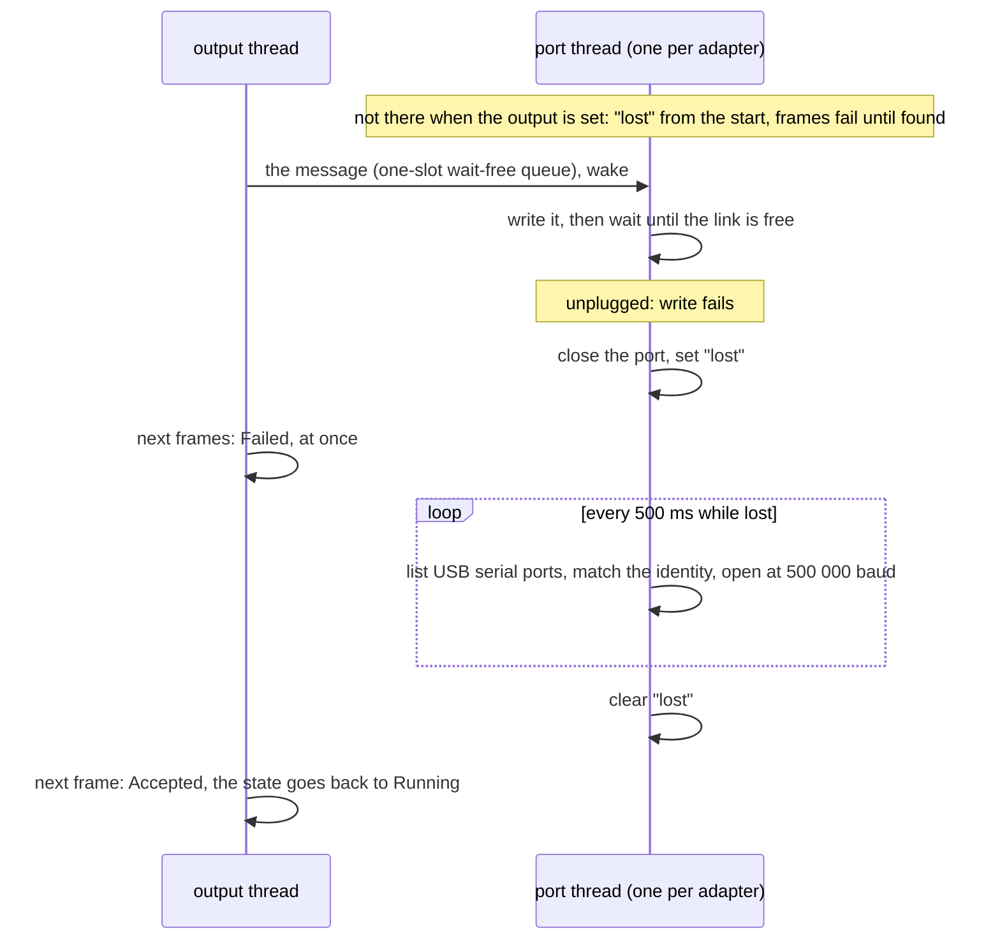

# The engine, in detail

The reference behind the [README](../README.md): how a command reaches the lights, the API, each output's states, the checks.

## A command, a frame, a picture





- Two boxes go round. The tick thread never waits, never fails a push, never frees a box (`crates/engine/src/snapshot.rs`).
- No box asked for: no picture sent.

An output's route lists channel spans in stream order. The tick gathers those spans into a spare box sized to their joined length. The output thread passes its bytes to `Device::take(&[u8])`.

| Route | Bytes on the link |
|---|---|
| DDP | Spans join end to end. Four 320-byte RGBW rows in four universes become one 1,280-byte packet. Longer streams split every 1,440 bytes, with PUSH on the last packet. |
| DMX USB Pro | One span of up to 512 channels. The adapter sends a zero start code, the span's bytes, and zeros through slot 512. |
| API v11 | `SetOutput.universes` becomes one span, rounded down to a whole pixel for DDP. The project and state show the first through last universe. |

| Step | Where | What |
|---|---|---|
| 1 | `Base::prepare`, then `Sender::admit` | `prepare`: `Project::update` checks the client `Command` against a `Base` (the project, patch and looks, taken from `Sender::base`) and says what follows: an `EngineCommand` for the tick thread, keep the device, restart its lane, or open one. Only this makes an `EngineCommand`. The blocking pool prepares output, patch, group and look edits. It checks route changes against the patch outside the publisher lock, so another client can still send a press. A press is prepared and admitted under the `Sender` at once, no thread hop before the next frame. Once `Stop` is taken (under the `Sender`), a command is answered `Stopping` and changes nothing: every accepted edit is in the last save. `admit`, under the `Sender`: `Stale` when another change replaced the base (the server prepares again, three times at most), else the plays, a slot and room in the queue are checked and the command queued. `Sender::begin` does both |
| 1b | `Opening::open` | The blocking pool starts the new lane, sizes its boxes and opens a fresh device if needed. Every due frame still uses the old lane, including a press from another client. |
| 2 | `Sender::publish_output` | Queues the prepared lane. A failed open answers `CannotOpen` and the old lane continues. |
| 3 | Tick thread | Installs the new run and lane together. A rate change on the same run keeps the lane. |
| 4 | Output workers | The old worker finishes its last send. The blocking pool drains the adapter and transfers a kept device to the new worker before replying. The new worker holds its frames until the transfer finishes. |
| 5 | Free thread | Reclaims the retired lane and its boxes. |

A pending open or device handoff refuses another `SetOutput` or `RemoveOutput` on that output with `Opening`. Pictures show the old run until the replacement is accepted.

If the old device is lost after a refused open, health records `OutputLost` and the reopen worker restores it on the old run. An adapter already `Reconnecting` keeps its failure count across an accepted reroute and returns to `Running` when it sends on the new run.

## API

Version 11. `GET /version` returns the API version. `GET /health` returns `ok` while the engine runs. Clients send commands on the WebSocket at `GET /api`. Generate the TypeScript types in `ui/src/engine-api.ts` with `UPDATE_TS=1 cargo test -p engine-core`.

| Who may open `/api` | Why |
|---|---|
| a client that is no web page (sends no `Origin`) | the shell, tests, scripts |
| the app window (`tauri://localhost`, `http://tauri.localhost`) | the desk itself |
| the UI in a browser (`http://127.0.0.1:5174`, and `:5299` under the end-to-end tests) | development |
| any other web page | refused with 403: a page must not stop or steer the lights. `/health` and `/version` stay open, they change nothing |

The list is `ORIGINS` in `crates/engine-server/src/lib.rs`. No pairing or token yet: that comes with a remote on a tablet or phone.

| Request or delivery | Engine answers |
|---|---|
| `{"Send": {"command": {"SetChannel": {"channel": {"universe": 1, "address": 1}, "value": 255}}}}` | `"Accepted"`, or `{"Refused": {"reason": "NoSuchAddress"}}` and nothing changes |
| `{"Send": {"command": {"Patch": ...}}}` | `{"Patched": {"fixture": 1}}`: its number |
| `"Query"` | `{"Picture": {"state": ..., "project": ..., "library": ..., "patch": [...], "universes": [[...512 levels]], "health": ...}}`. Each `project.outputs` entry is `null`, `{"Kind": {"kind": ..., "universes": {"first": 1, "count": 3}}}` or `{"Attached": {"universes": ...}}` for a test device. |
| In every `Picture` | `health` gives each attached output's status and timing over four seconds. With no outputs it is `{"window_ms":4000,"outputs":[]}`. |
| `"Subscribe"` | The current `Picture`, then `{"Changed": {"state": ..., "project": ..., "library": ..., "patch": ..., "channels": [...]}}` with each new frame. `patch` is `null` unless it changed since this subscriber's last frame. |
| While subscribed | `{"Health":{"health":...,"events":[...],"missed":0}}` when health changes, at most once per 500 ms. Events report late timing, device loss and recovery since subscription or the last health delivery. The engine keeps the newest 64 events. `missed` counts older events the subscriber missed. A query leaves its place in the log intact. |

| Command | Does |
|---|---|
| `SetChannel` (universe, address, value) | holds that channel at the value. It wins over the light that writes it, also at 0 |
| `ReleaseChannel` (universe, address) | lets it go: the light that writes it shows again, else zero |
| `ReleaseChannels` | lets every held raw channel go |
| `ReleaseAll` | lets every Manual play, every direct hold (`SetIntensity`, `SetColour`) and every raw channel go. Show, Autopilot and blackout stay (API 4: in API 3 it let only the raw channels go) |
| `Blackout` (on) | every channel goes out at zero while on, over everything; the held values stay |
| `SetOutput` (output 1 to 16, kind, universes, rate) | adds or replaces an output. Kind `{"Ddp": {"address": "ip:port", "color": "Rgb" or "Rgbw"}}` or `{"DmxUsbPro": {"adapter": 1}}` (the first ENTTEC DMX USB Pro by USB identity, in the order of their USB serial numbers, when the output first finds one; an adapter not there yet is no error, the output is NotFound until it is plugged in; from then on the output finds that same adapter by its serial, so a lost adapter never comes back as another). Adapters count from 1: 0 is `NotACommand`. Universes `{"first": 1, "count": 3}`, sent as one stream of channels. A DMX USB Pro takes one universe: more is refused with `{"TooManyUniverses": {"most": 1}}`. DDP RGB rounds the joined run down to whole pixels (510 bytes for one universe, 1,023 for two). Rate `"30"`, `"44"`, `"60"` or `null`: 60 for DDP, 44 for the DMX USB Pro |
| `RemoveOutput` (output) | removes it. Refused with `{"StreamsFixture": {"fixture": 1}}` when a fixture over more than one universe would be left with no output that streams them all; so is a `SetOutput` that changes the run |

Looks and who wins (`docs/history/looks-slice-3.md`, the Mixer's table in `engine-core/src/mix.rs`): per property of each light, Manual over Show over Autopilot, then the latest start. A direct hold is Manual. The picture's `state.plays` lists each play with its `rank`, `state` (`{"Waiting": {"beat": 12}}`, `Playing` or `Kept`) and `start` (the clock's `elapsed` at its start), `state.rules` the settings the frame applies, `state.clock` the beat clock at the frame: `bpm`, `feed`, `source` (`Feed`, `OneTap` or `Tapped`), `beat` (the grid: a whole number is a beat, a multiple of 4 a bar) and `elapsed` (beats since the engine started; a play's own beat is `elapsed` less its `start`).

| Command | Does | Refused |
|---|---|---|
| `PutStep` (look, name, step) | saves the target and sparse property values. Optional `step.swatches` holds up to four ordered RGB16 colours. A Wave can reference them by look ID | `EmptyPalette` if a saved Wave or retained play still uses the last swatch |
| `PutPattern` (look, name, pattern) | saves a Wave on an ordered group or a fixture matrix. Its period is 1 to 32 whole beats. Each target light must support continuous colour | `NoMatrix`, `Unsupported`, `InvalidTiming`, `NoSuchLook`, `WrongLookKind`, `EmptyPalette`, `WorkLimit` |
| `PutSequence` (look, name, sequence) | saves an ordered list of linked looks. Editing a step or sequence updates its running parents on the applying frame. Each keeps its start time and order | `NoSuchLook`, `WrongLookKind`, `LookCycle`, `InvalidTiming`, `WorkLimit` |
| `StartLook` (look, rank, when, use) | returns `{"Started": {"play": {"slot": 0, "generation": 1}}}`. Rank defaults to `Manual`, with `Show` and `Autopilot` available. Start defaults to `Now`. `Beat` and `Bar` launch at the first matching boundary on or after the request. A fresh start replaces that look at that rank | `NoSuchLook`, `InvalidTiming`, `PlayFull`, `WorkLimit`, `QueueFull` |
| `StopLook` (play) | Cancels a waiting play. For a playing look, `UntilRelease` keeps its Manual sample and `Stay` keeps its Show or Autopilot sample. A rest, `UntilStop` or `Reveal` ends the play | |
| `EndFlash` (play) | ends a Manual play at once. Another rank or an ended play: nothing | |
| `ReleaseHold` (play) | ends a play, playing or kept. Ended: nothing. Needs only a place in the command queue, with every play slot taken | |
| `SetMixRules` (rules: `brightness` `"Latest"` or `"Highest"`, `manual_end` `"UntilRelease"` or `"UntilStop"`, `other_end` `"Reveal"` or `"Stay"`) | saved with the show. `Highest`: the brightest within the winning rank. A switch to `UntilStop` or `Reveal` ends the kept plays of those ranks | |
| `SetInternalTempo` (bpm, 30 to 300) | the internal feed's tempo: the tempo now, unless taps set it. 124 at start, not saved | outside 30 to 300: `NotACommand` |
| `TapTempo` | a tap at the time the engine takes it (no client time). It marks a beat: at an exact beat the grid keeps its number, else it moves on to the next. A second tap 200 ms to 2 s later sets the tempo for every play (`Tapped`) until `ReleaseTempo`; under 200 ms is a bounce, ignored; one tap alone lapses after 2 s; a tap after a longer gap aligns the grid at the tempo now. The elapsed count never jumps | |
| `ReleaseTempo` | the feed's latest tempo again, at the grid's phase now | |

A sequence referencing looks 1 and 2 fades from the first into the second over one beat.

```json
{"Send":{"command":{"PutSequence":{"look":3,"name":"Red to blue","sequence":{"items":[{"look":1},{"look":2,"width":32,"transition":50}]}}}}}
```

| Field | Meaning | Default |
|---|---|---|
| Item `width` | 1 to 65,535 sixteenths of a beat | 16 (one beat) |
| Item `transition` | Percent of the incoming item's width spent blending common continuous properties. Discrete properties cut at entry | 0 |
| `use.speed` | `Half`, `Normal` or `Double` | `Normal` |
| `use.repeat` | `Loop` or `Once`. A nested once-use holds its last sample until the item's end. A standalone step holds until stopped or released | `Loop` |
| `use.spread` | 0 through 100 percent across the ordered target. Timed looks offset phase. Step items delay entry | 0 |

A Wave over a matrix can use the palette saved in step 3.

```json
{"Send":{"command":{"PutPattern":{"look":7,"name":"Panel sweep","pattern":{"Wave":{"target":{"Matrix":{"fixture":1}},"period":4,"palette":{"Step":{"look":3}}}}}}}
```

| Wave field | Effect |
|---|---|
| `target` | `{"Group":{"group":"front"}}` follows saved member order. `{"Matrix":{"fixture":1}}` follows head definition order, one row at a time. A shared master has no cell. |
| `palette` | `{"Step":{"look":3}}` follows palette edits. `{"Inline":[{"red":65535,"green":0,"blue":0}]}` stores the colours on the Wave. |
| `use.spread` | At 100%, group member `i` starts at `i / count` of a period. A matrix cell starts at `column / width` on every row. The blend wraps from the last swatch to the first. |

Each sequence item and each `StartLook` accepts its own `use`. A stop samples the play at the stop event. A once-use ends with its final sample, even if the next wake comes later. An empty step supplies a rest.

The patch: a fixture of the library at an address. The front checks each command against it and the library, compiles the writers (`rig`) and swaps them in on the tick thread as it swaps a device.

| Command | Does | Refused |
|---|---|---|
| `Patch` (name, maker, model, mode, at: universe, address) | adds a fixture: the lowest free number, its lights the first free from the lowest | `NoSuchFixture`, `NoSuchMode`, `{"PastTheEnd": {"channels": 3}}`, `{"NotStreamed": {"first": 1, "last": 2}}`, `{"NotSent": {"output": 1, "universe": 2, "address": 512}}`, `{"Overlaps": {"fixture": 1}}` (on a channel of fixture 1: no two fixtures share one), `NoSuchUniverse`, `NoSuchAddress`, `NoLightsLeft` |
| `PatchStrip` (name, pixels, color: `"Rgb"` or `"Rgbw"`, at) | adds a generic strip without a definition file (a WLED device): one light per pixel, maker `Generic`, model `RGB strip` or `RGBW strip`, mode `300 pixels`. 0 pixels is `NotACommand` | as `Patch`, but never `NoSuchFixture` or `NoSuchMode` |
| `Move` (fixture, at) | new address, the same lights: their held values stay | `NotPatched`, as `Patch` |
| `Unpatch` (fixture) | removes it, its lights' held values go, it and its lights leave every group | `NotPatched` |
| `Rename` (fixture, name) | | `NotPatched` |
| `SetIntensity` (target, intensity 0 to 65 535) | holds the intensity | `NotPatched`, `NoSuchLight`, `NoSuchGroup` |
| `SetColour` (target, red, green, blue, 0 to 65 535 each) | holds the colour | `NotPatched`, `NoSuchLight`, `NoSuchGroup` |
| `ReleaseIntensity` (target) | lets the intensity go: the dimmer shows the definition's default again, else 0. Not held: nothing changes | `NotPatched`, `NoSuchLight`, `NoSuchGroup` |
| `ReleaseColour` (target) | lets the colour go: each colour channel shows the definition's default again, else 0. Held black is black, not let go. Not held: nothing changes | `NotPatched`, `NoSuchLight`, `NoSuchGroup` |
| `SetGroup` (name, members) | makes a group, or replaces the one of that name in its place. Members in order, at most 512: `{"Fixture": {"fixture": 1}}` or `{"Light": {"light": 7}}` | `NotPatched`, `NoSuchLight` |
| `RemoveGroup` (name) | removes it. No such group: nothing changes | |

A target is `{"Fixture": {"fixture": 1}}` (all its lights), `{"Light": {"light": 7}}` or `{"Group": {"group": "front"}}` (every light of every member). The picture carries `groups`: name and members, in the order they were made; `Changed` carries them with the patch. Nothing uses the order yet. Fixtures and lights count from 1. A fixture with heads (a bar, a panel, a strip) is one light per head in the order of its definition, after the fixture itself when it has a channel in no head (a master dimmer); its `patch` row has `layout`, `{"width": 8, "height": 1}`, or `null`. Past address 512 a fixture runs on at address 1 of the next universe: `PastTheEnd` only past the engine's last universe. No invalid patch: a fixture over more than one universe needs one output whose run streams them all (`NotStreamed` names the universes), and that output cannot go or lose them while it is patched (`StreamsFixture`). Every channel of a fixture an output streams is one it sends: DDP sends whole pixels, so RGB on universes 1 and 2 sends 1023 channels, and a fixture on 2:512 is `NotSent`; an output change that would leave one is `StreamsFixture`. A fixture in one universe needs no output. No two fixtures share a channel: `Patch` or `Move` onto a channel of another fixture is `Overlaps`, and a show file that has one is left alone (`Refused` with `Overlaps`). Who wins on a channel is decided in one place, the Mixer in `engine-core` (`docs/design/who-wins.md`): a held value of a light over a default, then one pass per channel: a held raw channel over the light that writes it, and Blackout, a modifier every channel follows, over everything.

```json
{"Send": {"command": {"Patch": {"name": "PAR 3", "maker": "Generic", "model": "Generic RGB", "mode": "RGB", "at": {"universe": 1, "address": 37}}}}}
```

```json
{"Send": {"command": {"SetOutput": {"output": 1, "kind": {"Ddp": {"address": "192.168.1.50:4048", "color": "Rgbw"}}, "universes": {"first": 1, "count": 3}, "rate": null}}}}
```

## Fixture library

| | |
|---|---|
| Start | `npm run engine -- --fixtures <folder>`: every `.qxf` under the folder, read on a thread of its own while the engine runs |
| Where definitions come from | [QLC+](https://github.com/mcallegari/qlcplus), `resources/fixtures/`, Apache-2.0. Not shipped with the app yet: point `--fixtures` at a QLC+ checkout |
| State | `library` in `Picture` and `Changed`: `NoFolder`, `Reading`, `Read { read, failed }`, `CannotOpen` |
| Requests | `Search { text }`: best matches, each mode with its channel count. `Fixture { maker, model }`: each mode's channels by name and function. `Failures`: each file that could not be read, its line and why. A broken file never stops the engine |

## Show file



| | |
|---|---|
| Start | `npm run engine -- --show <file>`: the patch and the groups, opened at start, saved after every change and on `Stop` |
| Holds | each fixture by number with its mode whole (opens without the library), its first light, the groups in order. Not the outputs yet |
| A save | a new file `<file>.saving`, then renamed over the file, on the blocking pool. Never half written, never on the tick thread |
| Opening | Show file v6 stores Waves and step swatches. It reads v1 through v5 with their original schemas and applies the same checks as the commands. A file that fails one is left alone: empty patch, never written. Format: `crates/show-file` |
| State | `show` in `Picture` and `Changed`: `None`, `Kept`, `NotSaved`, `LeftAlone { why }`: `CannotRead`, `Broken { line, column }`, `Newer { version }`, `Taken { fixture }`, `Refused { reason }` |

## Each output's states



"Accepted" is the device's word: a DMX USB Pro accepts only once its adapter is found. DDP gets no answer from the device, so for it accepted, and Running, mean the frames were sent. After a refusal (nothing listens) a DDP output shows Reconnecting until 30 frames went out without one. A broken socket (a new address) is opened again by itself, off the tick thread.

Counters: `accepted`, `dropped` (the socket or the link was busy: the frame is dropped, never waited for), `failed`, `off_beat` (intervals more than 2 ms from the rate). With no output the engine still wakes 44 times a second and publishes its state.

## The DMX USB Pro port thread

The output thread never calls the serial driver: a vanishing device holds the driver up for many milliseconds. Each DMX USB Pro has a port thread that does every call:



| Who looks | How often | Cost |
|---|---|---|
| the port thread of each DMX USB Pro output | writes each message; while the adapter is not there yet or lost, lists the USB serial ports every 500 ms | asleep between messages. One listing is an IOKit or sysfs query of a few ms, never on the output thread |

## Checks with hands or hardware

Each prints what to do and when, with a bell:

| What | Command |
|---|---|
| WLED pattern (4 dots on 320 RGBW pixels, 30 s) | `cargo run -p engine-server --example wled_pattern -- 192.168.1.50` (port 4048 by default, or `ip:port`; optional seconds) |
| Patch a PAR and make it red, green, blue, then unpatch it (#135) | `cargo run -p engine-server --example patch_par -- ddp 192.168.1.50` (WLED: pixel 13) or `-- dmx 1` (an RGB PAR at address 37; another address after the device) |
| DMX USB Pro, 10 minutes: no interval off, nothing dropped | `cargo run --release -p engine-server --example dmx_usb_pro -- <port> ten-minutes` |
| DMX USB Pro, unplug and plug back in | `cargo run --release -p engine-server --example dmx_usb_pro -- <port> unplug` |
| DMX USB Pro, sleep and wake (press Enter once awake) | `cargo run --release -p engine-server --example dmx_usb_pro -- <port> sleep` |

`<port>` is the adapter's port (`/dev/cu.usbserial-...` on macOS). It only says which adapter; the output finds it by its USB identity.

The DMX USB Pro checks print a timed line for every state change (with the system error that lost the port), every interval off by more than 2 ms, and every `take` slower than 2 ms.

## What `npm test` runs

| Check | Proves |
|---|---|
| licence check | every crate and npm package is compatible with Apache-2.0 |
| layers check | crates and ui files depend only along the edges in `scripts/layers.mjs`; `engine-core` has no `std` and no `alloc` |
| names check | `engine-core` and `engine` name no protocol or device (DDP, UDP, DMX USB Pro, serial) outside the list of kinds (`scripts/names.mjs`) |
| `cargo clippy` | the lints for state machines and errors (root `Cargo.toml`, core crates); nothing on the tick thread can lock, block, do I/O or log (`crates/engine/clippy.toml`, linked from `crates/rt-thread`); every `unsafe` block says why it is sound |
| `cargo test` | `update`, `frame`, which output is due next, each output's state machine, DDP packets (every header byte, split at 1440 bytes), DMX USB Pro messages and the thread's priority as tables, no allocation while serving two test devices, taking commands and handing a snapshot to a reader every frame (`crates/engine/tests/no_alloc.rs`) and in each kind's `take` (`crates/outputs/tests/no_alloc.rs`); a DMX USB Pro against a fake serial port (a pseudo terminal): every byte, and unplugged, it fails until its port thread opens a new port; a port stuck in the driver never holds up `take`, and one that takes no byte for half a second is lost and looked for again, `ui/src/engine-api.ts` matches the Rust types; over the WebSocket: an output added, then "set channel" changes the bytes on its DDP socket in the next frame, wrong requests are refused, every subscriber gets the same picture of a frame (`crates/engine-server/tests/api.rs`) |
| `tsc`, oxlint, `node --test` | the UI type-checks; exhaustive switches, no `any`, only `engine.ts` talks to the engine; its connection state machine, every state and event; how replies change its picture |
| Playwright | engine + UI in a browser: the counter advances, the thread's priority shows, a fader sets a channel, an output and its counters show |
| Playwright, catalog | the storyboard catalog headless: every page mounts, a gesture shows the command it sends (`ui/src/catalog/catalog.spec.ts`) |

`npm run scorecard` prints numbers to watch, measured on the release build: lateness per output with two outputs at 60 and 44 a second, the same at the limits the API allows (16 outputs of 64 universes), intervals off by more than 2 ms, and send to frame, counted per output. A measurement that fails makes it exit non-zero. CI writes the line counts, public items and escape hatches into each run's summary. The timing numbers read "not measured on CI": run `npm run scorecard` on a real machine. A nightly workflow runs `npm run mutants`.
