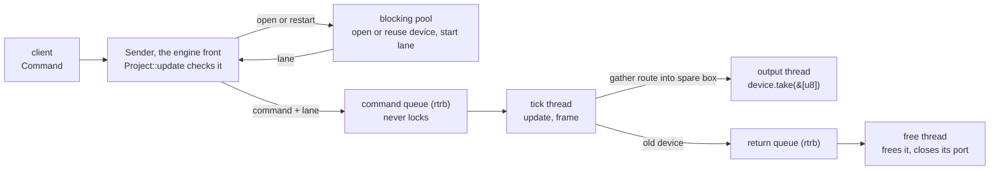
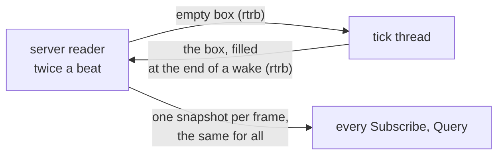
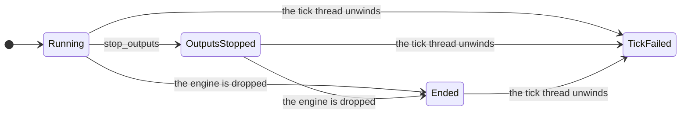
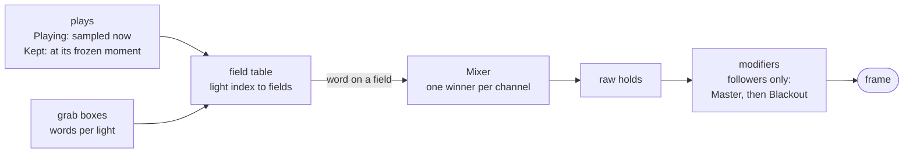
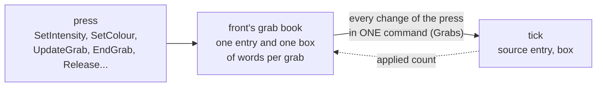
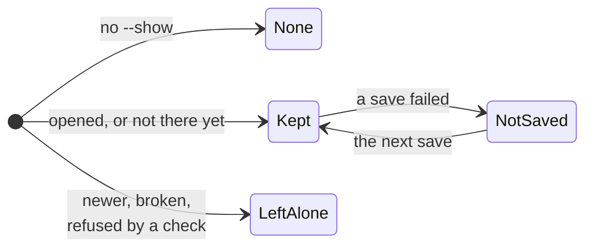
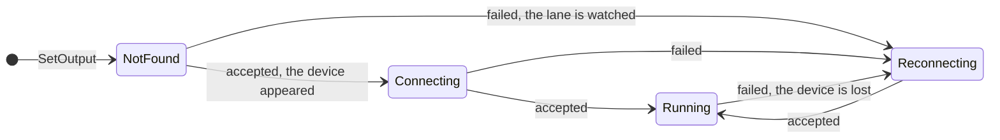

# The engine, in detail

The reference behind the [README](../README.md): how a command reaches the lights, the API, each output's states, the checks.

## A command, a frame, a picture





- Two boxes go round. The tick thread never waits, never fails a push, never frees a box (`crates/engine/src/snapshot.rs`).
- No box asked for: no picture sent.

An output's route lists channel spans in stream order. The tick gathers those spans into a spare box sized to their joined length. The output thread passes its bytes to `Device::take(&[u8])`.

| Route | Bytes on the link |
|---|---|
| DDP | Spans join end to end. Four 320-byte RGBW rows in four universes become one 1,280-byte packet. Longer streams split every 1,440 bytes, with PUSH on the last packet. |
| DMX USB Pro | One span of up to 512 channels. The adapter sends a zero start code, the span's bytes, and zeros through slot 512. |
| API v11 | `SetOutput.universes` becomes one span, rounded down to a whole pixel for DDP. The project and state show the first through last universe. |

| Step | Where | What |
|---|---|---|
| 1 | `Base::prepare`, then `Sender::admit` | `prepare`: `Project::update` checks the client `Command` against a `Base` (the project, patch and looks, taken from `Sender::base`) and says what follows: an `EngineCommand` for the tick thread, keep the device, restart its lane, or open one. Only this makes an `EngineCommand`. The blocking pool prepares output, patch, group and look edits. It checks route changes against the patch outside the publisher lock, so another client can still send a press. A press is prepared and admitted under the `Sender` at once, no thread hop before the next frame. Once `Stop` is taken (under the `Sender`), a command is answered `Stopping` and changes nothing: every accepted edit is in the last save. `admit`, under the `Sender`: `Stale` when another change replaced the base (the server prepares again, three times at most), else the plays, a slot and room in the queue are checked and the command queued. `Sender::begin` does both |
| 1b | `Opening::open` | The blocking pool starts the new lane, sizes its boxes and opens a fresh device if needed. Every due frame still uses the old lane, including a press from another client. |
| 2 | `Sender::publish_output` | Queues the prepared lane. A failed open answers `CannotOpen { why }` and the old lane continues: `Device { with }` (the device or socket refused, with the system's error number when it gave one), `Thread` (the output's thread did not start), `Unavailable` (the engine stopped, or the old device was not given back in time). |
| 3 | Tick thread | Installs the new run and lane together. A rate change on the same run keeps the lane. |
| 4 | Output workers | The old worker finishes its last send. The blocking pool drains the adapter and transfers a kept device to the new worker before replying. The new worker holds its frames until the transfer finishes. |
| 5 | Free thread | Reclaims the retired lane and its boxes. |

A pending open or device handoff refuses another `SetOutput` or `RemoveOutput` on that output with `Opening`. Pictures show the old run until the replacement is accepted.

If the old device is lost after a refused open, health records `OutputLost` and the reopen worker restores it on the old run. An adapter already `Reconnecting` keeps its failure count across an accepted reroute and returns to `Running` when it sends on the new run.

## Engine life

One state for the whole engine (`crates/engine/src/life.rs`), read by the tick, every output's thread and every opener. It never goes back.



| Life \ event | StopOutputs | Drop | TickPanicked |
|---|---|---|---|
| Running | OutputsStopped | Ended | TickFailed |
| OutputsStopped | same | Ended | TickFailed |
| Ended | same | same | TickFailed |
| TickFailed | same | same | same |

| Life | Tick | Outputs send | An output switch | `fresh()` |
|---|---|---|---|---|
| Running | wakes, serves | yes | as in [output-cutover.md](design/output-cutover.md) | the next picture |
| OutputsStopped | wakes, serves nothing: the final report | no, also a lane on its way out (T13) | refused, the writer gets `Stopping` | the next picture |
| Ended | ends | no | refused | (no engine to ask) |
| TickFailed | gone | no | refused | `Err(TickFailed)`: the server exits non-zero |

The tick's wake phase is the parity of its wake count:

| Phase | Set by | Means | An opener completing a switch |
|---|---|---|---|
| Between (even) | the tick, once every due frame is handed | no cutoff open | goes on |
| Handing (odd) | the tick, just before it counts the commands | a wake took its commands, its frames are not all handed | waits for the count to move, at most one wake, or until the life leaves Running |

## What the front reserves for a play

The front admits a command only when the tick's work and memory for it fit (`WorkLimit`, `PlayFull`). For each play it keeps one fact: its `Hold`, what to reserve. The tick's play states (`Waiting`, `Playing`, `Kept`, `engine-core/src/playback.rs`) stay the tick's; the front never reads them, only the tick's report of a kept or ended play. Code: `Hold` and `next_hold` in `crates/engine/src/lib.rs`, a test walks every pair.

| Hold | Reserves per wake |
|---|---|
| (free) | nothing |
| Playing | the play's work, as the look plays it (`looks::play_work`) |
| Kept | the plan's work: the last frame, held |

| Hold \ event | Start (`StartLook` admitted) | KeepSent (`StopLook`, the rules keep it) | KeptRead (`reap` reads the tick's kept version) | Released |
|---|---|---|---|---|
| (free) | Playing | (free) | (free) | (free) |
| Playing | Playing (a fresh start takes the slot) | Kept | Kept | (free) |
| Kept | Playing (a fresh start takes the slot) | Kept | Kept | (free) |

Released comes from: `ReleaseHold`, `EndFlash` of a Manual play, `StopLook` when the rules remove it, `ReleaseAll` (every Manual play), `SetMixRules` (every play the new rules do not keep), and `reap` reading that the tick ended the play. A once-use play released while playing still books its last sample in the queue before it.

## API

Version 12. `GET /version` returns the API version. `GET /health` returns `ok` while the engine runs. Clients send commands on the WebSocket at `GET /api`. Generate the TypeScript types in `ui/src/engine-api.ts` with `UPDATE_TS=1 cargo test -p wire` (`crates/wire`).

| Who may open `/api` | Why |
|---|---|
| a client that is no web page (sends no `Origin`) | the shell, tests, scripts |
| the app window (`tauri://localhost`, `http://tauri.localhost`) | the desk itself |
| the UI in a browser (`http://127.0.0.1:5174`) | development |
| the page of an end-to-end run, named in `BOSSYLIGHTS_ORIGINS` (`e2e/ports.ts`) | the tests, one page per run |
| any other web page | refused with 403: a page must not stop or steer the lights. `/health` and `/version` stay open, they change nothing |

The list is `ORIGINS` in `crates/engine-server/src/lib.rs`. No pairing or token yet: that comes with a remote on a tablet or phone.

| Request or delivery | Engine answers |
|---|---|
| `{"Send": {"command": {"SetChannel": {"channel": {"universe": 1, "address": 1}, "value": 255}}}}` | `"Accepted"`, or `{"Refused": {"reason": "NoSuchAddress"}}` and nothing changes |
| `{"Send": {"command": {"Patch": ...}}}` | `{"Patched": {"fixture": 1}}`: its number |
| any `Send` | `"Stopping"` when the engine stops first: nothing changed. `"Failed"` when the server failed while working on it (API 12): the picture says what is live |
| `"Query"` | `{"Picture": {"state": ..., "project": ..., "library": ..., "patch": [...], "universes": [[...512 levels]], "health": ...}}`. Each `project.outputs` entry is `null`, `{"Kind": {"kind": ..., "universes": {"first": 1, "count": 3}}}` or `{"Attached": {"universes": ...}}` for a test device. |
| In every `Picture` | `health` gives each attached output's status and timing over four seconds. With no outputs it is `{"window_ms":4000,"outputs":[]}`. |
| After the handoff | each row's `after_handoff` lists, in order, what follows the moment its frame is handed to the device, which the measured `press_to_light` leaves out: each `stage` with a `span` either `{"Computed": {"low_us", "high_us", "source"}}` (from a spec, rounded outward) or `"NotKnown"`. A DMX USB Pro: `HostToAdapter` not known, `SerialLink` 11,396 µs (`Baud`), `AdapterFrame` 0 to 25,000 µs and `DmxWire` from the end of the lowest patched slot to the end of the highest, both at the widget's defaults (`AdapterDefault`, `Dmx512AdapterDefault`: its settings are never read), `SlotGap` not known. With nothing patched, `DmxWire` spans all 512 slots, source `Dmx512AdapterDefaultNothingPatched`: a channel set by hand reaches lights the patch does not know. DDP: `NetworkAndController` not known. A test's own device: `Device` not known. The delay ends when the light has its value: its own reaction is not counted. |
| `lights` in a `Picture` or `Changed` | what grabs hold, from the front's grab book: each held light with its `intensity` and `colour` (`null` where not held), not what plays. `Changed` lists only the lights whose holds changed. The first picture whose frame has the press shows them |
| `"Subscribe"` | The current `Picture`, then `{"Changed": {"state": ..., "project": ..., "library": ..., "patch": ..., "channels": [...]}}` with each new frame. `patch` is `null` unless it changed since this subscriber's last frame. |
| While subscribed | `{"Health":{"health":...,"events":[...],"missed":0}}` when health changes, at most once per 500 ms. Events report late timing, device loss and recovery since subscription or the last health delivery. The engine keeps the newest 64 events. `missed` counts older events the subscriber missed. A query leaves its place in the log intact. |

Health pacing per subscriber (`HealthPacing` in `crates/engine-server/src/lib.rs`). Any message sent starts it; engine time comes from the first picture requested after the send.

| Pacing \ event | a message went out | a picture requested after that send | a picture: health changed, 500 ms of engine time since |
|---|---|---|---|
| Sending | AwaitingSample (send time) | same | same |
| AwaitingSample | same | Since (that picture's engine time) | same |
| Since | same | same | send health, Sending |

One connection (`talk` in `crates/engine-server/src/lib.rs`). An edit is a command that is prepared off the front or opens a device (`SetOutput`, `RemoveOutput`, patch, groups, looks). Replies go out in the order of their requests; pictures and health are no replies and never wait.

| Event \ connection | Idle (nothing waiting) | Editing (an edit of this connection is pending) |
|---|---|---|
| a press arrives | admitted now, reply now | admitted now; its reply in its turn. A press after a pending edit on the same connection runs against the state before that edit |
| an edit arrives | the worker starts it; its reply is first in line | queued on the worker behind the one running |
| `Query`, `Subscribe`, `Search`, `Fixture`, `Failures` | answered now | answered when its turn comes. A subscription starts as its picture goes out, so no `Changed` comes before it |
| bad JSON or Binary | `NotACommand` now | `NotACommand` in its turn |
| `Stop` | stops the engine, `Stopping` | stops the engine at once; `Stopping` in its turn |
| the edit is answered | | its reply and every ready reply behind it go out; the next edit starts, or Idle |
| a picture or health is due | sent | sent |
| the engine stops | close | every waiting request is answered in order (an edit `Stopping`), then close |
| the client closes | end | end; the running edit finishes alone, its reply dropped; edits not started are dropped |
| 32 requests wait (`WAITING`) | | the connection is read no further until a reply goes out |

Revision history (`Api::history` and `Api::spare` in `crates/engine-server/src/lib.rs`, 64 MiB). Each change keeps its moment (the patch, looks and held lights a picture shows) until the reader takes a snapshot past it. Each moment is paid before its change: an edit with its plans, a hold press with one revision, 256 KiB, which fits a held list of all 16,384 lights. A stalled reader holds at most 64 MiB. The last revision is a spare only a release may take: what you touch stays yours until Release (theory 5).

| Press | Commands |
|---|---|
| sets a hold | `SetIntensity`, `SetColour`, `SetProperty`, `UpdateGrab` |
| releases a hold | `EndGrab`, `ReleaseIntensity`, `ReleaseColour`, `ReleaseProperty`, `ReleaseAll` |
| changes no hold | every other press |

| History \ press | sets a hold | releases a hold | changes no hold |
|---|---|---|---|
| in step: the reader passed every moment | taken; its moment holds 256 KiB until a snapshot passes it, then all is free again | as a hold | taken; no moment, no bytes |
| behind, room left | taken; paid as in step | as a hold | taken; no moment, no bytes |
| behind, full: only the spare left | `WorkLimit`: holds, grabs and history unchanged | taken; paid from the spare | taken; in the next frame |
| behind, full, spare used | `WorkLimit` | `WorkLimit`, even one that holds nothing: nothing changes | taken; in the next frame |

| Command | Does |
|---|---|
| `SetChannel` (universe, address, value) | holds that channel at the value. It wins over every play and grab, also at 0 |
| `ReleaseChannel` (universe, address) | lets it go: the channel's winner shows again, else its rest |
| `ReleaseChannels` | lets every held raw channel go |
| `ReleaseAll` | lets every Manual play, every direct hold (`SetIntensity`, `SetColour`) and every raw channel go. Show, Autopilot and blackout stay (API 4: in API 3 it let only the raw channels go) |
| `Blackout` (on) | every channel that follows it goes to its dark while on, over everything: dimmers, emitters no dimmer carries, a shutter with a Closed range (closed), CMY without a dimmer (255). Fog, motion, wheels, colour a dimmer carries and a channel nobody patched stay. The held values stay |
| `SetOutput` (output 1 to 16, kind, universes, rate) | adds or replaces an output. Kind `{"Ddp": {"address": "ip:port", "color": "Rgb" or "Rgbw"}}` or `{"DmxUsbPro": {"adapter": 1}}` (the first ENTTEC DMX USB Pro by USB identity, in the order of their USB serial numbers, when the output first finds one; an adapter not there yet is no error, the output is NotFound until it is plugged in; from then on the output finds that same adapter by its serial, so a lost adapter never comes back as another). Adapters count from 1: 0 is `NotACommand`. Universes `{"first": 1, "count": 3}`, sent as one stream of channels. A DMX USB Pro takes one universe: more is refused with `{"TooManyUniverses": {"most": 1}}`. DDP RGB rounds the joined run down to whole pixels (510 bytes for one universe, 1,023 for two). Rate `"30"`, `"44"`, `"60"` or `null`: 60 for DDP, 44 for the DMX USB Pro. A DMX USB Pro sends at most 44 (theory.md, idea 1): `"60"` is refused with `{"TooFast": {"most": "44"}}` (API 12) |
| `RemoveOutput` (output) | removes it. Refused with `{"StreamsFixture": {"fixture": 1}}` when a fixture over more than one universe would be left with no output that streams them all; so is a `SetOutput` that changes the run |

Looks and who wins (`docs/history/looks-slice-3.md`, the Mixer's table in `engine-core/src/mix.rs`): per channel, Manual over Show over Autopilot, then the latest start. A direct hold is Manual. A coarse and fine pair is won as one word. The picture's `state.plays` lists each play with its `rank`, `state` (`{"Waiting": {"beat": 12}}`, `Playing` or `Kept`) and `start` (the clock's `elapsed` at its start), `state.rules` the settings the frame applies, `state.clock` the beat clock at the frame: `bpm`, `feed`, `source` (`Feed`, `OneTap` or `Tapped`), `beat` (the grid: a whole number is a beat, a multiple of 4 a bar) and `elapsed` (beats since the engine started; a play's own beat is `elapsed` less its `start`).

| Command | Does | Refused |
|---|---|---|
| `PutStep` (look, name, step) | saves the target and sparse property values. Optional `step.swatches` holds up to four ordered RGB16 colours. A Wave can reference them by look ID | `EmptyPalette` if a saved Wave or retained play still uses the last swatch |
| `PutPattern` (look, name, pattern) | saves a Wave on an ordered group or a fixture matrix. Its period is 1 to 32 whole beats; any other is `NotACommand` (API 12). Each target light must support continuous colour | `NoMatrix`, `Unsupported`, `NoSuchLook`, `WrongLookKind`, `EmptyPalette`, `WorkLimit` |
| `PutSequence` (look, name, sequence) | saves an ordered list of linked looks. Editing a step or sequence updates its running parents on the applying frame. Each keeps its start time and order | `NoSuchLook`, `WrongLookKind`, `LookCycle`, `InvalidTiming`, `WorkLimit` |
| `StartLook` (look, rank, when, use) | returns `{"Started": {"play": {"slot": 0, "generation": 1}}}`. Rank defaults to `Manual`, with `Show` and `Autopilot` available. Start defaults to `Now`. `Beat` and `Bar` launch at the first matching boundary on or after the time the request was sent. If the engine sees it only after that boundary, it plays in that frame, counting from the frame time. A fresh start replaces that look at that rank | `NoSuchLook`, `InvalidTiming`, `PlayFull`, `WorkLimit`, `QueueFull` |
| `StopLook` (play) | Cancels a waiting play. For a playing look, `UntilRelease` keeps its Manual sample and `Stay` keeps its Show or Autopilot sample. A rest, `UntilStop` or `Reveal` ends the play | |
| `EndFlash` (play) | ends a Manual play at once. Another rank or an ended play: nothing | |
| `ReleaseHold` (play) | ends a play, playing or kept. Ended: nothing. Needs only a place in the command queue, with every play slot taken | |
| `SetMixRules` (rules: `brightness` `"Latest"` or `"Highest"`, `manual_end` `"UntilRelease"` or `"UntilStop"`, `other_end` `"Reveal"` or `"Stay"`) | saved with the show. `Highest`: the brightest within the winning rank, on each dimmer channel. A light without a dimmer has none: its colour stays latest-wins. A switch to `UntilStop` or `Reveal` ends the kept plays of those ranks | |
| `SetInternalTempo` (bpm, 30 to 300) | the internal feed's tempo: the tempo now, unless taps set it. 124 at start, not saved | outside 30 to 300: `NotACommand` |
| `TapTempo` | a tap at the time the engine takes it (no client time). It marks a beat: at an exact beat the grid keeps its number, else it moves on to the next. A second tap 200 ms to 2 s later sets the tempo for every play (`Tapped`) until `ReleaseTempo`; under 200 ms is a bounce, ignored; one tap alone lapses after 2 s; a tap after a longer gap aligns the grid at the tempo now. The elapsed count never jumps | |
| `ReleaseTempo` | the feed's latest tempo again, at the grid's phase now | |

A sequence referencing looks 1 and 2 fades from the first into the second over one beat.

```json
{"Send":{"command":{"PutSequence":{"look":3,"name":"Red to blue","sequence":{"items":[{"look":1},{"look":2,"width":32,"transition":50}]}}}}}
```

| Field | Meaning | Default |
|---|---|---|
| Item `width` | 1 to 65,535 sixteenths of a beat; 0 is `NotACommand` | 16 (one beat) |
| Item `transition` | 0 to 100 (more is `NotACommand`): percent of the incoming item's width spent blending common continuous properties. Discrete properties cut at entry | 0 |
| `use.speed` | `Half`, `Normal` or `Double` | `Normal` |
| `use.repeat` | `Loop` or `Once`. A nested once-use holds its last sample until the item's end. A standalone step holds until stopped or released | `Loop` |
| `use.spread` | 0 through 100 percent across the ordered target (more is `NotACommand`). Timed looks offset phase. Step items delay entry | 0 |

A Wave over a matrix can use the palette saved in step 3.

```json
{"Send":{"command":{"PutPattern":{"look":7,"name":"Panel sweep","pattern":{"Wave":{"target":{"Matrix":{"fixture":1}},"period":4,"palette":{"Step":{"look":3}}}}}}}
```

| Wave field | Effect |
|---|---|
| `target` | `{"Group":{"group":"front"}}` follows saved member order. `{"Matrix":{"fixture":1}}` follows head definition order, one row at a time. A shared master has no cell. |
| `palette` | `{"Step":{"look":3}}` follows palette edits. `{"Inline":[{"red":65535,"green":0,"blue":0}]}` stores the colours on the Wave. |
| `use.spread` | At 100%, group member `i` starts at `i / count` of a period. A matrix cell starts at `column / width` on every row. The blend wraps from the last swatch to the first. |

Each sequence item and each `StartLook` accepts its own `use`. A stop samples the play at the stop event. A once-use ends with its final sample, even if the next wake comes later. An empty step supplies a rest.

The patch: a fixture of the library at an address. The front checks each command against it and the library, lowers each fixture's mode into its channels (`rig`: each channel's rest, dark, fade, pair and what it follows, from the fixture file) and makes the field table: each light's fields on those channels. The table swaps in on the tick thread whole, as it swaps a device. A channel nothing offers shows its rest. A frame visits only the patched channels and the raw holds, so its work follows the rig, not the size of the space (`cargo run -q --release -p rig --example frame_lateness -- 10 1` and `-- 10 10000`).

| Command | Does | Refused |
|---|---|---|
| `Patch` (name, maker, model, mode, at: universe, address) | adds a fixture: the lowest free number, its lights the first free from the lowest | `NoSuchFixture`, `NoSuchMode`, `{"PastTheEnd": {"channels": 3}}`, `{"NotStreamed": {"first": 1, "last": 2}}`, `{"NotSent": {"output": 1, "universe": 2, "address": 512}}`, `{"Overlaps": {"fixture": 1}}` (on a channel of fixture 1: no two fixtures share one), `NoSuchUniverse`, `NoSuchAddress`, `NoLightsLeft` |
| `PatchStrip` (name, pixels, color: `"Rgb"` or `"Rgbw"`, at) | adds a generic strip without a definition file (a WLED device): one light per pixel, maker `Generic`, model `RGB strip` or `RGBW strip`, mode `300 pixels`. 0 pixels is `NotACommand` | as `Patch`, but never `NoSuchFixture` or `NoSuchMode` |
| `Move` (fixture, at) | new address, the same lights: their held values stay | `NotPatched`, as `Patch` |
| `Unpatch` (fixture) | removes it, its lights' held values go, it and its lights leave every group | `NotPatched` |
| `Rename` (fixture, name) | | `NotPatched` |
| `SetIntensity` (target, intensity 0 to 65 535) | holds the intensity. On a light without a dimmer of its own it offers nothing (rule B, until #253) | `NotPatched`, `NoSuchLight`, `NoSuchGroup` |
| `SetColour` (target, red, green, blue, 0 to 65 535 each) | holds the colour. On a light without a dimmer it shows as it is, not dimmed by a held intensity | `NotPatched`, `NoSuchLight`, `NoSuchGroup` |
| `ReleaseIntensity` (target) | lets the intensity go: the dimmer shows the definition's default again, else 0. Not held, or a light without a dimmer: nothing changes | `NotPatched`, `NoSuchLight`, `NoSuchGroup` |
| `ReleaseColour` (target) | lets the colour go: each colour channel shows the definition's default again, else 0. Held black is black, not let go. Not held: nothing changes | `NotPatched`, `NoSuchLight`, `NoSuchGroup` |
| `SetGroup` (name, members) | makes a group, or replaces the one of that name in its place. Members in order, at most 512: `{"Fixture": {"fixture": 1}}` or `{"Light": {"light": 7}}` | `NotPatched`, `NoSuchLight` |
| `RemoveGroup` (name) | removes it. No such group: nothing changes | |

A target is `{"Fixture": {"fixture": 1}}` (all its lights), `{"Light": {"light": 7}}` or `{"Group": {"group": "front"}}` (every light of every member). The picture carries `groups`: name and members, in the order they were made; `Changed` carries them with the patch. A Wave on a group follows member order. Fixtures and lights count from 1. A fixture with heads (a bar, a panel, a strip) is one light per head in the order of its definition, after the fixture itself when it has a channel in no head (a master dimmer); its `patch` row has `layout`, `{"width": 8, "height": 1}`, or `null`. Past address 512 a fixture runs on at address 1 of the next universe: `PastTheEnd` only past the engine's last universe. No invalid patch: a fixture over more than one universe needs one output whose run streams them all (`NotStreamed` names the universes), and that output cannot go or lose them while it is patched (`StreamsFixture`). Every channel of a fixture an output streams is one it sends: DDP sends whole pixels, so RGB on universes 1 and 2 sends 1023 channels, and a fixture on 2:512 is `NotSent`; an output change that would leave one is `StreamsFixture`. A fixture in one universe needs no output. No two fixtures share a channel: `Patch` or `Move` onto a channel of another fixture is `Overlaps`, and a show file that has one is left alone (`Refused` with `Overlaps`). Who wins on a channel is decided in one place, the Mixer in `engine-core` (`docs/design/who-wins.md`): each play's and grab's offer on the channel (rank, then latest or highest), else its rest, then a held raw channel over the winner, and Blackout over everything on the channels the fixture file has follow it: each goes to the dark the file gives (a shutter to its first Closed byte). A channel nobody patched follows nothing.

```json
{"Send": {"command": {"Patch": {"name": "PAR 3", "maker": "Generic", "model": "Generic RGB", "mode": "RGB", "at": {"universe": 1, "address": 37}}}}}
```

```json
{"Send": {"command": {"SetOutput": {"output": 1, "kind": {"Ddp": {"address": "192.168.1.50:4048", "color": "Rgbw"}}, "universes": {"first": 1, "count": 3}, "rate": null}}}}
```

## A frame on the tick



One `engine_core::frame` per wake (`Ticker::frame` in `crates/engine/src/tick.rs`).

| Part | What |
|---|---|
| Source table | 1,024 entries (`mix::SOURCES`): 32 plays by slot, then 992 grabs. A channel's source tag names its winner |
| Offer | a word on a field: one channel (the word's high byte goes out) or a coarse and fine pair as one 16-bit word. A pair is never torn |
| Who wins (`mix::Offers`) | rank (Manual over Show over Autopilot, a grab is Manual), then the latest start. On a `highest` channel (the dimmers, when the brightness rule is Highest): the greater distance from `dark`, the latest on a tie |
| Field table (`rig::FieldPlan`) | per light index its fields, which fade, the dimmer channels, the patched channels, the follower index (the channels that follow a modifier, a pair as one word; the modifier pass visits only these). Swapped whole per patch edit, so a Move keeps a playing look and a grab. The interim step from a light index to channels: #253 replaces light values with fixture refs. No other tick code knows more of a light than this index |
| Effects (#283, #284) | an effect keeps its cells as (light index, field) and reads `rig::Targets::of(light)` each frame, as `looks::Plan::offer` and the grab boxes (`rig::Words::offer`) do. One way to survive a Move: E2 and E3 add no second one |

## A play on the tick

The tick keeps each play in a slot: off, `Waiting { beat }`, `Playing` or `Kept`. One table, walked by `a_play_on_the_tick_follows_its_table` (`engine-core/src/lib.rs`). "Plan" is `Plays::takes_plan`: whether a new plan for this play installs, else it goes back.

| State \ tick event | Start, Now | Start, Beat or Bar, not reached | Start, boundary reached | the grid reaches the beat | Keep | Release | ReleaseAll | Rules | Plan for this play | Offers each frame |
|---|---|---|---|---|---|---|---|---|---|---|
| off | Playing | Waiting | Playing from the frame | off | off | off | off | off | goes back | nothing |
| Waiting | Playing (new play) | Waiting (new play) | Playing (new play) | Playing from the crossing | off (cancelled) | off | Manual: off, else Waiting | Waiting | installs | nothing |
| Playing | Playing (new play) | Waiting (new play) | Playing (new play) | Playing | Kept | off | Manual: off, else Playing | Playing | installs | the plan sampled now (below) |
| Kept | Playing (new play) | Waiting (new play) | Playing (new play) | Kept | Kept | off | Manual: off, else Kept | off where the rules end its rank's stopped plays, else Kept | goes back | the plan sampled at its frozen moment: each channel's last offer, nothing where it was in a gap |

"For this play" is the same slot and generation. Another generation in the slot is "off" for it.

| Tick event | Comes from |
|---|---|
| Start | `StartLook` admitted |
| the grid reaches the beat | `Settle` at each command's send time and at the frame; `Tap` |
| Keep | `StopLook` when the rules keep it; a once-use play's natural end when the rules keep it (the tick's `settle`) |
| Release | `ReleaseHold`; `EndFlash` of a Manual play; `StopLook` when the rules remove it; a once-use play's natural end when the rules remove it (the tick's `settle`) |
| ReleaseAll | `ReleaseAll` |
| Rules | `SetMixRules` |
| Plan | an edit of a look (`PutStep`, `PutSequence`, `PutPattern`) for each live play of it |

The front never sees `Waiting`. `StopLook` on a waiting play is Keep on the tick (off, cancelled) while the front books the play as kept until it reads that the tick ended it: it over-reserves for that time, never under.

What a playing plan offers on one channel (`looks::Plan::offer`, `engine-core/src/evaluate.rs`):

| Plan at this moment | Offer |
|---|---|
| a step or a sequence item that names the channel | its word |
| a step or a sequence item that does not (a gap) | nothing: a lower source shows |
| a transition, both items name it, a fade channel | the two words blended as one 16-bit word |
| a transition, both name it, a jump channel (wheel, gobo, shutter) | the incoming item's word |
| a transition out of a gap / into a gap | the incoming item's word / nothing |
| a Wave | the swatch words ramped at the phase. A field that does not fade jumps at the swatch |
| past the end | `Loop` wraps. `Once` ends by the rules: Keep, or off |

| Kept rule | Why |
|---|---|
| Keep stores the play's moment (an `Elapsed`, a place in the plan, not a clock time). Each frame samples the plan there | a tempo change after the stop moves no byte. No scratch per play on the tick |
| A stop at a moment where the plan offers nothing ends the play | nothing to keep |

## A grab on the tick



`crates/engine/src/grabs.rs`. One grab entry per grab, one `Arc<Words>` box of words on its lights. A newer grab of a property takes its lights from older ones, so ending it never brings an older grab back.

| State \ event | a grab (here, or newer on its lights) | `UpdateGrab` | `EndGrab` | a release, `Unpatch` | `ReleaseAll` | `SetMixRules` to `UntilStop` |
|---|---|---|---|---|---|---|
| (free) | Live | nothing | nothing | nothing | (free) | (free) |
| Live | Live without them, or (free) | Live, new words | `UntilRelease`: Kept. `UntilStop`: (free) | Live without them, or (free) | (free) | Live |
| Kept | Kept without them, or (free) | nothing | nothing | Kept without them, or (free) | (free) | (free) |

| Rule | How |
|---|---|
| A press needs one queue place | every change of one press goes in one `Grabs` command |
| The tick never frees a box | the front keeps its clone, and the change list, until the tick's applied count passed the command that let it go |
| Booking by lights, unchanged | a live light property reserves work for an end and a release; a kept one only its release |
| A Move | the box holds light indices: the new field table puts its words on the new channels |

## Fixture library

| | |
|---|---|
| Start | `npm run engine -- --fixtures <folder>`: every `.qxf` under the folder, read on a thread of its own while the engine runs |
| Where definitions come from | [QLC+](https://github.com/mcallegari/qlcplus), `resources/fixtures/`, Apache-2.0. Not shipped with the app yet: point `--fixtures` at a QLC+ checkout |
| State | `library` in `Picture` and `Changed`: `NoFolder`, `Reading`, `Read { read, failed }`, `CannotOpen`. `read` counts files on the shelf; `failed` counts rows of `Failures`: a file, or one refused mode |
| Requests | `Search { text }`: best matches, each mode with its channel count. `Fixture { maker, model }`: each mode's channels by name and function. `Failures`: each file that could not be read, and each refused mode (`mode "…": why`), its line and why. A mode with a problem inside it is refused and the file's other modes are read (owner decision Q18); a file with no mode left is not read. A broken file never stops the engine |

## Show file



| | |
|---|---|
| Start | `npm run engine -- --show <file>`: the patch and the groups, opened at start, saved after every change and on `Stop` |
| Holds | each fixture by number with its mode whole (opens without the library), its first light, the groups in order. Not the outputs yet |
| A save | a new file `<file>.saving`, then renamed over the file, on the blocking pool. Never half written, never on the tick thread |
| Opening | Show file v6 stores Waves and step swatches. It reads v6 only: an older file is left alone (`Older`), no migration. It applies the same checks as the commands. A file that fails one is left alone: empty patch, never written. Nothing half opens: the patch, the looks and the Mixer's settings go to the tick in one chunk (2 places of the queue) or not at all, and only onto a front as it starts (no fixture, the default Mixer settings; else `Stale`). Every row: the table below. Format: `crates/show-file` |
| State | `show` in `Picture` and `Changed`: `None`, `Kept`, `NotSaved`, `LeftAlone { why }`: `CannotRead`, `Broken { line, column }`, `Newer { version }`, `Older { version }`, `Taken { fixture }`, `LookTaken { look }`, `Refused { reason }` |

The open, all or nothing (`show::open`, `Sender::open`). Every `LeftAlone` row leaves the patch, the looks and the Mixer's settings as they start; only `Kept` writes to the queue.

| State | Event | Next | Patch, looks, settings after |
|---|---|---|---|
| Reading | file not there | Opening (empty patch, no looks) | |
| Reading | cannot read (a folder, no rights) | `LeftAlone(CannotRead)` | as they start |
| Reading | over the most bytes, broken, newer, older, taken, refused by a check | `LeftAlone(why)` | as they start |
| Reading | read | Opening (the file's patch and looks) | |
| Opening | front not as it starts: a fixture patched, or Mixer settings other than the defaults | `LeftAlone(Refused(Stale))` | unchanged |
| Opening | patch refused as a change of the patch (`NotStreamed`, …) | `LeftAlone(Refused(reason))` | as they start |
| Opening | a look names nothing in the patch | `LeftAlone(Refused(LookInUse))` | as they start |
| Opening | fewer than 2 queue places free | `LeftAlone(Refused(QueueFull))` | as they start |
| Opening | all pass | `Kept` | the file's, in one chunk of 2 places |

## An output in the project

The front's project holds each output as one machine (`Setup` in `engine-core/src/project.rs`), walked by `an_output_in_the_project_follows_its_table`. Settled states: Empty, Kind (a device the engine opened), Attached (a test's device, its whole run), Routed (a test's device with its own route). Switching states: Opening and Restarting, each keeping `was`, the settled state the wire still shows.

| State \ event | SetOutput, same kind and run | SetOutput, same kind, new run | SetOutput, other kind | RemoveOutput | Opened | OpenFailed | Attached | Routed | Restore |
|---|---|---|---|---|---|---|---|---|---|
| Empty | Opening, open | Opening, open | Opening, open | Empty, send the removal | same | same | Attached | Routed | refused `Stale` |
| Kind | Kind, keep the lane | Restarting, restart | Opening, open | Empty, send the removal | same | same | Attached | Routed | back to before |
| Attached | Opening, open | Opening, open | Opening, open | Empty, send the removal | same | same | Attached (new run) | Routed | back to before |
| Routed | Opening, open | Opening, open | Opening, open | Empty, send the removal | same | same | Attached | Routed (new bounds) | back to before |
| Opening | refused `Opening` | refused `Opening` | refused `Opening` | refused `Opening` | Kind, the new run | `was` | refused `Opening` | refused `Opening` | back to before |
| Restarting | refused `Opening` | refused `Opening` | refused `Opening` | refused `Opening` | Kind, the new run | `was` | refused `Opening` | refused `Opening` | back to before |

| Query | Answer |
|---|---|
| on the wire | Kind as `Kind`; Attached and Routed as `Attached`; switching states as `was` |
| streams (patch checks) | Kind, Attached: their run. Routed, Empty: nothing (a route can have holes). Switching: `was` and the new run must both cover it |

"Before" is the settled state the output's last switch replaced (an open, a restart, an attach). `Restore` goes back to it once, and only to it: the engine shows the project as it was until the switch is visible on the tick (`ProjectView`), and checks a patch against both sides. A failed open or a removal clears it. A new switch cannot start while the old lane still waits to serve (`Opening`), so "before" is never replaced under a switch in flight.

## Each output's states



"Watched": the engine's recovery worker holds a request for the lane (a device carried over lost, or a refused restart, [output-cutover.md](design/output-cutover.md)). Its failed frame is a lost device, even before a frame was accepted. An outage is counted on every entry into Reconnecting.

"Accepted" is the device's word: a DMX USB Pro accepts only once its adapter is found. DDP gets no answer from the device, so for it accepted, and Running, mean the frames were sent. After a refusal (nothing listens) a DDP output shows Reconnecting until 30 frames went out without one. A socket that broke (a new address), or that the system refused when the output was set, is opened again by the output's own socket thread, off the tick thread: [outputs.md](design/outputs.md).

Counters: `accepted`, `dropped` (the socket or the link was busy: the frame is dropped, never waited for), `failed`, `off_beat` (intervals more than 2 ms from the rate). With no output the engine still wakes 44 times a second and publishes its state.

## The DMX USB Pro port thread

The output thread never calls the serial driver: a vanishing device holds it up for many milliseconds. Each DMX USB Pro has a port thread that does every call, looks for a lost adapter every 500 ms, and finishes a route when an output moves. Its machines (link, life, route finish, drain) and the bound `FINISH_WITHIN`: [outputs.md](design/outputs.md).

## Checks with hands or hardware

Each prints what to do and when, with a bell:

| What | Command |
|---|---|
| WLED pattern (4 dots on 320 RGBW pixels, 30 s) | `cargo run -p engine-server --example wled_pattern -- 192.168.1.50` (port 4048 by default, or `ip:port`; optional seconds) |
| Patch a PAR and make it red, green, blue, then unpatch it (#135) | `cargo run -p engine-server --example patch_par -- ddp 192.168.1.50` (WLED: pixel 13) or `-- dmx 1` (an RGB PAR at address 37; another address after the device) |
| DMX USB Pro, 10 minutes: no interval off, nothing dropped | `cargo run --release -p engine-server --example dmx_usb_pro -- <port> ten-minutes` |
| DMX USB Pro, unplug and plug back in | `cargo run --release -p engine-server --example dmx_usb_pro -- <port> unplug` |
| DMX USB Pro, sleep and wake (press Enter once awake) | `cargo run --release -p engine-server --example dmx_usb_pro -- <port> sleep` |

`<port>` is the adapter's port (`/dev/cu.usbserial-...` on macOS). It only says which adapter; the output finds it by its USB identity.

The DMX USB Pro checks print a timed line for every state change (with the system error that lost the port), every interval off by more than 2 ms, and every `take` slower than 2 ms.

## What `npm test` runs

| Check | Proves |
|---|---|
| licence check | every crate and npm package is compatible with Apache-2.0 |
| layers check | crates and ui files depend only along the edges in `scripts/layers.mjs`; `engine-core` has no `std` and no `alloc` |
| names check | `engine-core` and `engine` name no protocol or device (DDP, UDP, DMX USB Pro, serial) outside the list of kinds (`scripts/names.mjs`) |
| `cargo clippy` | the lints for state machines and errors (root `Cargo.toml`, core crates); nothing on the tick thread can lock, block, do I/O or log (`crates/engine/clippy.toml`, linked from `crates/rt-thread`); every `unsafe` block says why it is sound |
| `cargo test` | `update`, `frame`, which output is due next, each output's state machine, DDP packets (every header byte, split at 1440 bytes), DMX USB Pro messages and the thread's priority as tables, no allocation while serving two test devices, taking commands and handing a snapshot to a reader every frame (`crates/engine/tests/no_alloc.rs`) and in each kind's `take` (`crates/outputs/tests/no_alloc.rs`); a DMX USB Pro against a fake serial port (a pseudo terminal): every byte, and unplugged, it fails until its port thread opens a new port; a port stuck in the driver never holds up `take`, and one that takes no byte for half a second is lost and looked for again, `ui/src/engine-api.ts` matches the Rust types; over the WebSocket: an output added, then "set channel" changes the bytes on its DDP socket in the next frame, wrong requests are refused, every subscriber gets the same picture of a frame (`crates/engine-server/tests/api.rs`) |
| `tsc`, oxlint, `node --test` | the UI type-checks; exhaustive switches, no `any`, only `engine.ts` talks to the engine; its connection state machine, every state and event; how replies change its picture |
| Playwright | engine + UI in a browser: the counter advances, the thread's priority shows, a fader sets a channel, an output and its counters show |
| Playwright, catalog | the storyboard catalog headless: every page mounts, a gesture shows the command it sends (`ui/src/catalog/catalog.spec.ts`) |

`npm run scorecard` prints numbers to watch, measured on the release build: lateness per output with two outputs at 60 and 44 a second, the same at the limits the API allows (16 outputs of 64 universes), intervals off by more than 2 ms, and send to frame, counted per output. A measurement that fails makes it exit non-zero. CI writes the line counts, public items and escape hatches into each run's summary. The timing numbers read "not measured on CI": run `npm run scorecard` on a real machine. A nightly workflow runs `npm run mutants`.
