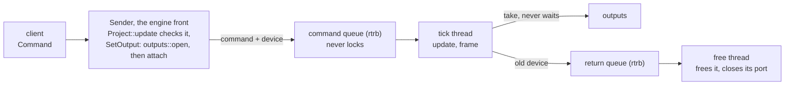
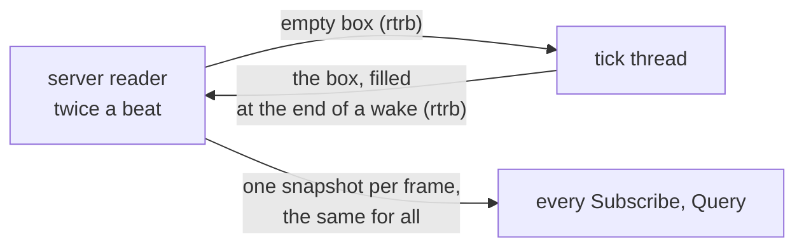
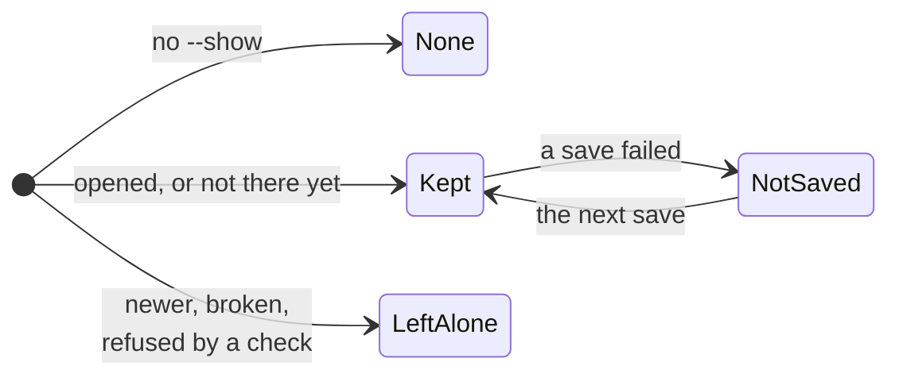
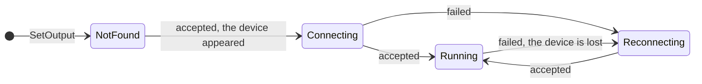
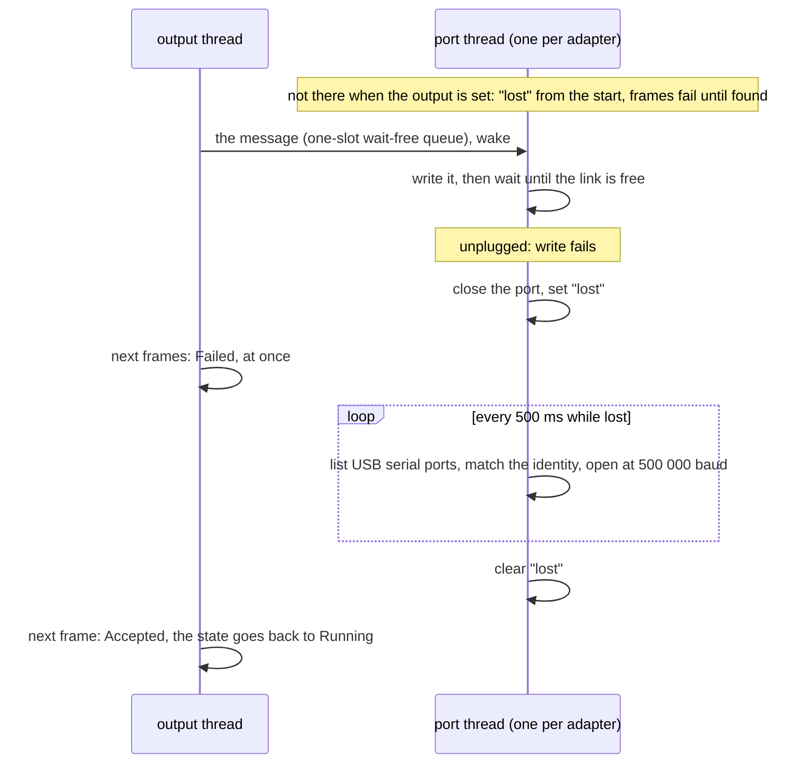

# The engine, in detail

The reference behind the [README](../README.md): how a command reaches the lights, the API, each output's states, the checks.

## A command, a frame, a picture





- Two boxes go round. The tick thread never waits, never fails a push, never frees a box (`crates/engine/src/snapshot.rs`).
- No box asked for: no picture sent.

The engine knows "an output": a run of universes, a rate, a state, counters, and a `Device` that takes a frame without waiting. Kinds, devices and bytes live only in `crates/outputs`; `engine-core` only lists the kinds a client may ask for, as data (`kinds.rs`).

How an output gets on and off the tick thread:

| Step | Where | What |
|---|---|---|
| 1 | `Sender::begin` | `Project::update` checks the client `Command` against the project (`crates/engine-core/src/project.rs`, a calculation) and says what follows: an `EngineCommand` for the tick thread, keep the device, or open one. Only this makes an `EngineCommand` |
| 1b | `Opening::open`, then `Sender::finish` | `outputs::open(kind)` makes a `Box<dyn Device>` (for DDP: a socket bound, connected, non-blocking). The server runs it on the blocking pool, without the `Sender`: other clients are answered meanwhile. One device opens at a time; until it is open, `SetOutput` and `RemoveOutput` answer `Opening`. Once open, the project holds the output's kind |
| 2 | `Sender::attach` | the one door for every device, also a test's own: sends `Attach` with the device |
| 3 | tick thread | puts it in the output's slot; the old device goes to the return queue |
| 4 | tick thread | when the output is due: `take(frame)` sends or drops, never waits |
| 5 | free thread | `RemoveOutput` or a replaced output: the old device is freed within a beat of its own (its port closed), and `SetOutput` waits for that before it opens. `SetOutput` for the kind the output already has keeps its device: only the run and the rate change |

## API

Version 2. `GET /health` (`ok` while the engine runs) and the WebSocket `GET /api`. Types: `ui/src/engine-api.ts`, generated from `crates/engine-core/src/api.rs`.

| Who may open `/api` | Why |
|---|---|
| a client that is no web page (sends no `Origin`) | the shell, tests, scripts |
| the app window (`tauri://localhost`, `http://tauri.localhost`) | the desk itself |
| the UI in a browser (`http://127.0.0.1:5174`, and `:5299` under the end-to-end tests) | development |
| any other web page | refused with 403: a page must not stop or steer the lights. `/health` and `/version` stay open, they change nothing |

The list is `ORIGINS` in `crates/engine-server/src/lib.rs`. No pairing or token yet: that comes with a remote on a tablet or phone.

| Client sends | Engine answers |
|---|---|
| `{"Send": {"command": {"SetChannel": {"channel": {"universe": 1, "address": 1}, "value": 255}}}}` | `"Accepted"`, or `{"Refused": {"reason": "NoSuchAddress"}}` and nothing changes |
| `{"Send": {"command": {"Patch": ...}}}` | `{"Patched": {"fixture": 1}}`: its number |
| `"Query"` | `{"Picture": {"state": ..., "project": ..., "library": ..., "patch": [...], "universes": [[...512 levels]]}}`. `project.outputs`: per output `null`, `{"Kind": {"kind": ..., "universes": {"first": 1, "count": 3}}}` (what it sends to, which run) or `{"Attached": {"universes": ...}}` (a test's own device) |
| `"Subscribe"` | the `Picture`, then `{"Changed": {"state": ..., "project": ..., "library": ..., "patch": ..., "channels": [...]}}` with every frame. `patch` is `null` unless it changed since the last message |

| Command | Does |
|---|---|
| `SetChannel` (universe, address, value) | holds that channel at the value. It wins over the light that writes it, also at 0 |
| `ReleaseChannel` (universe, address) | lets it go: the light that writes it shows again, else zero |
| `ReleaseAll` | lets every held channel go |
| `Blackout` (on) | every channel goes out at zero while on, over everything; the held values stay |
| `SetOutput` (output 1 to 16, kind, universes, rate) | adds or replaces an output. Kind `{"Ddp": {"address": "ip:port", "color": "Rgb" or "Rgbw"}}` or `{"DmxUsbPro": {"adapter": 1}}` (the first ENTTEC DMX USB Pro by USB identity, in the order of their USB serial numbers, when the output first finds one; an adapter not there yet is no error, the output is NotFound until it is plugged in; from then on the output finds that same adapter by its serial, so a lost adapter never comes back as another). Adapters count from 1: 0 is `NotACommand`. Universes `{"first": 1, "count": 3}`, sent as one stream of channels. A DMX USB Pro takes one universe: more is refused with `{"TooManyUniverses": {"most": 1}}`. DDP RGB sends whole pixels: 510 of each universe's 512 channels. Rate `"30"`, `"44"`, `"60"` or `null`: 60 for DDP, 44 for the DMX USB Pro |
| `RemoveOutput` (output) | removes it. Refused with `{"StreamsFixture": {"fixture": 1}}` when a fixture over more than one universe would be left with no output that streams them all; so is a `SetOutput` that changes the run |

The patch: a fixture of the library at an address. The front checks each command against it and the library, compiles the writers (`rig`) and swaps them in on the tick thread as it swaps a device.

| Command | Does | Refused |
|---|---|---|
| `Patch` (name, maker, model, mode, at: universe, address) | adds a fixture: the lowest free number, its lights the first free from the lowest | `NoSuchFixture`, `NoSuchMode`, `{"PastTheEnd": {"channels": 3}}`, `{"NotStreamed": {"first": 1, "last": 2}}`, `{"NotSent": {"output": 1, "universe": 2, "address": 512}}`, `{"Overlaps": {"fixture": 1}}` (on a channel of fixture 1: no two fixtures share one), `NoSuchUniverse`, `NoSuchAddress`, `NoLightsLeft` |
| `PatchStrip` (name, pixels, color: `"Rgb"` or `"Rgbw"`, at) | adds a generic strip without a definition file (a WLED device): one light per pixel, maker `Generic`, model `RGB strip` or `RGBW strip`, mode `300 pixels`. 0 pixels is `NotACommand` | as `Patch`, but never `NoSuchFixture` or `NoSuchMode` |
| `Move` (fixture, at) | new address, the same lights: their held values stay | `NotPatched`, as `Patch` |
| `Unpatch` (fixture) | removes it, its lights' held values go, it and its lights leave every group | `NotPatched` |
| `Rename` (fixture, name) | | `NotPatched` |
| `SetIntensity` (target, intensity 0 to 65 535) | holds the intensity | `NotPatched`, `NoSuchLight`, `NoSuchGroup` |
| `SetColour` (target, red, green, blue, 0 to 65 535 each) | holds the colour | `NotPatched`, `NoSuchLight`, `NoSuchGroup` |
| `ReleaseIntensity` (target) | lets the intensity go: the dimmer shows the definition's default again, else 0. Not held: nothing changes | `NotPatched`, `NoSuchLight`, `NoSuchGroup` |
| `ReleaseColour` (target) | lets the colour go: each colour channel shows the definition's default again, else 0. Held black is black, not let go. Not held: nothing changes | `NotPatched`, `NoSuchLight`, `NoSuchGroup` |
| `SetGroup` (name, members) | makes a group, or replaces the one of that name in its place. Members in order, at most 512: `{"Fixture": {"fixture": 1}}` or `{"Light": {"light": 7}}` | `NotPatched`, `NoSuchLight` |
| `RemoveGroup` (name) | removes it. No such group: nothing changes | |

A target is `{"Fixture": {"fixture": 1}}` (all its lights), `{"Light": {"light": 7}}` or `{"Group": {"group": "front"}}` (every light of every member). The picture carries `groups`: name and members, in the order they were made; `Changed` carries them with the patch. Nothing uses the order yet. Fixtures and lights count from 1. A fixture with heads (a bar, a panel, a strip) is one light per head in the order of its definition, after the fixture itself when it has a channel in no head (a master dimmer); its `patch` row has `layout`, `{"width": 8, "height": 1}`, or `null`. Past address 512 a fixture runs on at address 1 of the next universe: `PastTheEnd` only past the engine's last universe. No invalid patch: a fixture over more than one universe needs one output whose run streams them all (`NotStreamed` names the universes), and that output cannot go or lose them while it is patched (`StreamsFixture`). Every channel of a fixture an output streams is one it sends: DDP sends whole pixels, so RGB on universes 1 and 2 sends 1023 channels, and a fixture on 2:512 is `NotSent`; an output change that would leave one is `StreamsFixture`. A fixture in one universe needs no output. Two fixtures on the same channels are allowed: each `patch` row lists the other in `clashes`. Who wins on a channel is decided in one place, `mix` in `engine-core` (`docs/design/who-wins.md`): blackout over everything, a held raw channel over the light that writes it, a held value of a light over a default. Who wins between two fixtures on a shared channel is open (decision page, question 48): today the later in fixture order.

```json
{"Send": {"command": {"Patch": {"name": "PAR 3", "maker": "Generic", "model": "Generic RGB", "mode": "RGB", "at": {"universe": 1, "address": 37}}}}}
```

```json
{"Send": {"command": {"SetOutput": {"output": 1, "kind": {"Ddp": {"address": "192.168.1.50:4048", "color": "Rgbw"}}, "universes": {"first": 1, "count": 3}, "rate": null}}}}
```

## Fixture library

| | |
|---|---|
| Start | `npm run engine -- --fixtures <folder>`: every `.qxf` under the folder, read on a thread of its own while the engine runs |
| Where definitions come from | [QLC+](https://github.com/mcallegari/qlcplus), `resources/fixtures/`, Apache-2.0. Not shipped with the app yet: point `--fixtures` at a QLC+ checkout |
| State | `library` in `Picture` and `Changed`: `NoFolder`, `Reading`, `Read { read, failed }`, `CannotOpen` |
| Requests | `Search { text }`: best matches, each mode with its channel count. `Fixture { maker, model }`: each mode's channels by name and function. `Failures`: each file that could not be read, its line and why. A broken file never stops the engine |

## Show file



| | |
|---|---|
| Start | `npm run engine -- --show <file>`: the patch and the groups, opened at start, saved after every change and on `Stop` |
| Holds | each fixture by number with its mode whole (opens without the library), its first light, the groups in order. Not the outputs yet |
| A save | a new file `<file>.saving`, then renamed over the file, on the blocking pool. Never half written, never on the tick thread |
| Opening | the same checks as the commands. A file that fails one is left alone: empty patch, never written. Format: `crates/show-file` |
| State | `show` in `Picture` and `Changed`: `None`, `Kept`, `NotSaved`, `LeftAlone { why }`: `CannotRead`, `Broken { line, column }`, `Newer { version }`, `Taken { fixture }`, `Refused { reason }` |

## Each output's states



"Accepted" is the device's word: a DMX USB Pro accepts only once its adapter is found. DDP gets no answer from the device, so for it accepted, and Running, mean the frames were sent. After a refusal (nothing listens) a DDP output shows Reconnecting until 30 frames went out without one. A broken socket (a new address) is opened again by itself, off the tick thread.

Counters: `accepted`, `dropped` (the socket or the link was busy: the frame is dropped, never waited for), `failed`, `off_beat` (intervals more than 2 ms from the rate). With no output the engine still wakes 44 times a second and publishes its state.

## The DMX USB Pro port thread

The output thread never calls the serial driver: a vanishing device holds the driver up for many milliseconds. Each DMX USB Pro has a port thread that does every call:



| Who looks | How often | Cost |
|---|---|---|
| the port thread of each DMX USB Pro output | writes each message; while the adapter is not there yet or lost, lists the USB serial ports every 500 ms | asleep between messages. One listing is an IOKit or sysfs query of a few ms, never on the output thread |

## Checks with hands or hardware

Each prints what to do and when, with a bell:

| What | Command |
|---|---|
| WLED pattern (4 dots on 320 RGBW pixels, 30 s) | `cargo run -p engine-server --example wled_pattern -- 192.168.1.50` (port 4048 by default, or `ip:port`; optional seconds) |
| Patch a PAR and make it red, green, blue, then unpatch it (#135) | `cargo run -p engine-server --example patch_par -- ddp 192.168.1.50` (WLED: pixel 13) or `-- dmx 1` (an RGB PAR at address 37; another address after the device) |
| DMX USB Pro, 10 minutes: no interval off, nothing dropped | `cargo run --release -p engine-server --example dmx_usb_pro -- <port> ten-minutes` |
| DMX USB Pro, unplug and plug back in | `cargo run --release -p engine-server --example dmx_usb_pro -- <port> unplug` |
| DMX USB Pro, sleep and wake (press Enter once awake) | `cargo run --release -p engine-server --example dmx_usb_pro -- <port> sleep` |

`<port>` is the adapter's port (`/dev/cu.usbserial-...` on macOS). It only says which adapter; the output finds it by its USB identity.

The DMX USB Pro checks print a timed line for every state change (with the system error that lost the port), every interval off by more than 2 ms, and every `take` slower than 2 ms.

## What `npm test` runs

| Check | Proves |
|---|---|
| licence check | every crate and npm package is compatible with Apache-2.0 |
| layers check | crates and ui files depend only along the edges in `scripts/layers.mjs`; `engine-core` has no `std` and no `alloc` |
| names check | `engine-core` and `engine` name no protocol or device (DDP, UDP, DMX USB Pro, serial) outside the list of kinds (`scripts/names.mjs`) |
| `cargo clippy` | the lints for state machines and errors (root `Cargo.toml`, core crates); nothing on the tick thread can lock, block, do I/O or log (`crates/engine/clippy.toml`, linked from `crates/rt-thread`); every `unsafe` block says why it is sound |
| `cargo test` | `update`, `frame`, which output is due next, each output's state machine, DDP packets (every header byte, split at 1440 bytes), DMX USB Pro messages and the thread's priority as tables, no allocation while serving two test devices, taking commands and handing a snapshot to a reader every frame (`crates/engine/tests/no_alloc.rs`) and in each kind's `take` (`crates/outputs/tests/no_alloc.rs`); a DMX USB Pro against a fake serial port (a pseudo terminal): every byte, and unplugged, it fails until its port thread opens a new port; a port stuck in the driver never holds up `take`, and one that takes no byte for half a second is lost and looked for again, `ui/src/engine-api.ts` matches the Rust types; over the WebSocket: an output added, then "set channel" changes the bytes on its DDP socket in the next frame, wrong requests are refused, every subscriber gets the same picture of a frame (`crates/engine-server/tests/api.rs`) |
| `tsc`, oxlint, `node --test` | the UI type-checks; exhaustive switches, no `any`, only `engine.ts` talks to the engine; its connection state machine, every state and event; how replies change its picture |
| Playwright | engine + UI in a browser: the counter advances, the thread's priority shows, a fader sets a channel, an output and its counters show |
| Playwright, catalog | the storyboard catalog headless: every page mounts, a gesture shows the command it sends (`ui/src/catalog/catalog.spec.ts`) |

`npm run scorecard` prints numbers to watch, measured on the release build: lateness per output with two outputs at 60 and 44 a second, the same at the limits the API allows (16 outputs of 64 universes), intervals off by more than 2 ms, and send to frame, counted per output. A measurement that fails makes it exit non-zero. CI writes the line counts, public items and escape hatches into each run's summary. The timing numbers read "not measured on CI": run `npm run scorecard` on a real machine. A nightly workflow runs `npm run mutants`.
