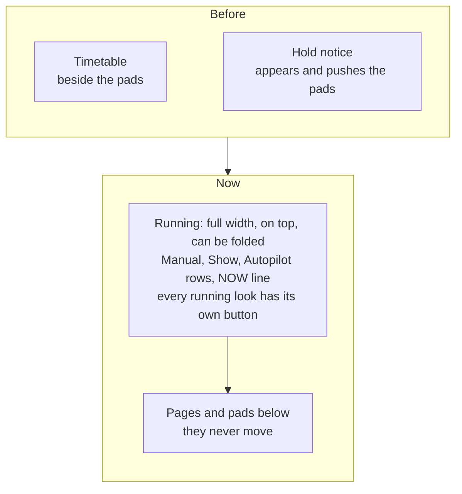
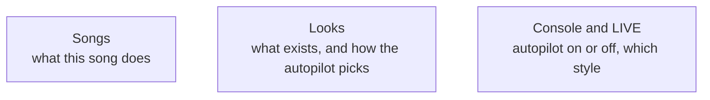
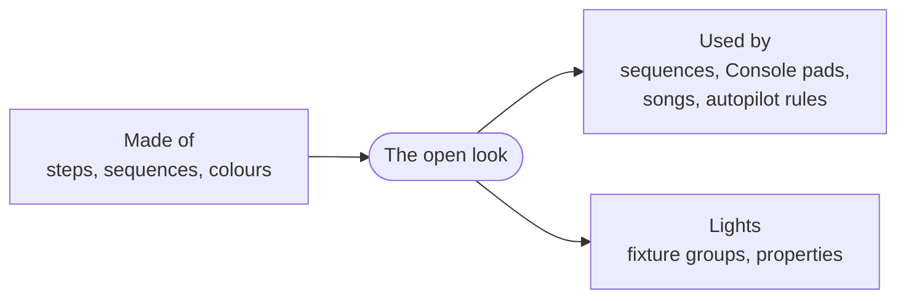
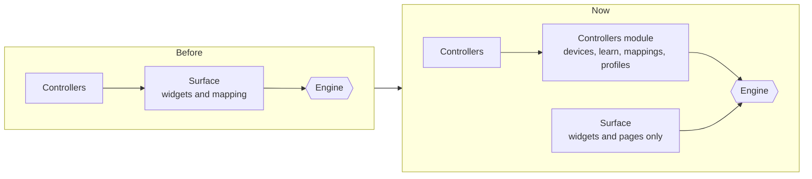

# Review 2: what the owner said, and what changes

Review of the mockups on 2026-11-18. Source: the export from the review layer.

## Verdicts

| Screen | Verdict | Rating | Next |
|---|---|---|---|
| Console | Change | 4 / 5 | rebuild the top half |
| Songs | Change | 4 / 5 | one recorded row, no autopilot |
| Looks | Change | 4 / 5 | groups, connections, autopilot moves in |
| Patch | Approve | 4 / 5 | one detail added |
| DMX | Approve | 5 / 5 | criteria on the issues |
| In/Out | Approve | 5 / 5 | unchanged |
| How it works | Approve | 5 / 5 | criteria on the issues |
| Modules | Approve | 5 / 5 | one module added, see below |

## Console: the timeline is the running view

| You said | Change |
|---|---|
| The "you hold until Release" panel is great, but it moves the layout | it gets a fixed place inside the Running panel. Nothing below it moves |
| One panel with all running looks and buttons to manage them | the Running panel: every running look is listed with Stop or Release. One "Release all" |
| The timeline should be full width, the rest below | full width on top, pages and pads below |
| The timeline could fold, and could be the view of the active looks | one panel does both. Folded, it is one line of chips |

## Songs: one recorded row, no autopilot

| You said | Change |
|---|---|
| Recording and "recorded today" are the same thing | one row, **Recorded**. Recording adds to it and it is red while it writes. No list of takes |
| The autopilot is not song specific | the Auto row and the autopilot bar leave Songs |
| All autopilot settings belong under Looks | they move to the Looks screen |

## Looks: groups, connections, autopilot

| You said | Change |
|---|---|
| The library should expand | the library can be widened to a full view and folded back |
| A good way to organise groups | groups are sections that fold. New, rename, delete. Drag a look into a group. One look can be in many |
| An open look shows which groups it is in | group chips at the top of the open look, with add and remove |
| A small diagram of what it is connected to, with jumps | a **Connections** diagram: made of, used by, lights. Every node is a jump |

The autopilot gets its own part of the Looks screen:

| Part | What you set |
|---|---|
| Styles | a named set of rules, for example "Club" or "Chill" |
| Rules | when (song section), pick (one from a group), fit (how it lines up with the music) |
| Groups | which groups the autopilot may use |
| Wildness | how often it changes |
| Never dark | what plays when nothing else does |

## Patch: approved, one detail

| You said | Change |
|---|---|
| LED panels can be RGBW and the colours can be in a different order | "Add a pixel panel" asks for the pixel type: RGB, RGBW, and the colour order (RGB, BGR, BRG, GBR, GRB, RBG). Same set as QLC+ |

## Answers that changed

| # | Question | Review 1 | Review 2 |
|---|---|---|---|
| Modules 3 | Where does controller mapping live? | in Surface, next to the widgets | **in In/Out**, like QLC+ profiles |
| Modules 2 | Can you play something that is not saved? | everything you try is saved by itself | no, everything playable lives in Project (same thing) |
| Theory 6 | What is Song Director? | an editor for a show whose blocks follow sections | it is the show editor, it is the song editor. One thing, one name |
| Theory 1, 2 | Who wins, how many layers | top layer wins, layers can be added | no layers. See [who-wins.md](../design/who-wins.md) |

### What Modules 3 does to the map

| Module | Whole interface | Hides |
|---|---|---|
| **Controllers** (new) | `devices` `learn` `mappings` | MIDI, OSC, controller profiles, pad colours sent back |
| **Surface** (smaller) | `layout` `press` | widgets, pages |

This is a proposal that follows from the answer. It is not rated yet.

## Still open

| # | Question |
|---|---|
| 1 | Theory 7: anything in QLC+ that the nine ideas cannot say? Not answered |
| 2 | Modules 5: which module is hardest to keep narrow? Not answered |
| 3 | The Controllers module above |
| 4 | One Recorded row per song: is "add to it" right, or should a new pass replace what is there? |
| 5 | How the autopilot picks: rules of "when, pick, fit" inside a style. Now on the Looks screen, to be rated there |

## Not approved yet

- Console, Songs, Looks: after the rebuild
- Eight issues wait for Songs: #85, #94, #95, #99, #70, #87, #86, #68
